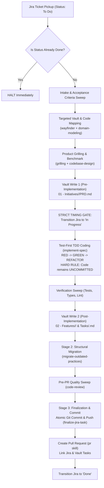

# End-to-End Task Execution Guide: From Jira to Pull Request

> **Standard Operating Procedure for Developers & AI Agents**  
> Combining **Jira**, the **Obsidian Vault**, and the **Unified Skills Suite** (Matt Pocock Skills + Task Lifecycle Protocols).

---

## 1. Executive Summary & Philosophy

In modern AI-assisted software engineering, velocity is determined by **clarity before code**. Writing code before resolving product ambiguity, domain models, or architecture results in expensive rework, broken tests, and fragmented documentation.

> *"Context not gathered before code is context paid for in rework."*

This guide establishes the authoritative end-to-end workflow for taking any engineering task from its inception in **Jira**, grounding it in the **Obsidian Vault**, utilizing **Matt Pocock's specialized skills** for exploration, grilling, design, and review, and delivering a verified, well-documented **Pull Request**.

```
┌─────────────────┐       ┌─────────────────────────┐       ┌────────────────────────┐
│      JIRA       │       │     OBSIDIAN VAULT      │       │     UNIFIED SKILLS     │
│  (Work Tracker) │ <───> │  (Canonical Knowledge)  │ <───> │  (Execution & Quality) │
│                 │       │                         │       │                        │
│ • Backlog / ToDo│       │ • 01 - Initiatives/     │       │ • Matt Pocock Suite    │
│ • In Progress   │       │ • 02 - Features/        │       │ • Lifecycle Protocols  │
│ • Done          │       │ • 04 - Rules/           │       │ • PR Review Protocols  │
└─────────────────┘       └─────────────────────────┘       └────────────────────────┘
```

---

## 2. The Three System Pillars

| Pillar | Primary System | Canonical Role | Key Artifacts |
|---|---|---|---|
| **Pillar 1: Work Management** | **Jira** | Tracks who is doing what, priority, acceptance criteria, and operational state. | Ticket (`BM-123`), Acceptance Criteria, Epic links, Task Status. |
| **Pillar 2: Knowledge Base** | **Obsidian Vault** | Canonical repository of product intent, architecture, technical design, benchmarks, and task history. | `$VAULT/01 - Initiatives/`<br>`$VAULT/02 - Features/`<br>`$VAULT/04 - Rules/` |
| **Pillar 3: AI Skills Suite** | **`.agents/skills/`** | Specialized AI execution instructions defining *how* repeatable engineering tasks are conducted. | Matt Pocock skills (`grilling`, `codebase-design`, `domain-modeling`, `code-review`, `pr`) + Lifecycle skills (`implement-jira-task`, `finalize-jira-task`). |

---

## 3. Unified Skills Architecture

All AI-agent skills are unified under a single, shared directory structure across the entire codebase:

```text
busmora-docs/
├── .agents/skills/               # Canonical runtime storage for ALL AI skills
│   ├── implement-jira-task/      # Lifecycle Stage 1 (Discovery & Implementation)
│   ├── migrate-outdated-practices/# Lifecycle Stage 2 (Structural Refactoring)
│   ├── finalize-jira-task/       # Lifecycle Stage 3 (Commit, PR & Jira Done)
│   ├── discuss-pr-comments/      # PR Review Stage 1 (Discuss & uncommitted fix)
│   ├── finalize-pr-comments/     # PR Review Stage 2 (Reply, resolve & push)
│   ├── codebase-design/          # Matt Pocock: Deep modules & Design It Twice
│   ├── domain-modeling/          # Matt Pocock: Ubiquitous language & ADRs
│   ├── grilling/                 # Matt Pocock: Stress-test decisions (1 per turn)
│   ├── grill-me/                 # Matt Pocock: Interactive alignment interview
│   ├── grill-with-docs/          # Matt Pocock: Grilling grounded in repo specs
│   ├── implement-spec/           # Matt Pocock: Strict TDD Red-Green-Refactor
│   ├── to-spec/                  # Matt Pocock: Ambiguity to technical spec
│   ├── to-tickets/               # Matt Pocock: Spec to atomic tickets
│   ├── code-review/              # Matt Pocock: Multi-agent standards & spec check
│   ├── pr/                       # Matt Pocock: Structured atomic PR drafting
│   ├── wayfinder/                # Matt Pocock: Rapid codebase navigation
│   ├── wait-what/                # Matt Pocock: De-obfuscating confusing code
│   └── ask-matt/                 # Matt Pocock: Engineering patterns & guidance
│
├── .claude/skills/               # Symlinks to ../../.agents/skills/* (Claude Code)
└── Vault/03 - Skills/            # Symlinks to ../../.agents/skills/* (Obsidian Vault UI)
```

### Skills Matrix Across the Task Lifecycle

| Task Phase | Primary Skills | System Transitions | Key Outputs |
|---|---|---|---|
| **1. Intake & Sweep** | `implement-jira-task` (Phases 0–4)<br>`wayfinder`<br>`domain-modeling` | Jira: Remains **"To Do"** / **"Selected"** | Ticket criteria parsed, domain glossary verified, caller map built. |
| **2. Grilling & Design** | `grilling` / `grill-with-docs`<br>`codebase-design`<br>`ask-matt` | Jira: Remains **"To Do"** | Grilling decisions aligned, 2 designs evaluated, benchmark scored. |
| **3. Vault Write 1** | `implement-jira-task` (Phase 6) | Jira: Remains **"To Do"** | `$VAULT/01 - Initiatives/<Name>/PRD.md`, `Benchmark.md`, Slice link. |
| **4. Jira Status Move** | `implement-jira-task` (Phase 7.0) | **Jira: Moves to "In Progress"** | Official start of coding. |
| **5. Test-First Coding** | `implement-spec`<br>`implement-jira-task` (Phase 7.2) | Jira: Remains **"In Progress"** | Failing test (Red), passing code (Green), refactor. **Zero commits**. |
| **6. Verification** | `implement-jira-task` (Phase 8) | Jira: Remains **"In Progress"** | Passing test suite output, linter & typecheck evidence. |
| **7. Vault Write 2** | `implement-jira-task` (Phase 9) | Jira: Remains **"In Progress"** | `$VAULT/02 - Features/<Feature>/` docs + `Tasks/<JIRA-KEY>.md` (Stage 1 `[x]`). |
| **8. Migration** | `migrate-outdated-practices` | Jira: Remains **"In Progress"** | Refactored legacy patterns; Stage 2 `[x]`. |
| **9. Code Review Sweep**| `code-review` | Jira: Remains **"In Progress"** | Standards and specification compliance verified. |
| **10. Finalize & Commit**| `finalize-jira-task`<br>`pr` | **Jira: Transitions to "Done"** | Atomic commit pushed, PR created with Vault links, Jira closed. |
| **11. Post-PR Feedback** | `discuss-pr-comments`<br>`finalize-pr-comments` | Jira: Moves to **"In Review"** $\rightarrow$ **"Done"** | PR comments clarified, rules codified into `04 - Rules/`, fixes pushed. |

---

## 4. Phase-by-Phase Task Lifecycle Protocol



---

### Step 1: Jira Intake & Early Exit Check
**Skills**: `implement-jira-task` (Phase 0 & 1)  
**Jira Status**: Stays **`To Do`** / **`Selected`** (Do NOT change to In Progress)

1. **Early Exit Verification**:
   - Query Jira for the assigned issue key (e.g. `BM-142`).
   - If the status is already `Done`, `Closed`, or `Resolved`: **Halt immediately**. Do not inspect code or modify documents.
2. **Intake Extraction**:
   - Extract:
     - Issue summary and full description.
     - Acceptance Criteria verbatim (treat as primary requirements to analyze).
     - Issue type, priority, and parent Epic.
     - Linked issues (`blocks`, `is blocked by`, `relates to`).
     - Existing developer comments and remote documentation links.
3. **Reference Detection**:
   - Check if the ticket explicitly references a **previous Jira ticket** (e.g., "builds on BM-110").
   - Check if the ticket links to an **Obsidian Vault document or directory**.

---

### Step 2: Targeted Vault Mapping & Codebase Exploration
**Skills**: `implement-jira-task` (Phases 2–4), `wayfinder`, `domain-modeling`, `ask-matt`  
**Jira Status**: Stays **`To Do`** / **`Selected`**

1. **Targeted Vault Inspection**:
   - Inspect the Vault **only** when triggered by ticket references or global rules:
     - **Referenced Ticket**: Locate `$VAULT/02 - Features/*/Tasks/<PREV-TICKET>.md`. Review previous decisions, touched files, and follow-up notes.
     - **Linked Document**: Read the referenced Initiative PRD or Feature documentation.
     - **Global Rules**: Inspect `$VAULT/04 - Rules/` (`Vault Conventions.md`, `Documentation Lifecycle.md`, and this guide).
   - *Rule*: Never do an unguided grep or load all Vault files without reason.
2. **Domain Modeling Alignment (`domain-modeling`)**:
   - Verify concepts against `domain/GLOSSARY.md` (Ubiquitous Language) and `domain/contexts.md`.
   - Ensure terms used in code match the approved domain vocabulary (e.g., *STAR Lenses*, *Business Brain*, *Honest Handoff*).
   - If new domain abstractions or major design changes are introduced, prepare an Architectural Decision Record draft (`domain-modeling/ADR-FORMAT.md`).
3. **Codebase Exploration (`wayfinder`)**:
   - Locate target modules, domain entities, route handlers, and Drizzle/NestJS schemas.
   - Map existing callers and integration points before altering function signatures.
   - Review current test fixtures in the target area to understand local testing patterns.
   - If legacy or confusing code is encountered, run `wait-what` to unpack the original rationale.

---

### Step 3: Product Grilling & Benchmark Evaluation (Hard Gate 1)
**Skills**: `grilling`, `grill-with-docs`, `codebase-design`, `ask-matt`  
**Jira Status**: Stays **`To Do`** / **`Selected`**

Before any code is written, all product, domain, and technical ambiguity must be systematically eliminated.

1. **Interactive Grilling Protocol (`grilling`)**:
   - Conduct grilling in chat with the developer.
   - **One decision per turn**: Present exactly one decision at a time.
   - Standard Grilling Question Structure:
     ```markdown
     ### [Decision Topic / Fork]
     
     **Context & Current Behavior**:
     [Brief background on existing behavior and what the ticket introduces]
     
     **The Question**:
     [One sharp, unambiguous question defining the product/design decision]
     
     **Choices**:
     - **Choice A**: [Description, UX impact, behavioral outcome, tradeoffs]
     - **Choice B**: [Description, UX impact, behavioral outcome, tradeoffs]
     
     **Concrete Example**:
     [A realistic scenario comparing Choice A vs Choice B using real data]
     
     **UI / Observability Guide**:
     [Where this surfaces in the frontend UI or logs/DB if backend-only]
     
     **Recommendation**:
     [Your proposed option and why it best serves the system]
     ```
   - Focus exclusively on: user flows, failure states, edge cases, permission boundaries, and observable outcomes.
2. **Codebase Design Principles (`codebase-design`)**:
   - **Design It Twice**: Explore at least two structural or interface approaches before writing code.
   - **Deep Modules**: Keep public module interfaces narrow and hide complex business rules deep within the domain service.
   - **Seams**: Ensure clean boundaries to allow test isolation without excessive mocking.
3. **Benchmark Evaluation (`Benchmark.md`)**:
   - If evaluating a third-party library, service, or algorithmic tradeoff (e.g. vector search vs text search), formulate a benchmark:
     - Candidates, criteria, performance, complexity, and operational cost.
     - Document the agreed selection for inclusion in Write 1.
4. **Developer Implementation Plan Approval**:
   - Synthesize grilling outcomes into a clear, numbered step-by-step implementation plan.
   - Secure explicit confirmation from the developer:
     > *"Plan approved. Proceed to Write 1 and implementation."*

---

### Step 4: Vault Write 1 — Pre-Implementation Documentation
**Skills**: `implement-jira-task` (Phase 6)  
**Jira Status**: Stays **`To Do`** / **`Selected`**

Persist the agreed context before touching production code:

1. **Initiative Directory**:
   - Path: `$VAULT/01 - Initiatives/<Initiative Name>/`
2. **Save or Update Initiative PRD**:
   - File: `$VAULT/01 - Initiatives/<Initiative Name>/PRD.md` (based on `Templates/Initiative PRD Template.md`).
   - Record: Background, goals, resolved grilling decisions, agreed scope, and the approved plan.
3. **Save Benchmark (If Conducted)**:
   - File: `$VAULT/01 - Initiatives/<Initiative Name>/Benchmark.md` (based on `Templates/Benchmark Template.md`).
4. **Slice Link**:
   - File: `$VAULT/01 - Initiatives/<Initiative Name>/Slices/<Feature Name>.md`. Connect the high-level Initiative to the specific canonical Feature.
5. **Handoff Notification**:
   - Announce in chat: *"Write 1 completed at $VAULT/01 - Initiatives/<Initiative Name>/PRD.md. Transitioning ticket to In Progress and beginning implementation."*

---

### Step 5: Jira Status Transition to "In Progress" (Strict Timing Rule)
**Skills**: `implement-jira-task` (Phase 7.0)  
**Jira Status**: **Moves to "In Progress"**

> [!IMPORTANT] Strict Timing Rule
> **Never** transition a Jira ticket to "In Progress" during discovery, reading, or grilling.  
> The ticket transitions to **"In Progress"** ONLY after:
> 1. Grilling is concluded.
> 2. The implementation plan is approved by the developer.
> 3. Vault Write 1 is written to disk.
> 4. Immediately before writing the first line of code.

Execute transition via CLI / Jira integration:
```bash
# Example Jira CLI or API transition
jira issue move <JIRA-KEY> "In Progress"
```

---

### Step 6: Test-First Implementation & Red-Green-Refactor
**Skills**: `implement-spec`, `implement-jira-task` (Phase 7.2)  
**Jira Status**: Remains **"In Progress"**

Now, and only now, write code.

1. **Pre-Coding Check**:
   - Review `$VAULT/04 - Rules/` and existing repository conventions.
2. **The TDD Loop**:
   - **RED**: Write a focused, failing unit or integration test representing the next requirement from the approved plan. Run test and verify it fails with the expected assertion error.
   - **GREEN**: Write the minimal production code needed to pass the test. Run test and confirm it passes.
   - **REFACTOR**: Improve readability, remove duplication, and optimize while keeping the test suite green.
3. **HARD RULE: No Committing During Implementation**:
   - All code edits must remain **uncommitted** in the working directory.
   - This allows the developer to review all modifications directly via VS Code Source Control / Git Diff before any permanent commit is made.
   - Committing belongs exclusively to Stage 3 (`finalize-jira-task`).
4. **Mid-Flight Roadblocks**:
   - If an unforeseen constraint breaks the approved plan: **Stop coding immediately**. Escalate the discovery to the developer with proposed options, and resume only upon approval.

---

### Step 7: Verification & Evidence Collection
**Skills**: `implement-jira-task` (Phase 8)  
**Jira Status**: Remains **"In Progress"**

1. **Execute Verification Sweeps**:
   - Run unit, integration, and E2E tests for the touched module.
   - Run type checks (`tsc --noEmit` or `pnpm typecheck`).
   - Run linter checks (`pnpm lint`).
2. **Collect Evidence**:
   - Record test counts (e.g., `32 passed, 0 failed`).
   - If any test was skipped (e.g. requires external API credentials not available locally), record the explicit justification.

---

### Step 8: Vault Write 2 — Canonical Feature & Task Record Sync
**Skills**: `implement-jira-task` (Phase 9 & 10)  
**Jira Status**: Remains **"In Progress"**

Document the actual, verified implementation in the Vault:

1. **Update Canonical Feature Folder**:
   - Path: `$VAULT/02 - Features/<Feature Name>/`
   - Create or update:
     - `Overview.md`: Purpose, value proposition, and parent Initiative link.
     - `Requirements.md`: Actual functional requirements delivered.
     - `Technical Design.md`: Architecture, schema models, and data flow.
     - `Testing.md`: Test strategy, mock boundaries, and execution instructions.
2. **Create Task Execution Record**:
   - Path: `$VAULT/02 - Features/<Feature Name>/Tasks/<JIRA-KEY>.md`
   - Use `Templates/Task Record Template.md`:
     ```markdown
     # Task: <JIRA-KEY> — <Summary>

     **Feature**: [[02 - Features/<Feature Name>/Overview|Feature Overview]]
     **Initiative**: [[01 - Initiatives/<Initiative Name>/PRD|Initiative PRD]]
     **Jira Key**: <JIRA-KEY>
     **Status**: Stage 1 Completed

     ---

     ## 1. Ticket Overview & Acceptance Criteria
     <Verbatim acceptance criteria from Jira>

     ## 2. Grilling Decisions & Alignment
     - **Decision 1**: <Resolution and rationale>
     - **Decision 2**: <Resolution and rationale>

     ## 3. Approved Implementation Plan
     <Paste the approved step-by-step plan>

     ## 4. Execution & Verification Log
     - **Touched Files**:
       - `path/to/file.ts`: <changes made>
     - **Tests Performed**:
       - `path/to/file.spec.ts`: 8 tests passed
     - **Skipped Tests & Justifications**: None

     ## 5. Developer & PR Notes
     - <Notes to be posted as comments on the PR in Stage 3>

     ## 6. Stage Completion Status
     - [x] Stage 1: Implement Jira Task (Completed: YYYY-MM-DD)
     - [ ] Stage 2: Migration
     - [ ] Stage 3: Finalize Jira Task
     ```
3. **Stage 1 Handoff**:
   - Announce in chat: *"Stage 1 (Implementation) complete. Code remains uncommitted for review. Ready for Stage 2 (Migration)."*

---

### Step 9: Structural Migration (Stage 2)
**Skills**: `migrate-outdated-practices`  
**Jira Status**: Remains **"In Progress"**

1. **Refactoring Sweep**:
   - Scan touched files and immediate neighborhood for deprecated practices (e.g. outdated Drizzle syntax, improper exception handling, missing types, direct db access bypassing UoW).
   - Perform structural refactoring with **ZERO business logic changes**.
2. **Re-Verify Tests**:
   - Run the test suite to guarantee zero regression.
3. **Update Task Record**:
   - In `$VAULT/02 - Features/<Feature Name>/Tasks/<JIRA-KEY>.md`:
     - Document migration actions taken.
     - Mark `[x] Stage 2: Migration (Completed: YYYY-MM-DD)`.

---

### Step 10: Automated Code Review (Pre-PR Quality Sweep)
**Skills**: `code-review` (Matt Pocock Suite)  
**Jira Status**: Remains **"In Progress"**

Before committing and creating the PR, execute an automated code review:

1. **Run `code-review`**:
   - Evaluates the working tree git diff along two distinct axes via parallel agents:
     - **Standards**: Does the code strictly adhere to repository conventions, architecture rules, and formatting?
     - **Spec**: Does the code fulfill every single acceptance criterion from the Jira ticket without regressions or missing edge cases?
2. **Address Review Findings**:
   - Correct any flagged issues before moving to finalization.

---

### Step 11: Atomic Git Commit & Remote Push (Stage 3)
**Skills**: `finalize-jira-task` (Phases 0–3)  
**Jira Status**: Remains **"In Progress"** until PR creation

1. **Verify Prerequisites**:
   - Check `$VAULT/02 - Features/<Feature Name>/Tasks/<JIRA-KEY>.md`:
     - Ensure `[x] Stage 1` and `[x] Stage 2` are both marked complete.
2. **Consolidate Vault Task Record**:
   - Mark `[x] Stage 3: Finalize Jira Task (Completed: YYYY-MM-DD)`.
   - Update canonical feature docs if durable behavior evolved.
3. **Atomic Commit (Ending Uncommitted State)**:
   - Stage changes explicitly by file path:
     ```bash
     git add src/modules/... tests/... Vault/02\ -\ Features/...
     ```
   - *Rule*: Never use blind globbing like `git add -A` or `git add .`.
   - Commit using Conventional Commits with the Jira ticket key:
     ```bash
     git commit -m "feat(module): descriptive summary [<JIRA-KEY>]"
     ```
   - *Rule*: No AI attribution footers (`Co-authored-by`, `Generated by AI`).
4. **Push Branch**:
   ```bash
   git push -u origin <branch-name>
   ```

---

### Step 12: Pull Request Creation (`pr` Skill)
**Skills**: `pr` (Matt Pocock Suite), `finalize-jira-task` (Phase 4)  
**Jira Status**: Transitions to **"Done"**

1. **Draft PR Body using `pr` Skill**:
   - Format:
     ```markdown
     ## Summary & Motivation
     [1-2 paragraphs detailing the business value, what was changed, and why]

     ## Jira Ticket
     - Resolves [BM-142: Title](https://busmora.atlassian.net/browse/BM-142)

     ## Vault Canonical Documentation
     - Feature Overview: [[02 - Features/<Feature Name>/Overview]]
     - Task Execution Record: [[02 - Features/<Feature Name>/Tasks/<JIRA-KEY>]]
     - Initiative PRD: [[01 - Initiatives/<Initiative Name>/PRD]]

     ## Changes Made
     - Added `<component/service>` to implement `<behavior>`
     - Added unit & integration tests covering `<scenarios>`
     - Migrated legacy pattern in `<nearby file>` (zero logic change)

     ## Verification Evidence
     - `pnpm test`: 42 passed, 0 failed
     - `pnpm typecheck`: Clean (0 errors)
     - `pnpm lint`: Clean

     ## Developer Notes & Follow-ups
     - [Notes extracted from Section 5 of the Task Record]
     ```
2. **Create Pull Request**:
   - Use `gh pr create` or web UI.
   - If developer review notes exist, post them as inline comments on the relevant diff lines.

---

### Step 13: Jira Completion Transition
**Skills**: `finalize-jira-task` (Phase 5 & 6)  
**Jira Status**: **Transitions to "Done"**

1. **Transition Ticket**:
   - Transition Jira ticket `<JIRA-KEY>` from `In Progress` $\rightarrow$ **`Done`**.
2. **Post Jira Comment**:
   - Post completion comment on the Jira ticket:
     - Pull Request link.
     - Vault Task Record path (`Vault/02 - Features/<Feature Name>/Tasks/<JIRA-KEY>.md`).
     - Verification summary.
3. **Present Evidence Report**:
   - Present final closeout report to the developer in chat with PR link and commit SHA.

---

### Step 14: Post-PR Review Lifecycle (Follow-Up)
**Skills**: `discuss-pr-comments`, `finalize-pr-comments`  
**Jira Status**: **"In Review"** $\rightarrow$ **"Done"**

When peer human reviewers provide feedback on the GitHub Pull Request:

1. **Discuss PR Comments (`discuss-pr-comments`)**:
   - Moves Jira ticket to **"In Review"**.
   - Walk through PR review comments interactively with the developer.
   - Extract developer preferences and codify durable lessons as new rules in `$VAULT/04 - Rules/`.
   - Implement necessary code fixes. Keep changes **uncommitted**.
2. **Finalize PR Comments (`finalize-pr-comments`)**:
   - Run verification sweep (tests, types, build).
   - Reply to discussed comments on GitHub and resolve conversation threads.
   - Commit fixes and push to the PR branch.
   - Transition Jira ticket back to **"Done"**.

---

## 5. Jira Status Lifecycle Cheat Sheet

```text
┌────────────────────────────────────────┬─────────────────────────┬─────────────────────────────┐
│ Workflow Milestone                     │ Jira Status             │ Responsible Skill           │
├────────────────────────────────────────┼─────────────────────────┼─────────────────────────────┤
│ Ticket Intake & Exploration            │ Initial (To Do)         │ implement-jira-task         │
│ Product Grilling & Benchmarking        │ Initial (To Do)         │ grilling / codebase-design  │
│ Vault Write 1 (PRD & Plan)             │ Initial (To Do)         │ implement-jira-task         │
│ Right Before Implementation Starts     │ IN PROGRESS             │ implement-jira-task (P7.0)  │
│ Test-First Implementation (Uncommitted)│ IN PROGRESS             │ implement-spec              │
│ Structural Migration                   │ IN PROGRESS             │ migrate-outdated-practices  │
│ Finalize, Commit & PR Created          │ DONE                    │ finalize-jira-task          │
│ PR Comments Arrive (Discussion & Fix)  │ IN REVIEW               │ discuss-pr-comments         │
│ PR Comments Resolved & Pushed          │ DONE                    │ finalize-pr-comments        │
└────────────────────────────────────────┴─────────────────────────┴─────────────────────────────┘
```

---

## 6. Hard Rules Checklist

Every team member and AI agent must adhere to these five non-negotiable rules:

- [ ] **Rule 1 (Status Timing)**: NEVER move Jira to "In Progress" before grilling is complete and Write 1 is saved.
- [ ] **Rule 2 (No Unapproved Commits)**: NEVER run `git commit` during Stage 1 (`implement-jira-task`) or Stage 2 (`migrate-outdated-practices`). Code must remain uncommitted for review in VS Code Source Control.
- [ ] **Rule 3 (Two Vault Writes)**: Strictly perform Write 1 (`01 - Initiatives/`) before coding, and Write 2 (`02 - Features/`) after verified coding.
- [ ] **Rule 4 (Prerequisite Gate)**: NEVER begin Stage 3 (`finalize-jira-task`) unless both Stage 1 and Stage 2 are marked `[x]` in the task record.
- [ ] **Rule 5 (Targeted Vault Inspection)**: NEVER scan or load the entire Vault indiscriminately. Inspect only explicitly referenced tickets, linked notes, or global rules.
