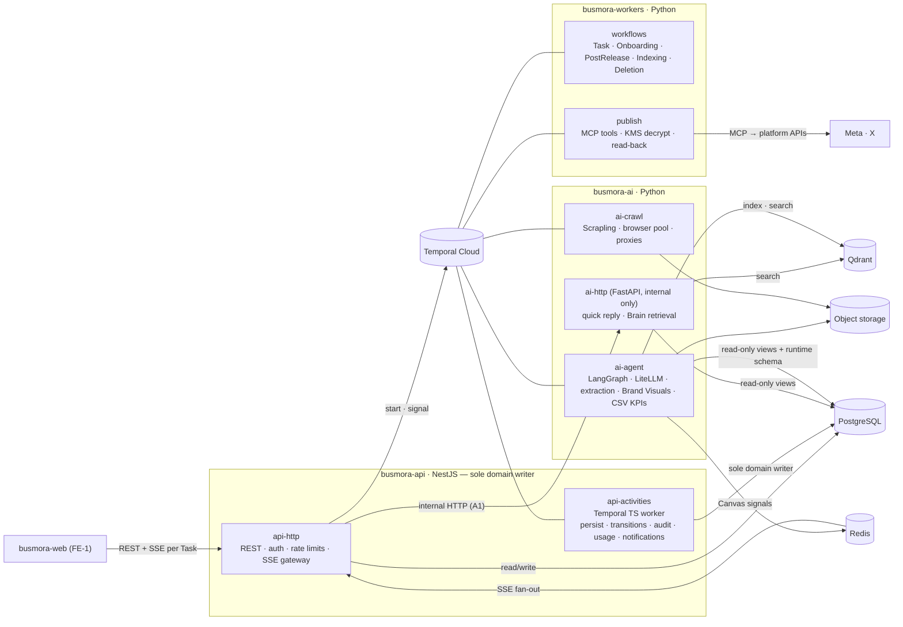

# 04 — Architecture Decision

> **Status:** Accepted (2026-10-18).
> **Decided by:** project lead, after reviewing [03-benchmark.md](./03-benchmark.md).
> **Builds on:** [01-constraints.md](./01-constraints.md), [02-options.md](./02-options.md), [03-benchmark.md](./03-benchmark.md).

---

## 1. Decision

| Area | Decision |
|---|---|
| **Backend** | **B1 Platform-Centred**, with one amendment. **A1:** `busmora-api` may call `busmora-ai` over **internal HTTP** for exactly two things: **quick replies** and **Brain retrieval**. This borrows from B3. |
| **Frontend** | **FE-1 Client-Rendered** for this release. **FE-3 Workspace Event Shell** is the planned evolution in a later version. |
| **Repositories** | Two standalone repositories: `busmora-backend` and `busmora-frontend` (01 R-5, unchanged). |

### 1.1 How A1 is interpreted
**Interpretation applied:** B1's data ownership is kept. `busmora-api` remains the **only writer** of domain data, including the Business Brain.

A1 adds a synchronous read path to `busmora-ai`:
- **Quick replies:** the Router and the quick-reply answer, bypassing Temporal.
- **Brain retrieval:** the two-stage search (Qdrant seed + 1–2 hop graph expansion, PRD FR-022). It is exposed over HTTP for callers outside the agent graph, such as Brain search on the Brain page and context previews.

Moving **ownership** of the Brain to `busmora-ai` (full B3 style) was **not** adopted. This interpretation was confirmed on 2026-10-18 (§8).

---

## 2. Why

From 03 §2.3 and §2.5:
- **B1 scored highest** for the backend (79.8). It keeps the domain rules in NestJS, which the team knows. It has a single PostgreSQL writer, which gives the fewest tenant-enforcement points. And it uses one migration toolchain.
- **B1's weakest criterion was latency (C5 = 3).** The quick-reply path crossed Temporal 8 times before the LLM call (03 E10).
- **A1 targets that weakness directly** with B3's strongest feature, a 2-leg quick path, without taking on B3's events, outboxes or split data ownership.
- **Brain retrieval over HTTP** lets the api use the same retrieval pipeline the agents use. Only the Python side has the Qdrant client (02 §0.3 #4), so this is the only way the api can serve semantic Brain search.
- **FE-1 scored highest** for the frontend (83.4). It is the simplest to build and needs no backend work.
- **FE-3 is kept as the next step** because it scored best on real-time UX and scale (C5 = 5, C9 = 5). B1's single writer makes it cheap to add later (03 §4).

---

## 3. Resulting backend architecture

### 3.1 Process roles (8)
`web`, `api-http`, `api-activities`, `workers-workflows`, `workers-publish`, **`ai-http`** (new, internal only), `ai-agent`, `ai-crawl`. Each is a role of the four deployables (D-26), not a new service.

### 3.2 Which path carries what

| Interaction | Path | Durable? |
|---|---|---|
| Quick reply (Router "simple") | api → **ai-http** → api stores the reply | No (01 DL-2) |
| Router says "complex" | api → ai-http returns the classification → **api** writes the Task and starts `TaskExecutionWorkflow` → acknowledges | Task: yes |
| Router says "ambiguous" | ai-http returns a clarifying question; api stores it as a message (01 RT-3) | No |
| Brain search and retrieval outside the agent graph | api → **ai-http** (seed + 1–2 hop expansion; results filtered to the workspace and approved items) | Read-only |
| Agent work, crawling, extraction, indexing, Brand Visuals, CSV KPIs | Temporal activities (unchanged B1) | Yes |
| Clarification waits, publishing, onboarding, deletion | Temporal workflows (unchanged B1) | Yes |
| Every write of domain state | `busmora-api` only (api-http or api-activities) | Yes |
| Canvas | ai → Redis Streams → api SSE (unchanged) | Live-only (01 RT-1) |

### 3.3 Guardrails on internal HTTP (A1)
1. **Two endpoint families only:** quick reply / routing, and Brain retrieval. Any other synchronous api → ai call needs a new decision record.
2. **No writes from `ai-http`.** It reads approved-knowledge views and Qdrant, and calls LLMs through LiteLLM. It never writes domain tables, so the single-writer rule and G3 hold.
3. **Internal network only.** There is no public ingress to `ai-http`.
4. **Authenticated and tenant-scoped.** Every call carries a short-lived **internal service JWT** whose signed claims include the workspace and user. `ai-http` applies that workspace to every view query and Qdrant filter. Mechanism: §9 R-1 (resolves G-D7).
5. **Bounded timeouts** sized to the p95 targets: quick reply ≤ 3 s end to end (01 DL-3). On timeout or error the user re-sends (DL-2); no retry storm.
6. **Treatment/Control:** the retrieval endpoint honours the same configuration flag as agent runs (EVAL §5), so Brain search and evaluation never diverge.
7. **Traced:** the `trace_id` claim in the service JWT is propagated into Langfuse. This resolves G-D12 for the HTTP path; propagation through Temporal remains a design detail.

### 3.4 Unchanged from B1
Everything in 02 §B1 not touched by A1 is unchanged:
- data approach
- Clarification waits
- `PostReleaseWorkflow`, the atomic claim, and the idempotency key on the Post Version
- KMS decryption only in `workers.publish`
- Qdrant/Redis rebuildability
- Drizzle as the single migration toolchain

---

## 4. Frontend decision

### 4.1 This release: FE-1 Client-Rendered
- As in 02 §FE-1: client-rendered app inside the App Router; React Query/SWR against `busmora-api`; **one SSE stream per running Task**; polling for non-Canvas live state (crawl progress, Post statuses, badges).
- Talks only to `busmora-api`.
- **Resolved on 2026-10-18 (§9):**
  - G-D6: tokens and sessions (R-3).
  - G-T3: SSE authentication via a stream cookie (R-4).
  - G-T2: React Query (R-6).
- **Still open:** G-T1, the i18n/RTL library.

### 4.2 Later version: FE-3 Workspace Event Shell
Recorded as the planned evolution, not part of this release. To keep that move cheap, FE-1 is built FE-3-ready:
1. **Feature folders by bounded context** (`identity`, `onboarding`, `employee`, `brain`, `deliverables`, `publishing`, `connections`, `settings`, `notifications`). FE-3 adds an `events/` handler per folder.
2. **One SSE client module** behind a small interface: subscribe, receive typed envelope, reconnect with `Last-Event-ID`. Moving from per-Task streams to one workspace stream changes this module, not the screens.
3. **The SSE event envelope** (02 C.4 #10) is used from day one: `id`, `type`, workspace, optional Task, occurred-at, payload. FE-3 only adds new event types.
4. **Polling lives in one place per feature** (query refetch options), so it can be replaced by event-driven cache updates.

**Backend preparation:** none required now. When FE-3 is adopted, `busmora-api`, as the single writer, emits UI events as it persists changes (03 §4, B1 × FE-3).

**When to revisit:** not defined by the docs. Proposed triggers, to be confirmed:
- polling load or staleness becomes a complaint during the pilot;
- a second Employee adds more live screens;
- the move to FE-3 is scheduled for a post-pilot version.

---

## 5. Accepted G5 exposure (deviations from the technical-architecture doc)

| # | Deviation | TA reference | Accepted by |
|---|---|---|---|
| X-1 | Temporal TypeScript SDK also runs an **activity worker** (`api-activities`), not only a workflow client | TA §3.1 "(Workflow Client)" | Adopting B1 |
| X-2 | **Synchronous internal HTTP** api → ai for quick replies and Brain retrieval | TA §1.2 "Communication via Temporal activities" | Amendment A1 |
| — | FE-1 | none | — |

Under 01 §4.3 step 6, these are now accepted. The technical-architecture doc is not edited (01 R-4), and the overrides are recorded in 01 Appendix A.

---

## 6. Indicative re-score of the adopted backend

This is single-scorer and indicative, not a new benchmark.

| Criterion (weight) | B1 | B1 + A1 | Reason for change |
|---|---|---|---|
| C1 (20) | 4 | 4 | One extra integration style, limited to two read-only endpoint families |
| C3 (15) | 5 | 4 | `ai-http` becomes a fifth workspace-enforcement point, and its auth mechanism is not yet defined (G-D7) |
| C4 (12) | 4 | 4 | 8 process roles instead of 7; still one owner of all writes |
| C5 (10) | 3 | 5 | Quick path drops from 8 legs to 2 (03 E10); Task acknowledgement no longer waits on Temporal before classification |
| Others | — | unchanged | — |
| **Weighted** | **79.8** | **80.8** | |

Frontend: FE-1 stays at 83.4.

---

## 7. Consequences and follow-ups

**Sprint-1 decisions: all resolved on 2026-10-18 (see §9):**

| Gap | Topic | Resolution |
|---|---|---|
| G-D7 | Internal-HTTP service auth | R-1 |
| G-D5 | Temporal Cloud auth | R-2 |
| G-D6 | Tokens and sessions | R-3 |
| G-T3 | Browser SSE auth | R-4 |
| G-T8 | Python ↔ TypeScript payload sync | R-5 |
| — | Contract approach (02 C.3): **code-first** | R-6 |

New open items created by these resolutions are listed in §9.8.

**Spikes in the walking skeleton:**
1. A Python workflow calling a TypeScript activity, end to end. This firms up B1's C1 score (03 §5).
2. Quick-reply p95 through `ai-http` with the light model, against the ≤ 3 s target.
3. Meta tester-mode public visibility (01 EP-5, already mandatory).

**Risks carried:**
- From B1 (02 §B1): payload drift between Pydantic and TypeScript, versioning month-long workflows, Temporal payload limits.
- From A1: scope creep on internal HTTP (mitigated by guardrail §3.3 #1); a tenant-scoping bug in `ai-http` (mitigated by #4 plus tests).

**Still deferred** (unchanged): cloud provider, region gate G4, all financial topics, and the provider bake-offs (D-39–D-42).

---

## 8. Confirmation

**Confirmed (2026-10-18):** the interpretation in §1.1 is correct.
- `busmora-ai` performs **read-only** Brain retrieval over internal HTTP.
- `busmora-api` remains the **sole owner and single writer** of the Brain tables in PostgreSQL.
- The **single-writer model** and the **single migration toolchain (Drizzle)** stay intact.

---

## 9. Sprint-1 resolutions (accepted 2026-10-18)

These resolve the blocking gaps from [02-options.md §D](./02-options.md). Where a resolution names a library or tool, it fills a gap the docs left open (02 §D.1). These are your explicit choices, not additions to the fixed stack made by the author.

### 9.1 R-1: Internal HTTP authentication (resolves G-D7)
- **Network isolation:** `busmora-api` and `busmora-ai` share a private network (Docker network locally, a private network in the cloud). `ai-http` has no public ingress.
- **Short-lived internal service JWT**, minted by `busmora-api` for each call:
  - **Asymmetric key pair**, separate from the key that signs user access tokens. `busmora-api` holds the private key; `busmora-ai` holds **only the public key**, so it can verify but never mint.
  - **Claims:** `aud=busmora-ai`, `workspace_id`, `user_id`, `trace_id`, `exp` = 60 seconds after issue.
  - `ai-http` rejects any token with the wrong audience, an expired time or a bad signature. It takes the workspace **only** from the verified claim, never from an unsigned header.
- **Defense in depth:** `ai-http` connects to PostgreSQL with a **read-only database role** restricted to the retrieval views. **Row-level security** on the workspace is enabled on those views, keyed to the verified `workspace_id`.
- **Trace propagation:** the `trace_id` claim is passed into Langfuse spans. This resolves G-D12 for the HTTP path.

### 9.2 R-2: Temporal Cloud authentication (resolves G-D5)
- **One Temporal Cloud API key per process role:** `api-http`, `api-activities`, `workers-workflows`, `workers-publish`, `ai-agent`, `ai-crawl`. Any one can be revoked or rotated without affecting the others.
- **Keys are loaded from a secrets store**, never from committed `.env` files. Which store is still open (G-T16, §9.8).
- **mTLS** remains a fallback if namespace policy requires it.
- **Temporal payload encryption** is logged as a separate open decision, **OD-1** (§9.8).

### 9.3 R-3: Tokens and sessions (resolves G-D6)
1. **Access token:** 15-minute lifetime, held **only in browser JavaScript memory** (never `localStorage` or `sessionStorage`).
2. **Refresh token:** cookie with `HttpOnly; Secure; SameSite=Strict; Path=/v1/auth/refresh`.
3. **Same-site deployment:** web on `app.<domain>`, api on `api.<domain>` under one registrable domain. This is what makes `SameSite=Strict` work.
4. **Request-forgery guard on the refresh endpoint:** `Origin` header check **plus** a required custom header.
5. **Rotation with reuse detection:** each refresh issues a new refresh token and invalidates the old one. If an invalidated token is presented again, the whole login session (every token in its chain) is revoked (strengthens D-29).
6. **Multi-tab coordination:**
   - On the client, a single tab performs the refresh and shares the result with the others (`BroadcastChannel` / Web Locks).
   - On the server, a 10-second grace window accepts the just-rotated token, so a concurrent refresh doesn't trip reuse detection.
   - On page reload, the app silently refreshes to get a new in-memory access token.
7. **Lifetimes:** the 7-day refresh lifetime is a **sliding idle window**. Every session has a **30-day absolute maximum**.

### 9.4 R-4: Browser SSE authentication (resolves G-T3)
- **Scoped stream cookie:** whenever the refresh endpoint issues a new access token, it also sets a short-lived cookie `HttpOnly; Secure; SameSite=Strict; Path=/v1/streams`. Its lifetime matches the access token.
- The frontend uses the **browser's native `EventSource`**. The cookie is sent automatically, including on native reconnects with `Last-Event-ID`.
- No token in any URL. `@microsoft/fetch-event-source` is **not** used (unmaintained).
- **Long-running tasks:** the server authenticates a stream **when it opens** and **keeps already-open streams alive** if the cookie expires mid-stream. Tasks can run longer than 10 minutes (PRD §13.4).
- **Reconnect after expiry:** a reconnect presenting an expired cookie gets 401. The client refreshes (which re-issues the stream cookie) and reopens the stream with `Last-Event-ID`.
- Streams are read-only GETs, so request forgery does not apply. The cookie is useless outside `/v1/streams`.

### 9.5 R-5: Python ↔ TypeScript payloads and validation (resolves G-T8)
- **Canonical source:** Pydantic models in `busmora-backend`. They define every Temporal payload exchanged between Python and TypeScript, including the `platform` activities hosted in `api-activities`. JSON Schema is exported from them.
- **TypeScript side:**
  - **Plain TypeScript types** are generated from that JSON Schema. The generator tool is a remaining detail (§9.8).
  - Payloads are **validated at runtime with Ajv** against the same schema. Zod is **not** added; class-validator stays for HTTP DTOs only.
- **CI checks:**
  1. The generated types are up to date (no drift).
  2. **Schema evolution is additive and backward-compatible**: new fields optional, nothing removed or retyped, for any schema an in-flight workflow may still replay. Workflows live up to a month (01 PB-12).
- **Same mechanism for A1:** FastAPI's OpenAPI spec for `ai-http` generates the **typed TypeScript client** that `busmora-api` uses for quick replies and Brain retrieval.

### 9.6 R-6: Contract between the repositories (resolves 02 C.3)
- **Code-first:** `@nestjs/swagger` in `busmora-api` generates `openapi.json` in CI, published as a versioned artifact of `busmora-backend`.
- **Frontend consumption:**
  - `openapi-typescript` generates types.
  - `openapi-fetch` is the typed client.
  - **React Query** handles data fetching and caching. This **resolves G-T2** (React Query, not SWR).
  - The frontend pins a contract version.
- **"Contracts defined first" (TA §12.1):** the DTO and controller-signature pull request merges **before** the implementation.
- **Breaking-change gate:** `oasdiff` runs in CI against the last published contract.
- **SSE event payloads** are defined as DTOs and **registered explicitly** with `@nestjs/swagger` (extra models), so the Canvas signals are typed for FE-1. The same envelope (02 C.4 #10) carries future FE-3 event types.

### 9.7 Gap-fill tools chosen by these resolutions

| Tool | Fills | Where |
|---|---|---|
| Ajv | Runtime JSON Schema validation (G-T8) | `busmora-api` |
| openapi-typescript, openapi-fetch | OpenAPI → TypeScript types and client (G-T7) | `busmora-frontend`; `busmora-api` for the `ai-http` client |
| oasdiff | Contract breaking-change check (G-T7) | CI of `busmora-backend` |
| React Query | Data fetching (G-T2) | `busmora-frontend` |
| `BroadcastChannel` / Web Locks | Multi-tab refresh coordination | Browser built-ins, not dependencies |
| Native `EventSource` | SSE client (G-T3) | Browser built-in |

### 9.8 Open items created or still open after these resolutions

| # | Item | Notes |
|---|---|---|
| **OD-1** | **Temporal payload encryption.** Do we need a payload codec, and a codec server so Temporal UI can still decode? | Prompts, drafts and approved posts pass through Temporal Cloud outside MENA (01 HR-3). Evaluate alongside the region study (G4). |
| G-T16 | Secrets store | R-2 depends on it; also the service-JWT private key (R-1) and app secrets |
| — | JSON Schema → TypeScript type generator (R-5) | A detail; must emit plain types only |
| — | Key rotation for the service-JWT key pair (R-1) | How often, and how `busmora-ai` gets the new public key (a static config value or a published key endpoint) |
| G-T1 | i18n/RTL library | Still open (§4.1) |
| — | Trace propagation through Temporal | R-1 covers HTTP only (G-D12) |
