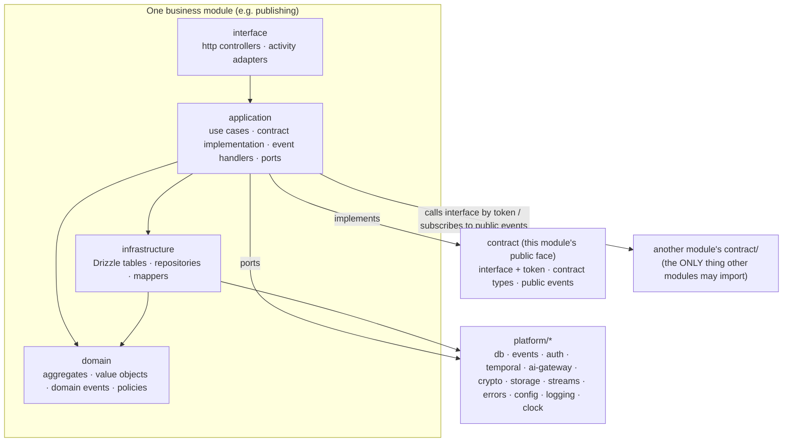

# BusMora — Backend Technical Design

> **Version:** 1.0 · **Status:** Accepted for build · **Date:** 2026-10-18
> **Scope:** the internal software architecture of the `busmora-backend` repository: `busmora-api` (NestJS), `busmora-workers` (Python), `busmora-ai` (Python).
> **Builds on:** [SYSTEM-ARCHITECTURE.md](./SYSTEM-ARCHITECTURE.md) (system-level decisions, unchanged here), [domain/](./domain/) (language, contexts, model, events), and `project-docs/`.
> **Design only:** no code. Folder structures are trees.
> **Rule kept:** no technology beyond those named in the source documents. Where this design needs something the docs don't name, it's listed as a gap (Appendix A) and not chosen.
> **Reference knowledge:** module, interface, seam, adapter, depth and "one adapter = hypothetical seam" come from the repository's `codebase-design` skill. The domain vocabulary and ADR format come from `domain-modeling`. "architecture-patterns" and "api-design-principles" are not installed, so general pattern knowledge stands in for them.

---

## Table of contents
1. [Recap of system-level decisions](#1-recap-of-system-level-decisions)
2. [Internal architecture pattern](#2-internal-architecture-pattern)
3. [Module boundaries](#3-module-boundaries)
4. [Folder structure](#4-folder-structure)
5. [Design patterns](#5-design-patterns)
6. [Domain layer per module](#6-domain-layer-per-module)
7. [Data access](#7-data-access)
8. [API layer conventions](#8-api-layer-conventions)
9. [Cross-cutting concerns](#9-cross-cutting-concerns)
10. [Testing strategy](#10-testing-strategy)
11. [Naming conventions and coding rules](#11-naming-conventions-and-coding-rules)
12. [Walkthrough: adding a feature end to end](#12-walkthrough-adding-a-feature-end-to-end)
13. [Internal decisions (ADRs)](#13-internal-decisions-adrs)
- [Appendix A — Gaps surfaced by this design](#appendix-a--gaps-surfaced-by-this-design)

---

## 1. Recap of system-level decisions

These are fixed by [SYSTEM-ARCHITECTURE.md](./SYSTEM-ARCHITECTURE.md). This document only designs *inside* them.

| # | System decision | Consequence for the internal design |
|---|---|---|
| S-1 | **Platform-Centred backend** (SYS ADR-003). `busmora-api` is the **single owner and only writer** of all domain data, the Brain included. | All business rules and all state transitions live in NestJS modules. Python never writes domain tables. |
| S-2 | **Python is stateless compute behind Temporal.** `busmora-workers` holds workflows (sequencing only) and the publish role. `busmora-ai` holds agents, crawling, retrieval, indexing, images and KPIs. | Python code is organised around use cases and adapters, not around persistence. |
| S-3 | **Amendment A1** (SYS ADR-004): internal HTTP from api to `ai-http` for **quick replies** and **read-only Brain retrieval** only. | Exactly one outbound HTTP adapter in api, with two operations. |
| S-4 | **Persistence crosses languages through Temporal.** `api-activities` is a TypeScript activity worker hosting the "platform" activities. | NestJS modules expose activity adapters next to their HTTP adapters. |
| S-5 | **Deterministic publishing** (SYS ADR-005): no LLM after Approval; MCP tools in `workers-publish`; claim → attempt → publish → read-back. | The publishing module owns the claim and attempt records. The worker owns platform calls. |
| S-6 | **Process roles:** `api-http`, `api-activities`, `workers-workflows`, `workers-publish`, `ai-http`, `ai-agent`, `ai-crawl` (+ `web`). | Each app has one entrypoint per role, over shared code. |
| S-7 | **Data:** PostgreSQL as source of truth, one schema per context. **Drizzle is the single migration toolchain.** Python reads approved-knowledge views through read-only roles with row-level security. Qdrant and Redis are derived. | Migrations live only in api. Views are the contract with Python. |
| S-8 | **No message bus.** Audit, usage and notification records are written **in the same transaction** as the change. | In-process domain events with same-transaction handlers. |
| S-9 | **Auth:** Argon2id; 15-minute JWT; rotating refresh token in an HttpOnly cookie; stream cookie for SSE; 60-second asymmetric service JWT for api → ai; one Temporal API key per role. | Guards and signers live in a shared `platform/auth` area, not in business modules. |
| S-10 | **Contracts:** code-first OpenAPI from `@nestjs/swagger`, with `oasdiff` in CI. Pydantic is canonical for Temporal payloads: JSON Schema → TypeScript types + Ajv. FastAPI's OpenAPI generates the api's `ai-http` client. | A `contracts/` area in the repo; generated code is never hand-edited. |
| S-11 | **Two standalone repositories**: this design covers `busmora-backend`. | Frontend concerns stop at the published contract. |

**Stack used in this design:**
- **TypeScript:** NestJS 10+, Passport.js + JWT, Argon2id, Drizzle ORM, Temporal TypeScript SDK, ioredis, class-validator, `@nestjs/swagger`, Ajv, `openapi-typescript`/`openapi-fetch` for the generated `ai-http` client.
- **Python:** 3.11+, FastAPI + Uvicorn, LangGraph, LiteLLM, Scrapling, Temporal Python SDK, Qdrant client, SQLAlchemy/asyncpg, Pydantic v2, MCP SDK.
- **Infrastructure:** PostgreSQL 16+, Qdrant, Redis 7+, Temporal Cloud, Cloud KMS, S3-compatible object storage, Langfuse, Docker Compose.
- **Built-ins only:** the Node.js runtime (e.g. `AsyncLocalStorage`, `crypto.randomUUID`), PostgreSQL features (schemas, views, row-level security, advisory locks), Temporal features (Schedules, signals, versioning/patching, test environments) and the Python standard library.

---

## 2. Internal architecture pattern

### 2.1 Forces
1. **Single writer** (S-1): one NestJS codebase holds every business rule for 13 business areas. Without strong internal boundaries it becomes one tangled service.
2. **Cross-context transactions are required.** For example, completing a Task writes Deliverables, Candidates, usage, audit and notifications **in one transaction** (SYS §4.6).
3. **Four students, vertical-slice ownership** (K-01). A feature must be findable in one place, and members must not tread on each other.
4. **Testability without the network.** LLMs, crawlers, Meta, X, KMS and Temporal must be replaceable in tests.
5. **A future Employee** (AG-8) should be addable as new configuration, capabilities and graph nodes, not a rewrite.
6. **Long-lived workflows** (up to a month) need contracts and schemas that only grow (S-10).

### 2.2 Alternatives considered (for `busmora-api`, where the domain lives)

| Alternative | What it is | Fit | Verdict |
|---|---|---|---|
| **A. Technical layering** | Global folders: `controllers/`, `services/`, `repositories/`, `entities/` | Simple to start, but every feature touches 4 global folders. Module ownership is invisible, and cross-context coupling grows silently. Fails forces 1 and 3. | Rejected |
| **B. Modular monolith by bounded context, pragmatic layers inside each module** | One module per context. Inside each: `domain` (pure), `application` (use cases), `infrastructure` (persistence, adapters), `interface` (HTTP and activity adapters). Modules talk only through a small public interface. Ports exist only at real seams. | Matches the 11 contexts and the single writer. Makes cross-context transactions possible with one unit of work. Vertical slices land inside one module. Testable. | **Chosen** |
| **C. Full Clean / Hexagonal everywhere** | Same modules as B, plus a port (interface) in front of **every** dependency: every repository, every module call, mappers at each ring | Maximal isolation, but most ports would have one adapter: hypothetical seams that cost a 4-person team time. The real DB is substitutable locally (Docker Compose), so repository ports buy little. | Rejected (B keeps its benefits where seams are real) |
| **D. Vertical-slice per endpoint (feature folders, no shared domain)** | Each use case owns its handler, SQL and DTOs; little shared domain | Fast for CRUD, but the core rules (Post lifecycle, Knowledge lifecycle, Task capacity) would be duplicated across slices. Weak for invariant-heavy aggregates. | Rejected (but B's `application/` *is* organised per use case) |
| **E. CQRS with separate read models / event sourcing** | Write model emits events; projections serve reads | Over-engineered for pilot scale. Conflicts with "no message bus". Adds projection drift. | Rejected |

### 2.3 Chosen pattern: Modular monolith with pragmatic layers and selective ports



**The dependency rule (enforced in CI by an import-boundary check, §10):**
1. `domain` depends on **nothing** outside itself: no NestJS, no Drizzle, no other modules, no I/O. Time arrives as a parameter or through the `Clock` port.
2. `application` may depend on its own `domain`, its own `infrastructure` (repositories), `platform` ports, its own `contract/` (which it implements), and **other modules' `contract/` only** (re-exported by their `index.ts`). It depends on the contract's **interface and token**, never on the class implementing it.
3. `infrastructure` may depend on its own `domain` and on `platform/db`. It never depends on `application` or `interface`.
4. `interface` (HTTP, activities) may depend only on its own `application`. Controllers and activities hold no business rules.
5. **No module imports another module's `domain/`, `application/`, `infrastructure/` or `interface/`.** It imports only that module's `index.ts`, which exports **nothing but the `contract/` folder**. Domain classes, internal domain events, repositories and Drizzle tables are never exported. §3.5 explains why this keeps internal changes from reaching other modules.
6. `platform/*` never imports from `modules/*`.
7. Cycles between modules are forbidden. The allowed directions are fixed in §3.3.

**Why it fits:**
- It turns the single-writer api into 13 deep modules with small interfaces. That gives locality for each owner and leverage for callers.
- It keeps one unit of work across modules, as the same-transaction rule requires.
- It puts ports exactly where two adapters genuinely exist: Temporal, `ai-http`, KMS, object storage, mail, clock, rate limiting. Production and test adapters both exist for each.

### 2.4 Internal patterns of the Python apps (same principles, smaller)

| App | Pattern | Layers |
|---|---|---|
| `busmora-workers` | **Thin deterministic workflows + activity adapters** | `workflows/` (sequencing only; no business rules, no I/O) → activity references by task queue. `publish/` is a small ports-and-adapters module: activities → MCP tools → platform adapters (anti-corruption for Meta and X). |
| `busmora-ai` | **Ports and adapters around a pure domain** | `entrypoints/` (FastAPI routes, Temporal activities) → `application/` (use cases) → `domain/` (LangGraph graph definition, retrieval algorithm, intent qualification, formatting rules, KPIs) ← `adapters/` (LiteLLM, Qdrant, read-only views, checkpoints, Scrapling, object storage, Redis Streams, Langfuse) |

The same dependency rule applies:
- `domain` imports no adapters.
- `entrypoints` hold no logic.
- Adapters implement ports declared beside the use cases that need them.
- Python never writes domain tables (S-1).

---

## 3. Module boundaries

### 3.1 `busmora-api` business modules

| Module | Context (domain/) | Owns (state and rules) | Public contract (`contract/`, re-exported by `index.ts`; see §3.5) |
|---|---|---|---|
| `identity` | Identity & Workspace | Users, Workspaces, Business Time Zone, email verification, password reset, workspace lifecycle (active → deletion requested → deleted), login sessions (refresh-token families in Redis) | `IdentityApi` (via `IDENTITY_API`): `getWorkspace`, `getBusinessTimeZone`, `assertWorkspaceActive`. Events: `UserRegistered`, `EmailVerified`, `WorkspaceCreated`, `BusinessTimeZoneChanged`, `WorkspaceDeletionRequested`, `WorkspaceDeleted` |
| `employee` | Marketing Employee (configuration seam, D-02) | Employee configuration, Capabilities, Sub-agent roster, model tiers, prompt versions; freezing configuration for runs | `EmployeeApi` (via `EMPLOYEE_API`): `freezeConfiguration(workspaceId, mode)` → `FrozenConfiguration` (`mode` = normal, treatment or control) |
| `conversation` | Marketing Employee | Conversations, Messages (7 message types), Quick Replies, structured-form rendering data | `ConversationApi` (via `CONVERSATION_API`): `appendEmployeeMessage` (used only by its own event handlers; exported for evaluation fixtures). Consumes Task, Deliverable and Knowledge events to append messages. |
| `tasks` | Marketing Employee | Tasks, Clarifications, Sub-agent Work records, Constraint Diagnosis, capacity (≤ 2 running per workspace), budgets and Partial Results | `TasksApi` (via `TASKS_API`): `requestTask`, `assertTaskInWorkspace` (SSE ownership), `getTaskSummary`. Events: `Task*`, `Clarification*`, `ResourceConsumed` |
| `brain` | Business Brain | Knowledge Items, Relationships, Procedural Rules, Candidates, Review, Retirement, Conflicts, Provenance, Brand Kit view, retrieval views for Python, index-version bookkeeping | `BrainApi` (via `BRAIN_API`): `proposeCandidates(workspaceId, proposals, provenance)`, `getBrandKit`. Events: `Knowledge*`, `Relationship*`, `ProceduralRuleApproved` |
| `crawls` | Market Intelligence | Onboarding Crawl and Research Crawl records, Snapshot metadata and reference counting (retention), crawl-cache bookkeeping | `CrawlsApi` (via `CRAWLS_API`): `getSnapshotMeta`, `markSnapshotReferenced`. Events: `OnboardingCrawl*`, `BrandKitDetected`, `ResearchCrawlCompleted`, `SourceSkipped` |
| `deliverables` | Deliverables | Deliverables (immutable), Source Citations, Performance Reports (upload + validation outcome) | `DeliverablesApi` (via `DELIVERABLES_API`): `createDeliverables(taskId, outputs)`, `getDeliverable`. Events: `DeliverableCreated`, `PerformanceReportRejected` |
| `publishing` | Governed Publishing | Posts, Post Versions, Approvals (single and bulk), Scheduled Times, Publish Attempts, the Post state machine, the claim, Batch Review Sessions (review-time instrumentation, EVAL §8) | No synchronous contract operation needed by others. Events: `Post*`, `ReviewSessionEnded` |
| `connections` | Channel Connections | Connected Accounts, KMS-encrypted credential envelopes, Reconnect Needed | `ConnectionsApi` (via `CONNECTIONS_API`): `getPublishingAccount(workspaceId, platform)` → status + opaque credential envelope; `hasConnectedAccount`. Events: `Account*` |
| `evaluation` | Evaluation | Scenarios, Evaluation Rounds, Scenario Runs (Treatment/Control), reviewer scores, review-time measurements | Operator commands only (CLI); no contract operations. Consumes the public event `ReviewSessionEnded.v1`. |
| `usage` | Usage Metering | Usage Records (append-only) | No contract operations; consumes public events `ResourceConsumed`, `PostPublished` (X cost) |
| `audit` | Audit Trail | Audit Events (append-only) | No contract operations; consumes public events every governed-action event |
| `notifications` | Notifications | In-app Notifications, read/unread | HTTP queries only; consumes attention-needed events |

### 3.2 Shared technical area: `platform/` (no business rules)

| Area | Provides | Seam (port) | Adapters |
|---|---|---|---|
| `platform/db` | Drizzle client, **TransactionManager** (ambient transaction through Node's `AsyncLocalStorage`), schema registry, the single migration history | — (real PostgreSQL in tests) | — |
| `platform/events` | In-process **domain-event dispatcher**: same-transaction handlers + after-commit hooks | — | — |
| `platform/auth` | Passport JWT strategy, access-token guard, stream-cookie guard, refresh-token rotation service, Argon2id hasher, service-JWT signer, `@CurrentTenant` | — | — |
| `platform/tenancy` | `TenantContext` (workspace id, user id, trace id) and its propagation | — | — |
| `platform/temporal` | Workflow starting and signalling; TS activity-worker bootstrap; Ajv validation of activity payloads | `WorkflowGateway` | Temporal client / in-memory recorder |
| `platform/ai-gateway` | Quick reply and Brain retrieval over `ai-http` | `AiGateway` (2 operations) | Generated `ai-http` client + service JWT / fake |
| `platform/crypto` | KMS envelope encryption (encrypt only, in api) | `CredentialCipher` | Cloud KMS / fake |
| `platform/storage` | Object storage for uploads; signed URL issuance where api needs it | `BlobStore` | S3-compatible / in-memory |
| `platform/mail` | Verification and reset emails | `Mailer` | Provider (open, OD-10) / in-memory outbox |
| `platform/rate-limit` | Guard for public endpoints | `RateLimiter` | Mechanism open (OD-14) / allow-all in tests |
| `platform/streams` | SSE gateway: reads per-Task Redis Streams; replay from `Last-Event-ID` or the `after` query parameter; heartbeats; reset event. Also reads the per-Task **Canvas state** hash for snapshots (§8.1.3). | `CanvasStateReader` | ioredis / in-memory fake |
| `platform/idempotency` | `Idempotency-Key` handling for commands (stored in PostgreSQL) | — | — |
| `platform/errors` | Domain-error base types, HTTP exception filter, error envelope | — | — |
| `platform/http` | Global validation pipe, URI versioning, pagination helpers, OpenAPI document setup | — | — |
| `platform/config` | Typed configuration validated at startup (class-validator) | — | — |
| `platform/logging` | Structured logger with trace, workspace and task ids; redaction | `Logger` (sink open, OD-13) | NestJS logger / test capture |
| `platform/clock` | Current time | `Clock` | system / fixed-time fake |

### 3.3 How modules communicate

**Allowed:**

| Mechanism | When | Rule |
|---|---|---|
| **Contract call** (synchronous, in-process) | A use case needs another context to *do* something inside the current transaction, e.g. `tasks.completeTask` → `deliverables.createDeliverables` + `brain.proposeCandidates` | Only through the target's **contract interface**, injected by its token (e.g. `BRAIN_API`). Interfaces are few and deep. Arguments and returns are **contract types** defined in `contract/`, never domain objects or ORM rows. |
| **Public event subscription** (same transaction) | A context must *react* to a fact owned by another context: audit, usage, notifications; conversation messages on Task events; publishing creating draft Posts on `DeliverableCreated` | The handler lives in the **consuming** module and subscribes to the producer's **public event contract** (e.g. `DeliverableCreated.v1`), never its internal domain event. It runs before commit; if it throws, the whole command rolls back. |
| **After-commit hook** | A side effect outside PostgreSQL: starting or signalling a workflow, re-indexing | Registered by the use case and run only after commit. It must be idempotent: deterministic workflow ids, safe repeated signals. |
| **Shared kernel** | Workspace id, user id, `BusinessTimeZone`, `Platform`, `Dialect`, money/cost units | Defined once in `modules/identity/index.ts` (workspace types) and `platform/tenancy`. Read-only types. |

**Fixed dependency directions** (arrows = "may call the contract interface of / may subscribe to the public events of"):
```
conversation ─► tasks ─► employee ─► identity
                 │  ├─► deliverables ─► identity
                 │  └─► brain ─► crawls ─► identity
publishing ─► connections ─► identity
publishing ⇢ (subscribes) deliverables events
conversation ⇢ (subscribes) tasks, deliverables, brain events
evaluation ─► tasks, employee, deliverables
evaluation ⇢ (subscribes) publishing events (ReviewSessionEnded.v1)
usage, audit, notifications ⇢ (subscribe) events of all modules; nobody depends on them
```

**Forbidden:**
1. Importing anything from another module except its `index.ts`.
2. Reading or writing another module's tables, including cross-module SQL joins. Cross-module references are **ID values**. Foreign keys are allowed only within a module and to `identity.workspaces`.
3. Calling another module's contract from `domain/`.
4. Cycles in the graph above. A new edge needs a design note.
5. Business rules in controllers, activities, event handlers of `audit`/`usage`/`notifications`, or Python workflows.
6. Any Python process writing domain tables. Python returns results through Temporal, and the owning module persists them.
7. Any synchronous api → ai call other than the two `AiGateway` operations (S-3).
8. Publishing tools or credential plaintext anywhere outside `workers-publish`.

### 3.4 Python-side boundaries

| App | Area | Owns | Exposed as |
|---|---|---|---|
| workers | `workflows/` | Sequencing of TaskExecution, Onboarding, PostRelease, Indexing, WorkspaceDeletion and the maintenance schedules | Temporal workflow types (task queue `workflows`) |
| workers | `publish/` | MCP tools, platform adapters, KMS decrypt, read-back | Activities on task queue `publish` |
| ai | `employee` domain | LangGraph graph (Router, Orchestrator, Sub-agents, Assembly, Knowledge Extractor), tool registry per Sub-agent | Activity `ai.run_agent_step`; HTTP `route-and-reply` |
| ai | `retrieval` domain | Two-stage retrieval, context assembly, token ceiling, control route | HTTP `brain-retrieval`; in-process to the graph |
| ai | `intelligence` domain | Sanitization, quarantine, intent qualification | In-process; crawl activities on task queue `ai-crawl` |
| ai | `content` domain | Platform formatting rules, dialect handling, Brand Visual composition rules | Activities `ai.render_brand_visual`, in-process |
| ai | `performance` domain | CSV normalization and deterministic KPIs | Activity `ai.compute_kpis` |

**Python rules:**
- Workflows never import adapters.
- Sub-agents never call each other; all hand-offs go through Orchestrator state (PRD §9.5).
- Each Sub-agent's tool list is fixed in the tool registry, and crawling tools are never given to writers.
- `ai-http` routes depend only on the routing and retrieval use cases.
- The Canvas adapter writes each signal to the per-Task Redis Stream **and** updates the per-Task Canvas state hash in the same Redis transaction, so a snapshot and its stream position always agree (§8.1.3). The key layout is part of `packages/contracts-py`.
- Python areas talk to each other only through the use-case interfaces and ports declared in `application/`. Python apps talk to each other and to api only through `packages/contracts-py` (§3.5 applies the same way).

### 3.5 Interface-only communication: a change inside one module never breaks another

**Goal:** any change inside a module compiles and runs without touching any other module, as long as its **contract** is unchanged. That covers its domain model, use cases, database tables, queries, internal events and adapters.

**1. Every module has a `contract/` folder. It is the only thing other modules can see.**

| File (in `modules/<m>/contract/`) | Contains | Example (brain) |
|---|---|---|
| `<m>.api.ts` | A TypeScript **interface** describing the module's operations, plus a NestJS **injection token** | `interface BrainApi { proposeCandidates(…); getBrandKit(…) }` and `BRAIN_API` |
| `<m>.types.ts` | **Contract types**: plain, serialisable input and output shapes owned by the contract. They are **not** domain classes. | `CandidateProposal`, `BrandKitView`, `ProvenanceRef` |
| `<m>.events.ts` | **Public event contracts**, each with an explicit version | `KnowledgeItemApproved.v1 { workspaceId, itemId, category, occurredAt }` |
| `<m>.errors.ts` | The contract's error codes, so callers can react without importing domain errors | `BRAIN_ITEM_NOT_FOUND` |

`index.ts` re-exports **only** `contract/`.

**2. Consumers depend on the interface, never the implementation.**
- A consuming module injects `BRAIN_API` and types it as `BrainApi`.
- The class that implements it (`BrainApiImpl` in `application/`) is bound to the token in `brain.module.ts`. No other module can import it.
- The implementation can be renamed, split or rewritten freely.

**3. Contract types are not domain types.**
- The provider maps between its domain objects and its contract types inside its own `application/` layer.
- If the Brain's `KnowledgeItem` gains fields, changes structure or gets a new invariant, only that mapping changes. Callers still receive the same `BrandKitView`.

**4. Public events are not internal events.**
- Each module raises **internal domain events** inside its domain.
- Before dispatch, the module maps them to **public event contracts** (`…v1`).
- Subscribers in other modules only ever see public events. A module can add, rename or restructure internal events without affecting anyone.

**5. Which changes can break whom:**

| Change inside module M | Other modules affected? |
|---|---|
| Domain model, aggregates, value objects, policies | **No** (hidden behind contract types) |
| Use cases, implementation class, internal refactors | **No** (consumers hold the interface) |
| Tables, columns, migrations, queries, indexes (own schema) | **No** (no other module reads M's tables, §3.3) |
| Internal domain events | **No** (only public `…vN` events cross) |
| Adapters, ports, platform usage | **No** |
| **Additive contract change**: new optional field, new operation, new event type or version | **No** (existing consumers keep compiling and working) |
| **Breaking contract change**: removing or retyping a field, changing an operation's meaning | **Not allowed in place.** Publish `…v2` / a new operation **next to** `v1`. Migrate consumers one at a time. Remove `v1` only when it has no consumers left. |

**6. How it's enforced:**
- **Compile time:** consumers can only import `contract/` (through `index.ts`). The architecture check fails the build on any deeper import (§10).
- **Contract tests:** each module has a test suite that exercises its `contract/` interface and public events, through the real implementation and real PostgreSQL. It runs on every change to the module, so an internal edit that silently changes contract behaviour fails in the provider's own build, before any consumer notices.
- **Contract change review:** any change under `contract/` is flagged in the pull request and must be additive, or add a new version.
- **Same rule across languages:** Python ↔ TypeScript payloads (`packages/contracts-py`), the `ai-http` API and the `brain_read` views follow the same additive rules (§7.4, R-5).

**7. Wiring example** (described, not code):
- `tasks` needs to propose Candidates.
- `tasks.module.ts` imports `BrainModule`, which exports only the `BRAIN_API` provider.
- The `CompleteTask` use case declares a dependency on `BrainApi` via `BRAIN_API` and passes `CandidateProposal[]`, a contract type.
- Nothing in `tasks` names a Brain class, table or internal event.

---

## 4. Folder structure

```
busmora-backend/
├── apps/                                     # one folder per deployable (D-26); each builds one image
│   ├── api/                                  # busmora-api — NestJS, TypeScript; sole domain writer
│   │   ├── src/
│   │   │   ├── main.http.ts                  # entrypoint for role api-http (REST + SSE)
│   │   │   ├── main.activities.ts            # entrypoint for role api-activities (Temporal TS activity worker)
│   │   │   ├── main.cli.ts                   # entrypoint for operator commands (workspace deletion, evaluation seeding)
│   │   │   ├── http.module.ts                # root wiring for api-http: modules' http adapters + platform
│   │   │   ├── activities.module.ts          # root wiring for api-activities: modules' activity adapters + platform
│   │   │   ├── cli.module.ts                 # root wiring for operator commands
│   │   │   ├── modules/                      # business modules, one per bounded context
│   │   │   │   ├── identity/                 # Users, Workspaces, sessions, time zone
│   │   │   │   │   ├── domain/               # aggregates, value objects, domain events, policies (pure TS)
│   │   │   │   │   ├── application/          # use cases (commands/queries), contract implementation, event handlers
│   │   │   │   │   │   ├── commands/         # one file per command use case (e.g. register-user)
│   │   │   │   │   │   ├── queries/          # one file per query use case (read models for HTTP)
│   │   │   │   │   │   └── handlers/         # subscriptions to other modules' public events (if any)
│   │   │   │   │   ├── infrastructure/       # persistence for this module only
│   │   │   │   │   │   ├── schema/           # Drizzle table definitions for this module's PostgreSQL schema
│   │   │   │   │   │   ├── repositories/     # one repository per aggregate root
│   │   │   │   │   │   └── mappers/          # row ↔ domain mapping
│   │   │   │   │   ├── interface/            # adapters that call application use cases
│   │   │   │   │   │   ├── http/             # controllers + request/response DTOs (class-validator, @nestjs/swagger)
│   │   │   │   │   │   └── activities/       # Temporal activity implementations owned by this module (if any)
│   │   │   │   │   ├── contract/             # the ONLY public face of the module (§3.5)
│   │   │   │   │   │   ├── identity.api.ts   # interface + injection token (e.g. IDENTITY_API)
│   │   │   │   │   │   ├── identity.types.ts # contract types (plain, serialisable; not domain classes)
│   │   │   │   │   │   ├── identity.events.ts# public, versioned event contracts (…v1)
│   │   │   │   │   │   └── identity.errors.ts# contract error codes
│   │   │   │   │   ├── identity.module.ts    # Nest module: binds the implementation to the token; exports only the token
│   │   │   │   │   └── index.ts              # re-exports contract/ and nothing else
│   │   │   │   ├── employee/                 # Employee configuration, Capabilities, frozen configuration (same layout)
│   │   │   │   ├── conversation/             # Conversations, Messages, Quick Replies (same layout)
│   │   │   │   ├── tasks/                    # Tasks, Clarifications, capacity, budgets, Canvas snapshot query (same layout)
│   │   │   │   ├── brain/                    # Knowledge Items, Relationships, Procedural Rules, Review (same layout)
│   │   │   │   │   └── infrastructure/
│   │   │   │   │       └── read-views/       # definitions of the read-only views Python consumes (contract)
│   │   │   │   ├── crawls/                   # crawl records, Snapshot metadata, retention (same layout)
│   │   │   │   ├── deliverables/             # Deliverables, Citations, Performance Reports (same layout)
│   │   │   │   ├── publishing/               # Posts, Versions, Approvals (single + bulk), Attempts, claim, Review Sessions (same layout)
│   │   │   │   ├── connections/              # Connected Accounts, credential envelopes (same layout)
│   │   │   │   ├── evaluation/               # Scenarios, rounds, runs, scores (same layout; CLI interface)
│   │   │   │   ├── usage/                    # Usage Records (handlers + queries)
│   │   │   │   ├── audit/                    # Audit Events (handlers + queries)
│   │   │   │   └── notifications/            # Notifications (handlers + queries)
│   │   │   ├── platform/                     # technical capabilities shared by modules; no business rules
│   │   │   │   ├── auth/                     # JWT strategy, guards (access, stream cookie), refresh rotation, Argon2id, service-JWT signer
│   │   │   │   ├── tenancy/                  # TenantContext and its propagation (HTTP and activities)
│   │   │   │   ├── db/                       # Drizzle client, TransactionManager (ambient transaction)
│   │   │   │   │   ├── migrations/           # the ONE migration history (generated SQL, reviewed in PR)
│   │   │   │   │   └── roles/                # role, grant and row-level-security definitions for Python read roles
│   │   │   │   ├── events/                   # in-process domain-event dispatcher; after-commit hooks
│   │   │   │   ├── temporal/                 # WorkflowGateway port + adapter; worker bootstrap; Ajv payload validation
│   │   │   │   ├── ai-gateway/               # AiGateway port + adapter over the generated ai-http client
│   │   │   │   ├── crypto/                   # CredentialCipher port + KMS adapter
│   │   │   │   ├── storage/                  # BlobStore port + object-storage adapter
│   │   │   │   ├── mail/                     # Mailer port (provider open)
│   │   │   │   ├── rate-limit/               # RateLimiter port + guard (mechanism open)
│   │   │   │   ├── streams/                  # SSE gateway: Redis Streams reader, replay, heartbeats, reset
│   │   │   │   ├── idempotency/              # Idempotency-Key store + interceptor
│   │   │   │   ├── errors/                   # domain-error base, error codes catalogue, exception filter, envelope
│   │   │   │   ├── http/                     # validation pipe, /v1 versioning, pagination, OpenAPI setup
│   │   │   │   ├── config/                   # typed config schema, validated at startup
│   │   │   │   ├── logging/                  # structured logger, redaction, trace propagation
│   │   │   │   └── clock/                    # Clock port + system adapter
│   │   │   └── generated/                    # machine-generated; never edited by hand
│   │   │       ├── temporal-contracts/       # TS types generated from contracts/temporal JSON Schema
│   │   │       └── ai-http-client/           # TS client generated from contracts/ai-http OpenAPI
│   │   └── test/
│   │       ├── fakes/                        # second adapters for every port (Temporal, AI, KMS, storage, mail, clock, rate limit)
│   │       ├── builders/                     # aggregate and request builders; seeded-workspace helpers
│   │       ├── domain/                       # pure unit tests per module (mirrors modules/*/domain)
│   │       ├── integration/                  # use-case tests against real PostgreSQL (Docker Compose)
│   │       ├── http/                         # end-to-end HTTP tests per module (app + test database)
│   │       ├── activities/                   # activity tests in the Temporal TS test environment
│   │       └── architecture/                 # import-boundary and dependency-direction checks
│   ├── workers/                              # busmora-workers — Python; sequencing + publish
│   │   ├── src/busmora_workers/
│   │   │   ├── main_workflows.py             # entrypoint for role workers-workflows
│   │   │   ├── main_publish.py               # entrypoint for role workers-publish
│   │   │   ├── workflows/                    # deterministic workflow definitions (no I/O, no business rules)
│   │   │   │   ├── task_execution.py         # TaskExecutionWorkflow (Clarification waits, capacity wait)
│   │   │   │   ├── onboarding.py             # OnboardingWorkflow
│   │   │   │   ├── post_release.py           # PostReleaseWorkflow (one per Post)
│   │   │   │   ├── indexing.py               # IndexingWorkflow
│   │   │   │   ├── workspace_deletion.py     # WorkspaceDeletionWorkflow
│   │   │   │   └── maintenance.py            # scheduled workflows: retention sweep, reconciliation
│   │   │   ├── activity_refs/                # typed references to activities on other task queues (platform.*, ai.*, crawl.*)
│   │   │   ├── publish/                      # role workers-publish (ports and adapters)
│   │   │   │   ├── activities/               # publish_post_version, read_back, refresh_credential
│   │   │   │   ├── mcp_server/               # MCP tools: publish_facebook, publish_instagram, publish_x (FR-102)
│   │   │   │   ├── platforms/                # anti-corruption adapters for Meta Graph / Instagram and X API v2
│   │   │   │   └── secrets/                  # KMS decryption, in memory only
│   │   │   ├── config/                       # settings validated with Pydantic models
│   │   │   └── observability/                # logging setup, trace-id propagation
│   │   └── tests/
│   │       ├── workflows/                    # time-skipping workflow tests with stubbed activities
│   │       ├── publish/                      # publish activities against fake platform adapters
│   │       └── fakes/                        # fake platforms, fake KMS
│   └── ai/                                   # busmora-ai — Python; agents, crawling, retrieval
│       ├── src/busmora_ai/
│       │   ├── main_http.py                  # entrypoint for role ai-http (FastAPI, internal only)
│       │   ├── main_agent.py                 # entrypoint for role ai-agent (Temporal activity worker)
│       │   ├── main_crawl.py                 # entrypoint for role ai-crawl (Temporal activity worker)
│       │   ├── entrypoints/                  # adapters that call use cases; no logic
│       │   │   ├── http/                     # routes (route-and-reply, brain-retrieval), service-JWT verification, schemas
│       │   │   └── activities/               # run_agent_step, extract_candidates, index_items, render_brand_visual, compute_kpis, crawl_*
│       │   ├── application/                  # use cases + the ports they need
│       │   ├── domain/                       # pure logic; no adapters
│       │   │   ├── employee/                 # LangGraph graph, state schema, Sub-agents, tool registry, budgets
│       │   │   ├── retrieval/                # seed + 1–2 hop expansion, assembly, token ceiling, control route
│       │   │   ├── intelligence/             # sanitization, quarantine boundaries, intent qualification
│       │   │   ├── content/                  # platform formatting, dialect rules, Brand Visual composition rules
│       │   │   └── performance/              # CSV normalization, deterministic KPIs
│       │   ├── adapters/                     # implementations of ports
│       │   │   ├── llm/                      # LiteLLM (light/heavy tiers, fallback, cost capture)
│       │   │   ├── vector/                   # Qdrant (workspace + status filters always applied)
│       │   │   ├── brain_views/              # SQLAlchemy Core reads of api-owned read-only views
│       │   │   ├── checkpoints/              # LangGraph checkpointer in the runtime schema
│       │   │   ├── crawler/                  # Scrapling, browser pool, proxies, SSRF guard, cache
│       │   │   ├── blob/                     # object storage (Snapshots, Brand Visuals)
│       │   │   ├── canvas/                   # Canvas signal emitter (Redis Streams, per Task)
│       │   │   ├── tracing/                  # Langfuse
│       │   │   └── image/                    # image-model adapter (provider deferred, D-40)
│       │   ├── prompts/                      # version-controlled prompt templates (version recorded per run)
│       │   └── config/                       # settings validated with Pydantic models
│       └── tests/
│           ├── domain/                       # pure tests: retrieval assembly, qualification, KPIs, formatting
│           ├── application/                  # use cases with fake adapters
│           ├── entrypoints/                  # FastAPI routes and activities with fakes
│           └── fakes/                        # fake LLM, fake vector store, fake crawler, fake views
├── packages/
│   └── contracts-py/                         # CANONICAL Pydantic models: Temporal payloads, Canvas signal envelope
├── contracts/                                # generated artefacts, committed, verified in CI
│   ├── temporal/                             # JSON Schema exported from contracts-py
│   ├── ai-http/                              # OpenAPI exported from ai-http
│   └── api/                                  # openapi.json generated from busmora-api; published for the frontend
├── evaluation/                               # Scenario definitions, seeded-workspace data, rubrics (EVAL §3–§5)
├── deploy/
│   └── compose/                              # Docker Compose: all backend roles + PostgreSQL, Redis, Qdrant, object storage
├── scripts/                                  # contract generation, drift checks, seeding, local setup
├── ci/                                       # pipeline definitions (CI tooling open, OD-16)
└── docs/
    └── adr/                                  # internal ADRs (seeded from §13)
```

---

## 5. Design patterns

### 5.1 Patterns used

| Pattern | Where | Problem it solves |
|---|---|---|
| **Modular monolith** | `apps/api/src/modules/*` | One writer holding 13 contexts without becoming a ball of mud; vertical-slice ownership |
| **Published interface (module contract)** | each module's `contract/`: interface + token, contract types, versioned public events | Modules depend only on interfaces. Internal changes never ripple to other modules (§3.5). Callers learn 1–3 operations. |
| **Dependency inversion via injection tokens** | `contract/<m>.api.ts` token bound in `<m>.module.ts` | Consumers never reference the implementing class, so it can be rewritten freely |
| **Integration (public) events separate from domain events** | internal events mapped to `…vN` public events before dispatch | Internal event changes stay private; public events evolve additively by version |
| **Aggregate + state machine** | `Post`, `Task`, `KnowledgeItem`, `ProceduralRule`, `ConnectedAccount`, `Workspace` | Invariants held in one place. Examples: approval binds to one Post Version; edit returns to `pending_approval`; ≤ 2 running Tasks; manual items start Approved. |
| **Value object** | `ScheduledTime`, `BusinessTimeZone`, `Provenance`, `CredentialEnvelope`, `IdempotencyKey`, `PostContent`, `KnowledgeCategory`, `Cost` | Validity by construction; comparison by value; no primitive obsession around time zones and money |
| **Policy (strategy for rules)** | `TaskCapacityPolicy`, `PostTransitionPolicy`, `CandidateOriginPolicy`, `RetentionPolicy` | Keeps rules readable and unit-testable apart from aggregates |
| **Repository** (concrete, per aggregate root) | `modules/*/infrastructure/repositories` | Keeps Drizzle out of the domain. One place per aggregate for loading, saving and the mandatory workspace scope. |
| **Unit of Work (ambient transaction)** | `platform/db` TransactionManager, propagated by `AsyncLocalStorage` | Cross-module same-transaction writes (task completion, audit, usage, notifications) without passing transactions by hand |
| **Domain events, in-process, same transaction** | `platform/events` + `application/handlers` | Decouples audit, usage, notifications, conversation messages and draft-Post creation from producers, without a message bus (S-8) |
| **After-commit hook + deterministic workflow ids** | use cases that start or signal workflows | Workflows start only for committed state. Retries can't create duplicates, because the workflow id equals the Task, Post or index-version id. |
| **Ports and adapters (selective)** | `WorkflowGateway`, `AiGateway`, `CredentialCipher`, `BlobStore`, `Mailer`, `RateLimiter`, `Clock`, `Logger`; in ai: `Llm`, `VectorIndex`, `BrainViews`, `Crawler`, `Blob`, `CanvasSink`, `Tracer`, `ImageModel`; in workers: `PlatformPublisher` | Replace the network in tests. Every port has **two real adapters** (production + test). |
| **Anti-corruption layer** | `workers/publish/platforms/*`; `platform/ai-gateway` | Meta and X API shapes and the `ai-http` client types never leak into domain types |
| **Process manager** | Python workflows | Durable sequencing with timers and signals, while rules stay in api |
| **Claim check** | Temporal payloads carry ids and object-storage keys | Avoids Temporal payload-size limits; content travels by reference |
| **Idempotency key / idempotent consumer** | `platform/idempotency` (HTTP); activity idempotency by (workflow id, step); publish key = Post Version id | Duplicate submissions and activity retries never double-write or double-post (G1) |
| **Optimistic concurrency** | `version` columns on Post and Knowledge Item; commands carry the version they act on | Stale edits and approvals are rejected (Approval binds to a version) |
| **Pessimistic per-workspace lock** | PostgreSQL advisory transaction lock in `TaskCapacityPolicy` and the Post claim | Exact enforcement of "≤ 2 running Tasks" and of a single claim, under concurrency |
| **Snapshot (frozen configuration)** | `employee.freezeConfiguration` → workflow input | In-flight runs are unaffected by later edits (TA §11.2); the seam for a future Employee |
| **Envelope encryption** | `platform/crypto` (encrypt) / `workers/publish/secrets` (decrypt) | Credential plaintext exists only in memory in one process |
| **Read-only view contract** | `brain/infrastructure/read-views` + `platform/db/roles` | Python reads approved knowledge without owning or coupling to write tables |
| **Mapper / DTO** | `interface/http` DTOs, `infrastructure/mappers` | API shapes and storage shapes evolve independently of the domain |
| **Registry (tool scoping)** | `ai/domain/employee` tool registry per Sub-agent | Each Sub-agent sees only its own tools (TA §6.4, §13 #3) |
| **Template / builder for prompts** | `ai/prompts` | Versioned, reviewable prompts; the version is recorded per run |

### 5.2 Patterns deliberately avoided

| Avoided | Why |
|---|---|
| Event sourcing | Pilot scale; PostgreSQL rows with an audit trail meet the requirements; projections would add drift |
| CQRS with separate read stores | One database is enough; read queries live in each module's `application/queries` |
| Message bus or transactional outbox | Excluded at system level (S-8). After-commit hooks + deterministic ids + reconciliation cover external side effects. |
| Generic repository / base CRUD service | Hides aggregate invariants; makes it easy to skip the workspace scope |
| Repository interfaces (ports) for every repository | One adapter = a hypothetical seam. Tests use real PostgreSQL. |
| Active Record / ORM entities as domain objects | Couples rules to Drizzle; makes the domain impure |
| Service locator / global singletons | Hidden dependencies, untestable; NestJS dependency injection is used instead |
| Shared `utils`/`common` business module | Turns into a dumping ground. Shared *technical* code goes to `platform/`; shared *business* code doesn't exist. |
| Sharing domain classes or internal events across modules | Would make any internal change a cross-module break. Only contract types and public events cross (§3.5). |
| Distributed transactions or sagas across services | Python never writes domain data, so no cross-service transaction exists |
| Aspect-oriented business logic (decorators that change behaviour) | Rules must be visible in use cases. Decorators are limited to wiring, validation and auth. |
| An LLM call in any publish path | System rule (S-5) |

---

## 6. Domain layer per module

The vocabulary follows [domain/GLOSSARY.md](./domain/GLOSSARY.md). Storage names that differ from it are noted in §7.2.

Everything in this section is **internal** to its module. Aggregates, value objects and policies never leave it. The events listed are **internal domain events**; each module maps the ones others need into **public, versioned event contracts** in its `contract/<m>.events.ts` (§3.5). Cross-module inputs and outputs are **contract types**, never these domain classes.

### 6.1 `identity`

| Kind | Items |
|---|---|
| **Aggregates** | `User` (email, password hash, verified, preferred UI language) · `Workspace` (business name, website URL, business time zone, status: active / deletion_requested / deleted) |
| **Entities** | `LoginSession` (refresh-token family; lives in Redis) |
| **Value objects** | `Email`, `PasswordHash` (Argon2id), `BusinessTimeZone` (IANA id), `UiLanguage` (ar, en), `WorkspaceId`, `UserId` |
| **Invariants** | One User per Workspace this release. A Workspace is created at registration. Deletion is operator-run and final. |
| **Policies** | `RefreshRotationPolicy`: rotate on use; reuse revokes the family; 10-second grace for the just-rotated token; 7-day sliding idle window; 30-day absolute limit |
| **Events** | `UserRegistered`, `EmailVerified`, `WorkspaceCreated`, `BusinessTimeZoneChanged`, `WorkspaceDeletionRequested`, `WorkspaceDeleted` |

### 6.2 `employee`

| Kind | Items |
|---|---|
| **Aggregates** | `EmployeeConfiguration`: the Marketing Employee's Capabilities, Sub-agent roster, model tier per role (light/heavy), prompt-template versions, budgets (≤ 5 min research, cost ceilings, recursion cap) |
| **Value objects** | `Capability`, `SubAgentKind`, `ModelTier`, `PromptVersion`, `TaskBudget`, `RetrievalMode` (treatment or control), `FrozenConfiguration` (an immutable, serialisable copy) |
| **Invariants** | Freezing always produces a complete configuration. One active configuration per Employee kind. |
| **Events** | none needed (configuration changes are operator actions) |

### 6.3 `conversation`

| Kind | Items |
|---|---|
| **Aggregates** | `Conversation` with `Message` entities |
| **Value objects** | `MessageKind` (text, text_response, structured_form, task_status, deliverable_card, knowledge_notification, error), `StructuredForm` (fields: text, radio, checkbox, dropdown; per-field "Search Yourself"), `FormAnswer`, `ContentLanguage` |
| **Invariants** | Messages are append-only. A Quick Reply is stored only as a message. |
| **Events** | none (it consumes Task, Deliverable and Knowledge events to append messages) |

### 6.4 `tasks`

| Kind | Items |
|---|---|
| **Aggregates** | `Task` (type, request, status, frozen configuration ref, constraint diagnosis, budget, cost so far) containing `Clarification` (form, answers, asked at, expires at = +7 days) and `SubAgentWork` (sub-agent, input/result summaries, user-visible tool labels) |
| **Value objects** | `TaskStatus` (requested, running, awaiting_clarification, completed, partially_completed, failed, cancelled), `ConstraintDiagnosis` (discovery, positioning, conversion), `Cost`, `StepResult` |
| **Policies** | `TaskCapacityPolicy` (≤ 2 running per workspace), `ClarificationExpiryPolicy` (7 days), `PartialResultPolicy` (time or cost ceiling reached) |
| **Read models** | `CanvasSnapshot` (Task status; per node: Orchestrator and the 5 Sub-agents with state idle / active / completed / error and the current user-visible tool label; active connections; `asOfEventId`). Built by a query, never stored by `tasks` (§8.1.3). |
| **Invariants** | Transitions only as in the Task state diagram. At most one open Clarification. Cost never decreases. |
| **Events** | `TaskRequested`, `TaskStarted`, `ConstraintDiagnosed`, `ClarificationRequested`, `ClarificationAnswered`, `ClarificationExpired`, `TaskCompleted`, `TaskPartiallyCompleted`, `TaskFailed`, `TaskCancelled`, `ResourceConsumed` |

### 6.5 `brain`

| Kind | Items |
|---|---|
| **Aggregates** | `KnowledgeItem` (category, title, summary, structured properties, kind, status, version, provenance, freshness) · `Relationship` (from, to, type, weight, status) · `ProceduralRule` (rule text, scope, origin, status, version) · `Conflict` (items, detected at, resolution) |
| **Value objects** | `KnowledgeCategory` (the nine), `KnowledgeStatus` (candidate, approved, rejected, retired), `RelationType` (targets, competes_with, has_tone, solves_pain_point, related_to), `Provenance` (source type, Snapshot or Task ref, captured at), `Confidence`, `ItemVersion`, `BrandKit` (read model: logo / colors / fonts, detected or not) |
| **Policies** | `CandidateOriginPolicy`: manual → approved; everything else → candidate. `ReviewPolicy`: individual only; no bulk. `ConflictDetectionPolicy`: flag, never resolve. `SensitiveInfoPolicy`: refuse passwords and financial or personal data; warn. `RetirementPolicy`: "delete" = retire. |
| **Invariants** | Both ends of a Relationship are in the same workspace. Only approved items are visible to retrieval views. No hard delete. Each edit creates a new version. |
| **Events** | `KnowledgeCandidateProposed`, `KnowledgeItemApproved`, `KnowledgeCandidateRejected`, `KnowledgeItemAddedManually`, `KnowledgeItemEdited`, `KnowledgeItemRetired`, `RelationshipAdded`, `RelationshipRetired`, `KnowledgeConflictDetected`, `ProceduralRuleApproved` |

### 6.6 `crawls`

| Kind | Items |
|---|---|
| **Aggregates** | `OnboardingCrawl` (URL, pages ≤ 10, progress, outcome, Brand Kit detection) · `ResearchCrawl` (Task ref, sources tried/skipped, items, time and cost spent) |
| **Entities** | `SnapshotRecord` (object key, URL, platform, captured at, reference count) |
| **Value objects** | `CrawlOutcome` (complete, partial, failed), `SourceSkip` (source, reason), `SourceRef` |
| **Policies** | `OnboardingBounds` (≤ 10 pages, ≤ 5 min, robots.txt respected, configurable), `OneCrawlPerWorkspace`, `RetentionPolicy` (keep while referenced; unreferenced raw research data 7 days) |
| **Events** | `OnboardingCrawlStarted`, `OnboardingCrawlCompleted`, `OnboardingCrawlFailed`, `BrandKitDetected`, `ResearchCrawlCompleted`, `SourceSkipped` |

### 6.7 `deliverables`

| Kind | Items |
|---|---|
| **Aggregates** | `Deliverable` (type, title, content, Task ref, partial flag) · `PerformanceReport` (object key, normalized columns, validation outcome) |
| **Value objects** | `DeliverableType` (research_report, competitor_analysis, content_posts, content_calendar, performance_diagnosis, general), `SourceCitation` (URL, platform, accessed at), `DeliverableContent` (Markdown or structured) |
| **Invariants** | Immutable once created. Every research claim has a citation. |
| **Events** | `DeliverableCreated`, `PerformanceReportRejected` |

### 6.8 `publishing`

| Kind | Items |
|---|---|
| **Aggregates** | `Post` (target platform + Connected Account ref, scheduled time or "now", status, version counter, origin Deliverable) containing `PostVersion` entities (immutable content, Brand Visual key, author, created at), an `Approval` value (version, user, at, channel: single or bulk), and `PublishAttempt` entities (idempotency key, started at, outcome, platform post id/URL, read-back) · `ReviewSession` (user, optional origin Deliverable, started at, last activity at, ended at, end reason: finished / left / abandoned, counts of approvals, rejections, edits and regenerations) |
| **Value objects** | `PostStatus` (draft, pending_approval, approved, rejected, scheduled, publishing, published, failed, cancelled, expired), `ScheduledTime` (UTC instant + planning IANA zone), `Platform` (facebook_page, instagram_business, x), `PostContent`, `IdempotencyKey`, `FailureReason` |
| **Policies** | `BulkDecisionPolicy`: a bulk approve/reject acts only on the Posts and versions the User listed, each Post decided on its own (PRD §11.3; the "no bulk" rule D-24 applies to Brain Candidates, not Posts). `ReviewSessionPolicy`: one open session per user per workspace; starting a new one closes the previous as abandoned; idle sessions are closed as abandoned at their last activity. `PostTransitionPolicy` (the full state machine, SYS §3.4). `ClaimPolicy`: claim succeeds only if approved/scheduled and on the same version; still pending → expired. `RetryPolicy` (2× on API error, cooldown on rate limit, then failed; manual retry reuses the same version and key). `PlatformLimits` (Instagram 50/24 h; X 100/15 min per user). |
| **Invariants** | Approval binds to exactly one Post Version. A new version clears Approval. At most one successful attempt per Post. A Post can't be cancelled once it is `publishing`. Changing the zone never moves an approved or scheduled Post. |
| **Events** | `PostDrafted`, `PostSubmittedForApproval`, `PostVersionCreated`, `PostApproved`, `PostRejected`, `PostScheduled`, `PostCancelled`, `PostExpired`, `PostPublished`, `PostPublishFailed`, `ReviewSessionStarted`, `ReviewSessionEnded` |

### 6.9 `connections`

| Kind | Items |
|---|---|
| **Aggregates** | `ConnectedAccount` (platform, platform account id, status, credential envelope, credential version, connected at) |
| **Value objects** | `CredentialEnvelope` (opaque ciphertext + encryption context `{workspace_id, integration_id, credential_version}`), `AccountStatus` (connected, reconnect_needed, disconnected) |
| **Invariants** | Plaintext never exists in api. Connection happens only when posting is requested (lazy). Disconnect is always allowed. |
| **Events** | `AccountConnected`, `AccountReconnectNeeded`, `AccountDisconnected` |

### 6.10 `evaluation`, `usage`, `audit`, `notifications`

| Module | Model |
|---|---|
| `evaluation` | Aggregates `Scenario` (category, seeded workspace, request, expected Deliverable type, rubric dimensions) and `EvaluationRound` with `ScenarioRun` (mode: treatment or control; Deliverable ref; clarification and correction counts) and `ReviewerScore`. Events `ScenarioRun`, `DeliverableScored`. Rule: same model and prompts in both modes; two reviewers, third on a disagreement > 1 point. |
| `usage` | `UsageRecord` (append-only): resource kind (model tokens, crawl/proxy, image, X post), quantity, estimated cost, Task ref |
| `audit` | `AuditEvent` (append-only): action, actor (user, employee, system), subject, at |
| `notifications` | `Notification`: kind, subject link, read/unread |

---

## 7. Data access

### 7.1 Repositories
- **One repository per aggregate root**, in `modules/<m>/infrastructure/repositories`. It loads and saves the **whole aggregate**, including child entities such as Post Versions and Clarifications.
- **Every method takes `workspaceId` as its first argument.** There is no unscoped read or write.
- Query use cases (`application/queries`) may read their **own** module's tables directly through Drizzle for list and detail views, still workspace-scoped. They never read other modules' tables.
- Repositories return **domain objects** (via mappers), never Drizzle rows.
- Writes use **optimistic concurrency** (`version` column) on Post and Knowledge Item, and append-only inserts on audit and usage.

### 7.2 Data ownership and schemas

| PostgreSQL schema | Owner module | Main tables (storage names) |
|---|---|---|
| `identity` | identity | `users`, `workspaces`, `email_verifications`, `password_resets` |
| `employee` | employee | `employee_configurations`, `capabilities` |
| `conversation` | conversation | `conversations`, `messages` |
| `tasks` | tasks | `tasks`, `clarifications`, `subagent_work` |
| `brain` | brain | `brain_nodes` (= Knowledge Items), `brain_node_versions`, `brain_edges` (= Relationships), `brain_procedural_rules`, `brain_conflicts`, `brain_index_state` |
| `brain_read` | brain (views only) | read-only views over **approved** items, Relationships, Procedural Rules, Snapshot metadata; row-level security on workspace |
| `crawls` | crawls | `onboarding_crawls`, `research_crawls`, `snapshots` |
| `deliverables` | deliverables | `deliverables`, `source_citations`, `performance_reports` |
| `publishing` | publishing | `posts`, `post_versions`, `publish_attempts`, `review_sessions` |
| `connections` | connections | `connected_accounts` |
| `evaluation` | evaluation | `scenarios`, `evaluation_rounds`, `scenario_runs`, `reviewer_scores` |
| `usage` | usage | `usage_records` |
| `audit` | audit | `audit_events` (append-only; no update or delete grant except for workspace deletion) |
| `notifications` | notifications | `notifications` |
| `platform` | platform/idempotency | `idempotency_keys` (key, workspace, request hash, response snapshot, expiry) |
| `ai_runtime` | **busmora-ai** (technical, not domain) | LangGraph checkpoints. The schema and grants are created by a Drizzle migration; the tables inside are managed by the LangGraph checkpointer (BTD-ADR-09). |

The storage names `brain_nodes` and `brain_edges` are kept from the product docs for traceability. Code uses the glossary terms `KnowledgeItem` and `Relationship`, and the mappers are the only place both names meet.

**Cross-module references** are ID columns without foreign keys. The exception is `workspace_id`, which every table carries, with a foreign key to `identity.workspaces`. **Workspace deletion** is orchestrated module by module by `WorkspaceDeletionWorkflow` through each module's deletion activity, so no cascading foreign key crosses modules.

### 7.3 Transactions
- **One command = one transaction**, opened by the use case through `TransactionManager.run()`. Repositories, contract implementations and same-transaction event handlers all join it automatically through the ambient context.
- **Cross-module writes** happen only by calling other modules' contract interfaces *inside* the same transaction. Example: `CompleteTask` → `DeliverablesApi.createDeliverables` → `BrainApi.proposeCandidates`; handlers then append usage, audit, notifications and conversation messages.
- **After-commit hooks** start or signal workflows, and are idempotent:

  | Workflow | Workflow id |
  |---|---|
  | `TaskExecutionWorkflow` | Task id |
  | `PostReleaseWorkflow` | Post id |
  | `IndexingWorkflow` | item id + version |

  If a hook fails after commit, a scheduled **reconciliation** workflow finds rows whose workflow should exist (e.g. a Task `requested` with no running workflow, or an item whose index version lags) and starts it.
- **Isolation:** the default is read committed. **Advisory transaction locks** keyed by workspace serialise capacity checks and Post claims.
- **Activities are idempotent.** Each "platform" activity carries the workflow id plus a step sequence number, and the owning module records processed step keys. A Temporal retry therefore re-applies nothing.

### 7.4 Migrations
- **Drizzle is the single toolchain** (SYS ADR-008).
  - Table definitions live in each module's `infrastructure/schema/`.
  - There is **one ordered migration history** in `platform/db/migrations/`.
  - Generated SQL is reviewed in the pull request.
  - Roles, grants, views and row-level-security policies are migrations too (`platform/db/roles/`).
- **Expand → migrate → contract.** Columns are added before they are used and removed only after no code, view or in-flight workflow depends on them. Month-long workflows and Python's views make breaking changes unsafe.
- **Views are a contract** with Python. `brain_read` views change only additively. A breaking change means a new view name, with both kept until Python is migrated.
- Migrations run as a step before api roles start, never from Python.

### 7.5 Python data access
- `ai-agent` and `ai-http` use **SQLAlchemy Core** (no ORM models) against `brain_read` views, through read-only roles with row-level security keyed to the verified workspace. `ai-agent` also uses the `ai_runtime` schema for checkpoints.
- Every Qdrant query applies `workspace_id` + `status=approved` filters inside the `VectorIndex` adapter, so callers can't forget them.
- `busmora-workers` has **no database access**. Everything it needs arrives in activity results.

---

## 8. API layer conventions

| Topic | Convention |
|---|---|
| **Routing** | URI versioning `/v1/...`. One controller per resource, inside its module's `interface/http`. Resources follow SYS §6.3: `/auth`, `/workspace`, `/onboarding`, `/conversations/{id}/messages`, `/tasks/{id}`, `/tasks/{id}/clarifications/{id}`, `/brain/items`, `/brain/relationships`, `/brain/candidates`, `/brain/conflicts`, `/brain/search`, `/deliverables`, `/posts`, `/posts/{id}/versions`, `/batch-review/sessions`, `/tasks/{id}/canvas`, `/connections`, `/notifications`, `/performance-reports`, `/streams/tasks/{taskId}`. The workspace comes from the token; OD-20 stays open, and adding it to the path later would be additive. |
| **Commands vs queries** | Queries are `GET` on resources. State changes that are not plain field updates are **action sub-resources** named after the domain verb: `POST /v1/posts/{id}/approve`, `/reject`, `/cancel`, `/reschedule`, `/regenerate`, `/retry`; `POST /v1/brain/candidates/{id}/approve` and `/reject`; `POST /v1/brain/items/{id}/retire`. Actions on many Posts at once are collection actions: `POST /v1/posts/bulk-approve` and `/bulk-reject` (§8.1.1). |
| **Validation** | Request DTOs use class-validator. A global validation pipe applies whitelisting, rejects unknown properties, and transforms types. Domain validation happens again in value objects and aggregates; DTO validation is only the first gate. |
| **DTOs and mapping** | Request DTOs → command objects (in `application`) → domain. Domain → response DTOs through explicit mapper functions in `interface/http`. Drizzle rows and domain objects never cross the HTTP boundary. Response DTOs carry `@nestjs/swagger` metadata so `openapi.json` is exact. |
| **Error format** | One envelope: `{ "error": { "code", "messageKey", "details", "correlationId" } }`. Codes come from a catalogue in `platform/errors` (e.g. `VALIDATION_FAILED`, `NOT_FOUND`, `STALE_VERSION`, `INVALID_TRANSITION`, `CAPACITY_QUEUED`, `RECONNECT_NEEDED`, `CSV_HEADERS_UNRECOGNIZED`, `RATE_LIMITED`, `UNAUTHENTICATED`). |
| **HTTP status mapping** | 400 validation · 401 unauthenticated · 403 workspace mismatch · 404 not found (also used for cross-workspace ids, so existence isn't leaked) · 409 stale version / invalid transition · 422 domain rule violation · 429 rate limited · 202 accepted for asynchronous work · 503 dependency unavailable (e.g. `ai-http`) |
| **Versioning** | `/v1` only; additive changes within it. The frontend pins the published `openapi.json`. `oasdiff` blocks breaking changes. |
| **Pagination** | Cursor based: `?limit=` (default and maximum set in config) and `?cursor=`; response `{ items, nextCursor }`. Ordering is stable (creation time + id). Filters are query parameters: Deliverables by `type` and date range; Brain by `category`, `relationType`, `q`. |
| **Idempotency** | Required `Idempotency-Key` header on: send message / start task, send to Batch Review, approve, bulk approve / bulk reject, start review session, retry publish, uploads. The key + workspace + request hash maps to the stored response. The same key with a different body is rejected. |
| **Concurrency** | Commands on Posts include `postVersionId`; commands on Knowledge Items include `version`. A mismatch returns 409 `STALE_VERSION`. |
| **Time** | UTC ISO-8601 instants. `ScheduledTime` is sent as `{ instant, zone }`, and the Business Time Zone as an IANA id. |
| **Asynchronous work** | 202 with the resource id (Task, Onboarding Crawl). Progress arrives over SSE; state is available by `GET`. |
| **SSE** | `GET /v1/streams/tasks/{taskId}`. Authenticated by the stream cookie; ownership is checked through `TasksApi.assertTaskInWorkspace`. Uses the SYS §6.4 envelope, heartbeats and the reset event. Already-open streams survive cookie expiry. An optional `?after=<eventId>` starts the first connection after a Canvas snapshot (native `EventSource` sends `Last-Event-ID` only on reconnects); `Last-Event-ID` wins when both are present (§8.1.3). |
| **Uploads** | `POST /v1/performance-reports`, multipart CSV. The file goes to `BlobStore`; validation and normalization run as part of the diagnosis Task. Size limits are an open requirement. |
| **OpenAPI** | Generated in CI from controllers and DTOs, including explicitly registered SSE event payload DTOs. Published as a versioned artefact. |
| **CORS** | The frontend runs on `app.<domain>` and calls `api.<domain>`: same site, different origin. api-http allows exactly the configured app origin with credentials enabled, so the refresh cookie and the stream cookie (native `EventSource` with credentials) work. All other origins are refused. |

### 8.1 Batch Review and Canvas endpoints (frontend gap FG-10)

These three endpoints close gap FG-10 in [FRONTEND-TECHNICAL-DESIGN.md](./FRONTEND-TECHNICAL-DESIGN.md). Each one follows the conventions in the table above. All three are **additive** to `/v1`.

#### 8.1.1 Bulk approve / reject the remaining Posts
**Source:** PRD §11.3 ("Approve all remaining", "Reject all remaining"), SYS §5.3 (Batch Review), the Approval invariant in §6.8.

| Item | Specification |
|---|---|
| **Endpoints** | `POST /v1/posts/bulk-approve` · `POST /v1/posts/bulk-reject` (owned by `publishing`) |
| **Headers** | `Idempotency-Key` required |
| **Request** | `{ items: [ { postId, postVersionId } ] }`: 1 to N items (N = configured maximum, G-16). Duplicate `postId`s are a validation error. |
| **What "remaining" means** | The client sends exactly the Posts that are still undecided **on the User's screen**, each with the version the User saw. The server never expands "all remaining" by itself, because an Approval must bind to a version the User actually saw. A Post that changed after the screen loaded comes back as `stale_version` instead of being approved unseen. |
| **Processing** | Each item runs the **same use case as the single command** (`ApprovePost` / `RejectPost`), in **its own transaction**, in request order. One item's failure never rolls back another (the Post is the consistency boundary). Each successful item registers its own after-commit hook (signal to its `PostReleaseWorkflow`) and emits its usual events. Approvals record `channel = bulk`. Each item gets its own audit event, all carrying the request's correlation id. |
| **Per-item outcomes** | `approved` · `rejected` · `already_decided` (the same version was already approved or rejected: a safe no-op, so retries stay correct) · `stale_version` · `invalid_transition` · `not_found` (also for another workspace's ids) |
| **Response** | `200` whenever the request itself is valid: `{ results: [ { postId, outcome, post? } ], counts: { succeeded, failed } }`. `post` is the updated Post summary when it changed. Whole-request failures use the normal envelope: `400` (empty, too many, duplicates), `401`, `429`. |
| **Idempotency** | The whole result is stored under the key; a retry with the same key returns it. If the process stops before the result is stored, a retry re-runs the items, and those already done return `already_decided`. |
| **Not affected** | Brain Candidates stay individual-only (D-24, PRD §5.2): there is no bulk endpoint under `/brain`. |

#### 8.1.2 Batch Review Session tracking
**Source:** EVAL §6 (Batch Review Efficiency ≤ 15 minutes) and EVAL §8 ("Review time per batch — Batch review session timestamps"), SYS §7.4 (product instrumentation in PostgreSQL).

| Item | Specification |
|---|---|
| **Endpoints** | `POST /v1/batch-review/sessions` (start) · `POST /v1/batch-review/sessions/{id}/end` (end). Both owned by `publishing`. |
| **Start** | `Idempotency-Key` required. Body `{ deliverableId? }` (the Content Calendar or Content Package being reviewed, if any) → `201 { id, startedAt }`. If the User already has an open session in this workspace, it is closed first as `abandoned` at its last activity. |
| **End** | Body `{ reason: "finished" \| "left" }` → `200 { id, startedAt, endedAt, durationSeconds, endReason, counts }`. Ending an already-ended session returns it unchanged, so the call is naturally idempotent. Another user's or workspace's session → `404`. |
| **Activity** | Measured **on the server**. `publishing`'s own handlers for the User's Post actions (approve, reject, edit → new version, regenerate, bulk approve/reject) update the open session's `lastActivityAt` and counts. The client sends no heartbeats, and Post commands don't change. |
| **Abandoned sessions** | A tab closed or a network lost leaves a session open. The maintenance schedule (§9.6) closes sessions idle longer than the idle timeout (value open, G-16) with `endedAt = lastActivityAt` (or `startedAt` if nothing happened) and reason `abandoned`. Duration therefore runs to the last real decision, not to the sweep. |
| **Clock** | All times come from the server's `Clock`; client timestamps are never trusted. |
| **Output** | Ending a session (any reason) emits the public event `ReviewSessionEnded.v1` `{ sessionId, workspaceId, userId, deliverableId?, startedAt, endedAt, durationSeconds, endReason, counts }`. `evaluation` stores the review-time measurement from it; `audit` records it. |
| **Data kept** | Timestamps and counts only; no Post content. Deleted with the workspace like every other table. |

#### 8.1.3 Canvas snapshot for resets
**Source:** SYS §6.4 (reset → "the client refetches through queries"), SYS ADR-013 / ADR-020 (live-only Canvas, five signal types), §9.7.

| Item | Specification |
|---|---|
| **Endpoint** | `GET /v1/tasks/{id}/canvas` (owned by `tasks`; normal access-token auth; workspace-scoped like every query) |
| **Response** | `200 { taskId, taskStatus, nodes: [ { agent, state, toolLabel? } ], connections: [ { from, to, active } ], asOfEventId, live }`. `agent` is the Orchestrator or one of the 5 Sub-agents. `state` is `idle` / `active` / `completed` / `error`. `toolLabel` is the **user-visible** label only. `asOfEventId` is the stream position the snapshot reflects, or `null`. |
| **Live source** | Together with each signal, `busmora-ai` updates a **per-Task Canvas state hash** in Redis, in the same Redis transaction as the stream write (§3.4): node states, tool labels, active connections and the last event id. `platform/streams` reads it through `CanvasStateReader`. One small read; the stream is never replayed to build a snapshot. |
| **Durable fallback** | If the hash has expired (same retention as the stream, G-16) or the Task has ended, the snapshot is built from PostgreSQL: Task status and Sub-agent Work records give `completed` / `error` / `idle`, with no tool labels or active connections; `asOfEventId = null`, `live = false`. For an ended Task, the durable states win over the hash. |
| **Client sequence** | On page load, or on a `reset` event: `GET …/canvas` → draw it → open the stream with `?after=<asOfEventId>` (§8 SSE row). If `asOfEventId` is `null`, open without `after` (live only). If `after` is already outside the replay window, the stream sends `reset` again; the frontend limits these retries. |
| **Ownership** | `tasks` builds the snapshot (its records + the reader); no other module is involved, and `TasksApi` doesn't change. The Redis key layout and hash fields are defined in `packages/contracts-py`, and change additively like the other Python contracts. |

---

## 9. Cross-cutting concerns (only what the docs require)

### 9.1 Authentication and authorization
- **Users (api-http):**
  - The Passport JWT strategy verifies the 15-minute access token. A guard builds the `TenantContext` (workspace, user, trace id). Every controller handler receives it.
  - Refresh rotation, reuse detection, the grace window and the session limits live in `platform/auth` + `identity` (S-9).
  - The refresh endpoint also checks the `Origin` header and requires the custom header.
- **Authorization model:** one role (the User owns their workspace). Authorization means **every resource belongs to the caller's workspace**. Repositories enforce it by requiring `workspaceId`; a cross-workspace id returns 404.
- **Streams:** a separate guard reads the path-scoped stream cookie.
- **Operators:** only through `main.cli.ts` commands run with infrastructure access (workspace deletion, evaluation). There are no operator HTTP endpoints; how operators themselves are authenticated is part of OD-16.
- **api-activities:** the workspace comes from the workflow input and is checked against the target aggregate's workspace.
- **ai-http:** verifies the service JWT (`aud=busmora-ai`, 60 s) with the public key, and takes the workspace only from the claim.
- **workers-publish:** has no inbound surface. It decrypts credentials in memory and never logs them.

### 9.2 Configuration
- Each app has one typed configuration object, validated at startup: class-validator in api, Pydantic models in Python. Invalid configuration stops the process.
- Secrets (Temporal API key per role, service-JWT private key in api / public key in ai, database credentials, provider keys) arrive from the secrets store, which is still open (OD-5). They are never committed.
- Per-role settings select the entrypoint's behaviour: task queue names, concurrency limits, the browser-pool size.

### 9.3 Logging and tracing
- **Structured logs** with `trace_id`, `workspace_id`, `task_id`/`post_id` where relevant, plus event name and outcome. The sink is open (OD-13).
- **Redaction** of tokens, credential envelopes, passwords and cookie values happens in the logger, not at call sites.
- The **trace id** starts at api-http, travels in the service JWT (HTTP path) and in workflow inputs (Temporal path; OD-9 covers full propagation), and is tagged on Langfuse traces.
- Every agent action, tool call and error is logged in `busmora-ai` and traced in Langfuse with workspace, Task, model, prompt version and cost (NFR-005).

### 9.4 Error handling

| Layer | Behaviour |
|---|---|
| Domain | Throws typed domain errors (`InvalidTransition`, `StaleVersion`, `CapacityExceeded`, `PolicyViolation`). Never HTTP or Temporal types. |
| Application | Lets domain errors pass; wraps adapter failures as `DependencyUnavailable` with context |
| HTTP interface | The exception filter maps errors to the envelope and status (§8). Unknown errors become 500 with a correlation id and no internals. |
| Activities (TS and Python) | Domain errors → **non-retryable** Temporal failures carrying the error code. Infrastructure failures → **retryable**, with the documented retry policies (agent steps up to 3; site unreachable 2×; platform API 2×; cooldown on rate limit). |
| Workflows | Translate final failures into domain outcomes through platform activities: `partially_completed`, `failed` with a user-facing explanation, Post `failed` with reason. Never silent. |
| LLM output | Parsed against Pydantic schemas; self-correct once, then fall back to clean text (TA §13 #2) |

### 9.5 Caching (only where the docs require it)

| Cache | Where | Rule |
|---|---|---|
| Crawl cache | `ai-crawl` + Redis (keys with 7-day TTL); bookkeeping in `crawls` | No re-crawl of the same competitor within 7 days unless requested (BM §4.3) |
| Brand Visuals | Object-storage keys derived from template + dimension + content hash | Cached by template and dimension (FR-085) |
| Canvas replay | Redis Streams per Task | Replay during the run plus a short grace window (length open) |
| Sessions | Redis refresh-token families | Derived; loss means re-login |

No HTTP response caching or query caching in api: not required, and it would complicate the single-writer consistency.

### 9.6 Background jobs
**Temporal is the only background-job mechanism.** There are no in-process cron jobs or queues.

| Job | Mechanism |
|---|---|
| Tasks, onboarding, publishing, indexing, workspace deletion | Workflows (S-2) |
| Retention sweep (unreferenced raw research data after 7 days; expired idempotency keys) | Temporal Schedule → maintenance workflow → platform activities |
| Closing abandoned Batch Review Sessions (§8.1.2) | Same maintenance schedule → `publishing` activity |
| Reconciliation (workflows that should exist after a failed after-commit hook; lagging index versions) | Temporal Schedule → maintenance workflow |
| Capacity queue | When a running Task ends, `tasks` signals the oldest queued Task's workflow. Each waiting workflow also re-checks on a durable timer as a fallback. |

### 9.7 Real-time
- `busmora-ai` writes Canvas signals (`agent_started`, `agent_tool_used`, `agent_completed`, `agent_error`, `flow_connection`) to a **per-Task Redis Stream**, using the envelope from `contracts-py`.
- `platform/streams` in api-http reads them, replays from `Last-Event-ID` (or `after`), sends heartbeats, and sends **reset** when replay is impossible.
- After a reset, the client redraws from `GET /v1/tasks/{id}/canvas`, which reads the per-Task Canvas state hash written atomically with the stream, then resumes the stream from the snapshot's position (§8.1.3).
- Task-status chat messages are persisted by the `conversation` module (event handlers) and fetched by the frontend through queries.
- **Ready for the Workspace Event Shell later:** UI events would be emitted by api event handlers into a per-workspace stream. The handler slot already exists (same-transaction handlers + after-commit hook).

### 9.8 Tenancy and security rules repeated in code
- `workspaceId` is mandatory in every repository method, every activity input, every Qdrant filter, every object key prefix and every Redis key.
- Crawled text is sanitized and quarantined in `ai/domain/intelligence` **before** it reaches any prompt.
- The SSRF guard lives in the crawler adapter.
- Sub-agent tool scoping lives in the tool registry.
- KMS decryption code exists only in `workers/publish/secrets`.

---

## 10. Testing strategy

Test frameworks are still open (OD-12). This strategy is framework-neutral. Following `codebase-design`: **the interface is the test surface**, and tests replace (not layer on) lower-level tests once a deeper interface covers them.

| Layer / target | What is tested | How | Dependencies |
|---|---|---|---|
| **api · domain** | Aggregates, value objects, policies: Post state machine, claim rules, Knowledge lifecycle, capacity, expiry, rotation policy | Pure in-process unit tests, table-driven over every allowed and forbidden transition | none (in-process) |
| **api · application** | Use cases and contract implementations through their public interfaces: transactions, cross-module writes, same-transaction handlers, after-commit hooks, idempotency, workspace scoping | Integration tests against **real PostgreSQL** (Docker Compose), with **fake adapters** for ports: Temporal recorder, fake AI gateway, fake KMS, in-memory blob, fixed clock | local-substitutable (PostgreSQL); fakes for remote ones |
| **api · HTTP interface** | Routing, validation, error envelope, status codes, pagination, idempotency header, version conflicts, auth guards, cookie rules, SSE replay and reset (including `after`). Bulk approve/reject with mixed outcomes (one stale, one invalid, one already decided) and a retry under the same key. Review sessions: start closes an open one, end is idempotent, the sweep closes idle ones at last activity. Canvas snapshot from the live hash and from the durable fallback. | End-to-end tests booting the api-http app on a test database, with fake ports | as above + Redis |
| **api · activities** | Each platform activity's contract (input validated by Ajv), idempotent re-execution, mapping of domain errors to non-retryable failures | Temporal TS SDK test environment invoking activities | as above |
| **api · architecture** | Dependency rule (§2.3), module import boundaries (only `contract/` is importable across modules), no `domain` → framework imports | Static import-graph check in CI (tooling open; Appendix A) | none |
| **api · module contracts** | Each module's `contract/` interface and public events behave as documented: inputs, outputs, error codes, event payloads per version. Changes under `contract/` are additive, or add a new version. | A contract suite per module running against the real implementation and PostgreSQL, triggered on any change in that module; a CI diff check on `contract/` folders | PostgreSQL |
| **Contracts** | Pydantic → JSON Schema → TS types up to date; schema evolution additive; `ai-http` client regenerated; `openapi.json` unchanged or additive (`oasdiff`) | CI checks on `contracts/` | none |
| **Migrations** | Every migration applies on a copy of the previous schema; views and row-level security behave (a read-only role can't see another workspace or candidates) | Migration test job against PostgreSQL | PostgreSQL |
| **workers · workflows** | Sequencing, Clarification wait and 7-day expiry, capacity wait, Post release at the Scheduled Time, expiry, cancellation, retries, reconciliation | Temporal Python **time-skipping** test environment with stubbed activities | none (in-process) |
| **workers · workflow versioning** | Replaying recorded histories of in-flight workflows against new code | Replay tests on stored histories | none |
| **workers · publish** | MCP tools and platform adapters: idempotency key use, attempt-before-call, read-back before retry, rate-limit cooldown, refresh → reconnect needed, Instagram JPEG/public-URL rules | Fake platform adapters (the second adapter of `PlatformPublisher`) | true external → fakes |
| **ai · domain** | Retrieval assembly (seed + hops, token ceiling, control route), intent qualification, sanitization/quarantine, formatting limits, KPI math | Pure tests | none |
| **ai · application** | Agent step (graph runs to interrupt/finish with fake LLM responses), tool scoping per Sub-agent, extraction, indexing filters, crawl bounds | Fake LLM, fake vector index, fake crawler, fake views | fakes |
| **ai · entrypoints** | `ai-http` routes: service-JWT verification (wrong audience, expired, bad signature), workspace taken only from claims, timeout budget; activity payload validation | FastAPI's test client + fakes; activity invocation | fakes |
| **Security** | Tenant isolation across api, views, Qdrant and object keys; prompt-injection quarantine; SSRF guard; no credential in logs | Dedicated suites using two seeded workspaces | mixed |
| **System** | Walking-skeleton spikes (SYS §9.4); kill tests (stop a worker or api mid-task and mid-publish → resume, no duplicate); 100-workspace load test with stubbed LLM and crawler | Docker Compose environment (load tool open) | all |
| **Evaluation** | Scenario set run in Treatment and Control with frozen configuration; outputs exported for blind human scoring | `evaluation/` + operator CLI | real models |

---

## 11. Naming conventions and coding rules

### 11.1 Naming

| Item | Convention | Example |
|---|---|---|
| Domain terms in code | **Glossary terms only** (domain/GLOSSARY.md). Never the "Avoid" synonyms. | `KnowledgeItem` (not Node), `Post` (not Publication), `Review` vs `Approval` |
| Storage names | snake_case, plural tables, schema per module; product-doc names kept where they exist | `brain.brain_nodes`, `publishing.post_versions` |
| TS files | kebab-case, suffixed by role | `approve-post.command.ts`, `post.aggregate.ts`, `scheduled-time.value.ts`, `post.repository.ts`, `posts.controller.ts`, `approve-post.request.dto.ts`, `claim-post.activity.ts`, `post-published.event.ts` |
| TS types | PascalCase; use cases named `<Verb><Noun>` | `ApprovePost`, `ProposeCandidates`, `CompleteTask` |
| Domain events | Past tense, PascalCase, from domain/events.md | `PostApproved`, `KnowledgeItemRetired` |
| Error codes | UPPER_SNAKE, stable | `STALE_VERSION` |
| Python modules | snake_case; packages by layer then area | `busmora_ai/domain/retrieval/assembly.py` |
| Temporal workflows | PascalCase + `Workflow` | `PostReleaseWorkflow` |
| Temporal activities | `<owner>.<verb_noun>` snake_case, owner = task queue family | `platform.claim_post`, `ai.run_agent_step`, `crawl.crawl_site`, `publish.publish_post_version` |
| Task queues | role-aligned | `platform`, `ai-agent`, `ai-crawl`, `publish`, `workflows` |
| Workflow ids | deterministic, prefixed by kind | `task-{taskId}`, `post-{postId}`, `index-{itemId}-{version}`, `deletion-{workspaceId}` |
| HTTP | plural nouns, kebab-case paths, verbs only for action sub-resources | `/v1/performance-reports`, `/v1/posts/{id}/approve` |
| Redis keys | `{workspaceId}:{area}:{id}` | `ws-…:canvas:task-…` |
| Object keys | `{workspace_id}/{source_type}/{timestamp}_{filename}` (TA §5.3) | — |

### 11.2 Coding rules
1. **The dependency rule (§2.3) and module boundaries (§3.3) are enforced in CI.** A violation fails the build.
2. **Domain code is pure.** No framework imports, no I/O, no current-time calls (use `Clock`), no randomness except via injected id generation.
3. **Every repository method, activity input and external query is workspace-scoped.**
4. **One command = one transaction = one use case file.** No business logic in controllers, activities, handlers of generic modules, or Python workflows.
5. **External side effects run after commit** and are idempotent (deterministic ids / keys).
6. **No new port without two real adapters** (production + test).
7. **Generated code is never edited.** Change the source (Pydantic model, DTO, FastAPI route) and regenerate.
8. **Contracts evolve additively:** API, Temporal payloads and `brain_read` views.
9. **Workflow code changes keep in-flight runs replayable** (Temporal versioning/patching); a replay test is required for changed workflows.
10. **Prompts change by new version files**, never by editing a released version. The version used is recorded per run.
11. **No secrets, tokens, credential envelopes or personal data in logs, traces, exceptions or Temporal payloads.** Credential envelopes travel only api → `workers.publish`, as ciphertext.
12. **No LLM call in any publish path.** No crawler tool in non-research Sub-agents.
13. **Strict typing:** no implicit `any` in TS; fully typed Pydantic models in Python. Value objects for time, money, ids and statuses; no raw strings for enums.
14. **Errors are typed domain errors** with catalogued codes; no string-matching on messages.
15. **Tests sit at the module interface:** contracts, use cases, routes, activities. Internal helpers are tested through them.
16. **Modules speak only through interfaces.**
    - Inject other modules by contract token; use contract types; subscribe to public `…vN` events.
    - Never export domain classes, internal events, repositories or tables.
    - A breaking contract change is never made in place: add `v2` next to `v1`, migrate consumers, then remove `v1`.

---

## 12. Walkthrough: adding a feature end to end

**Example feature: "Reschedule an expired Post"** (PB-7: an expired Post can be rescheduled and returns to `pending_approval`). The same steps apply to any feature; steps that don't apply are skipped.

| # | Step | Where | What to do |
|---|---|---|---|
| 1 | **Name it in the domain language** | domain/GLOSSARY.md | Confirm the terms (Post, Scheduled Time, Expired Post). If a new term is needed, update the glossary first. |
| 2 | **Locate the owning module** | §3.1 | Publishing owns Posts → `modules/publishing`. If two modules seem to own it, stop and resolve ownership before coding. |
| 3 | **Model the rule in the domain** | `publishing/domain` | Add `Post.reschedule(newTime, now)`: allowed only from `expired`, `newTime` must be in the future. Effect: status → `pending_approval`, emits `PostRescheduled` (add it to domain/events.md). Extend `PostTransitionPolicy`. |
| 4 | **Unit-test the domain** | `test/domain/publishing` | Table-driven: allowed from `expired`; rejected from every other state; past time rejected; event emitted. |
| 5 | **Write the use case** | `publishing/application/commands/reschedule-post.command.ts` | Load the Post (workspace-scoped) → call `reschedule` → save with optimistic version → register an after-commit hook to start a new `PostReleaseWorkflow` (deterministic id per Post + schedule revision). |
| 6 | **Expose and consume through the contract** | `publishing/contract/publishing.events.ts`; consuming modules' `application/handlers` | Map the internal `PostRescheduled` event to a new public `PostRescheduled.v1` contract. Adding an event is additive, so no existing consumer changes. `audit` subscribes to `PostRescheduled.v1` and appends an Audit Event; `notifications` needs nothing. No other module imports anything new from `publishing` except this public event. |
| 7 | **Persistence** | `publishing/infrastructure` | If new columns are needed (e.g. `schedule_revision`), add them to the module's Drizzle schema, generate the migration into `platform/db/migrations`, and review the SQL. Expand-only. |
| 8 | **Contract first (API)** | `publishing/interface/http` | Add the `RescheduleRequest` DTO (`{ instant, zone }`, validated) and the response DTO. Add `POST /v1/posts/{id}/reschedule` with the `Idempotency-Key` requirement and error codes (`INVALID_TRANSITION`, `STALE_VERSION`). **Merge this signature PR first.** CI regenerates `openapi.json` and `oasdiff` confirms it is additive. |
| 9 | **Temporal contract (if a workflow or activity changes)** | `packages/contracts-py` → `contracts/temporal` → `apps/api/src/generated` | Change the Pydantic model (additive), export JSON Schema, regenerate TS types. CI checks for drift and additivity. |
| 10 | **Workflow change (if any)** | `workers/workflows/post_release.py` | Reuse the existing workflow with the new Scheduled Time. If its logic changes, guard the change with Temporal versioning and add a replay test with a recorded history. |
| 11 | **Activity change (if any)** | `publishing/interface/activities` | `platform.claim_post` already checks state and version, so nothing changes. Any new activity must be idempotent per (workflow id, step). |
| 12 | **AI involvement (if the feature needs it)** | `ai/domain` + `ai/application` + `ai/entrypoints/activities` | Add the use case behind a port, register the activity on the right task queue, emit Canvas signals only through `CanvasSink`, version any prompt. (Not needed for this example.) |
| 13 | **Tests at each interface** | `test/integration`, `test/http`, `workers/tests/workflows` | Use case against PostgreSQL with a fake `WorkflowGateway` (assert the start was requested after commit). HTTP test for 200/409/422 + idempotent replay. Workflow time-skipping test for release at the new time. |
| 14 | **Frontend handoff** | published `openapi.json` | Tag the contract version. The frontend regenerates types and adds the Batch Review action. |
| 15 | **Docs** | `docs/adr` only if an internal decision changed | Most features need no ADR. Update domain/events.md and the glossary when the language changes. |

---

## 13. Internal decisions (ADRs)

Format: the `domain-modeling` skill's ADR format (title; context, decision, why; considered options and consequences where useful). All are **Accepted** for build.

### BTD-ADR-01 — Modular monolith by bounded context with pragmatic layers
- **Context:** the api is the single writer of 13 business areas. The work must be divisible among 4 people, and cross-context transactions are required.
- **Decision:** one NestJS module per context with `domain / application / infrastructure / interface` layers. Modules communicate only through their `contract/` (interface + token, contract types, versioned public events), re-exported by `index.ts` (§3.5).
- **Considered:**
  - technical layering (feature scattering);
  - full Clean/Hexagonal everywhere (hypothetical seams);
  - vertical slice per endpoint (duplicated invariants);
  - CQRS / event sourcing (over-engineering; conflicts with no message bus).
- **Consequences:** clear ownership and locality. The rules must be enforced by CI import checks.

### BTD-ADR-02 — Ports only at real seams; concrete repositories
- **Context:** `codebase-design`: one adapter means a hypothetical seam. PostgreSQL is locally substitutable through Docker Compose.
- **Decision:** ports for Temporal, `ai-http`, KMS, object storage, mail, rate limiting, clock and logging, each with a production and a test adapter. Repositories are concrete classes, and tests run against real PostgreSQL.
- **Considered:** a repository interface for every aggregate, with in-memory fakes. Rejected: double maintenance, and the fakes would diverge from real SQL behaviour (locks, constraints, row-level security).
- **Consequences:** application tests need a database; they are faster to trust and slower to run.

### BTD-ADR-03 — Ambient transaction (unit of work) across modules
- **Context:** completing a Task must write Deliverables, Candidates, usage, audit, notifications and messages atomically.
- **Decision:** `TransactionManager.run()` opens one transaction per command and propagates it through Node's `AsyncLocalStorage`. Repositories, contract implementations and same-transaction handlers join it automatically.
- **Considered:**
  - passing a transaction object through every call: noisy and error-prone;
  - per-module transactions with compensation: needless sagas inside one database.
- **Consequences:** contract implementations must never open their own transactions. Long work (LLM, HTTP) must never run inside a transaction.

### BTD-ADR-04 — In-process domain events with same-transaction handlers
- **Context:** there is no message bus (SYS §3.5). Audit, usage and notifications must be written with the change.
- **Decision:** aggregates collect events; the unit of work dispatches them before commit to handlers in consuming modules. External effects use after-commit hooks.
- **Considered:**
  - transactional outbox + relay: excluded at system level;
  - a third-party event-emitter package: not in the stack, and it would hide transaction semantics.
- **Consequences:** handler failures roll back the command, which is the desired atomicity. Handlers must be fast and must not call external systems.

### BTD-ADR-05 — Commit-then-start with deterministic workflow ids + reconciliation
- **Context:** starting a workflow can't join a PostgreSQL transaction.
- **Decision:**
  - Start or signal workflows in after-commit hooks, using deterministic ids (`task-{id}`, `post-{id}`, `index-{id}-{version}`), so a duplicate start is a no-op.
  - A scheduled reconciliation workflow repairs rows whose workflow is missing.
- **Considered:**
  - start-then-commit: an orphan workflow if the commit fails;
  - an outbox: excluded.
- **Consequences:** a short window where a committed Task has no workflow. Reconciliation closes it, and the user sees "starting".

### BTD-ADR-06 — Workspace scope as an explicit repository parameter (api); row-level security for Python roles
- **Context:** tenant isolation must hold in every store (G2).
- **Decision:**
  - api repositories require `workspaceId` on every method, and cross-workspace ids return 404.
  - Row-level security is applied to the `brain_read` views used by Python's read-only roles, keyed to the verified workspace.
- **Considered:** row-level security on every api table. Rejected for this release: it adds session-variable plumbing on every connection and makes migrations and tests harder. The api is the single, tested writer.
- **Consequences:** api isolation rests on code discipline plus the CI import and security tests. Python isolation also has a database-level guard.

### BTD-ADR-07 — One Drizzle schema per module, one migration history, expand → contract
- **Context:** single migration toolchain (SYS ADR-008). Long-lived workflows and Python views depend on the schema.
- **Decision:** each module defines its tables in `infrastructure/schema`. There is one ordered migration history in `platform/db/migrations`. All changes are expand-then-contract, and views are versioned additively.
- **Considered:** a migration folder per module, rejected because ordering across modules would be ambiguous.
- **Consequences:** schema reviews go through one folder, and removing columns takes two releases.

### BTD-ADR-08 — Read-only views as the Python contract
- **Context:** Python must read approved knowledge without owning tables (SYS ADR-004, ADR-008).
- **Decision:**
  - The `brain_read` schema exposes approved Knowledge Items, Relationships, Procedural Rules and Snapshot metadata as views, under read-only roles with row-level security.
  - Python uses SQLAlchemy Core against these views only.
- **Considered:**
  - Python reading base tables: couples it to write-model internals and exposes candidates;
  - an api read endpoint: adds a network hop to every retrieval.
- **Consequences:** view changes are coordinated, additive contract changes.

### BTD-ADR-09 — LangGraph checkpoints in a Python-managed runtime schema
- **Context:** LangGraph needs durable checkpoints to pause and resume (TA §6.1), which is technical state, not domain state.
- **Decision:**
  - A Drizzle migration creates the `ai_runtime` schema and its grants.
  - Tables inside it are managed by the LangGraph checkpointer under the `ai-agent` role.
  - No domain data is ever stored there.
- **Considered:**
  - Drizzle defining the checkpointer's tables: couples us to the library's internal schema;
  - checkpoints in Temporal payloads: size limits, and it bloats history.
- **Consequences:** a documented exception to "Drizzle defines every table", limited to technical state. Deleting a workspace also clears its checkpoints.

### BTD-ADR-10 — Thin deterministic workflows; rules stay in api
- **Context:** Python workflows sequence long work, but S-1 puts every rule in api.
- **Decision:**
  - Workflows only sequence activities, wait on signals and timers, and translate outcomes.
  - Every decision (capacity, claim, transition validity, expiry) is a platform activity in the owning module.
- **Considered:** rules inside workflows (the rejected B2 style). Rejected because it splits rules across languages.
- **Consequences:** more activity round trips, accepted per SYS ADR-003. Workflows stay small and replay-safe.

### BTD-ADR-11 — Idempotency stored in PostgreSQL
- **Context:** duplicate submissions must not create duplicate Tasks or approvals, even across restarts (G1, RPO 0).
- **Decision:**
  - `Idempotency-Key` records (workspace, key, request hash, response snapshot, expiry) live in `platform.idempotency_keys`, written in the command's transaction.
  - Activity idempotency uses processed step keys inside the owning module.
- **Considered:** Redis. Rejected because Redis is derived and may lose data.
- **Consequences:** a retention sweep removes expired keys.

### BTD-ADR-12 — Concurrency control: optimistic versions + advisory locks
- **Context:** stale approvals must fail, "≤ 2 running Tasks" must be exact, and a Post must be claimed once.
- **Decision:**
  - A `version` column, with commands carrying `postVersionId` / `version`.
  - PostgreSQL advisory transaction locks per workspace (capacity) and per Post (claim).
- **Considered:** serializable isolation everywhere. Rejected: retries on every conflict and harder reasoning.
- **Consequences:** locks are short and held only inside one transaction.

### BTD-ADR-13 — Ports and adapters inside `busmora-ai`; tool scoping by registry
- **Context:** agent code depends on LLMs, Qdrant, crawlers, storage and tracing, all of which must be faked in tests. Sub-agents must see only their own tools.
- **Decision:**
  - `entrypoints → application → domain`, with adapters behind ports declared by use cases.
  - The LangGraph graph and the tool registry live in `domain/employee`.
  - The `VectorIndex` adapter always applies workspace and status filters.
- **Considered:** calling SDKs directly from graph nodes. Rejected as untestable, and filters could be forgotten.
- **Consequences:** a port per external dependency (two adapters each), and a fake LLM suite for agent tests.

### BTD-ADR-14 — MCP server embedded in `workers-publish`
- **Context:** FR-102 defines publishing as MCP tools. SYS ADR-002 forbids a fifth deployable.
- **Decision:**
  - The MCP server module runs inside the `workers-publish` process.
  - The publish activity invokes its tools; the transport between them is an internal detail.
  - Platform specifics sit behind anti-corruption adapters.
- **Considered:**
  - an MCP server as its own process role: an extra network hop and plaintext crossing a boundary;
  - calling platform APIs directly without MCP: deviates from the documented tool interface.
- **Consequences:** the MCP tool interface stays the seam for adding platforms later (LinkedIn, TikTok).

### BTD-ADR-15 — Canonical Pydantic contracts in a shared Python package
- **Context:** workers, ai and api exchange Temporal payloads. Pydantic is canonical (SYS ADR-014).
- **Decision:**
  - `packages/contracts-py` holds every cross-language payload and the Canvas envelope.
  - Workers and ai import it. JSON Schema is exported into `contracts/temporal`, and TS types are generated into api.
- **Considered:** models duplicated in each Python app. Rejected: drift between workers and ai.
- **Consequences:** a payload change touches one package, regenerates artefacts, and must pass the additivity check.

### BTD-ADR-16 — Operators act through CLI commands, not HTTP
- **Context:** workspace deletion and evaluation are operator-only. There is no admin UI (K-06).
- **Decision:** `main.cli.ts` runs application use cases (and workflow starts) in a standalone NestJS context with infrastructure access.
- **Considered:** operator HTTP endpoints. Rejected: they need a second auth model and enlarge the attack surface.
- **Consequences:** operator authentication is infrastructure access (OD-16). Every operator action is audited.

### BTD-ADR-17 — Modules communicate only through published contracts
- **Context:** with 13 modules in one codebase and 4 people working in parallel, an edit inside one module must not break or force edits in others. Exporting domain classes or internal events, even through `index.ts`, would let internal changes ripple outward.
- **Decision:**
  - Each module publishes a `contract/` folder:
    - an interface + injection token;
    - plain contract types;
    - versioned public event contracts;
    - error codes.
  - `index.ts` exports only that.
  - Consumers inject the interface by token and subscribe only to public events. Providers map domain ↔ contract internally.
  - Contracts change additively; breaking changes add a new version next to the old one.
  - Enforced by the CI import check, per-module contract suites and contract-diff review (§3.5, §10).
- **Considered:**
  - exporting a concrete facade class with domain types: internal type changes would break callers;
  - sharing domain events across modules: any internal event refactor would break subscribers;
  - separate deployable services per module: real isolation, but contradicts the single-writer, four-deployable system design.
- **Consequences:**
  - A small mapping layer per module, between domain and contract.
  - Extra `…v2` contracts during migrations.
  - In return, any change that leaves a module's contract alone needs no edits anywhere else.

### BTD-ADR-18 — Bulk Post decisions: explicit versions, one transaction per Post
- **Context:** PRD §11.3 requires "Approve/Reject all remaining" in Batch Review. Approval must bind to the version the User saw, and a weekly batch can hold many Posts.
- **Decision:**
  - `POST /v1/posts/bulk-approve` and `/bulk-reject` take an explicit list of `{ postId, postVersionId }`.
  - Each item reuses the single-Post use case in its own transaction, and the response reports an outcome per item.
  - The whole result is idempotent under one key.
- **Considered:**
  - A server-side "everything still pending": it could approve versions the User never saw.
  - One all-or-nothing transaction: one stale Post would block the whole batch, and the locks would be long.
  - Looping single calls from the client: N requests, N keys, and no single result.
- **Consequences:** partial success is normal, and the client must show per-item outcomes. The Post state machine and the claim are unchanged.

### BTD-ADR-19 — Batch Review Sessions measured on the server, owned by `publishing`
- **Context:** EVAL §6/§8 needs review time per batch (target ≤ 15 minutes) from session timestamps.
- **Decision:**
  - The client only starts and ends a session.
  - Activity and counts come from `publishing`'s own handlers for the User's Post actions.
  - Idle sessions are closed by the maintenance schedule at their last activity.
  - `ReviewSessionEnded.v1` feeds `evaluation`.
- **Considered:**
  - Client-reported timestamps or heartbeats: untrusted, and lost when a tab closes.
  - Deriving sessions afterwards from audit events alone: no reliable start or end.
  - Placing sessions in `evaluation`: `evaluation` would then need Post internals.
- **Consequences:** one new table and one new public event. The idle timeout is a tunable value (G-16).

### BTD-ADR-20 — Canvas snapshot from an atomically written state hash
- **Context:** SSE resets require the client to redraw the live Canvas, and the Canvas is live-only (SYS ADR-020).
- **Decision:**
  - `busmora-ai` updates a per-Task Canvas state hash in the same Redis transaction as each stream write.
  - `GET /v1/tasks/{id}/canvas` returns it together with its stream position, falling back to durable Task records.
  - The stream accepts `?after=` so the client resumes exactly from the snapshot.
- **Considered:**
  - Folding the whole stream on every reset: costly, and incomplete once the stream is trimmed.
  - Persisting Canvas state in PostgreSQL: makes a live-only view durable and adds writes on every signal.
  - Showing an empty Canvas after a reset: loses in-progress state.
- **Consequences:** a small, additive change to the Python Canvas adapter and `contracts-py`. The SSE envelope is unchanged.

---

## Appendix A — Gaps surfaced by this design

These are not decided here. They are needed to build, and the docs don't name a tool. They add to SYS §9.2 (OD-1 … OD-20).

| # | Gap | Needed for | Related |
|---|---|---|---|
| G-1 | Test frameworks for TS and Python; end-to-end and load tools | §10 | OD-12 |
| G-2 | Import-boundary / static-analysis tooling to enforce §2.3 and §3.3 in CI | §10 architecture tests | new |
| G-3 | TypeScript package/workspace tooling and Python packaging for a polyglot repo with `packages/contracts-py` | §4 | new |
| G-4 | Object-storage client libraries (TS and Python) | `platform/storage`, `ai/adapters/blob` | OD-2, OD-4 |
| G-5 | KMS client libraries (TS encrypt, Python decrypt) | `platform/crypto`, `workers/publish/secrets` | OD-2 |
| G-6 | Python Redis client (Canvas signals, crawl cache) | `ai/adapters/canvas`, `ai/adapters/crawler` | new |
| G-7 | Python JWT verification library for the service JWT | `ai/entrypoints/http` | new |
| G-8 | Python HTTP client for Meta and X APIs (if not provided through the MCP SDK's dependencies) | `workers/publish/platforms` | new |
| G-9 | JSON Schema → TypeScript type generator | `contracts/temporal` → `generated/` | OD-8 |
| G-10 | Logging sink, metrics and error tracking | §9.3 | OD-13 |
| G-11 | Rate-limiting mechanism | `platform/rate-limit` | OD-14 |
| G-12 | Email provider | `platform/mail` | OD-10 |
| G-13 | Image-composition library with Arabic text shaping | `ai/domain/content`, `ai/adapters/image` | OD-11 |
| G-14 | Local Temporal for Docker Compose | `deploy/compose`, workflow tests | OD-15 |
| G-15 | CI/CD runner and operator access model | `ci/`, BTD-ADR-16 | OD-16 |
| G-16 | Values: pagination defaults and maxima, upload size limit, Canvas grace window, Redis Streams and Canvas-state retention, idempotency-key expiry, maximum items per bulk decision, Batch Review Session idle timeout | §8, §9 | OD-18, §9.3 of SYS |
