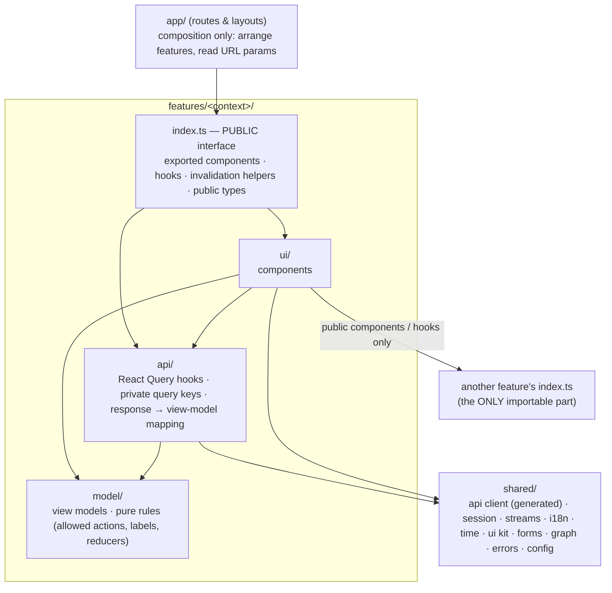

# BusMora — Frontend Technical Design

> **Version:** 1.0 · **Status:** Accepted for build · **Date:** 2026-10-18
> **Scope:** the internal software architecture of the `busmora-frontend` repository (`busmora-web`, Next.js).
> **Builds on:** [SYSTEM-ARCHITECTURE.md](./SYSTEM-ARCHITECTURE.md) (FE-1 now, FE-3 later; contract; auth), [BACKEND-TECHNICAL-DESIGN.md](./BACKEND-TECHNICAL-DESIGN.md) (API conventions), [domain/](./domain/) and `project-docs/`.
> **Design only:** no code. Folder structures are trees.
> **Rule kept:** no technology beyond those named in the source documents. Anything else needed is listed as a gap (Appendix A) and not chosen.
> **Reference knowledge:** the repository's `codebase-design` skill (modules, interfaces, seams, depth) and `domain-modeling` (language, ADR format), applied in the same way as the backend design.

---

## Table of contents
1. [Recap of system-level decisions](#1-recap-of-system-level-decisions)
2. [Internal architecture pattern](#2-internal-architecture-pattern)
3. [Module (feature) boundaries](#3-module-feature-boundaries)
4. [Folder structure](#4-folder-structure)
5. [Design patterns](#5-design-patterns)
6. [Client model layer per feature](#6-client-model-layer-per-feature)
7. [Data access](#7-data-access)
8. [API consumption conventions](#8-api-consumption-conventions)
9. [Cross-cutting concerns](#9-cross-cutting-concerns)
10. [Testing strategy](#10-testing-strategy)
11. [Naming conventions and coding rules](#11-naming-conventions-and-coding-rules)
12. [Walkthrough: adding a feature end to end](#12-walkthrough-adding-a-feature-end-to-end)
13. [Internal decisions (ADRs)](#13-internal-decisions-adrs)
- [Appendix A — Gaps surfaced by this design](#appendix-a--gaps-surfaced-by-this-design)

---

## 1. Recap of system-level decisions

| # | System decision | Consequence for the internal design |
|---|---|---|
| F-1 | **Client-Rendered Application** (SYS ADR-009). The App Router supplies routing and layouts; every application page is a client component; the browser calls `api-http` directly. | All data loading is client-side through React Query. Routes are composition only. |
| F-2 | **Workspace Event Shell later** (FE-3). FE-1 is built to make that move cheap. | One SSE module behind a small interface. Polling isolated per feature. An `events/` slot reserved in each feature. |
| F-3 | **Contract:** code-first `openapi.json` from the backend. The frontend pins a version and generates types with `openapi-typescript`; the client is `openapi-fetch` + React Query (SYS ADR-015). | One generated client in `shared/api`. Features never hand-write request types. |
| F-4 | **Tokens** (SYS ADR-012): 15-minute access token **in memory only**; refresh token in an HttpOnly, `SameSite=Strict` cookie on `/v1/auth/refresh`; `app.` / `api.` same-site subdomains; `Origin` + custom-header check; rotation with reuse detection; multi-tab coordination (`BroadcastChannel` / Web Locks); silent refresh on reload. | One `shared/session` module owns the token. Nothing else touches it. |
| F-5 | **SSE** (SYS ADR-013): a path-scoped HttpOnly **stream cookie** + native `EventSource` with `Last-Event-ID`; reconnect after expiry → 401 → refresh → reopen. | One `shared/streams` module owns every `EventSource`. |
| F-6 | **Canvas:** one stream per running Task (≤ 2 per workspace); Canvas signals `agent_started`, `agent_tool_used`, `agent_completed`, `agent_error`, `flow_connection`; live only; whole-message replies, no token streaming (SYS ADR-020). | The Canvas is a pure reducer over signals, plus a reset path. |
| F-7 | **Screens** (SYS §5.3): auth, onboarding, Marketing Employee (chat + Canvas), Brain, Deliverables, Batch Review, Settings, in-app notifications. | One feature per bounded context; pages compose features. |
| F-8 | **i18n:** Arabic RTL and English LTR UI; dates per locale; scheduling in the **Business Time Zone**. | Direction at the document root; logical (start/end) styling; time helpers built on the browser's `Intl`. |
| F-9 | **Two standalone repositories.** The frontend depends on the backend only through the published contract. | No shared code with the backend except generated types. |

**Stack used in this design:**
- **Framework and UI:** Next.js 14+ (App Router), TypeScript, React Flow, Tailwind CSS / shadcn/ui.
- **Data:** React Query, `openapi-typescript`, `openapi-fetch`.
- **Browser and platform built-ins only:** native `EventSource`, `BroadcastChannel`, Web Locks, `Intl`, `crypto.randomUUID`, and Next.js features (layouts, route groups, error/not-found boundaries, `next/font`).
- **Not chosen:** an i18n library, a form library, a Markdown renderer and a graph-layout library are **not** named by the docs (Appendix A).

---

## 2. Internal architecture pattern

### 2.1 Forces
1. **Eight screen areas** map to the backend's bounded contexts. Four people build them in vertical slices alongside the backend modules.
2. **Many live surfaces** (Canvas, crawl progress, Post statuses, badges) need one consistent approach, which must later switch from polling to a workspace event stream with minimal change.
3. **Strict security rules** on tokens and streams must live in one place.
4. **Arabic-first right-to-left UI** must be the default in every component, not a retrofit.
5. **The same independence rule as the backend:** a change inside one feature must not break or force edits in another.

### 2.2 Alternatives considered

| Alternative | What it is | Fit | Verdict |
|---|---|---|---|
| **A. Type-based folders** | Global `components/`, `hooks/`, `services/`, `types/` | Every feature spreads across four folders. Ownership is invisible and coupling grows silently. Fails forces 1 and 5. | Rejected |
| **B. Feature-Sliced Design (full)** | Fixed layers `app / pages / widgets / features / entities / shared` with strict import rules | Strong boundaries, but the six-layer taxonomy (especially entity vs feature vs widget) costs a student team classification debates. The backend's contexts already give natural slices. | Rejected as a whole (its "public API per slice" and "layers import downward" rules are adopted) |
| **C. Feature modules by bounded context, with internal layers and public interfaces** | `app/` (routes, composition only) → `features/<context>/` (each with `api / model / ui`, one public `index.ts`) → `shared/` (technical kernel) | Mirrors the backend modules one-to-one. One owner per feature. One place each for tokens, streams and the API client. Directly supports the later event-shell switch. | **Chosen** |
| **D. Micro-frontends** | Independently deployed UI pieces | Deployment overhead with no team-scale benefit; contradicts one `busmora-web` deployable | Rejected |
| **E. Global client store as the hub** | All data in one client-side store (Redux-style), API results copied in | Duplicates React Query's server cache and invites stale copies. The docs name React Query as the data layer. | Rejected |

### 2.3 Chosen pattern: feature modules with public interfaces over a shared kernel



**The dependency rule** (enforced in CI by an import-boundary check, §10):
1. `app/` imports **only features' `index.ts`** and `shared/`. Routes contain no data fetching, rules or styling logic beyond layout.
2. Inside a feature:
   - `ui/` may use its own `api/`, its own `model/` and `shared/`.
   - `api/` may use its own `model/` and `shared/`.
   - `model/` is **pure**: no React, no network, no browser APIs.
3. A feature may import **another feature's `index.ts` only**, and only along the allowed directions in §3.3.
4. `shared/` never imports from `features/` or `app/`.
5. Generated code (`shared/api/generated`) is imported only by `shared/api` and by features' `api/` folders. UI never sees raw response types; it sees view models.
6. No cycles between features.

**Why it fits:**
- Each feature is a deep module: a few exported components and hooks hide its queries, keys, mappings and rules.
- Security-sensitive and real-time code each has exactly one home.
- Moving to the event shell touches `shared/streams` plus each feature's new `events/` folder, not the screens.

---

## 3. Module (feature) boundaries

### 3.1 Features

| Feature | Backend context | Owns | Public interface (`index.ts`) |
|---|---|---|---|
| `auth` | Identity & Workspace | Register, verify email, login, logout, password reset screens; `useCurrentUser` | `LoginScreen`, `RegisterScreen`, `VerifyEmailScreen`, `ResetPasswordScreen`, `useCurrentUser()` |
| `onboarding` | Identity / Market Intelligence | Website URL entry, crawl progress, Business Time Zone setup | `OnboardingScreen`, `CrawlProgressBadge` |
| `employee` | Marketing Employee | Conversation list, chat thread, the 7 message types, the structured-form renderer, Quick Replies, task status messages | `EmployeeScreen` (chat + Canvas layout), `ConversationList` |
| `canvas` | Marketing Employee (live view) | The live Task graph (Orchestrator + 5 Sub-agents), signal reducer, reset handling | `TaskCanvas({ taskId })`, `useTaskCanvas(taskId)` |
| `brain` | Business Brain | Graph view, Candidate Review (7 sections), item side panel (view / edit / retire), manual items and Relationships, filters and search, Provenance/Snapshot view, Conflicts, Brand Kit facts | `BrainScreen`, `CandidateReviewScreen`, `PendingCandidatesBadge`, `invalidateBrain()` |
| `deliverables` | Deliverables | List with type/date filters and cursor pagination, full viewer (Markdown and structured), Deliverable card | `DeliverablesScreen`, `DeliverableViewer({ id })`, `DeliverableCard({ deliverable })`, `invalidateDeliverables()` |
| `publishing` | Governed Publishing | Batch Review grid and list, per-Post actions, bulk approve/reject remaining, reschedule, retry, failure reasons, batch-review session timing | `BatchReviewScreen`, `SendToBatchReviewAction({ deliverableId })`, `invalidatePosts()` |
| `connections` | Channel Connections | Connected Accounts list, connect/disconnect, Reconnect Needed, lazy connect prompt, OAuth return handling | `ConnectionsPanel`, `ConnectPrompt({ platform })`, `OAuthReturnScreen` |
| `settings` | Identity & Workspace | Account, Business Time Zone, UI language | `SettingsScreen` |
| `notifications` | Notifications | In-app notification list, unread badge, mark read | `NotificationBell`, `invalidateNotifications()` |

### 3.2 Shared kernel (`shared/`, no business rules)

| Area | Provides | Seam |
|---|---|---|
| `shared/api` | The single `openapi-fetch` client: base URL, bearer token from `session`, credentials for cookies, idempotency-key header helper, error-envelope normalization, cursor-pagination helpers. `generated/` holds the types. | `ApiClient` (real / test double backed by a mock server, which is a tooling gap) |
| `shared/session` | In-memory access token, silent refresh on load, coordinated refresh across tabs (`BroadcastChannel` + Web Locks), one retry on 401, logout broadcast, unauthenticated redirect signal | Session store (real / test fake) |
| `shared/streams` | The **only** creator of `EventSource`. `subscribeTaskStream(taskId, onSignal, onReset)` returns an unsubscribe function. Validates the SSE envelope; handles heartbeats, reset and 401 → refresh → reopen. | `StreamSource` (native / test fake) |
| `shared/i18n` | Message catalogues (ar, en), `t(key)`, current language, document direction | Adapter over an i18n library (open, OD-7) |
| `shared/time` | Formatting in the Business Time Zone (`Intl`); converting a wall-clock time picked in the business zone into `{ instant, zone }`; relative times | — (pure) |
| `shared/ui` | Owned shadcn/ui components, right-to-left-safe layout primitives, toasts, dialogs, empty/error states, the app shell's navigation | — |
| `shared/forms` | Building blocks for forms: field wrappers, validation messages, idempotent submit | Adapter over a form library (open, OD-19) |
| `shared/graph` | React Flow wrappers used by the Canvas and the Brain graph: node/edge base styles, viewport, left-to-right graph container | Layout algorithm port (library open) |
| `shared/markdown` | Safe rendering of Deliverable Markdown | Adapter over a renderer + sanitizer (open, OD-19) |
| `shared/errors` | Maps error codes to i18n messages; route error boundaries; conflict and reconnect helpers | — |
| `shared/config` | Typed public runtime configuration (api base URL, polling intervals), validated at startup | — |
| `shared/telemetry` | Client error reporting hook | Sink open (OD-13) |

### 3.3 How features communicate: only through public interfaces

**Allowed:**

| Mechanism | When | Rule |
|---|---|---|
| **Page composition** | A route needs several features side by side (Employee screen = `ConversationList` + chat + `TaskCanvas`) | The page in `app/` arranges features' exported components and passes **ids and props only** |
| **Exported component / hook** | One feature renders another's UI inside its own (the chat shows a `DeliverableCard`; a content Deliverable offers `SendToBatchReviewAction`; Batch Review shows `ConnectPrompt`) | Import only from the other feature's `index.ts`. Props are **public types** declared in that `index.ts` (view-model shapes), never the provider's internal types. |
| **Invalidation helper** | An action in one feature makes another feature's data stale (a Review changes the badge count; a completed Task creates Deliverables) | Call the exported `invalidateX()` helper. **Never** read or write another feature's query keys or cache directly. |
| **Shared kernel** | Session, API client, streams, i18n, time, UI kit | Through `shared/` only |

**Fixed dependency directions:**
```
employee ─► canvas, deliverables (DeliverableCard), brain (PendingCandidatesBadge link)
deliverables ─► publishing (SendToBatchReviewAction)
publishing ─► connections (ConnectPrompt)
onboarding ─► brain (PendingCandidatesBadge)
settings ─► connections (ConnectionsPanel)
app/ ─► every feature's index.ts
auth, notifications, canvas, connections, brain ─► (nothing but shared)
```

**Forbidden:**
1. Importing another feature's `ui/`, `api/`, `model/` or `events/` (deep imports).
2. Reading, writing or invalidating another feature's React Query keys directly.
3. Global mutable state shared between features (module-level variables, a global client store).
4. Creating an `EventSource`, calling `fetch` or touching tokens outside `shared/streams`, `shared/api` and `shared/session`.
5. Passing raw generated API types across a feature's public interface. Features export **their own view-model types**.
6. Business rules in `app/` routes.
7. Cycles in the graph above.

### 3.4 A change inside a feature never breaks another

| Change inside feature F | Other features affected? |
|---|---|
| Component structure, styling, internal components | **No** (only exported components are visible) |
| Query keys, hooks' internals, caching options, polling intervals | **No** (keys are private; others only call `invalidateF()`) |
| Mapping from API types to view models; F's use of a changed API endpoint | **No**, as long as F's exported view-model types keep their shape |
| Internal model rules (allowed actions, labels, reducers) | **No** |
| **Additive change to F's `index.ts`**: new optional prop, new export | **No** |
| **Breaking change to F's `index.ts`**: removing or retyping a prop or export | **Not in place.** Add the new export next to the old one, migrate consumers, then remove the old one. |

**Enforcement:**
- The CI import-boundary check (deep imports fail the build).
- TypeScript compile errors: they appear only if a public type changed, which is visible in review.
- A public-interface test per feature (§10).
- A pull-request rule: any change to a feature's `index.ts` is called out and must be additive.

---

## 4. Folder structure

```
busmora-frontend/
├── src/
│   ├── app/                                  # Next.js App Router: routes and layouts ONLY (composition)
│   │   ├── layout.tsx                        # root document: lang + dir, fonts (next/font), global styles
│   │   ├── providers.tsx                     # client providers: QueryClient, i18n, session, streams
│   │   ├── (public)/                         # unauthenticated routes
│   │   │   ├── login/                        # renders auth's LoginScreen
│   │   │   ├── register/                     # renders auth's RegisterScreen
│   │   │   ├── verify-email/                 # renders auth's VerifyEmailScreen
│   │   │   └── reset-password/               # renders auth's ResetPasswordScreen
│   │   ├── (app)/                            # authenticated workspace (client-rendered)
│   │   │   ├── layout.tsx                    # session gate, app shell navigation, NotificationBell
│   │   │   ├── onboarding/                   # OnboardingScreen
│   │   │   ├── employee/                     # EmployeeScreen (+ optional conversation id segment)
│   │   │   ├── brain/                        # BrainScreen
│   │   │   │   └── candidates/               # CandidateReviewScreen
│   │   │   ├── deliverables/                 # DeliverablesScreen
│   │   │   │   └── [id]/                     # DeliverableViewer
│   │   │   ├── batch-review/                 # BatchReviewScreen
│   │   │   └── settings/                     # SettingsScreen
│   │   │       └── connections/              # ConnectionsPanel
│   │   ├── connect/
│   │   │   └── [platform]/return/            # OAuthReturnScreen (landing after OAuth via api callback)
│   │   ├── error.tsx                         # top-level error boundary (shared/errors UI)
│   │   └── not-found.tsx                     # not-found page
│   ├── features/                             # one folder per bounded context
│   │   ├── auth/
│   │   │   ├── index.ts                      # PUBLIC interface (screens, useCurrentUser, public types)
│   │   │   ├── api/                          # React Query hooks + private query keys + mapping
│   │   │   ├── model/                        # view models, pure rules
│   │   │   └── ui/                           # components
│   │   ├── onboarding/                       # same layout (index.ts, api/, model/, ui/)
│   │   ├── employee/                         # same layout; ui/ includes the message-type renderers
│   │   │   └── ui/structured-form/           # renders server-provided form schemas (FR-032)
│   │   ├── canvas/                           # same layout; model/ holds the signal reducer
│   │   ├── brain/                            # same layout; ui/ includes graph view, review sections, side panel
│   │   ├── deliverables/                     # same layout; ui/ includes the viewer and calendar rendering
│   │   ├── publishing/                       # same layout; model/ holds allowed-actions per Post status
│   │   ├── connections/                      # same layout
│   │   ├── settings/                         # same layout
│   │   └── notifications/                    # same layout
│   │   # each feature gains events/ when the Workspace Event Shell arrives (FE-3)
│   ├── shared/                               # technical kernel; no business rules; never imports features
│   │   ├── api/
│   │   │   ├── generated/                    # openapi-typescript output from the pinned contract (never edited)
│   │   │   ├── client                        # the single openapi-fetch client + auth/credentials wiring
│   │   │   ├── errors                        # error-envelope normalization to typed errors
│   │   │   ├── idempotency                   # Idempotency-Key creation per user intent
│   │   │   └── pagination                    # cursor helpers for infinite/paged lists
│   │   ├── session/                          # in-memory token, refresh coordinator, 401 retry, logout broadcast
│   │   ├── streams/                          # the only EventSource owner; envelope validation; reset/reconnect
│   │   ├── i18n/                             # catalogues ar/en, t(), language + direction (library open)
│   │   │   └── messages/                     # message catalogues per feature namespace
│   │   ├── time/                             # Intl formatting in the Business Time Zone; wall-time ↔ {instant, zone}
│   │   ├── ui/                               # owned shadcn/ui components, RTL-safe primitives, app shell parts
│   │   ├── forms/                            # field primitives, validation display, idempotent submit (library open)
│   │   ├── graph/                            # React Flow wrappers for Canvas and Brain graph; layout port
│   │   ├── markdown/                         # safe Markdown rendering adapter (library open)
│   │   ├── errors/                           # code → message mapping; boundary components; conflict UI
│   │   ├── config/                           # typed runtime config (api base URL, polling intervals)
│   │   └── telemetry/                        # client error reporting hook (sink open)
│   └── test/
│       ├── fakes/                            # fake session, fake stream source, API mock setup
│       ├── builders/                         # view-model and response builders
│       └── architecture/                     # import-boundary checks
├── e2e/                                      # end-to-end journeys against a running backend (Docker Compose)
├── contracts/
│   └── api/                                  # pinned openapi.json version consumed by type generation
├── scripts/                                  # pull contract version, generate types, check drift
├── public/                                   # static assets (icons; fonts if self-hosted)
└── ci/                                       # pipeline definitions (CI tooling open, OD-16)
```

---

## 5. Design patterns

### 5.1 Patterns used

| Pattern | Where | Problem it solves |
|---|---|---|
| **Feature module with a public interface** | `features/<context>/index.ts` | Independence between features: internal changes never ripple (§3.4) |
| **Composition at the route** | `app/` pages | Features stay unaware of each other's layout; pages arrange them |
| **Server-state cache (React Query)** | every feature's `api/` | One source of truth for API data: deduplication, refetching, polling, invalidation |
| **Query-key factory (private per feature)** + exported invalidation helpers | `features/*/api` | Keys never leak; cross-feature staleness goes through an interface |
| **View model + mapper** | `api/` maps generated response types → `model/` view models | UI is insulated from contract changes; one place to adapt to a new API version |
| **Pure reducer / state machine** | `canvas/model` (signals → node states), `publishing/model` (allowed actions per Post status) | Predictable, unit-testable UI logic; the Post rules mirror the backend state machine, for display only |
| **Single gateway modules** | `shared/api`, `shared/session`, `shared/streams` | One place for tokens, credentials, retries, error normalization and stream lifecycles (security and FE-3 readiness) |
| **Adapter over open libraries** | `shared/i18n`, `shared/forms`, `shared/markdown`, `shared/graph` layout | The library choice (still open) can land without touching features |
| **Coordinator (leader election across tabs)** | `shared/session` refresh via Web Locks + `BroadcastChannel` | Exactly one refresh at a time; no false reuse detection (SYS ADR-012) |
| **Idempotent command submission** | `shared/api/idempotency` + mutations | One key per user intent, reused on retry, so a double click or network retry never duplicates a Task, approval or upload |
| **Schema-driven rendering** | `employee/ui/structured-form` | Clarification forms come from the server as data (field kinds + "Search Yourself"), so new forms need no frontend release |
| **Error boundary per route segment** | `app/**/error.tsx` + `shared/errors` | A failure in one screen doesn't take down the shell |
| **Polling strategy isolated per feature** | the `refetchInterval` option in the feature's `api/` | Can be swapped for event-driven updates feature by feature (FE-3) |

### 5.2 Patterns deliberately avoided

| Avoided | Why |
|---|---|
| Global client store mirroring API data | Duplicates the React Query cache; stale copies |
| Optimistic updates on governed actions (Approval, Review, publish retry, cancel) | Governance must reflect the backend's verdict: version conflicts, invalid transitions. Optimistic updates are used only for UI-only state such as marking a notification read. |
| Server Components, Server Actions, BFF route handlers | Rejected at system level (FE-2). Tokens never go through a Next.js server. |
| Next.js middleware for auth | The access token lives only in browser memory, so middleware can't see it; the session gate is client-side |
| Direct `fetch` / `EventSource` in components | Would bypass auth, credentials, error normalization and reconnect rules |
| Physical left/right styling | Breaks right-to-left; logical start/end utilities only |
| Token-by-token text animation | Replies are whole messages (SYS ADR-020) |
| Shared "utils" with business logic | Business rules live in a feature's `model/` |

---

## 6. Client model layer per feature

The frontend's model layer holds **view models and display rules only**. The backend remains the authority on every rule; the frontend mirrors rules only to show allowed actions and states.

| Feature | View models | Pure rules / reducers |
|---|---|---|
| `auth` | `CurrentUser` (id, email, verified, UI language) | Password-field requirements for display |
| `onboarding` | `CrawlProgress` (pages crawled ≤ 10, estimated completion, outcome) | Progress display; partial/failed messaging |
| `employee` | `ConversationSummary`, `MessageView` (7 kinds: text, text response, structured form, task status, deliverable card, knowledge notification, error), `StructuredFormView` (fields: text, radio, checkbox, dropdown; per-field Search Yourself) | Message-kind → renderer mapping; form answer assembly (a field is answered or marked Search Yourself) |
| `canvas` | `CanvasState`: nodes (Orchestrator + Market Research, Competitor Analysis, Content Writer, Campaign Planner, Social Poster) with state idle / active / completed / error, active tool label, animated connections | `applySignal(state, signal)`: the five signal types; `reset()` on a reset event; error shown only if user-visible |
| `brain` | `KnowledgeItemView` (category, title, summary, properties, status, version, provenance), `RelationshipView`, `CandidateView` (+ review section), `ConflictView`, `BrandKitView`, `GraphView` | Category → review-section mapping, as supplied by the API (OD-18); allowed actions per status (approve, edit-and-approve, reject; retire for approved); filters |
| `deliverables` | `DeliverableSummary`, `DeliverableView` (type, title, Markdown or structured content, citations, partial flag), `ContentCalendarView` | Type → viewer mapping |
| `publishing` | `PostView` (platform, `ScheduledTimeView` in the business zone, status, current version id, Brand Visual preview, failure reason), `BatchReviewView` | `allowedActions(status)`, mirroring SYS §3.4: approve/reject/edit/regenerate in pending; cancel in approved/scheduled; reschedule in expired; retry in failed. "Remaining" selection for bulk actions. Session timer start/stop. |
| `connections` | `ConnectedAccountView` (platform, status: connected / reconnect needed / disconnected) | Connect-prompt need (no connected account for a platform) |
| `settings` | `WorkspaceSettingsView` (Business Time Zone, UI language) | — |
| `notifications` | `NotificationView` (kind, subject link, read) | Unread count |

**Glossary rule:** view-model names and labels use [domain/GLOSSARY.md](./domain/GLOSSARY.md) terms (Post, Post Version, Approval, Review, Knowledge Item, Candidate, Task, Clarification, Canvas). Translations are in the i18n catalogues, not in code.

---

## 7. Data access

### 7.1 API client
- **One client instance** in `shared/api/client`: `openapi-fetch` typed by `shared/api/generated`.
  - Base URL from `shared/config`.
  - Bearer token injected from `shared/session`.
  - `credentials: include` on the auth refresh call, for the refresh cookie.
- On **401**, the client asks `shared/session` to refresh (coordinated across tabs) and retries **once**. A second 401 signals "unauthenticated", and the shell redirects to login.
- Every non-2xx response is normalized to a typed `ApiError { code, messageKey, details, correlationId, status }` from the backend error envelope.

### 7.2 Queries and mutations (inside each feature's `api/`)
- **Queries:**
  - React Query hooks named `use<Noun>Query`.
  - Keys come from a **private** key factory, always including the workspace scope implied by the session.
  - Responses are mapped to view models in a `select` step, so components receive view models only.
- **Mutations:**
  - Named `use<Verb><Noun>Mutation`.
  - Each user intent gets an **Idempotency-Key** (`crypto.randomUUID`), held until success or abandonment, so retries reuse it.
  - Commands on Posts carry `postVersionId`; commands on Knowledge Items carry `version`.
  - On success, invalidate the feature's own keys and call the exported `invalidateX()` helpers of affected features.
  - Governed actions are **not optimistic** (§5.2).
- **Lists:** cursor pagination (`limit`, `cursor` → `{ items, nextCursor }`). Filters live in the URL search params, so views are shareable and survive reloads.
- **Polling** (FE-1) is declared only in the owning feature's query options:
  - crawl progress while a crawl runs;
  - Post statuses on Batch Review while any Post is `scheduled` or `publishing`;
  - notification badge;
  - pending-Candidate badge.

  Intervals come from `shared/config` (values open).

### 7.3 Real-time
- `canvas` subscribes through `shared/streams.subscribeTaskStream(taskId, …)` while a Task is running (at most 2 per workspace). Signals go through `applySignal`.
- On first load, or on a **reset** event or a replay gap, the Canvas fetches `GET /v1/tasks/{id}/canvas`, redraws from it, and opens the stream with `?after=<asOfEventId>` (BACKEND §8.1.3). Repeated resets are retried a bounded number of times.
- Task-status chat messages are persisted by the backend and arrive through the `employee` conversation query, which refetches when the Task's stream reports completion or failure.
- **The future event shell:** `shared/streams` gains `subscribeWorkspaceStream`, each feature adds `events/` handlers that update its own cache, and polling options are removed. Screens don't change.

### 7.4 Local state
- **UI state:** component-local (open panels, selections in Batch Review, draft form values).
- **URL state:** filters, cursors, the selected conversation and Deliverable id.
- **Session state:** only in `shared/session`, never in React context as a raw token.
- **No `localStorage` / `sessionStorage` for tokens, ever.** Non-sensitive preferences (UI language) come from the user's profile through the API.

---

## 8. API consumption conventions

| Topic | Convention |
|---|---|
| **Contract version** | `contracts/api/openapi.json` is pinned. Upgrading is a deliberate pull request: pull the new version, regenerate types, fix compile errors in features' `api/` mappers only. |
| **Generated types** | Never edited. Never exported across a feature's public interface (view models are). |
| **Routing** | Calls use the backend's `/v1` resources and action sub-resources (e.g. `POST /v1/posts/{id}/approve`), exactly as the contract defines. |
| **Validation** | Client-side validation helps the user (required fields, formats). The server's validation is authoritative; `VALIDATION_FAILED` details map onto form fields. |
| **Errors** | `shared/errors` maps codes to i18n messages and actions: `STALE_VERSION` → refetch + "this changed; review again"; `INVALID_TRANSITION` → refetch; `RECONNECT_NEEDED` → show `ConnectPrompt`; `CAPACITY_QUEUED` → "queued" state; `RATE_LIMITED` → retry later; 5xx → generic message with correlation id. |
| **Idempotency** | Required header on: send message / start Task, send to Batch Review, approve, bulk approve / reject, start review session, retry publish, uploads. One key per user intent. |
| **Concurrency** | Always send the version the user saw (`postVersionId`, `version`). |
| **Time** | Send `{ instant, zone }` for Scheduled Times. Show every time in the Business Time Zone, labelled with the zone. |
| **Asynchronous work** | Treat 202 + id as "started"; show progress from SSE or polling. |
| **Streams** | Only through `shared/streams`; the stream cookie is sent automatically (native `EventSource` with credentials). |
| **Uploads** | Performance CSV via multipart through `shared/api`; size limit shown from config once defined. |
| **Pagination** | Cursor-based infinite lists; never compute offsets. |

---

## 9. Cross-cutting concerns (only what the docs require)

### 9.1 Authentication and authorization
- **App load:**
  1. `shared/session` calls the refresh endpoint (cookie + required custom header).
  2. On success it holds the 15-minute access token in memory. The backend also sets the stream cookie.
  3. On failure, the `(app)` layout redirects to login.
- **Multi-tab:**
  - One tab refreshes, holding a Web Lock; the others receive the new token over `BroadcastChannel`.
  - Logout is broadcast to all tabs.
  - The server's 10-second grace window covers races.
- **Authorization:** one role (the User of the workspace). The UI hides nothing for permission reasons; the backend enforces workspace scope. A 403/404 shows not-found.
- **OAuth connect:** the browser is sent to the api's start URL; the api handles the platform callback and redirects to `/connect/[platform]/return`, which refetches `connections` and resumes the pending action (e.g. send to Batch Review).

### 9.2 Configuration
`shared/config` reads Next.js public environment variables, validates them once at startup, and exposes typed values:
- api base URL;
- polling intervals;
- pagination page size;
- the upload size limit, when defined.

No secrets exist in the frontend.

### 9.3 Logging and error reporting
- Client errors go through `shared/telemetry` with the correlation id from `ApiError` (sink open, OD-13).
- Tokens, cookies, form contents and personal data are never logged.

### 9.4 Error handling
- **Route-level error boundaries** keep the shell alive.
- **Feature-level** empty, error and retry states use shared components.
- **Mutation errors** are mapped by code (§8).
- **Network loss:** queries retry with backoff, except 4xx. Streams reconnect natively. No offline mode (PRD §16).

### 9.5 Caching
- React Query is the only cache. Stale times per query are defined in each feature's `api/`.
- No service worker and no persistent cache, because offline mode is not planned.

### 9.6 Internationalization and right-to-left
- The document root carries `lang` and `dir` from the UI language (ar → rtl, en → ltr). Switching language switches both without a reload.
- Styling uses **logical** utilities only (start/end, inline padding/margin); physical left/right classes are forbidden.
- Icons with direction (arrows, chevrons) flip by direction.
- **Graph canvases** (Canvas, Brain graph) render inside a fixed left-to-right coordinate container so layout math stays stable; labels inside nodes follow the UI language.
- Text from generated content is shown with its own direction (Arabic or English, including mixed text with product names in English).
- An Arabic + Latin font pair is loaded through `next/font` (font choice open).
- **Dates and times:** `shared/time` formats with `Intl.DateTimeFormat` in the **Business Time Zone** and the UI locale. Wall-clock picks are converted to `{ instant, zone }` by a pure helper that handles daylight-saving transitions and is unit-tested.

### 9.7 Background work
None in the frontend beyond polling (§7.2) and live streams (§7.3). Long Tasks continue on the server when the browser closes (PRD §13.4); on return, queries show the result.

### 9.8 Evaluation instrumentation (required by EVAL §8)
- Batch Review session timing: `publishing` starts a session when the Batch Review screen opens (`POST /v1/batch-review/sessions`) and ends it when every Post is decided (`finished`) or the User leaves the screen (`left`). The backend measures activity and closes abandoned sessions itself (BACKEND §8.1.2).
- "Approve/reject all remaining" sends the undecided Posts on screen with their versions to `POST /v1/posts/bulk-approve` / `bulk-reject` and shows the per-item outcomes (BACKEND §8.1.1).
- Edits and approvals are captured server-side from the normal commands.

---

## 10. Testing strategy

Frameworks are still open (OD-12); this strategy is framework-neutral. **The public interface is the test surface**, matching the backend.

| Layer / target | What is tested | How |
|---|---|---|
| **Feature `model/`** | Pure rules: `applySignal`, `allowedActions(status)`, message-kind mapping, form answer assembly | In-process unit tests, table-driven (every Post status, every signal) |
| **`shared/time`** | Formatting in a zone; wall-time → instant across daylight-saving changes in Egypt and GCC zones | Pure unit tests |
| **`shared/session`** | Silent refresh, 401 → single refresh → retry, multi-tab single refresh, logout broadcast | Unit tests with fake channel and lock |
| **`shared/streams`** | Envelope validation, heartbeat, reset, reconnect with `Last-Event-ID`, 401 → refresh → reopen | Tests with a fake `StreamSource` |
| **Feature `api/`** | Hooks map responses to view models, send idempotency keys and versions, invalidate the right helpers | Tests against an API mock generated from the pinned contract (tool open) |
| **Feature public interface** | Each feature's exported components and hooks render and behave as documented, in Arabic (RTL) and English (LTR) | Component tests through `index.ts` only |
| **Architecture** | Import boundaries (§2.3, §3.3), no `EventSource`/`fetch`/token access outside shared gateways, no physical left/right classes | Static checks in CI (tool open) |
| **Contract** | Generated types are up to date with the pinned version; the app compiles | CI step |
| **End-to-end journeys** | Onboarding → Review; message → Task → Canvas → Deliverable; Batch Review → connect → approve → status; expired → reschedule | Against the backend running in Docker Compose (cross-repo setup open, OD-17) |

---

## 11. Naming conventions and coding rules

### 11.1 Naming

| Item | Convention | Example |
|---|---|---|
| Domain terms | Glossary terms only | `PostView`, `CandidateReviewScreen`, `TaskCanvas` |
| Files | kebab-case | `batch-review-screen.tsx`, `allowed-actions.ts`, `use-posts-query.ts` |
| Components | PascalCase; screens end with `Screen` | `DeliverableViewer`, `BrainScreen` |
| Hooks | `use<Noun>Query`, `use<Verb><Noun>Mutation`, `use<Thing>` | `usePostsQuery`, `useApprovePostMutation`, `useTaskCanvas` |
| View models | `<Noun>View` | `KnowledgeItemView` |
| Invalidation helpers | `invalidate<Feature>()` | `invalidatePosts()` |
| i18n keys | `<feature>.<area>.<key>` | `publishing.actions.approve` |
| Routes | kebab-case, nouns | `/batch-review`, `/brain/candidates` |

### 11.2 Coding rules
1. **Features speak only through `index.ts`.** No deep imports, no foreign query keys, no shared mutable state (§3.3).
2. **Routes compose; features implement.** No data fetching or rules in `app/`.
3. **Only `shared/api` talks HTTP, only `shared/streams` opens streams, only `shared/session` touches tokens.**
4. **UI receives view models, never generated response types.**
5. **No hard-coded user-facing strings**; every label goes through `shared/i18n`.
6. **Logical styling only** (start/end); never left/right.
7. **Times are formatted only through `shared/time`**, in the Business Time Zone.
8. **Every non-idempotent command carries an idempotency key**; every governed command carries the version the user saw.
9. **No optimistic updates on governed actions.**
10. **Generated code is never edited**; contract upgrades are deliberate pull requests.
11. **Public interface changes are additive**; a breaking change adds a new export first.
12. **Strict TypeScript:** no implicit `any`; exhaustive switches over statuses and message kinds.
13. **No tokens, cookies or personal data in logs or telemetry.**
14. **The Canvas holds no durable state**; on reset, it refetches.

---

## 12. Walkthrough: adding a feature end to end

**Example: "Reschedule an expired Post"**, the frontend half of the backend walkthrough.

| # | Step | Where | What to do |
|---|---|---|---|
| 1 | **Confirm the language** | domain/GLOSSARY.md | Post, Expired Post, Scheduled Time, Business Time Zone |
| 2 | **Locate the owning feature** | §3.1 | `publishing` |
| 3 | **Wait for or pull the contract** | `contracts/api` | The backend merges `POST /v1/posts/{id}/reschedule` (signature first). Pull the new version and regenerate `shared/api/generated`. The build must pass unchanged elsewhere, because the change is additive. |
| 4 | **Model rule** | `publishing/model/allowed-actions` | Add `reschedule` as allowed only for `expired`. Unit-test the full status table. |
| 5 | **Mutation** | `publishing/api` | Add `useReschedulePostMutation`. It sends `{ instant, zone }` built by `shared/time` from the user's pick, plus an idempotency key and `postVersionId`. On success it invalidates its own Post keys; if the badge depends on it, it calls `invalidateNotifications()`. |
| 6 | **UI** | `publishing/ui` | Add a "Reschedule" action and a date-time picker in the Business Time Zone (zone labelled). Map errors: `INVALID_TRANSITION` / `STALE_VERSION` → refetch and explain. |
| 7 | **i18n** | `shared/i18n/messages/publishing` | Add Arabic and English strings; check right-to-left layout. |
| 8 | **Public interface** | `publishing/index.ts` | Nothing to export (the action is internal to Batch Review), so no other feature changes. |
| 9 | **Tests** | `publishing` model, api and public-interface tests; e2e | Model table; mutation sends key/version/zone; Batch Review shows the action only for expired Posts in both directions; e2e: expire → reschedule → pending approval. |
| 10 | **Review checklist** | pull request | No deep imports; no physical left/right classes; no new `fetch`/`EventSource`; contract version bumped deliberately |

---

## 13. Internal decisions (ADRs)

### FTD-ADR-01 — Feature modules by bounded context with public interfaces
- **Context:** eight screen areas, 4 developers, and a requirement that changes inside one area never break another.
- **Decision:**
  - `features/<context>/` mirrors the backend modules, with `api/`, `model/` and `ui/` layers.
  - `index.ts` is the only importable surface; routes in `app/` compose features.
- **Considered:** type-based folders; full Feature-Sliced Design; micro-frontends; a global store hub (§2.2).
- **Consequences:** clear ownership, and the same mental model as the backend. Boundaries are enforced by CI import checks and additive public-interface rules.

### FTD-ADR-02 — React Query is the only server-state store
- **Decision:** all API data lives in React Query, keyed privately per feature. Cross-feature staleness goes through exported `invalidateX()` helpers.
- **Considered:** a global client store; sharing query keys across features.
- **Consequences:** no duplicate caches, and a feature's keys can change freely.

### FTD-ADR-03 — Three gateway modules: `shared/api`, `shared/session`, `shared/streams`
- **Context:** the token, cookie and stream rules (SYS ADR-012/013) are security-critical, and FE-3 will replace polling with a workspace stream.
- **Decision:** only these modules call HTTP, hold the token and open `EventSource`.
- **Considered:** calls from each feature directly: rules would be duplicated and drift.
- **Consequences:** one place to review security. The move to FE-3 changes `shared/streams` plus per-feature `events/` handlers only.

### FTD-ADR-04 — View models at feature boundaries; generated types stay inside `api/`
- **Decision:** features map generated response types to their own view models, and export only view models.
- **Considered:** using generated types throughout the UI.
- **Consequences:** a contract upgrade touches mappers, not components or other features.

### FTD-ADR-05 — No optimistic updates on governed actions
- **Decision:** Approval, Review, publish retry, cancel and reschedule wait for the backend's response, then invalidate.
- **Considered:** optimistic UI for speed.
- **Consequences:** a slightly slower feel on those actions, in exchange for the UI never showing a state the backend rejected (version conflicts, invalid transitions).

### FTD-ADR-06 — Polling isolated in the owning feature (FE-1), replaceable by events (FE-3)
- **Decision:** polling is declared only in feature query options, with intervals from config.
- **Considered:** a global poller.
- **Consequences:** FE-3 migrates feature by feature.

### FTD-ADR-07 — Right-to-left by default: document direction + logical styling; graphs in a left-to-right container
- **Decision:**
  - `dir`/`lang` on the root, switching with the UI language.
  - Logical utilities only.
  - Graph canvases use a fixed left-to-right coordinate space with localized labels.
- **Considered:** mirroring graph coordinates in right-to-left: layout complexity for no clarity gain.
- **Consequences:** a lint rule against physical classes (tool open).

### FTD-ADR-08 — Time handled with `Intl` in the Business Time Zone
- **Decision:** `shared/time` formats with `Intl` and converts wall time to `{ instant, zone }` with a pure, tested helper. No date library.
- **Considered:** adding a date library (not in the docs).
- **Consequences:** daylight-saving edge cases are covered by dedicated tests.

### FTD-ADR-09 — Client-side session gate; no Next.js middleware auth
- **Decision:** the `(app)` layout gates on `shared/session` after a silent refresh.
- **Considered:** middleware redirects. They can't see an in-memory token.
- **Consequences:** a brief loading state on first load.

### FTD-ADR-10 — Schema-driven Structured Forms
- **Decision:** `employee/ui/structured-form` renders forms from the server's message payload (field kinds, options, Search Yourself).
- **Considered:** a hard-coded component per form.
- **Consequences:** new Clarification forms need no frontend release. The renderer must cover all four field kinds.

### FTD-ADR-11 — Adapters over still-open libraries
- **Decision:** i18n, forms, Markdown rendering and graph layout sit behind `shared/*` adapters.
- **Consequences:** when OD-7 / OD-19 / the layout choice are made, only the adapter changes.

### FTD-ADR-12 — Owned UI kit
- **Decision:** shadcn/ui components are copied into `shared/ui` (owned code), adapted once for right-to-left and the brand.
- **Consequences:** features use only `shared/ui`, with no direct styling of third-party components.

---

## Appendix A — Gaps surfaced by this design

These are not decided here. They add to SYS §9.2 and the backend's Appendix A.

| # | Gap | Needed for | Related |
|---|---|---|---|
| FG-1 | i18n library (catalogues, plurals, interpolation) | `shared/i18n` | OD-7 |
| FG-2 | Form library and validation display | `shared/forms` | OD-19 |
| FG-3 | Markdown renderer + sanitizer | `shared/markdown`, Deliverable viewer | OD-19 |
| FG-4 | Graph auto-layout algorithm/library for the Brain graph (and Canvas positions) | `shared/graph` | new |
| FG-5 | Test frameworks; API mock server from OpenAPI; end-to-end tool | §10 | OD-12, OD-17 |
| FG-6 | Import-boundary and styling lint tooling (deep imports, physical left/right classes) | §2.3, §11 | new (matches backend G-2) |
| FG-7 | Client error-reporting sink | `shared/telemetry` | OD-13 |
| FG-8 | Arabic + Latin font choice | `next/font` setup | new |
| FG-9 | Values: polling intervals, page sizes, upload size limit, Canvas grace window | `shared/config` | OD-18 |
| FG-10 | **Contract additions:** (a) bulk approve/reject with versions, (b) Batch Review session start/end and (c) the Canvas snapshot are **resolved** in BACKEND §8.1. Still open: (d) the Review-section mapping per Candidate (OD-18). | §6, §7.3, §9.8 | backend API |
| FG-11 | Accessibility and supported browsers | all UI | SYS §9.3 |
| FG-12 | Workspace in the URL or implied by the token. Routes in §4 assume it is implied; if it moves into the path, `app/(app)/` gains a `[workspaceId]` segment and query keys take it from the route. | §4, §7.2 | OD-20 |
