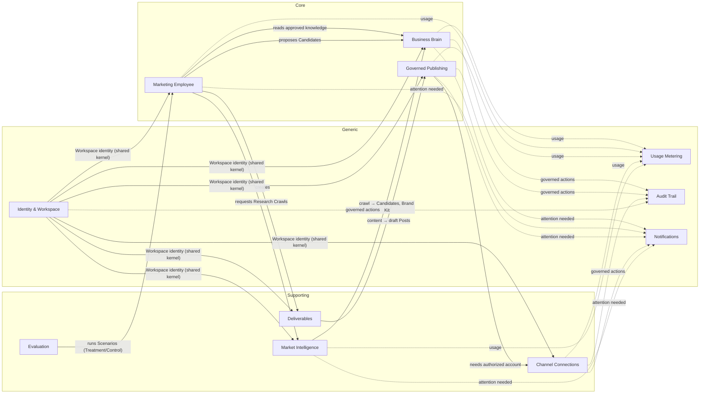
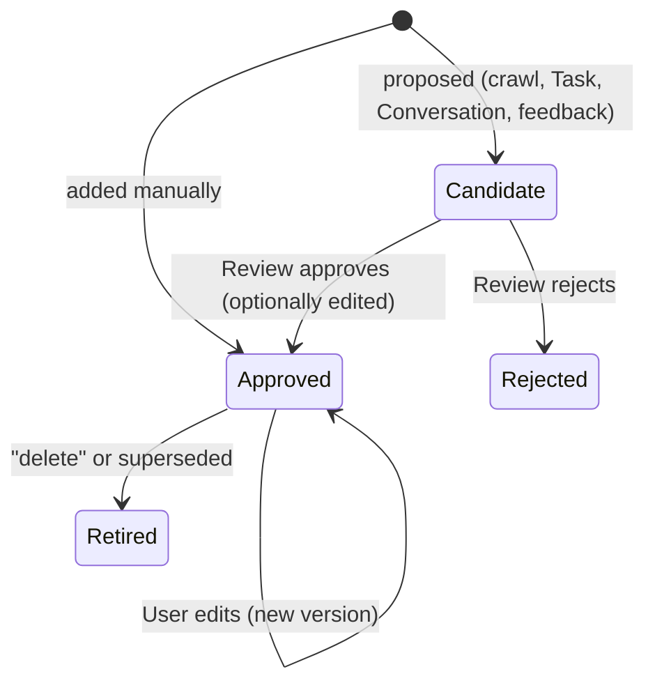
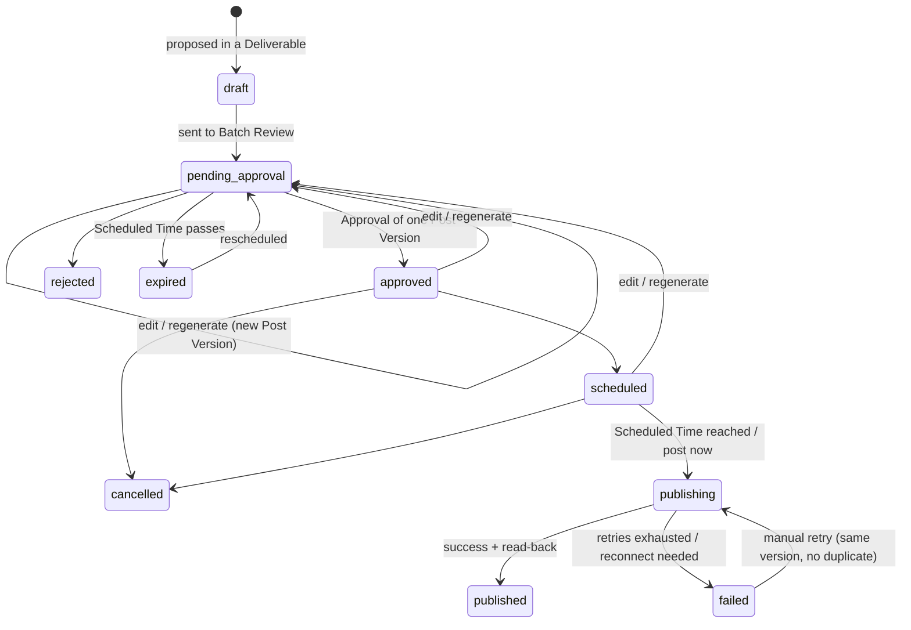
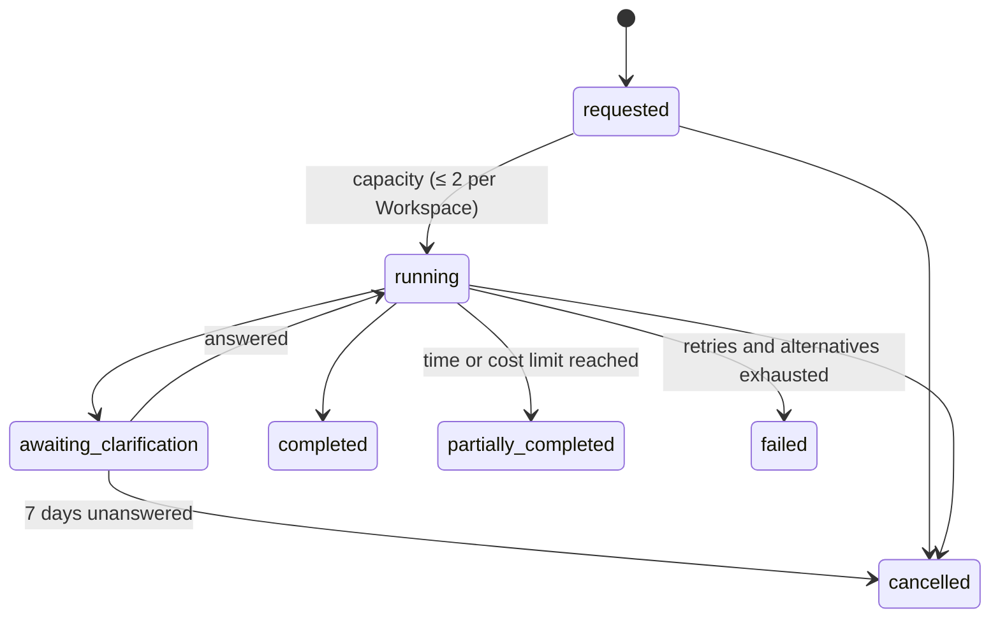
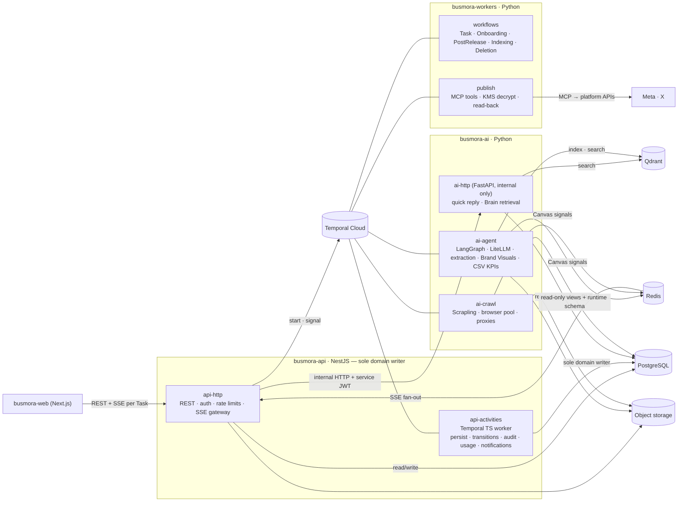
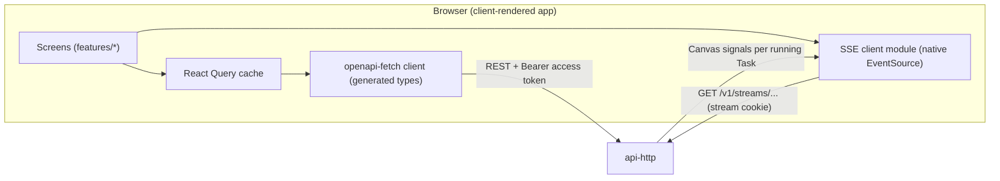
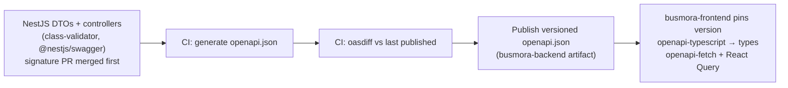

# BusMora — System Architecture

> **Version:** 1.0 · **Status:** Accepted · **Date:** 2026-10-18
> **Built from:** `project-docs/` (canonical product docs), `architecture/decisions/00-requirements-analysis.md`, `01-constraints.md`, `02-options.md`, `03-benchmark.md`, `04-decision.md`, and `architecture/domain/`.
> **Scope:** the complete architecture of the first release (the 24-week Marketing Employee release), plus its planned growth path. This document is self-contained; the source files hold the detailed evidence behind it.
> **Rule kept:** no technology appears here that is not already in those documents.

---

## Table of contents
1. [Overview & goals](#1-overview--goals)
2. [Constraints, quality attributes and technology stack](#2-constraints-quality-attributes-and-technology-stack)
3. [Domain model & bounded contexts](#3-domain-model--bounded-contexts)
4. [Backend architecture](#4-backend-architecture)
5. [Frontend architecture](#5-frontend-architecture)
6. [Backend ↔ frontend contract](#6-backend--frontend-contract)
7. [Cross-cutting concerns and growth path](#7-cross-cutting-concerns-and-growth-path)
8. [Architecture decision records](#8-architecture-decision-records)
9. [Risks, gaps and open questions](#9-risks-gaps-and-open-questions)

---

## 1. Overview & goals

### 1.1 What BusMora is
BusMora is a multi-tenant SaaS that gives an **Arabic-first small or medium business** (5–50 employees, e-commerce and local services, Egypt and the GCC) one **AI Marketing Employee**. In one chat-centred product, the Employee:

- **Learns the business.** A bounded crawl of the business's website seeds a **Business Brain**: a reviewed knowledge graph of facts plus learned style rules. The user approves every proposed fact individually.
- **Researches the market.** It crawls Reddit, YouTube, the Facebook Ads Library, competitor sites and the open web, and keeps only high-intent signals.
- **Produces marketing work.** Research reports, competitor analyses, dialect-aware Arabic and English content with on-brand images, content calendars, and diagnoses of uploaded performance CSVs.
- **Publishes only with approval.** Posts go to Facebook Pages, Instagram Business and X only after the user approves them in a **Batch Review**. Publishing is deterministic and idempotent, and each post is verified by reading it back from the platform.
- **Shows its work.** A live **Canvas** shows which specialist Sub-agents are working and what they are doing.
- **Gets smarter.** Reusable facts and style corrections flow back into the Brain as candidates for review.

The first release is built by **4 students in 24 weeks** as a graduation project that launches for real, with a **paid pilot of 1–3 businesses**.

### 1.2 Users and actors

| Actor | Role |
|---|---|
| **User** | The one person who operates a workspace (founder or marketing coordinator). One user per workspace this release. |
| **Marketing Employee** | The AI worker: a Router, an Orchestrator and five Sub-agents (Market Research, Competitor Analysis, Content Writer, Campaign Planner, Social Poster) |
| **BusMora operators** (internal) | Pilot onboarding, workspace deletion requests, evaluation rounds, observability |
| **Evaluation reviewers** (internal) | Arabic-native humans who score outputs; two per deliverable, a third breaks ties |
| **External platforms** | Meta (Facebook Pages, Instagram Business), X, crawled public sources, LLM providers |

### 1.3 Core journeys
1. **Onboarding:** sign up → enter website URL → background crawl (≤ 10 pages, ≤ 5 min) → review candidate facts one by one → Brain populated.
2. **Conversation:** the Employee greets the user, flags missing Brain information, and asks through structured forms with a per-field "Search yourself" option.
3. **Research / competitor analysis:** request → live Canvas → cited report saved as a Deliverable → reusable facts become Brain candidates.
4. **Content:** posts in the Brand Voice and dialect, each with a Brand Visual (generated imagery plus the brand's logo, colors and typography).
5. **Campaign → approval → publish:** content calendar → Batch Review → connect a platform account if needed → scheduled, idempotent publishing → read-back verification → per-post result.
6. **Performance:** upload a CSV → deterministic KPIs → diagnosis with three prioritized adjustments.

### 1.4 Architecture goals

| # | Goal | Why |
|---|---|---|
| AG-1 | **No external write without approval.** The approved content is published byte-for-byte, exactly once. | The product's governance promise (PRD §11, D-16, D-46) |
| AG-2 | **Durable long-running work.** Tasks, clarification waits (up to 7 days) and scheduled posts (up to a month) survive restarts and closed browsers. | PRD §13.4, TA §11.2 |
| AG-3 | **Grounding in a reviewed Brain**, measurable against a document-only control route | D-20–D-25, EVAL §5 |
| AG-4 | **Real-time transparency** through the Canvas | D-17, D-34 |
| AG-5 | **Tenant isolation in every store** | PRD NFR-003, AC-13 |
| AG-6 | **Arabic-first**: right-to-left UI and native dialect generation | D-06, D-07 |
| AG-7 | **Deliverable by 4 students in 24 weeks**, with vertical-slice ownership | D-05, TA §12.1 |
| AG-8 | **Domain-neutral seams** so a future Employee can be added without redesign | D-02, D-03, MVP §9 |

### 1.5 In and out of scope for this release
- **In:** everything listed in §1.1, as one full-scope release (D-04).
- **Out (later or never):**
  - Other Employees; LinkedIn and TikTok publishing; paid-ad management; analytics-platform APIs.
  - Multi-user workspaces; document or PDF upload; automatic conflict resolution; a native mobile app.
  - In-product billing, tiers and quotas; the anonymous "Instant Brain Audit" lead magnet; daily competitor monitoring.
  - Offline mode and white-labeling are not planned.

---

## 2. Constraints, quality attributes and technology stack

### 2.1 Binding constraints

| # | Constraint | Source |
|---|---|---|
| K-01 | 4 students, 24 weeks, one full-scope release, vertical-slice ownership | D-04, D-05; TA §12.1 |
| K-02 | **Four deployables:** `busmora-web`, `busmora-api`, `busmora-workers`, `busmora-ai`. Each may run several **process roles** (same code, different entrypoint); a role is not a new service. | D-26 |
| K-03 | **Two standalone repositories:** `busmora-backend` (api, workers, ai) and `busmora-frontend` (web) | 01 R-5 |
| K-04 | `project-docs/` is the source of truth; the earlier pitch deck's design (Neo4j, admin builder, LinkedIn) is superseded. Where the docs conflict: decision registry > PRD > technical architecture > other docs. | 01 R-1, R-2 |
| K-05 | **The stack is fixed** (§2.4). Missing tools are filled only by explicit decision. | 01; 04 §9 |
| K-06 | Single Marketing Employee; no admin or marketplace machinery | D-01, D-03 |
| K-07 | No in-product billing this release; **usage and cost metering per workspace from day one** | 01 SC-2, SC-3 |
| K-08 | Publishing: one BusMora Meta app and one BusMora X app. There is **no legal entity yet**, so the pilot runs in Meta's tester mode (pilot users added as app testers). Instagram limit is **50 posts per 24 h**. | 01 EP-1–EP-4 |
| K-09 | Brand assets come only from the website crawl (no uploads); no document or PDF ingestion | 01 BA-1–BA-5 |
| K-10 | Dialects: Egyptian, Gulf, Modern Standard Arabic | 01 SC-5 |
| K-11 | Region: a single region in Frankfurt (**provisional**, not yet a gate). Cloud provider deferred. | 01 HR-1, HR-2 |

### 2.2 Quality attributes and targets

| Attribute | Target | Source |
|---|---|---|
| **Latency (p95, hard)** | Quick chat reply ≤ 3 s. Complex-task acknowledgement (task record + first Canvas event) ≤ 2 s. Canvas update ≤ 500 ms after the backend event. Content ≤ 30 s per piece. Research ≤ 5 min. Website crawl ≤ 5 min. | PRD NFR-001; 01 DL-3 |
| **Availability** | ≥ 99% monthly uptime, excluding planned maintenance | NFR-002 |
| **Durability** | **RPO = 0** for everything committed to PostgreSQL and object storage, with point-in-time restore. Qdrant and Redis are derived and must be rebuildable. **RTO ≤ 1 h.** | NFR-002; 01 DL-4–DL-7 |
| **Reliability** | Task completion ≥ 85%; publish success with read-back ≥ 95%; **0 duplicate posts** | NFR-002; EVAL §10 |
| **Scale** | Capacity sized for the pilot (≤ 3 workspaces). ≥ 100 concurrent workspaces proven by a load test with stubbed LLM and crawler calls. Per workspace: ≤ 2 running tasks and 1 crawl at a time. | NFR-004; 01 SC-7–SC-9 |
| **Security** | Tenant isolation in every store; OAuth tokens encrypted with KMS envelope encryption and decrypted only in memory; defenses against prompt injection and SSRF; rate limits on public endpoints | NFR-003; TA §9 |
| **Privacy and lifecycle** | No sensitive personal or financial data stored in the Brain. Full per-workspace deletion run by operators. Unreferenced raw crawl data deleted after 7 days. | PRD §10.3; 01 DT-1–DT-4 |
| **i18n** | Arabic right-to-left and English left-to-right UI; native generation in both; dates per locale; scheduling in the workspace's business time zone | NFR-006; 01 PB-12 |
| **Observability** | Every agent action, tool call and error logged; LLM traces, tokens and cost per workspace in Langfuse; Temporal UI for workflows | NFR-005; D-33 |
| **Quality** | Arabic rubric: all dimensions ≥ 4, none < 3. ≥ 75% of content accepted with zero or minor edits. Brain grounding gives ≥ 50% fewer clarifications and corrections than the control route. | EVAL §10; 01 DD-2 |
| **Cost guardrails** (financials otherwise deferred) | ≤ $0.40 per task and ≤ $0.05 per search; recursion caps | BM §4.3; TA §13 #9 |

### 2.3 Evaluation framework used to choose the architecture
- **Hard gates:**
  - **G1** no unapproved or duplicate publish.
  - **G2** tenant isolation in every store.
  - **G3** no loss in PostgreSQL or object storage, with derived stores rebuildable.
  - **G5** consistent with the decision registry and settled constraints.
  - The region gate (G4) is withheld until the region study is done.
- **Weighted criteria (sum 100):**

  | Criterion | Weight |
  |---|---|
  | C1 delivery feasibility | 20 |
  | C2 reliability | 15 |
  | C3 security and isolation | 15 |
  | C4 operational simplicity | 12 |
  | C5 latency and real-time | 10 |
  | C6 AI-quality enablers | 10 |
  | C7 observability and testability | 8 |
  | C8 extensibility | 6 |
  | C9 scalability headroom | 4 |

- **Results:** see ADR-003 and ADR-009 in §8.

### 2.4 Technology stack

**Fixed by the product docs:**

| Layer | Technologies |
|---|---|
| Frontend (`busmora-web`) | Next.js 14+ (App Router), TypeScript, React Flow, Tailwind CSS / shadcn/ui, SSE with `Last-Event-ID` reconnects, React Query |
| Platform API (`busmora-api`) | NestJS 10+ (TypeScript), Passport.js + JWT, Argon2id, Drizzle ORM, SSE gateway reading Redis Streams, Temporal TypeScript SDK, ioredis, class-validator + Swagger (`@nestjs/swagger`) |
| Workers and AI (`busmora-workers`, `busmora-ai`) | Python 3.11+, FastAPI + Uvicorn, LangGraph, LiteLLM, Scrapling, Temporal Python SDK, Qdrant client, SQLAlchemy / asyncpg, Pydantic v2, MCP SDK |
| Data and infrastructure | PostgreSQL 16+, Qdrant, Redis 7+, Temporal Cloud (+ Temporal UI), Cloud KMS, S3-compatible object storage, Docker Compose (local) |
| Observability | Langfuse |

**Gap-fills chosen by explicit decision** (04 §9):

| Tool | Purpose |
|---|---|
| Ajv | Runtime validation of Temporal payloads against JSON Schema on the TypeScript side |
| openapi-typescript + openapi-fetch | Typed API types and client, generated from OpenAPI |
| oasdiff | Breaking-change check on the published API contract |
| Browser built-ins (native `EventSource`, `BroadcastChannel`, Web Locks) | SSE client; coordinating token refresh across tabs |

**Deferred provider choices:** LLM providers (decided by an Arabic-quality bake-off), embedding model, image model, object-storage vendor, rotating-proxy vendor, cloud provider (D-39–D-42; 01 HR-2).

---

## 3. Domain model & bounded contexts

### 3.1 Ubiquitous language (key terms)

| Term | Meaning | Not to be confused with |
|---|---|---|
| **Business** | The real company BusMora works for | "Customer" (ambiguous) |
| **Workspace** | The Business's isolated space in BusMora | Account, tenant |
| **User** | The single person operating a Workspace | Owner, marketing person |
| **Business Brain** | The Workspace's reviewed, permanent memory of the Business | Knowledge base |
| **Knowledge Item** | One fact about the Business, in one of nine **Knowledge Categories**: Company Profile, Offering, Audience, Brand Rule, Positioning, Strategic Goal, Channel, Competitor, Company Fact | Node, entity |
| **Relationship** | A typed, directed link between Knowledge Items: targets, competes with, has tone, solves pain point, related to | Edge |
| **Procedural Rule** | A reviewed instruction on *how* to work for this Business (style, dialect), learned from edits and feedback | — |
| **Candidate** | A proposed Knowledge Item or Procedural Rule not yet reviewed | — |
| **Review** | The User's individual approve, edit-and-approve or reject decision on one Candidate | Approval |
| **Retirement** | Withdrawing an approved Knowledge Item while keeping its history; what "delete" means | Deletion |
| **Brand Voice / Dialect / Brand Kit** | How the Business sounds; its Arabic register; the logo, colors and fonts detected from its website | — |
| **Marketing Employee / Orchestrator / Sub-agent** | The AI worker; its planning core; its five specialists | Agent, bot |
| **Conversation / Quick Reply / Task** | The chat; an immediate answer that starts no work; one unit of requested marketing work | Job, workflow |
| **Constraint Diagnosis** | The Orchestrator's judgement of the bottleneck: discovery, positioning or conversion | — |
| **Clarification / Search Yourself** | A pause in a Task asking for missing info through a form; the option to let the Employee research a field | — |
| **Canvas** | The live view of a running Task | Decision canvas |
| **Onboarding Crawl / Research Crawl / Snapshot** | The first website read; material gathered for a Task; a preserved crawled page | — |
| **Research Signal / Buyer Vernacular** | Crawled material showing buyer intent; buyers' own words | — |
| **Deliverable** | Finished work kept in the Workspace: Research Report, Competitor Analysis, Content Package, Content Calendar, Performance Diagnosis, General | Artifact, output |
| **Post / Post Version** | One piece of social content for one Connected Account at one time; one unchangeable state of its content | Snapshot |
| **Approval** | Consent to publish one specific Post Version as-is | Review |
| **Batch Review** | Where the User approves, edits, regenerates, rejects or cancels many Posts | — |
| **Publish Attempt / Read-back Verification** | One try to go live; confirming afterwards that the post exists on the platform | — |
| **Platform / Connected Account** | Facebook Pages, Instagram Business or X; the Business's authorized account on one of them | Channel (a Brain category) |
| **Usage Record / Audit Event / Notification** | Metered resource use; an unalterable record of a governed action; an in-app message | — |

### 3.2 Bounded contexts

| Context | Type | Owns |
|---|---|---|
| **Business Brain** | **Core** | Knowledge Items, Relationships, Procedural Rules, Candidates and Review, Retirement, Conflicts, Provenance, Brand Kit facts |
| **Marketing Employee** | **Core** | Conversations, Quick Replies, Tasks, Constraint Diagnosis, Clarifications, Sub-agent work, the Canvas feed, content and Brand Visual generation |
| **Governed Publishing** | **Core** | Posts, Post Versions, Batch Review, Approvals, Scheduled Times, Publish Attempts, read-back |
| **Market Intelligence** | Supporting | Onboarding and Research Crawls, Snapshots, Research Signals, the 7-day crawl cache |
| **Deliverables** | Supporting | Deliverables and Source Citations, Performance Reports |
| **Channel Connections** | Supporting | Connected Accounts, authorization state, Reconnect Needed |
| **Evaluation** (internal) | Supporting | Scenarios, Evaluation Rounds, Reviewer scores, Treatment and Control runs |
| **Identity & Workspace** | Generic | Users, Workspaces, Business Time Zone, workspace deletion |
| **Usage Metering** | Generic | Usage Records |
| **Audit Trail** | Generic | Audit Events |
| **Notifications** | Generic | In-app Notifications |



**Boundary rules:**
- **Review ≠ Approval.** Review is a knowledge decision; Approval is a publishing decision.
- **Channel ≠ Platform.** A Channel is where the business markets (a Brain category); a Platform is where BusMora can publish.
- **Snapshot ≠ Post Version.** A Snapshot preserves a crawled page; a Post Version freezes Post content.
- **Deliverables are not knowledge.** Facts inside them reach the Brain only as Candidates.
- **The Canvas is a live view, not a record.**

### 3.3 Brain governance rules
- **Manual entries** are approved immediately. Everything else starts as a **Candidate**: crawl, conversation (including form answers), task results and edit diffs.
- Candidates are reviewed **individually**; there is no bulk approval.
- **"Delete" means retire**, with the audit trail kept. The only hard deletion is deleting a whole workspace.
- **Procedural Rules** need approval before they influence generation.
- **Conflicts** are surfaced to the User and never resolved automatically.
- **Retrieval reads approved items only**: a vector seed in Qdrant, then 1–2 hops over Relationships in PostgreSQL, assembled under a token ceiling. A **document-only control route** exists for evaluation.

### 3.4 Lifecycles

**Knowledge Item / Procedural Rule**


**Post** (the approval lifecycle)


Rules attached to the Post lifecycle:
- There is no fixed approval timer. A Post expires only when its Scheduled Time passes while it is still pending.
- Automatic retries follow PRD §13.3: 2× on an API error; cooldown on a rate limit.
- A broken credential triggers a silent refresh; if that fails, the Post goes to `failed` with "reconnect needed" and the User is notified.

**Task**


### 3.5 Key domain events
- **Identity:** `WorkspaceCreated`, `BusinessTimeZoneChanged`, `WorkspaceDeletionRequested`, `WorkspaceDeleted`.
- **Market Intelligence:** `OnboardingCrawlStarted/Completed/Failed`, `BrandKitDetected`, `ResearchCrawlCompleted`, `SourceSkipped`.
- **Brain:** `KnowledgeCandidateProposed`, `KnowledgeItemApproved`, `KnowledgeCandidateRejected`, `KnowledgeItemAddedManually`, `KnowledgeItemEdited`, `KnowledgeItemRetired`, `Relationship Added/Retired`, `KnowledgeConflictDetected`, `ProceduralRuleApproved`.
- **Employee:** `TaskRequested`, `TaskStarted`, `ConstraintDiagnosed`, `ClarificationRequested/Answered/Expired`, `TaskCompleted`, `TaskPartiallyCompleted`, `TaskFailed`, `TaskCancelled`, `ResourceConsumed`.
- **Deliverables:** `DeliverableCreated`, `PerformanceReportRejected`.
- **Publishing:** `PostDrafted`, `PostSubmittedForApproval`, `PostVersionCreated`, `PostApproved`, `PostRejected`, `PostScheduled`, `PostCancelled`, `PostExpired`, `PostPublished` (after read-back), `PostPublishFailed`.
- **Connections:** `AccountConnected`, `AccountReconnectNeeded`, `AccountDisconnected`.

In this release these events are recorded by `busmora-api` as **rows written in the same transaction as the change**: audit, usage and notification records. There is no message bus.

**Canvas progress signals are separate from domain events.** They are live-only and replayed only during a run plus a short grace window: `agent_started`, `agent_tool_used`, `agent_completed`, `agent_error`, `flow_connection` (PRD FR-045).

---

## 4. Backend architecture

### 4.1 Style
**"Platform-Centred" with one amendment:**
- **`busmora-api` (NestJS) is the single owner and only writer of all domain data**, the Brain included.
- **Python services are stateless compute** reached through **Temporal**.
- **Amendment A1:** two read-only synchronous paths go over **internal HTTP** to `busmora-ai`, for **quick replies** and **Brain retrieval**.

### 4.2 Diagram


### 4.3 Components (process roles)

| Deployable | Role | Responsibilities |
|---|---|---|
| `busmora-web` | `web` | Serves the frontend (§5) |
| `busmora-api` (NestJS) | `api-http` | Public REST API; user auth (Argon2id, JWT, refresh rotation); rate limiting; OAuth consent callbacks + KMS encryption; uploads; SSE gateway reading Redis Streams; Temporal client (starts and signals workflows); internal HTTP client to `ai-http` |
| | `api-activities` | Temporal **TypeScript activity worker** hosting the "platform" activities: persist task progress and results, open and cancel Clarifications, store Candidates, claim and record Post publishing, write audit, usage and notification rows |
| `busmora-workers` (Python) | `workers-workflows` | Workflow definitions: `TaskExecutionWorkflow`, `OnboardingWorkflow`, `PostReleaseWorkflow` (one per Post), `IndexingWorkflow`, `WorkspaceDeletionWorkflow`. Sequencing only; no domain rules. |
| | `workers-publish` | MCP publishing tools (`publish_facebook`, `publish_instagram`, `publish_x`); KMS decryption in memory; idempotent dispatch; read-back verification; token refresh. **No database access.** |
| `busmora-ai` (Python) | `ai-http` | **Internal-only** FastAPI: Router and quick replies; Brain retrieval (seed + 1–2 hops). **Never writes domain data.** |
| | `ai-agent` | Temporal activity worker: LangGraph (Router, Orchestrator, Sub-agents), LiteLLM, knowledge extraction, embedding and Qdrant indexing, Brand Visual generation, CSV KPI computation; emits Canvas signals |
| | `ai-crawl` | Temporal activity worker: Scrapling crawlers with a bounded headless-browser pool, rotating proxies, sanitization, intent qualification |

### 4.4 Bounded contexts → components

| Context | Rules and state (owner) | Durable process | Compute |
|---|---|---|---|
| Business Brain | api `brain` module | `IndexingWorkflow` re-embeds after approve, edit or retire | ai: extraction, embeddings, retrieval (`ai-http` for synchronous search) |
| Marketing Employee | api `conversation` and `tasks` modules | `TaskExecutionWorkflow` | ai: Router (`ai-http`), Orchestrator, Sub-agents (`ai-agent`) |
| Governed Publishing | api `publishing` module (state machine) | `PostReleaseWorkflow` per Post | `workers-publish` |
| Market Intelligence | api `crawls` module (records, Snapshot metadata) | `OnboardingWorkflow`; crawl steps inside Tasks | `ai-crawl` |
| Deliverables | api `deliverables` module | — | ai produces content |
| Channel Connections | api `connections` module | Refresh inside the publish path | `workers-publish` |
| Identity & Workspace | api `identity` module | `WorkspaceDeletionWorkflow` | — |
| Usage, Audit, Notifications | api modules (same-transaction rows) | — | — |
| Evaluation | api `evaluation` module | Scenario run = `TaskExecutionWorkflow` with a frozen Treatment/Control flag | ai |

**Extensibility seam:** Employee configuration, Capabilities and Task records are api-owned records. The active configuration is **frozen into every workflow input**, so in-flight work is unaffected by later edits.

### 4.5 Data architecture

| Store | Holds | Who writes | Notes |
|---|---|---|---|
| **PostgreSQL 16+** (source of truth) | All domain state, one schema per context: identity, brain (`brain_nodes`, `brain_edges`, `brain_procedural_rules`), conversation, tasks, deliverables, publishing (posts, post versions, publish attempts), connections (KMS-encrypted credential envelopes), crawl metadata, audit (append-only), usage, notifications, evaluation | **`busmora-api` only.** Drizzle is the single migration toolchain. | RPO 0 + point-in-time restore |
| PostgreSQL runtime schema | LangGraph checkpoints | `ai-agent` | Technical state, not domain state |
| PostgreSQL retrieval views | Approved Knowledge Items, Relationships, Procedural Rules, Snapshot metadata | read by `ai-agent` and `ai-http` through **read-only roles**, with **row-level security** on the workspace | Python never writes domain tables |
| **Qdrant** (derived) | Embeddings of approved items; control-route chunks. Each point carries `workspace_id` and `status`. | `ai-agent` | Rebuilt from PostgreSQL + object storage by `IndexingWorkflow` |
| **Redis 7+** (derived) | Refresh-token families (with rotation state); per-Task Canvas streams (replay buffer); crawl-cache keys (7-day TTL) | api, ai | Loss affects only sessions, live replay and the cache |
| **Object storage** (S3-compatible) | Crawl Snapshots (HTML), uploaded CSVs, Brand Visuals (served to Meta and X through signed public URLs) | ai (Snapshots, images), api (uploads). Metadata rows are written only by api. | Keys: `{workspace_id}/{source_type}/{timestamp}_{filename}` |
| **Temporal Cloud** | In-flight workflow state and references | workflows | Large content travels by reference, never inline |

**Retention and deletion:**
- Snapshots are kept while any item or Deliverable references them, including retired items.
- Unreferenced raw research data is deleted after **7 days**.
- **Workspace deletion** is operator-run and removes everything:
  - PostgreSQL, **including that workspace's audit log**;
  - Qdrant, object storage, Redis and LLM traces;
  - its credentials become unrecoverable.
  - Only a minimal deletion record remains.
- Every row and object is attributable to a workspace.

### 4.6 Communication

| Interaction | Path | Durable? |
|---|---|---|
| User → system | Browser → `api-http` (REST) | — |
| Quick reply | `api-http` → **`ai-http`** (Router + reply) → api stores the reply | No (re-send on failure) |
| Complex request | `ai-http` returns the classification → **api** writes the Task, starts `TaskExecutionWorkflow`, acknowledges | Yes |
| Ambiguous request | `ai-http` returns a clarifying question; api stores it | No |
| Brain search outside the agent graph | `api-http` → **`ai-http`** retrieval (approved, workspace-scoped) | Read-only |
| Agent work, crawling, extraction, indexing, images, KPIs | Temporal activities | Yes |
| Persisting any result | Temporal activity on `api-activities` | Yes |
| Live progress | `ai-agent` / `ai-crawl` → Redis Streams (keyed by Task) → `api-http` SSE → browser | Live only |

**Key flows:**
1. **Task.**
   - api writes the Task (`requested`) and starts `TaskExecutionWorkflow` (workflow id = Task id). The response acknowledges the task within 2 s.
   - The workflow calls `platform.start_task` (capacity check), then loops `ai.run_agent_step`: LangGraph runs until an interrupt, completion or a step budget, checkpointing and emitting Canvas signals. `platform.record_progress` persists each step.
   - `platform.complete_task` writes Deliverables, Candidates, usage, audit and notifications in **one transaction**.
2. **Clarification.**
   - A step returns a form → `platform.open_clarification`.
   - The workflow waits for a `clarification_answered` signal (sent by api after validating the answer) or a **7-day timer**.
   - On answer, the next step resumes LangGraph from its checkpoint. On timeout, `platform.cancel_task` runs and the User is notified.
3. **Review.** REST → api `brain` module (validation, write, audit) → `IndexingWorkflow`.
4. **Batch Review and publish.**
   - Sending a Post to Batch Review starts `PostReleaseWorkflow` with a timer to its Scheduled Time.
   - Approve, edit, regenerate (AI before approval only), reject, cancel and reschedule are api writes.
   - At the Scheduled Time, `platform.claim_post` **atomically** checks the Post:
     - still approved and on the same Post Version → it moves to `publishing` and returns the version reference plus the credential envelope;
     - still pending → it moves to `expired`;
     - anything else → the workflow ends.
   - `workers.publish` decrypts in memory, calls the MCP tool with **idempotency key = Post Version id**, and reads the post back. `platform.record_publish_result` stores the outcome.
5. **Onboarding.** `OnboardingWorkflow`: crawl (≤ 10 pages / 5 min, robots.txt respected) → extract → `platform.store_candidates` (including Brand Kit facts) → notification.
6. **Platform connection (lazy).** When the User sends Posts to Batch Review without a Connected Account, api returns a connect prompt. The OAuth consent goes through api, which encrypts the tokens with KMS (keyed with the workspace, integration and credential version).

**Guardrails on internal HTTP (A1):**
1. Only two endpoint families: quick reply / routing, and Brain retrieval. Anything more needs a new decision record.
2. `ai-http` never writes domain data.
3. Internal network only, with no public ingress.
4. Every call is authenticated with the internal service JWT (§4.7).
5. Timeouts are bounded so the quick reply stays under 3 s; on failure the user re-sends.
6. Retrieval honours the same Treatment/Control flag as agent runs.
7. The `trace_id` claim is propagated into Langfuse.

### 4.7 Authentication and security

| Concern | Design |
|---|---|
| **User login** | Email + password with **Argon2id**; email verification; password reset |
| **Access token** | JWT, **15 min**, carrying user and active workspace; held **only in browser memory** |
| **Refresh token** | Random, stored in Redis, **rotated on every use with reuse detection** (a reused token revokes the whole login session). Sent as an `HttpOnly; Secure; SameSite=Strict` cookie with `Path=/v1/auth/refresh`. **7-day sliding idle window**, **30-day absolute maximum**. |
| **Same-site deployment** | `app.<domain>` (web) and `api.<domain>` (api) under one registrable domain |
| **Request forgery** | The refresh endpoint checks the `Origin` header **and** requires a custom header |
| **Multi-tab** | One tab refreshes and shares the result (`BroadcastChannel` / Web Locks); the server accepts the just-rotated token for **10 s**. On page reload the app refreshes silently. |
| **SSE auth** | A short-lived `HttpOnly; Secure; SameSite=Strict` **stream cookie** with `Path=/v1/streams`, issued together with each access token. The browser's native `EventSource` sends it, including on reconnects with `Last-Event-ID`. Open streams stay alive when the cookie expires mid-stream. A reconnect with an expired cookie gets 401 → the client refreshes → the stream reopens. |
| **Internal HTTP (api → ai)** | Private network plus a **60-second internal service JWT** signed with a dedicated **asymmetric key pair**. Claims: `aud=busmora-ai`, `workspace_id`, `user_id`, `trace_id`. `ai-http` holds only the public key and takes the workspace only from the verified claim. Its database role is read-only, with row-level security on the workspace. |
| **Temporal Cloud** | **One API key per process role**, loaded from a secrets store; mTLS as a fallback |
| **Tenant isolation** | Workspace in the JWT → every query; in every workflow input; in every Qdrant filter, object key and Redis key; Langfuse tags. Database roles: api read-write; ai read-only views + runtime schema; workers none. |
| **OAuth credentials** | KMS envelope encryption in api; **decrypted only in `workers-publish`**, in memory, never logged. Plaintext never exists in `busmora-ai`, where untrusted crawled text is processed. |
| **Prompt injection** | Crawled content is sanitized (HTML, scripts and styles stripped), quarantined inside explicit data boundaries, and treated as data by system instructions. Each Sub-agent gets only its own tools; publishing tools live in a different process. |
| **SSRF** | Crawl targets are validated against private IP ranges |
| **Rate limiting** | Public endpoints limited in `api-http`; domain-level cooldown in crawlers |

### 4.8 External integrations

| Integration | Where | Notes |
|---|---|---|
| **Meta Graph API** (Facebook Pages) and **Instagram Content Publishing** | OAuth in `api-http`; publishing in `workers-publish` via MCP | One BusMora Meta app. **Tester mode** for the pilot (no legal entity yet, so no Business Verification or Advanced Access). Instagram limit 50 posts/24 h; images must be public JPEG URLs. |
| **X API v2** | Same split | One BusMora developer app (OAuth 2.0 PKCE). Pay-per-use ($0.015 per post, $0.20 with a URL), paid by BusMora and metered per workspace. Limit 100 posts / 15 min per user. |
| **Reddit, YouTube, Facebook Ads Library, competitor sites, open web** | `ai-crawl` | Custom Scrapling crawling only (no search API); rotating proxies; bounded browser pool; 7-day cache |
| **LLM providers** (via LiteLLM) | `ai-agent`, `ai-http` | "Light" models (routing, extraction) and "heavy" models (planning, writing); provider chosen by an Arabic-quality bake-off, with a fallback |
| **Embedding model / image model** | `ai-agent` | Chosen in the Sprint 1 bake-off |
| **Cloud KMS** | api (encrypt), `workers-publish` (decrypt) | Envelope encryption |
| **Object storage** | api, ai | S3-compatible; vendor chosen in Sprint 1 |
| **Temporal Cloud** | all Python roles, `api-http`, `api-activities` | Managed durable execution |
| **Langfuse** | ai roles | Traces, tokens, cost, prompt version |
| **Email** (verification, reset) | `api-http` | Provider not yet chosen |

### 4.9 Deployment topology
- **8 process roles from 4 images:** `web`, `api-http`, `api-activities`, `workers-workflows`, `workers-publish`, `ai-http`, `ai-agent`, `ai-crawl`.
- **Public ingress:** `web` and `api-http` only. Everything else sits on the private network.
- **Managed services:** PostgreSQL, Redis, Qdrant, Temporal Cloud, KMS, object storage, Langfuse.
- **Scaling:** `api-http`, `ai-http` and `ai-agent` scale horizontally. `ai-crawl` is capped by its browser pool. One workflow worker and one publish worker suffice for the pilot.
- **Region:** a single region in Frankfurt (provisional; the cloud provider is deferred).
- **Local development:** Docker Compose runs the same roles. The frontend repository consumes the backend through its published contract (§6).
- **Workflow versioning:** workflows live up to a month, so changes to running workflow code must stay compatible with in-flight runs (TA §13 #10).

---

## 5. Frontend architecture

### 5.1 Style
**"Client-Rendered Application"** for this release. The App Router provides routing and layouts; every application page is a client component. The browser talks directly to `api-http`. The **"Workspace Event Shell"** is the planned next step (§7.9), and this release is built to make that move cheap.

### 5.2 Structure (repository `busmora-frontend`)
```
app/
  (public)/login, register, verify, reset
  (app)/layout          ← client shell: navigation, language + direction, session
  (app)/onboarding, employee/[conversationId], brain, deliverables, batch-review, settings
features/<context>/      ← identity, onboarding, employee, brain, deliverables,
                           publishing, connections, settings, notifications
                           (queries, mutations, components; later: events/)
shared/                  ← shadcn/ui components, generated API client, SSE client module,
                           i18n, formatting
```

### 5.3 Screens

| Area | What it provides |
|---|---|
| Auth | Register, email verification, login, logout, password reset |
| Onboarding | Website URL; non-blocking crawl progress (pages crawled, estimated completion); Business Time Zone |
| Marketing Employee | Conversation list and history. Split view: chat on one side, Canvas on the other (Canvas toggled on mobile). Chat message types: text, structured forms (text, radio, checkbox, dropdown, "Search yourself"), task status, Deliverable cards, knowledge notifications, errors. Replies arrive as whole messages (no token streaming). |
| Canvas | React Flow: Orchestrator + 5 Sub-agents; idle, active, completed and error states; animated edges; abstracted tool labels |
| Brain | React Flow graph of approved and Candidate items; side panel (view, edit, retire); manual items and Relationships; filters and search (semantic search via the api → `ai-http` retrieval path); Provenance and Snapshot view; individual Candidate Review in 7 sections with a badge; Conflicts; Brand Kit facts |
| Deliverables | List; filter by type and date; full view (Markdown or structured) |
| Batch Review | Grid or list showing Platform, time in the Business Time Zone, Brand Visual preview and status. Per Post: approve, reject, edit, regenerate, cancel, reschedule, retry. "Approve/reject all remaining". Failure reasons. Lazy connect prompt. Session timing captured for evaluation. |
| Settings | Account; Connected Accounts (status, connect, disconnect, reconnect needed); Business Time Zone; UI language |

### 5.4 Data flow


- **Queries and mutations** go through React Query hooks backed by the generated `openapi-fetch` client.
- **Live Canvas:** one SSE stream per running Task (at most 2 per workspace), with native `Last-Event-ID` replay.
- **Other live state** (crawl progress, Post statuses, badges) is refreshed by **polling**, configured in one place per feature.

### 5.5 State
- **Server state:** the React Query cache.
- **UI and form state:** local to components.
- **Language and direction:** a client context sets the document's `dir`.
- **Session:** the access token in memory only; the refresh token and stream cookie are HttpOnly and invisible to scripts.

### 5.6 Communication and auth
- The browser calls `api.<domain>` from `app.<domain>`, which is same-site.
- Every request carries `Authorization: Bearer <access token>`.
- On 401, the app refreshes once (coordinated across tabs) and retries.
- Requests to the refresh endpoint carry the required custom header.

### 5.7 Deployment
`busmora-web` runs as a container serving the application.

### 5.8 Built to move to the Workspace Event Shell later
1. **Feature folders per bounded context.** Each will later gain an `events/` handler.
2. **One SSE client module** behind a small interface (subscribe → typed envelope → reconnect). Moving to one workspace-wide stream changes only this module.
3. **The SSE event envelope is used from day one** (§6.4).
4. **Polling is isolated** per feature, so it can be replaced by event-driven cache updates.

---

## 6. Backend ↔ frontend contract

### 6.1 Surfaces

| Surface | Between | Form |
|---|---|---|
| Commands and queries | web → api | REST/JSON, described by OpenAPI |
| Server push | api → web | SSE: one stream per Task now, one workspace stream later |
| Auth and session | web ↔ api | Auth endpoints + cookie and token rules, declared as OpenAPI security schemes |
| Platform-connection redirects | browser ↔ api ↔ Meta / X | Start URL, api-handled callback, return route into the app |
| Uploads | web → api | Performance CSV (multipart) |

### 6.2 Pipeline (code-first)


- **"Contracts defined first"** (TA §12.1) is met by merging the DTO and controller-signature pull request before the implementation.
- **`oasdiff`** blocks unintended breaking changes.
- **SSE event payloads** are DTOs registered explicitly with `@nestjs/swagger`, so they are typed in the frontend.

### 6.3 Conventions
1. **Versioning:** a `/v1` prefix; only additive changes within a version; the frontend pins a contract version.
2. **Resources by bounded context:** `/auth`, `/workspace`, `/onboarding`, `/conversations/{id}/messages`, `/tasks/{id}`, `/tasks/{id}/clarifications/{id}`, `/brain/items`, `/brain/relationships`, `/brain/candidates`, `/brain/conflicts`, `/brain/search`, `/deliverables`, `/posts`, `/posts/{id}/versions`, `/connections`, `/notifications`, `/performance-reports`.
3. **One error envelope:** stable code, i18n message key, details, correlation id. Domain codes cover stale Post Version, reconnect needed, capacity queued, and unrecognized CSV headers.
4. **Optimistic concurrency:** commands on Posts and Knowledge Items carry the version they act on; a stale version returns a conflict. This is how "an Approval binds to one Post Version" is enforced at the boundary.
5. **Idempotency keys** on non-idempotent commands: send message / start task, send to Batch Review, approve, retry publish, upload.
6. **Asynchronous work** returns "accepted" plus the resource id; progress arrives over SSE, and current state is available via GET.
7. **Lists:** cursor pagination and filters (Deliverables by type and date; Brain by category, relationship type and text).
8. **Time:** UTC instants plus IANA zone fields (Scheduled Time, Business Time Zone).
9. **Language:** UI strings belong to the frontend; generated content carries language and dialect tags.
10. **SSE envelope** (§6.4).
11. **Security schemes** declared in the spec.
12. **Uploads:** multipart CSV with documented limits (the values are still open).

### 6.4 SSE envelope

| Field | Meaning |
|---|---|
| `id` | Monotonic per stream; used for `Last-Event-ID` replay |
| `event` | Event type: the five Canvas signals now; domain-event types later |
| `data.workspace` | Workspace id |
| `data.task` | Task id (optional) |
| `data.occurred_at` | When it happened (UTC) |
| `data.payload` | Type-specific body |

Streams also carry heartbeats, and send a **reset** event when a reconnect falls outside the replay window. The client then refetches through queries.

### 6.5 Contracts inside the backend repository
- **Temporal payloads between Python and TypeScript:**
  - **Pydantic models are canonical**, and JSON Schema is exported from them.
  - Plain TypeScript types are generated from that schema.
  - Payloads are validated at runtime with **Ajv**; class-validator stays for HTTP DTOs only.
  - **CI checks** that the types haven't drifted and that **schema evolution is additive**: new fields optional, nothing removed or retyped while any in-flight workflow may replay it.
- **`ai-http`:** FastAPI's OpenAPI spec generates the typed TypeScript client used by `busmora-api`.

---

## 7. Cross-cutting concerns and growth path

### 7.1 Multi-tenancy
- The workspace is the tenant boundary everywhere: JWT claim, every PostgreSQL query (plus row-level security on the views Python reads), workflow inputs, Qdrant payload filters, object-storage prefixes, Redis keys, Langfuse tags, and the internal service JWT.
- One user per workspace this release.

### 7.2 Security
See §4.7. Untrusted crawled text and publishing credentials **never share a process**, and an LLM is **never** in the publishing path after Approval.

### 7.3 Reliability and idempotency
- **Durability:**
  - Temporal resumes tasks, clarification waits and scheduled releases after crashes.
  - PostgreSQL is the source of truth with RPO 0.
  - Qdrant and Redis are rebuildable.
- **Publishing exactly once:**
  - one `PostReleaseWorkflow` per Post;
  - an atomic claim on the approved Post Version;
  - idempotency key = Post Version id;
  - the attempt is recorded **before** calling the platform, and read back before any retry. This covers platforms that don't accept idempotency keys.
- **Retries:**
  - Agents: tool and sub-agent retries up to 3, then alternative sources, then a transparent error.
  - Crawling: site unreachable → 2 retries; rate limit → backoff, then skip the source; CAPTCHA → skip, use alternatives, notify.
  - Publishing: 2 retries on an API error, cooldown on a rate limit.
  - Time and cost limits produce a **Partial Result**.
- **If Temporal Cloud is unavailable:** tasks, onboarding crawls, publishing and indexing pause. Quick replies (over `ai-http`), Brain editing, Batch Review edits and Deliverables browsing keep working.

### 7.4 Observability and evaluation
- **Tracing:** Langfuse traces every LLM call with workspace, Task, model, prompt version and cost. Temporal UI shows every workflow. The internal service JWT carries `trace_id` across the HTTP path.
- **Product instrumentation** (stored in PostgreSQL): clarification and correction events, approvals, edits and publishes, Batch Review session timing.
- **Evaluation:**
  - A fixed scenario set runs on seeded workspaces in **Treatment** (Brain) and **Control** (documents only), with the same model and prompts.
  - It is scored blind by two Arabic-native reviewers, with a third breaking ties.

### 7.5 Internationalization and time
- Arabic right-to-left and English left-to-right UI; native generation in Egyptian, Gulf or MSA Arabic and English, including mixed language (product names kept in English).
- One **Business Time Zone** per workspace. Scheduled Times are stored as UTC instants plus their planning zone, so daylight-saving changes are handled. Changing the zone never moves approved or scheduled Posts.

### 7.6 Cost control
- A **Usage Record** is written for every model call, crawl or proxy use, image and X post. Records are kept per workspace and per Task.
- Guardrails: ≤ $0.40 per task and ≤ $0.05 per search, plus recursion caps.
- Research is bounded by time (≤ 5 min) and cost rather than by item count.
- The usage data feeds the cost-derived pricing tiers planned after the pilot.

### 7.7 Configuration and versioning
- Each workflow receives a frozen configuration.
- Prompt templates are version-controlled, and their version is recorded per run.
- Workflow code changes stay compatible with in-flight runs.
- The API contract and Temporal payload schemas evolve additively.

### 7.8 Testing approach (as far as the docs define it)
- **Boundaries for stubbing:** LLM, crawler and platform APIs are stubbed at Temporal activity boundaries and at the `ai-http` client.
- **Rules:** domain rules are tested in NestJS.
- **Sequencing:** workflow sequencing and timers are tested in Python.
- **Contracts:** checked by `oasdiff` and the schema-drift checks.
- **Scenarios:** run on seeded workspaces.
- **Load:** a stubbed load test proves 100 concurrent workspaces.
- The test frameworks themselves are still to be chosen (§9.2).

### 7.9 Growth path from MVP to later phases

| Phase | What changes | Seam that makes it possible |
|---|---|---|
| **This release (MVP, 24 weeks)** | Everything in §1–§6; paid pilot with 1–3 businesses in Meta tester mode | — |
| **After a legal entity exists** | Meta Business Verification and Advanced Access; any business can connect without being a tester | One BusMora Meta app already in place; nothing structural |
| **Frontend: Workspace Event Shell** | One workspace-wide SSE stream carries Canvas signals **and** UI events (badges, Post statuses, crawl progress, Deliverables); polling removed | The single writer (`busmora-api`) emits UI events where it already writes audit and notification rows; the envelope (§6.4) and the SSE client module (§5.8) are already in place |
| **Billing and tiers** | Payments, plan tiers, quotas, feature gating; daily competitor monitoring as a scheduled workflow | Usage Records already exist per workspace and Task; quotas become admission checks in `platform.start_task`; scheduled work fits the existing workflow tier. The payment provider is still open: Stripe does not serve Egypt- or Saudi-based merchants. |
| **Second Employee** (e.g. Sales) | New Sub-agents, Capabilities and screens | Domain-neutral Employee configuration, frozen per run; the approval and execution semantics and the Brain are reusable; new feature folders in the frontend |
| **More platforms** (LinkedIn, TikTok) | New MCP tools and Connected Account types | MCP tool interface in `workers-publish`; Platform as a value in the Post model |
| **Document upload, multi-user workspaces, automatic conflict resolution** | New ingestion pipeline; membership and roles; governance automation | Brain Provenance already supports multiple sources; the workspace is already the tenant unit |
| **Region / residency** | Possible move to a MENA region and Temporal payload encryption | Decided by the region study (G4) and open decision OD-1 |
| **Scale beyond the pilot** | Horizontal scaling of the stateless roles | Validated by the 100-workspace load test |

---

## 8. Architecture decision records

Format: the ADR format of the repository's `domain-modeling` skill (title, context, decision and why, plus optional status, considered options and consequences). An "architecture-decision-records" skill was requested but isn't installed, so this format substitutes for it. All records are **Accepted** unless marked otherwise.

### ADR-001 — Product docs are the single source of truth
- **Context:** an earlier pitch deck described a different system: Neo4j, an admin "Employee Builder", LinkedIn, other observability tools, a four-agent roster.
- **Decision:** `project-docs/` is canonical. Where documents conflict: decision registry > PRD > technical architecture > other docs.
- **Rejected:** treating the deck as canonical. Every deck-only item traced to deleted, superseded specifications.
- **Consequences:** one consistent design. Refinements to the PRD are recorded in architecture documents rather than by editing the PRD.

### ADR-002 — Four deployables and two standalone repositories
- **Context:** the decision registry fixes four services. The technical architecture showed a single monorepo.
- **Decision:**
  - Four deployables (`web`, `api`, `workers`, `ai`), each allowed to run several process roles.
  - **Two standalone repositories:** `busmora-backend` and `busmora-frontend`.
- **Rejected:**
  - the monorepo, replaced by your decision for clearer ownership;
  - a fifth deployable for the MCP server; it lives in the worker tier instead.
- **Consequences:** the frontend depends only on the published API contract. Full-stack local development across the repositories is still to be defined.

### ADR-003 — Backend style: Platform-Centred (api is the single writer)
- **Context:** three options were benchmarked against the gates and weighted criteria:

  | Option | Score |
  |---|---|
  | B1 Platform-Centred | **79.8** |
  | B2 Workflow-Centred | 73.2 |
  | B3 Context-Owned | 65.6 |

- **Decision:** B1. `busmora-api` (NestJS) owns every domain rule and is the only writer; Python services are stateless compute behind Temporal.
- **Rejected:**
  - **B2 Workflow-Centred** (one long-lived Temporal workflow per Post, Task, Brain and account). It is race-free by construction, but puts Temporal on nearly every user write and requires advanced Temporal features that the team has no documented experience with.
  - **B3 Context-Owned** (schema per service; integration by HTTP, events and Temporal). It has the best latency and extensibility, but has three integration styles, 10 process roles, the most tenant-enforcement points, and needs a migration tool outside the stack.
- **Consequences:**
  - The fewest isolation points and one migration toolchain.
  - Persistence crosses languages through Temporal: **Temporal TypeScript SDK also runs an activity worker** (accepted deviation from the technical architecture).
  - The B1-versus-B2 ranking was sensitive to two judgement cells; a walking-skeleton spike verifies B1's feasibility.

### ADR-004 — Internal HTTP for quick replies and Brain retrieval (amendment A1)
- **Context:** B1's weakest criterion was latency. The quick-reply path crossed Temporal 8 times before the LLM call. The api also cannot query Qdrant itself, because only Python has the client.
- **Decision:**
  - `busmora-api` calls an internal-only `ai-http` service for **quick replies** and **read-only Brain retrieval**.
  - The api remains the sole writer.
  - Exactly two endpoint families are allowed.
- **Rejected:**
  - routing everything through Temporal: too slow for the 3-second target;
  - moving Brain ownership to `busmora-ai` (B3-style): it would break the single-writer model and the single migration toolchain.
- **Consequences:**
  - The quick path drops from 8 legs to 2.
  - An accepted deviation from the "communication via Temporal" principle.
  - `ai-http` becomes one more tenant-enforcement point, secured by ADR-010.
  - Indicative score 80.8.

### ADR-005 — No AI in the publishing path after Approval
- **Context:** the technical architecture showed a Social Poster agent inside the task graph, but publishing happens at scheduled times, possibly weeks later.
- **Decision:**
  - The Social Poster Sub-agent only formats Posts **before** Approval and produces the immutable Post Version.
  - A deterministic `PostReleaseWorkflow` publishes **exactly that version** through MCP tools in `workers-publish`.
- **Rejected:**
  - agent dispatch at publish time: an LLM could alter approved content;
  - a mix of agent dispatch for "post now" and deterministic dispatch for scheduled posts.
- **Consequences:** byte-for-byte publishing and enforceable idempotency, with no dependence on a live task run.

### ADR-006 — Approval lifecycle bound to Post Versions
- **Context:** the PRD state machine lacked cancel and expiry, while TA signals implied them.
- **Decision:** the states in §3.4, including `cancelled` and `expired`:
  - Approval binds to one Post Version.
  - Any edit or regeneration returns the Post to `pending_approval`.
  - Expiry happens only when the Scheduled Time passes while pending.
  - Every social-post output, from a calendar or a one-off request, can enter Batch Review.
- **Rejected:**
  - a fixed 24-hour approval timer;
  - copy-only one-off content, as PRD §11.1 originally stated.
- **Consequences:** a clear lifecycle that the frontend and backend share.

### ADR-007 — Knowledge graph in PostgreSQL with Qdrant vectors
- **Context:** the Brain needs relational integrity, graph traversal and semantic search.
- **Decision:** `brain_nodes` and `brain_edges` in PostgreSQL (1–2 hop traversal) with Qdrant for vector seeds (D-20, D-22).
- **Rejected:**
  - **Neo4j:** a second database to operate;
  - **pgvector:** weak at heavy metadata filtering;
  - **Pinecone:** not open source, provider-hosted, and excluded on cost.
- **Consequences:**
  - One source of truth, and Qdrant is rebuildable.
  - Retrieval runs in Python, which reads the api-owned approved views.

### ADR-008 — Single migration toolchain: Drizzle
- **Context:** both NestJS and Python touch PostgreSQL.
- **Decision:** Drizzle, owned by `busmora-api`, defines every domain table. Python only reads (and writes its runtime schema).
- **Rejected:**
  - Prisma (from an early team note; the technical architecture names Drizzle);
  - a separate Python-side migration tool (not in the stack).
- **Consequences:** the schema is unambiguous, and Python must adapt to the views the api exposes.

### ADR-009 — Frontend: client-rendered now, Workspace Event Shell later
- **Context:** the frontend benchmark scored:

  | Option | Score |
  |---|---|
  | FE-1 Client-Rendered | **83.4** |
  | FE-3 Workspace Event Shell | 71.2 |
  | FE-2 Server-First BFF | 58.6 |

- **Decision:** FE-1 for this release, built FE-3-ready; FE-3 is the planned evolution.
- **Rejected:**
  - **FE-2 Server-First BFF:** tokens stay out of the browser, but it brings the steepest learning curve, a second server tier holding streams, and a proxy hop on the Canvas;
  - **FE-3 now:** the richest event contract and extra backend work too early.
- **Consequences:** the access token lives in browser memory (mitigated by ADR-012); non-Canvas state is polled until FE-3.

### ADR-010 — Internal service JWT for api → ai calls
- **Context:** internal HTTP needs authentication and tamper-proof tenant scoping.
- **Decision:**
  - A private network.
  - A 60-second JWT signed with a dedicated asymmetric key. Claims: `aud=busmora-ai`, `workspace_id`, `user_id`, `trace_id`.
  - `ai-http` verifies with the public key only.
  - Read-only database role with row-level security.
- **Rejected:**
  - a shared secret with a plain `X-Workspace-Id` header: the workspace isn't protected, and both sides can mint;
  - HMAC request signing: acceptable, but symmetric.
- **Consequences:** a key pair to manage; its rotation method is still open.

### ADR-011 — Temporal Cloud authentication per process role
- **Decision:** one Temporal Cloud API key per process role, loaded from a secrets store; mTLS as a fallback.
- **Rejected:** a single shared key, which would make rotation and revocation all-or-nothing.
- **Consequences:** depends on choosing a secrets store. Payload encryption is a separate open decision (OD-1).

### ADR-012 — Tokens and sessions
- **Decision:**
  - A 15-minute access token in memory only.
  - A rotating refresh token with reuse detection, in an `HttpOnly; Secure; SameSite=Strict` cookie scoped to `/v1/auth/refresh`.
  - Same-site subdomains; `Origin` and custom-header checks on refresh.
  - Multi-tab coordination with a 10-second server grace window.
  - A 7-day sliding idle window and a 30-day absolute maximum.
- **Rejected:**
  - tokens in `localStorage`: readable by any injected script;
  - long-lived access tokens;
  - cross-site hosting: it would force `SameSite=None` and full CSRF handling.
- **Consequences:** a silent refresh on every page load, and refresh coordination code in the frontend.

### ADR-013 — SSE authentication with a scoped stream cookie
- **Decision:**
  - A short-lived HttpOnly cookie scoped to `/v1/streams` with the browser's native `EventSource`.
  - Open streams survive cookie expiry.
  - Reconnect after expiry: 401 → refresh → reopen with `Last-Event-ID`.
- **Rejected:**
  - `@microsoft/fetch-event-source` with header tokens: unmaintained, and needs custom reconnect logic;
  - tokens in URL query strings: they leak into logs.
- **Consequences:** native reconnection and replay, with no extra dependency.

### ADR-014 — Python ↔ TypeScript payload contracts
- **Decision:**
  - Pydantic is canonical; JSON Schema is exported from it.
  - Generated TypeScript types; Ajv runtime validation.
  - CI checks for drift and for additive-only evolution.
  - The `ai-http` client is generated from FastAPI's OpenAPI spec.
- **Rejected:**
  - Zod: a second validation library next to class-validator;
  - hand-written mirrored types: drift risk.
- **Consequences:** payload changes go through the schema first, and in-flight workflows stay replayable.

### ADR-015 — Code-first API contract
- **Decision:**
  - `@nestjs/swagger` generates `openapi.json` in CI, published as a versioned artifact.
  - The frontend uses `openapi-typescript` + `openapi-fetch` + React Query.
  - The DTO-signature pull request merges first.
  - `oasdiff` gates breaking changes.
  - SSE payloads are registered as DTOs.
- **Rejected:** spec-first, i.e. a hand-authored OpenAPI file plus a drift check. It means duplication, and needs extra tooling.
- **Consequences:** the frontend waits for the backend's signature pull request, but always has an exact, typed contract.

### ADR-016 — Single region, Frankfurt (Provisional)
- **Context:** the requirement was a MENA region. Temporal Cloud and Langfuse Cloud have no Middle East region, and LLM providers are outside MENA too.
- **Decision (provisional):** a single region in Frankfurt, resting on the premise that no pilot customer needs in-country hosting. **Not yet a gate.** Under study.
- **Rejected:**
  - splitting data stores into MENA with services in Frankfurt: data still leaves MENA, and every step crosses regions;
  - hard in-region residency: it would require self-hosting Temporal and in-region LLMs.
- **Consequences:** customer data leaves MENA in any case. Linked to OD-1.

### ADR-017 — No in-product billing this release
- **Decision:** pilots are charged outside the app; usage and cost are metered per workspace from day one.
- **Rejected:**
  - minimal in-app billing (checkout + access gating);
  - full tiers, quotas and gating.
- **Consequences:** prices are derived later from real usage data. All financial topics, including the payment provider, are deferred.

### ADR-018 — One platform app per network, tester mode for the pilot
- **Decision:**
  - One BusMora Meta app and one BusMora X developer app; BusMora pays X costs, metered per workspace.
  - With no legal entity, the pilot runs in Meta tester mode.
  - Instagram limit 50 posts per 24 h.
- **Rejected:** customers bringing their own developer apps.
- **Consequences:** a mandatory Sprint-1 check that tester-mode posts are publicly visible. Advanced Access is possible once an entity exists.

### ADR-019 — Crawl-only brand assets; no document ingestion
- **Decision:**
  - Logo and colors come only from the website crawl.
  - Fallbacks: the business name as text, a neutral palette, and default Arabic/Latin fonts.
  - Detected colors and fonts are editable as Brain facts.
  - No document or PDF ingestion; the only upload is the performance CSV.
- **Rejected:**
  - a brand-kit upload in Settings;
  - full asset and document ingestion (out of scope per the PRD).
- **Consequences:** Brand Visual quality depends on what the crawl can detect.

### ADR-020 — Live-only Canvas, whole-message replies
- **Decision:** Canvas replay covers reconnects during a run plus a short grace window; replies arrive as complete messages.
- **Rejected:**
  - storing every Canvas event so past runs can be re-watched;
  - token-by-token streaming.
- **Consequences:** Redis holds only short-lived replay buffers. Langfuse covers after-the-fact inspection.

---

## 9. Risks, gaps and open questions

### 9.1 Risks

| # | Risk | Mitigation |
|---|---|---|
| R-01 | Pilot posts in Meta tester mode may be visible only to app-role users | Mandatory Sprint-1 check: publish from a tester's Page and Instagram account and verify public visibility |
| R-02 | No legal entity, so no Meta Advanced Access | Tester mode for the pilot (≤ 50 testers is far above 1–3 pilots) |
| R-03 | Customer data leaves MENA through Temporal Cloud and LLM providers | Region decision provisional; OD-1 (payload encryption) open |
| R-04 | Python ↔ TypeScript activity contracts drift | Pydantic-canonical schemas, generated types, Ajv, CI drift and evolution checks (ADR-014) |
| R-05 | Month-long workflows break on incompatible deploys | Workflow versioning discipline; additive payload evolution |
| R-06 | Quick-reply p95 exceeds 3 s | Internal HTTP path (ADR-004); measured in the walking-skeleton spike |
| R-07 | A tenant-scoping bug in `ai-http` | Workspace only from the verified service-JWT claim; read-only role with row-level security; tests |
| R-08 | Scope creep on internal HTTP | Guardrail: two endpoint families only; new ones need a decision record |
| R-09 | Duplicate post if a platform accepted the post but the attempt wasn't recorded | Record the attempt before calling the platform; read back before any retry |
| R-10 | Brand Visual quality limited by crawl detection | Fallbacks and editable Brain facts (ADR-019) |
| R-11 | Polyglot complexity for a 4-person team (B1 feasibility judged 4/5) | Walking-skeleton spike: a Python workflow calling a TypeScript activity, end to end |
| R-12 | Budget unknown | Financial topics deferred; usage metering from day one |

### 9.2 Open decisions and gaps (deferred by choice; to be resolved later)

| # | Item |
|---|---|
| OD-1 | Temporal payload encryption, and a codec server for Temporal UI |
| OD-2 | Cloud provider; region as a gate (G4) |
| OD-3 | All financial topics: budget, pricing, payment provider |
| OD-4 | Provider bake-offs: LLMs, embedding model, image model, object-storage vendor, proxy vendor |
| OD-5 | Secrets store (needed by Temporal keys, the service-JWT private key and app secrets) |
| OD-6 | Service-JWT key rotation and public-key distribution |
| OD-7 | i18n/RTL library for the frontend |
| OD-8 | JSON Schema → TypeScript type generator (plain types only) |
| OD-9 | Trace propagation through Temporal (the HTTP path is covered) |
| OD-10 | Email delivery provider |
| OD-11 | Image composition with Arabic text shaping for Brand Visuals |
| OD-12 | Test frameworks (TypeScript, Python, end-to-end, contract) and a load-test tool |
| OD-13 | Application logs, metrics and error tracking beyond Langfuse and Temporal UI |
| OD-14 | Rate-limiting mechanism for public endpoints |
| OD-15 | Local Temporal for Docker Compose |
| OD-16 | CI/CD, image registry, production runtime and orchestration, ingress/TLS; environments (dev, staging, prod) |
| OD-17 | Full-stack local development and end-to-end tests across the two repositories |
| OD-18 | Domain details: performance-CSV formats and normalization; how the crawler discovers open-web pages; mapping the 7 Review sections to the 9 Knowledge Categories; length of the Canvas replay grace window; Redis Streams retention |
| OD-19 | Markdown rendering and sanitization for Deliverables; form library for structured forms; PDF/Markdown export (a stretch goal) |
| OD-20 | Workspace in the URL path or implied by the token |

### 9.3 Requirement gaps (not specified anywhere)
Accessibility. Supported browsers. Upload size limits. Per-user API rate limits. Log and trace retention. Pilot support/SLA. Constraints on sending customer data to LLM providers.

### 9.4 Spikes required in the walking skeleton
1. A Python workflow calling a TypeScript activity, end to end (prompt → api → Temporal → workers → ai stub → SSE).
2. Quick-reply p95 through `ai-http` with the light model, against the 3-second target.
3. Meta tester-mode public visibility.
