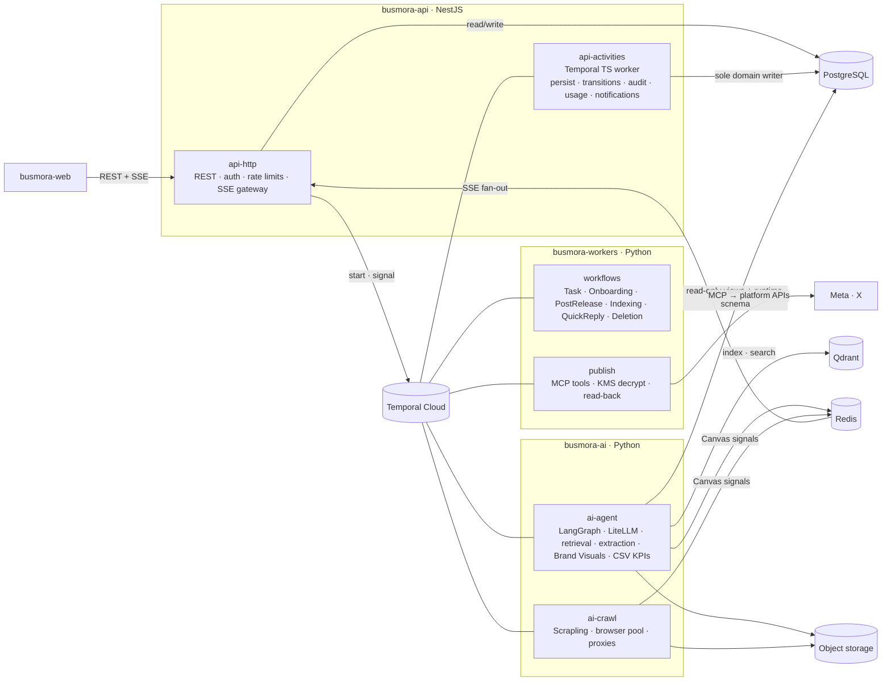
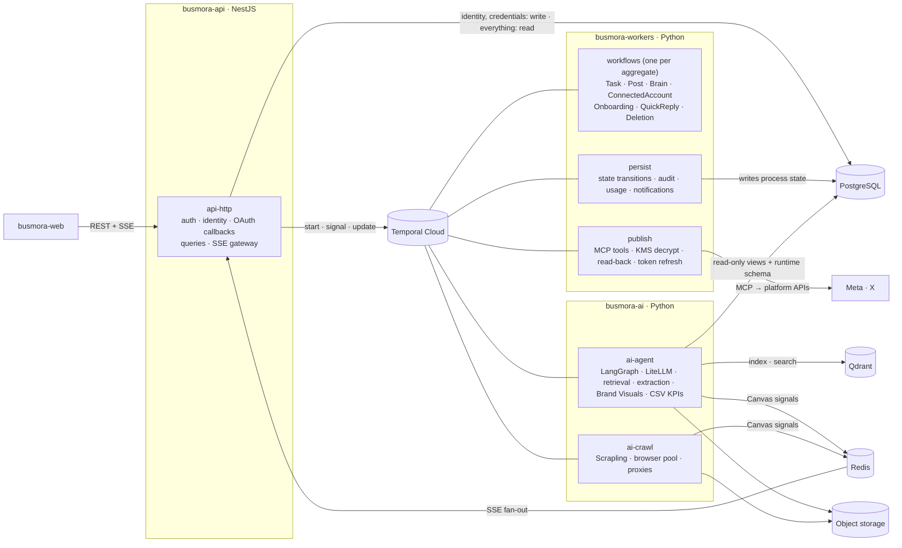
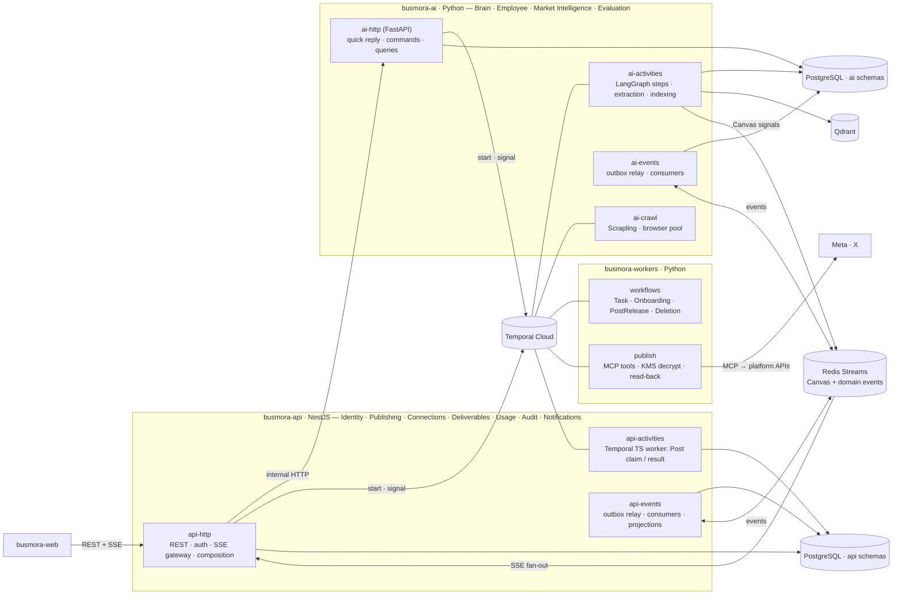

# 02 — Architecture Options

> **Design only.** No code, no recommendation. Scoring against the gates and weights in [01-constraints.md §4](./01-constraints.md) is the next step.
> **Inputs read in full (2026-10-17):** all seven `project-docs/` files, [00-requirements-analysis.md](./00-requirements-analysis.md), [01-constraints.md](./01-constraints.md), and `domain/` ([GLOSSARY](../domain/GLOSSARY.md), [contexts](../domain/contexts.md), [model](../domain/model.md), [events](../domain/events.md)). Reading log in the appendix.
> **Reference knowledge:** you named "architecture-patterns", "microservices-patterns" and "api-design-principles" as references. No skill or document by those names exists on this machine, so general knowledge of those pattern catalogues was used instead: modular monolith, process manager, entity workflow, transactional outbox, projections, API composition, BFF, contract-first APIs. These are patterns, not technologies.
> **Vocabulary** follows [GLOSSARY.md](../domain/GLOSSARY.md): Post, Post Version, Approval, Review, Knowledge Item, Task, Clarification, Canvas and so on.

---

## 0. Ground rules

### 0.1 The fixed stack (from the docs; nothing added)

| Layer | Fixed technologies | Source |
|---|---|---|
| Frontend (`busmora-web`) | Next.js 14+ (App Router), TypeScript, React Flow, Tailwind CSS / shadcn/ui, SSE client with `Last-Event-ID` reconnects, React Query / SWR | TA §3.1 |
| Platform API (`busmora-api`) | NestJS 10+ (TypeScript), Passport.js + JWT strategy, Argon2id, Drizzle ORM, SSE gateway reading Redis Streams, Temporal TypeScript SDK, ioredis, class-validator + Swagger | TA §3.1; D-29 |
| Workers + AI (`busmora-workers`, `busmora-ai`) | Python 3.11+, FastAPI + Uvicorn, LangGraph, LiteLLM, Scrapling, Temporal Python SDK, Qdrant client, SQLAlchemy / asyncpg, Pydantic v2, MCP SDK | TA §3.1 |
| Data & infrastructure | PostgreSQL 16+, Qdrant, Redis 7+, Temporal Cloud (+ Temporal UI), Cloud KMS, S3-compatible object storage, Docker Compose (local) | TA §3.1, §10.1; D-27, D-30 |
| Observability | Langfuse | D-33 |
| Contracts | "API contracts defined first (OpenAPI spec + TypeScript interfaces)" | TA §12.1 |
| **Not chosen here** (deferred) | Cloud provider, LLM providers, embedding model, image model, object-storage vendor, proxy vendor, payment provider | 01 HR-2, §2.13; D-39–D-42 |

The options combine these technologies differently. They add none. Some options use a listed technology in a role the docs don't describe. Each option flags this under **Deviations from TA**. Under 01 R-3 ("follow the docs as written") such deviations need your explicit acceptance before adoption. Per your instruction of 2026-10-18 (01 §4.3 step 6), they do **not** exclude an option from scoring. [03-benchmark.md](./03-benchmark.md) scores every option and reports each one's G5 exposure separately.

### 0.2 Inputs that bind every option

- **Four deployables** (D-26): `busmora-web`, `busmora-api`, `busmora-workers`, `busmora-ai`. An option may run one deployable as several **process roles**: the same codebase and image, started with a different entrypoint and scaled separately. A process role is not a new service.
- **Two standalone repositories, settled and final** (your decision of 2026-10-18; 01 R-5): `busmora-backend` (api + workers + ai) and `busmora-frontend` (web). This supersedes the single monorepo in TA §12.3; TA itself is not edited (01 R-4). Because it is settled, it is **not** counted as a deviation against any option.
- **Gates** G1, G2, G3 and G5 (G4 withheld), plus every Settled or Doc-derived item in 01.
- **Domain:** the 11 bounded contexts in [contexts.md](../domain/contexts.md) and the events in [events.md](../domain/events.md).

### 0.3 Common to all three backend options

These follow directly from the docs and 01, so the options don't differ on them:

1. **Only `busmora-api` is reachable from the browser.** It owns end-user auth: Argon2id, short-lived JWT carrying user and workspace, rotating refresh tokens in Redis (D-29; TA §9.1). It also rate-limits public endpoints (TA §1.1, §13 #8).
2. **The SSE gateway is in `busmora-api`** and reads Redis Streams. `busmora-ai` writes Canvas signals keyed by Task (D-34; TA §8).
3. **All agent work runs in `busmora-ai`**: Router, Orchestrator, Sub-agents, crawling, LiteLLM, knowledge extraction (TA §4.3).
4. **Qdrant is written and queried only from Python**, the only side with a Qdrant client. Every point carries workspace and status, and indexes are rebuildable from PostgreSQL and object storage (TA §5.2; 01 DL-6).
5. **Publishing after Approval is deterministic.** A non-LLM Temporal workflow publishes the approved Post Version through the MCP tools. Those tools run in a `publish` role of `busmora-workers`, which is also where KMS decryption happens (01 PB-1, PB-2; TA §1.1 "KMS vault" and "MCP Server" in the worker/AI tier; TA §4.2).
6. **OAuth consent callbacks and KMS encryption happen in `busmora-api`** (TA §4.1, §9.3).
7. **Large content travels by reference** (object-storage key or row id), not inline in Temporal payloads. Object keys are partitioned by workspace (TA §5.3; 01 DT-4).
8. **Every workflow input carries a frozen configuration** (TA §11.2), including the Treatment/Control retrieval flag for evaluation runs (EVAL §5).
9. **LangGraph checkpoints live in PostgreSQL** in a Python-owned runtime schema (TA §6.1, §13 #1).
10. **Observability:** Langfuse traces come from `busmora-ai`, tagged with workspace and Task. Temporal UI covers workflows (D-33; TA §10.1).
11. **Docker Compose runs the same process roles locally** (TA §10.1, §12.1).

TA does not say **which process writes workflow results to PostgreSQL**. TA §11.2 says `busmora-ai` is an activity worker "returning structured deliverables"; TA §4.1 says the Platform Service holds Brain management, Tasks, Deliverables and "approval state machine records". Every option has to interpret this (01 §2.14 #1). It is the main thing that separates them.

---

## A. Backend architectures (repository `busmora-backend`)

### A.0 How the options were derived

**Forces** (from the requirements and constraints):

| # | Force | From | Pulls toward |
|---|---|---|---|
| F1 | 4 students, 24 weeks, each member owning features across web → api → workers → ai | D-05; TA §12.1 | Few integration styles and few cross-language hops per feature (C1, C4) |
| F2 | Long, timer-driven processes with colliding triggers. Clarifications wait ≤ 7 days, Posts are scheduled up to a month ahead, pending Posts expire at their Scheduled Time, and edit/cancel can collide with release. | 01 DL-1, PB-4–PB-7, PB-12; PRD FR-092 | Durable timers; transitions that can't race (C2, G1) |
| F3 | The stack fixes the language split. LangGraph, Scrapling, LiteLLM, Qdrant and MCP are Python-only; Drizzle, Passport and Swagger are TypeScript-only. | TA §3.1 | A cross-language boundary is unavoidable; the question is where to put it |
| F4 | PostgreSQL is the single source of truth with RPO 0; Qdrant and Redis are derived | D-20; 01 DL-4–DL-6 | Clear write ownership in PostgreSQL (G3) |
| F5 | Tenant isolation in every store, with few enforcement points | 01 G2; C3 | Few places that must apply the workspace filter |
| F6 | Hard p95 latency: quick reply ≤ 3 s (non-durable), task acknowledgement ≤ 2 s, Canvas ≤ 500 ms | 01 DL-2, DL-3 | Short paths for chat and acknowledgement (C5) |
| F7 | OAuth plaintext only during a publish; untrusted crawled text never inside a context that can publish | TA §9.2–9.3; 01 PB-1 | Credentials and crawled content in separate processes (C3) |
| F8 | Domain-neutral seams; the evaluation switch | D-02; MVP §9; EVAL §5 | Configuration-driven Employee; one retrieval switch point (C6, C8) |

**Decision axes**, and where each option sits on them:

| Axis | B1 Platform-Centred | B2 Workflow-Centred | B3 Context-Owned |
|---|---|---|---|
| X1. Who owns domain state | `busmora-api` alone | Durable workflows (Python) | The service that owns each bounded context |
| X2. Unit of durable orchestration | One workflow per process (task, onboarding, post release) calling stateless steps | One long-lived workflow per aggregate (Task, Post, Brain, Connected Account) | Workflows only for timers and waits; everything else event-driven |
| X3. How TypeScript and Python talk | Temporal only, including TypeScript activities | Temporal only (commands as signals and updates) | Internal HTTP + domain events + Temporal |
| X4. PostgreSQL ownership | One writer, one migration toolchain | Shared schema; each table has one writing process | One schema per owning service |
| X5. Where invariants are enforced (approval lifecycle, Brain governance) | NestJS modules | Workflow code | The owning service |

The three options are three internally consistent combinations of these axes. Each pulls hardest on a different subset of forces.

---

### B1 — Platform-Centred: NestJS owns the domain; Python is stateless compute behind Temporal

#### Rationale
This option pulls hardest on F1, F4 and F5. TA §4.1 already places Brain management, Task and Deliverable management and approval records in the Platform Service. TA §1.2 says "Communication via Temporal activities". B1 takes both literally:
- `busmora-api` is the **only writer of domain state**.
- Python does only what the stack makes Python-only (F3).
- All TypeScript ↔ Python traffic goes through Temporal. To return results to the domain owner, `busmora-api` also hosts **Temporal TypeScript activities**.

#### Diagram


#### Mapping to bounded contexts

| Context | Rules and state (owner) | Durable process | Compute |
|---|---|---|---|
| Business Brain | api `brain` module: Review, lifecycle, Conflicts, Provenance, Retirement | `IndexingWorkflow` re-embeds after approve/edit/retire | ai: extraction, embedding, Qdrant, retrieval |
| Marketing Employee | api `conversation` and `tasks` modules: messages, Task records, Clarifications | `TaskExecutionWorkflow`, `QuickReplyWorkflow` | ai: Router, Orchestrator, Sub-agents |
| Governed Publishing | api `publishing` module: Post, Post Version, Approval, state machine (01 PB-3) | `PostReleaseWorkflow` per Post, from "send to Batch Review" until a final state | workers `publish` role |
| Market Intelligence | api `crawls` module: crawl records, Snapshot metadata, cache index | `OnboardingWorkflow`; research crawls as Task steps | ai-crawl |
| Deliverables | api `deliverables` module | — | Content produced by ai |
| Channel Connections | api `connections` module: OAuth, KMS encrypt, status | Token refresh inside the publish path | workers `publish` decrypts |
| Identity & Workspace | api `identity` module | `WorkspaceDeletionWorkflow` | — |
| Usage, Audit, Notifications | api modules; rows written in the same transaction as the action they record | — | — |
| Evaluation | api `evaluation` module: Scenarios, runs, scores | Scenario run = `TaskExecutionWorkflow` with the Treatment/Control flag frozen | ai |

**Domain-neutral seams (D-02):** Employee configuration, Capability and Task Record are api-owned records. The configuration is frozen into each workflow input.

#### Data approach
- **PostgreSQL:** one database with one schema per context. **Every domain table is written only by `busmora-api`.** Drizzle is the single migration toolchain, which answers 01 §2.14 #1.
- **Python access:**
  - `busmora-ai` gets a read-only role on views exposing approved Knowledge Items, Relationships, Procedural Rules and Snapshot metadata, for graph expansion. It also gets read-write on its own runtime schema for LangGraph checkpoints.
  - `busmora-workers` has **no database access**. Its publish role receives what it needs through activity inputs.
- **Tenant isolation:** the views require a workspace filter. PostgreSQL row-level security (a database feature) can back it.
- **Audit, usage and notification rows** are written in the same transaction as the change they describe. No separate event infrastructure is needed.
- **Qdrant:** approved items plus control-route chunks. Rebuilt by `IndexingWorkflow` from PostgreSQL and object storage.
- **Redis:** refresh tokens, per-Task Canvas streams, crawl-cache keys with a 7-day TTL (01 DT-3).
- **Object storage:** Snapshots and Brand Visuals are written by ai; CSV uploads by api. Metadata rows are written only by api.
- **Temporal:** in-flight process state and references only.

#### Communication (key flows)
1. **Quick reply.** api stores the message, starts a short `QuickReplyWorkflow`, and waits on its result for a bounded time. The workflow runs `ai.route_and_reply` and returns either a reply or "complex".
   - Reply: api stores it and responds.
   - Complex: api starts flow 2.
2. **Task.** api writes the Task (`requested`) and starts `TaskExecutionWorkflow` (workflow id = Task id), then acknowledges.
   - The workflow calls `platform.start_task` (capacity check, 01 SC-9).
   - It then loops `ai.run_agent_step`: LangGraph runs until an interrupt, completion or a step budget. It checkpoints in the runtime schema and emits Canvas signals.
   - After each step, `platform.record_progress` persists it.
   - Finally `platform.complete_task` writes Deliverables, Candidates, usage, audit and notifications in one transaction.
3. **Clarification.** A step returns an interrupt carrying a form. `platform.open_clarification` stores it. The workflow then waits for a `clarification_answered` signal (sent by api after validation) or a 7-day timer.
   - On answer: the next `run_agent_step` resumes LangGraph from the checkpoint.
   - On timeout: `platform.cancel_task`.
4. **Review.** REST → api `brain` module validates and writes, with audit → starts `IndexingWorkflow`.
5. **Batch Review and publish.**
   - "Send to Batch Review" starts `PostReleaseWorkflow` with a timer to the Scheduled Time.
   - Approve, edit, regenerate, reject and cancel are api writes. Regenerate runs a short workflow that calls ai **before** approval only.
   - At the Scheduled Time, `platform.claim_post` atomically checks the Post. If it is still approved on the same version, it moves to `publishing` and returns the version reference plus the credential envelope. If it is still pending, it moves to `expired`. Otherwise the workflow ends.
   - `workers.publish` decrypts in memory, calls the MCP tool with idempotency key = Post Version id, and reads back.
   - `platform.record_publish_result` stores the outcome.
6. **Onboarding.** api validates the URL and starts `OnboardingWorkflow`: `ai.crawl_site` → `ai.extract_candidates` → `platform.store_candidates` (including Brand Kit facts) → notification.

#### Auth
- **Users:** only `busmora-api` authenticates users. The frontend never reaches Python.
- **Tenant propagation:** api derives the workspace from the JWT and writes it into every workflow input. Python takes the workspace from nowhere else, and every view query and Qdrant filter requires it.
- **Service identities:**
  - Each process role has its own Temporal Cloud credential (mechanism is a gap, D G-D5).
  - Database roles: api read-write; ai read-only plus its runtime schema; workers none.
- **Secrets:** KMS encrypts in api and decrypts only in `workers.publish`. Plaintext never exists in `busmora-ai`, where untrusted crawled text lives (F7).

#### Integrations

| Integration | Lives in |
|---|---|
| Meta / X OAuth consent and token exchange | api-http |
| Meta / X publishing and read-back (MCP) | workers `publish` |
| Crawled sources, proxies, headless browsers | ai-crawl |
| LLMs, embeddings, image model (via LiteLLM where applicable) | ai-agent |
| Langfuse | ai-agent, ai-crawl |
| Email for verification and reset (provider = gap) | api-http |
| KMS | api (encrypt), workers `publish` (decrypt) |

#### Deployment topology
- **7 process roles from 4 images:** `web`, `api-http`, `api-activities`, `workers-workflows`, `workers-publish`, `ai-agent`, `ai-crawl`.
- **Public ingress:** `web` and `api-http` only.
- **Scaling:** `api-http` and `ai-agent` scale horizontally. `ai-crawl` is capped by the browser pool. A single workflow worker is enough for the pilot (01 SC-7).
- **Managed services** (same in every option): PostgreSQL, Redis, Qdrant, Temporal Cloud, KMS, object storage, Langfuse.
- **Local:** Docker Compose runs the same roles.

#### Cost / effort
Costs are relative only; financial topics are deferred (01 Q9).
- **Runtime footprint:** 7 process roles.
- **Build effort: medium.**
  - **Extra building blocks:** a TypeScript activity worker; payload contracts mirrored between Pydantic and TypeScript; retrieval views; `IndexingWorkflow`; `QuickReplyWorkflow`.
  - **Avoided:** event infrastructure, a second migration toolchain, internal HTTP.

#### Team-fit
- Domain rules live in NestJS. The team has stated prior NestJS + PostgreSQL experience (DRAW "SQL DATABASE OPTIONS"; non-canonical, but it is a fact about the team).
- Python work concentrates in agents, crawling and publishing, which suits 1–2 Python-leaning members.
- A vertical slice is: api module + workflow sequencing step + ai activity + frontend page. Every slice touches both languages, but the Python part is thin for non-AI features.

#### Pros and cons

| Pros | Cons |
|---|---|
| One writer, so the fewest tenant-enforcement points and audit written atomically with each change | Every persistence step crosses languages through Temporal, which adds latency and payload contracts in two languages |
| One migration toolchain; schema ownership is unambiguous | Sequencing (Python workflows) is separate from rules (NestJS); a reader needs both to follow a flow |
| Python is stateless and scales freely | Quick replies go through Temporal (F6 pressure) |
| Matches TA §4.1's allocation and TA §1.2's "communication via Temporal" | `busmora-api` grows large and holds every context |
| Credentials never in the process that reads crawled text | Retrieval views couple Python to api-owned table shapes |

#### Risks
- **Quick-reply p95 (≤ 3 s) and task acknowledgement (≤ 2 s)** depend on Temporal round trips plus the Router call, because classification happens before the Task exists (01 DL-3).
- **Payload drift** between Pydantic models and TypeScript DTOs, with no shared-schema tool in the docs (gap G-T8).
- **Temporal payload and history size limits** if large Deliverables are passed inline. Mitigated by common rule 7.
- **Versioning month-long `PostReleaseWorkflow`s** across deploys (TA §13 #10 states the goal but not the method).
- **The api activity role competes with HTTP traffic** if both run in one process. Mitigated by the separate role.

#### Deviations from TA (flag for G5)
- Uses the Temporal TypeScript SDK as an **activity worker**. TA §3.1 lists it as "(Workflow Client)". This is a role extension of a listed technology, not a new one.

---

### B2 — Workflow-Centred: durable workflows own every long-lived aggregate; `busmora-api` is a thin edge

#### Rationale
This option pulls hardest on F2. The Post lifecycle has ten states and several triggers that can collide: user edit, cancel or reschedule; release at the Scheduled Time; expiry; a broken credential (01 PB-3–PB-9). Clarifications wait up to 7 days, and Posts wait up to a month. TA §1.2 already says "Temporal owns the durable business workflow and approval signals".

B2 makes **each long-lived aggregate its own workflow** (one per Post, per Task, per Brain, per Connected Account). All transitions of an aggregate are therefore serialized inside one workflow. A cancel and a release cannot interleave, and expiry is a timer inside that same workflow. `busmora-api` keeps identity, credentials intake, reads and the SSE gateway, and sends every process command to a workflow.

#### Diagram


#### Mapping to bounded contexts

| Context | Workflow that owns transitions | State written by | Compute |
|---|---|---|---|
| Business Brain | `BrainWorkflow`, one per Workspace. Serializes candidate intake, Review, edits, Retirement, Relationships, Conflict checks and indexing. | workers `persist` | ai |
| Marketing Employee | `TaskWorkflow` per Task (Clarification waits); `QuickReplyWorkflow` per message. Conversation messages are persisted by these workflows. | workers `persist` | ai |
| Governed Publishing | `PostWorkflow` per Post, from `draft` to a final state, with timers for the Scheduled Time and expiry | workers `persist` | workers `publish` |
| Channel Connections | `ConnectedAccountWorkflow` per account: proactive refresh, Reconnect Needed, tells affected `PostWorkflow`s | api stores the encrypted credential at callback; workers `persist` updates status | workers `publish` |
| Market Intelligence | `OnboardingWorkflow` per Workspace; research crawls as Task steps | workers `persist` | ai-crawl |
| Deliverables | Written by `TaskWorkflow` at completion | workers `persist` | ai |
| Identity & Workspace | Plain CRUD in api; `WorkspaceDeletionWorkflow` | api | — |
| Usage, Audit, Notifications | Written by `persist` alongside each transition | workers `persist` | — |
| Evaluation | `ScenarioWorkflow` wrapping a `TaskWorkflow` in Treatment or Control | workers `persist` | ai |

**Domain-neutral seams (D-02):** an Employee is a set of workflow types plus a frozen configuration. A future Employee adds workflow types and Capabilities without new services.

#### Data approach
- **PostgreSQL:** one database with shared schemas, and **each table has exactly one writing process.**
  - `busmora-api` writes identity, workspace, credential envelopes and upload metadata.
  - `workers.persist` writes all process state: Tasks, Clarifications, messages, Posts and Versions, Publish Attempts, Brain items and edges and rules, Deliverables, usage, audit, notifications.
  - `busmora-ai` has read-only views plus its runtime schema.
- **Migrations:** one toolchain (Drizzle, in the api codebase) covers all tables, including those Python writes through SQLAlchemy. The schema is therefore authored in TypeScript but written to from Python.
- **Persist then acknowledge.** A workflow accepts a command only after its `persist` activity has committed the transition. PostgreSQL is then always the durable record (RPO 0, G3), while Temporal holds the in-flight process.
- **Workflow ids encode workspace and aggregate** (e.g. `ws-{id}/post-{id}`). This makes "one workflow per Post" a uniqueness guarantee, so there is at most one publisher per Post (G1).
- **Qdrant, Redis and object storage** are used as in B1.

#### Communication (key flows)
1. **Quick reply:** same as B1. api starts `QuickReplyWorkflow` and waits for a bounded time.
2. **Task.** api starts `TaskWorkflow` and acknowledges. The first `persist` writes the Task record. Steps loop `ai.run_agent_step` + `persist`. On completion it writes Deliverables, starts a `PostWorkflow` per proposed Post (`draft`), and signals `BrainWorkflow` with Candidates.
3. **Clarification.** `TaskWorkflow` waits for an **Update** `answer_clarification` (validated inside the workflow) or a 7-day timer.
4. **Review.** api sends an Update to `BrainWorkflow`: persist → re-index → Conflict check → returns the result to the UI.
5. **Batch Review and publish.** Each user action is an Update on that Post's `PostWorkflow`:
   - send to Batch Review (includes the lazy OAuth check), edit (new Post Version), regenerate (ai activity, before approval only), approve, reject, cancel, reschedule.
   - The workflow keeps a timer to the Scheduled Time.
   - At release: `workers.publish` runs with idempotency key = Post Version id → read-back → `persist`.
   - If still pending at that time: `expired`.
6. **Connected accounts.** `ConnectedAccountWorkflow` refreshes tokens ahead of expiry. On failure it marks Reconnect Needed and signals affected `PostWorkflow`s (01 PB-9).
7. **Onboarding.** `OnboardingWorkflow`: crawl → extract → signal `BrainWorkflow` with Candidates and Brand Kit facts.
8. **Reads:** api queries PostgreSQL directly. Workflows are never queried for UI data.

#### Auth
- **Users:** only `busmora-api` authenticates users.
- **Tenant propagation:** workflow ids and search attributes carry the workspace. Every Update validator rejects a workspace mismatch, and `persist` activities write only rows of their workflow's workspace.
- **Database roles:** api read-write on identity, credentials and uploads, read-only on the rest; workers `persist` read-write on process tables; ai read-only views plus runtime.
- **Secrets:** KMS decryption and token refresh happen only in `workers.publish`.

#### Integrations
Same placement as B1, except that token refresh is proactive, inside `ConnectedAccountWorkflow` → `workers.publish`.

#### Deployment topology
- **7 process roles:** `web`, `api-http`, `workers-workflows`, `workers-persist`, `workers-publish`, `ai-agent`, `ai-crawl`.
- `busmora-api` has no Temporal worker.
- **Scaling:** `ai-agent` horizontal; `workers-persist` horizontal; `ai-crawl` capped.
- **Local:** Docker Compose runs the same roles.

#### Cost / effort
- **Runtime footprint:** 7 process roles.
- **Build effort: medium-high.**
  - **Extra building blocks:**
    - Entity-workflow patterns: Update handlers and validators, continue-as-new for the indefinitely long `BrainWorkflow`, versioning of month-long `PostWorkflow`s.
    - A `persist` activity for every transition.
    - Temporal on every write path.
  - **Avoided:** a TypeScript worker, custom locks and schedulers, race handling in application code.

#### Team-fit
- The core is Python-centric. TypeScript members work on the api edge, read endpoints and the frontend.
- **Every member must understand Temporal determinism, Updates and workflow versioning**, the steepest learning curve of the three options.
- A vertical slice is: thin api endpoint + workflow + activities + frontend page.

#### Pros and cons

| Pros | Cons |
|---|---|
| Lifecycle races are impossible by construction (one workflow per Post/Task/Brain) | Temporal is on the path of nearly every user write. A Temporal Cloud outage blocks Reviews, Batch Review actions and chat, not only background work. |
| Timers, expiry, Clarification waits and proactive token refresh are native | User commands pay Update round trips |
| Temporal UI gives a per-aggregate history | Long-lived workflows (Brain indefinitely, Posts up to a month) need disciplined versioning |
| No TypeScript worker; api stays thin | Two places hold state: the workflow (in flight) and PostgreSQL (durable record). They must be kept aligned by persist-then-acknowledge. |
| Strong G1 story: one workflow per Post, idempotency key per version | Schema is authored in TypeScript but written from Python |

#### Risks
- **Workflow determinism bugs** and **non-versioned changes** to running workflows. A deploy can break in-flight Posts.
- **`BrainWorkflow` history growth** and Update throughput. continue-as-new must be designed in from the start.
- **The learning curve threatens delivery feasibility** (C1, 20% weight) in a 24-week window.
- **Temporal Cloud availability becomes product availability** for most features. Customer data also leaves MENA through Temporal (01 HR-3).

#### Deviations from TA (flag for G5)
- **Allocation:** Brain management, Task and Deliverable records and approval-state records move from the Platform Service (TA §4.1) into workers.
- **Command path:** Temporal carries all user commands, not only "approval signals" (TA §1.2).

---

### B3 — Context-Owned: each bounded context's data lives with its logic; integration by events, internal queries and Temporal

#### Rationale
This option pulls hardest on F3, F6 and F8. It assigns each bounded context to the service whose language its logic needs, and gives that service sole ownership of the context's data:
- **TypeScript (`busmora-api`)** owns the user-facing generic and supporting contexts, plus Governed Publishing, whose rules are deterministic.
- **Python (`busmora-ai`)** owns the AI-heavy contexts: Business Brain (retrieval and Qdrant are Python-only), Marketing Employee and Market Intelligence.

The services integrate in three ways:
- **Domain events** ([events.md](../domain/events.md)) through a transactional outbox, with Redis Streams as transport.
- **Internal HTTP** where the user needs an immediate answer.
- **Temporal** only where durability over time is needed (TA §1.2: "Temporal for durability, LangGraph for intelligence").

#### Diagram


#### Mapping to bounded contexts

| Context | Owner and schema | Commands arrive by | Publishes |
|---|---|---|---|
| Identity & Workspace | api · `identity` | REST | `WorkspaceCreated`, `WorkspaceDeletionRequested` |
| Governed Publishing | api · `publishing` | REST; `DeliverableCreated` creates draft Posts | `Post*` events; starts `PostReleaseWorkflow` |
| Channel Connections | api · `connections` | OAuth callbacks, REST | `Account*` events |
| Deliverables | api · `deliverables` (stored from `DeliverableCreated`) | Event | — |
| Usage, Audit, Notifications | api · `ops` (consumers of all events) | Events | Notifications to the SSE gateway |
| Business Brain | ai · `brain` | Internal HTTP from api (Review, edit, add, retire); internal calls from Employee and crawl | `Knowledge*` events |
| Marketing Employee (Conversations, Tasks, Clarifications) | ai · `employee` | Internal HTTP from api (message, answer, cancel) | `Task*`, `Clarification*`, `DeliverableCreated` |
| Market Intelligence | ai · `intel` | Internal | `OnboardingCrawl*`, `ResearchCrawlCompleted`, `SourceSkipped` |
| Evaluation | ai · `eval` | Internal endpoints | — |
| Durable processes | workers (no schema): workflow code only; activities belong to the owners | Temporal | — |

**Domain-neutral seams (D-02):** a future Employee can be a new consumer and producer of the same events, with its own context schema.

#### Data approach
- **PostgreSQL:** one cluster, **one schema per owning service**. Database roles stop any service reading or writing another service's schemas. Cross-context data moves only by events or internal calls.
- **Outbox and inbox:**
  - Each owner writes domain events to an outbox table in the same transaction as its state change.
  - A relay publishes them to Redis Streams consumer groups.
  - Consumers deduplicate by event id using an inbox table.
  - Redis is transport only. If it loses data, events are replayed from the outbox (01 DL-6, G3).
- **Projections:** api keeps only small projections it needs for the UI, such as pending-Candidate badge counts and notification lists. Brain and Task screens are served by **API composition**: api calls ai's internal HTTP.
- **Migrations:** Drizzle for api schemas. **Python-owned schemas need a migration toolchain the docs don't name** (gap G-T9). The alternative, Drizzle for all schemas, weakens the ownership boundary.
- **Qdrant:** owned by ai. **Object storage:** keys under each owner's prefix.

#### Communication (key flows)
1. **Quick reply.** api sends `POST /internal/conversations/{id}/messages` to ai over HTTP. ai runs the Router and either returns a reply, or creates a Task and starts `TaskWorkflow` and returns the Task id. **No Temporal on the quick path.**
2. **Task.** Inside the call above, ai writes the Task plus a `TaskRequested` outbox event and returns. Acknowledgement is the HTTP response.
3. **Clarification.** The answer goes api → ai over HTTP. ai validates it and signals `TaskWorkflow`. The workflow waits for the signal or a 7-day timer.
4. **Review.** api → ai over HTTP. The Brain write and a `KnowledgeItemApproved` outbox event commit together. The api consumers then update badges and audit.
5. **Deliverable.** ai emits `DeliverableCreated` (by reference). api stores the Deliverable, and Publishing creates draft Posts.
6. **Publish.**
   - api owns Posts. "Send to Batch Review" starts `PostReleaseWorkflow` (TypeScript client).
   - At the Scheduled Time, the `api-activities` activity `claim_post` runs, then `workers.publish`, then `record_result`. The pattern is the same as B1.
   - Regenerate is an api → ai call before approval only.
7. **Onboarding.** api → ai over HTTP. ai starts `OnboardingWorkflow` and writes Candidates to its Brain schema, emitting events.

#### Auth
- **Users:** only `busmora-api` authenticates users.
- **Internal HTTP:** api → ai calls carry a **service credential plus the forwarded user and workspace identity**. The mechanism is not in the docs (gap G-D7). **ai must enforce the workspace on every endpoint.**
- **Events:** every event carries the workspace, and every consumer scopes by it.
- **Database roles:** one per service, with no cross-schema access.
- **Secrets:** KMS decryption only in `workers.publish`.

#### Integrations
Same placement as B1. Internal HTTP is the only new channel, and it stays inside the backend.

#### Deployment topology
- **10 process roles:** `web`, `api-http`, `api-activities`, `api-events`, `workers-workflows`, `workers-publish`, `ai-http`, `ai-activities`, `ai-crawl`, `ai-events`.
- **Public ingress:** `web` and `api-http` only. `ai-http` is internal only.
- **Scaling:** every role scales independently. The ai side keeps working for Brain and chat if publishing is degraded, and vice versa.

#### Cost / effort
- **Runtime footprint:** 10 process roles.
- **Build effort: high.**
  - **Extra building blocks:** outbox, relay and inbox on both sides; projections; internal HTTP and its auth; two migration toolchains (gap); a TypeScript activity worker; three integration styles to test.
  - **Gained:** a short quick-reply path and failure isolation between the TypeScript and Python halves.

#### Team-fit
- Ownership splits naturally by language, e.g. 2 TypeScript + 2 Python members.
- But the documented vertical-slice ownership (TA §12.1) means every member must work with all three integration styles. Features such as Task → Deliverable → Post cross the boundary through events.

#### Pros and cons

| Pros | Cons |
|---|---|
| Each context's data lives with the logic that uses it; ownership is clear | Most moving parts: three integration styles and 10 process roles (C4) |
| Shortest quick-reply path (HTTP, no Temporal) for the ≤ 3 s target | Eventual consistency. A Deliverable or badge appears after event processing, and the UI must show that. |
| Failure isolation: a Temporal or ai outage leaves Identity, Batch Review edits and Deliverables browsing working | Most tenant-enforcement points: api, every ai endpoint, consumers on both sides, outboxes, views, Qdrant |
| Events give a natural seam for a future Employee and for audit, usage and notifications | Needs a Python migration toolchain the docs don't list |
| Temporal is used only where durability over time is required | Debugging spans HTTP, events and workflows |

#### Risks
- **Distributed-systems failure modes** (duplicates, ordering, projection drift, partial failure across HTTP calls) for a 4-student team in 24 weeks.
- **Internal HTTP without a documented service-auth mechanism**, so tenant leakage between services becomes possible if a check is missed.
- **Redis Streams consumer-group operations**: pending entries, retention, replay from the outbox.
- **Scope creep** from building infrastructure (relay, inbox, projections) instead of product.

#### Deviations from TA (flag for G5)
1. **Synchronous HTTP between `busmora-api` and `busmora-ai`.** TA §1.2 says "Communication via Temporal activities". 01 R-1 superseded the deck's REST labels as documentation; it did not adopt them as design.
2. **Brain management moves to ai.** TA §4.1 places it in the Platform Service.
3. **Temporal TypeScript SDK as an activity worker.** TA §3.1 lists it as "(Workflow Client)".
4. **Redis Streams also carries domain events.** TA §2 describes Redis as "Streams for the canvas, caching".

---

### A.4 Side by side (descriptive, not scored)

| Aspect | B1 Platform-Centred | B2 Workflow-Centred | B3 Context-Owned |
|---|---|---|---|
| Writers to PostgreSQL | api only (ai: its runtime schema only) | api (identity, credentials) + workers `persist` (all process state) | api (its schemas) + ai (its schemas) |
| Migration toolchains | Drizzle | Drizzle for all, including Python-written tables | Drizzle + a Python toolchain (gap), or Drizzle for all |
| Integration styles | Temporal | Temporal | Temporal + internal HTTP + events |
| Process roles (including web) | 7 | 7 | 10 |
| Approval-lifecycle rules live in | NestJS `publishing` (the workflow re-checks at claim) | `PostWorkflow` | NestJS `publishing` (the workflow re-checks at claim) |
| Brain governance lives in | NestJS `brain` | `BrainWorkflow` | ai `brain` |
| Clarification wait | Workflow signal + LangGraph checkpoint | Workflow Update + LangGraph checkpoint | Workflow signal (sent by ai) + LangGraph checkpoint |
| Quick-reply path | api → Temporal → ai → Temporal → api | api → Temporal → ai → Temporal → api | api → ai (HTTP) |
| User commands that go through Temporal | Task start, Clarification answers, post release | Nearly all process commands, including Reviews and Batch Review | Workflow starts and signals only |
| If Temporal is down | Tasks, quick replies and publishing pause; Brain, Batch Review edits and Deliverables work | Most writes pause; identity and reads work | Tasks and publishing timers pause; quick replies, Brain, Batch Review edits and Deliverables work |
| Places that must enforce the workspace | api; ai read-only views; Qdrant filter; workflow inputs | api; `persist` activities; Update validators; views; Qdrant | api; ai endpoints; consumers on both sides; outboxes; views; Qdrant |
| Where OAuth plaintext exists | `workers.publish`, during a publish | `workers.publish`, during a publish or refresh | `workers.publish`, during a publish |
| How G1 is met | Claim-then-publish with idempotency key = Post Version id | One `PostWorkflow` per Post + idempotency key = Post Version id | Same as B1 |
| How G3 is met | Single writer; Qdrant/Redis rebuilt from PostgreSQL | Persist-then-acknowledge; Qdrant/Redis rebuilt | Outbox replay; Qdrant/Redis rebuilt |
| Deviations from TA (needs your acceptance under R-3) | 1 | 2 | 4 |

---

## B. Frontend architectures (repository `busmora-frontend`)

Every frontend option works with every backend option. The frontend only ever talks to `busmora-api`.

### B.0 What the frontend must cover (docs only)

| Area | Required by the docs | Source |
|---|---|---|
| Auth | Register, email verification, login, logout, password reset | PRD FR-001, FR-002 |
| Onboarding | Website URL; non-blocking crawl with progress (pages crawled, estimated completion); Business Time Zone | FR-010, FR-014; 01 PB-12 |
| Marketing Employee | Conversation list and history. Chat with the 7 message types, including Structured Forms (text, radio, checkbox, dropdown, per-field "Search Yourself"), free text, Deliverable cards. Split layout with chat and Canvas; Canvas toggle on mobile. Progress shown in chat for long tasks. | FR-030–FR-033, §13.4; D-15 |
| Canvas | React Flow: Orchestrator + 5 Sub-agents; idle, active, completed and error states; animated edges; abstracted tool labels. SSE with `Last-Event-ID`; ≤ 500 ms; live-only, with a grace window after the run. | FR-040–FR-046; 01 DL-3, RT-1 |
| Brain | React Flow graph of approved and Candidate items. Side panel to view, edit or retire. Manual items and Relationships. Filter by category and relationship type; full-text search. Provenance view of the Snapshot. Candidate Review in 7 sections, one at a time, with a badge. Conflicts. Brand Kit facts. | FR-013, FR-021; 01 BG-1–BG-7, BA-5 |
| Deliverables | List; filter by type and date; full view (Markdown or structured); download (stretch goal) | FR-050, FR-051 |
| Batch Review | Grid or list showing Platform, time in the Business Time Zone, preview with Brand Visual, and status. Per-Post approve, reject, edit, regenerate, cancel, reschedule, retry. Approve or reject all remaining. Failure reasons. Lazy connect prompt. Session timing captured for evaluation. | PRD §11.3; 01 PB-3–PB-12; EVAL §8 |
| Settings | Account; Connected Accounts (status, connect, disconnect, Reconnect Needed); Business Time Zone; UI language | FR-004, §12.3; 01 PB-12 |
| Notifications | In-app badges and chat messages only | 01 RT-4 |
| Cross-cutting | Arabic RTL and English LTR; dates and times per locale; responsive layout; whole-message replies with no token streaming | NFR-006, FR-030; 01 RT-2 |

**Common to all frontend options:**
- The fixed stack from §0.1.
- Code organized by bounded context: `identity`, `onboarding`, `employee` (chat + Canvas), `brain`, `deliverables`, `publishing` (Batch Review), `connections`, `settings`, `notifications`.
- Deployed as the `busmora-web` container (D-26).
- Never calls Python services.

---

### FE-1 — Client-Rendered Application

#### Structure
```
app/
  (public)/login, register, verify, reset
  (app)/layout          ← client shell: navigation, language + direction, session
  (app)/onboarding, employee/[conversationId], brain, deliverables, batch-review, settings
features/<context>/      ← query hooks, mutations, components per bounded context
shared/                  ← shadcn/ui components, API client, SSE client, i18n, formatting
```

#### Rendering and data flow
- The App Router is used for routing and layouts only. **Every app page is a client component**, and there is no server-side data fetching.
- Components call React Query / SWR hooks, which call `busmora-api` REST directly from the browser.
- The Employee view opens **one SSE stream per running Task**.
- Other live states are refreshed by periodic refetch: crawl progress, Post statuses after the Scheduled Time, badges.

#### State handling
- Server state lives in the query cache.
- UI state is local or in context.
- Form state is local.
- Language and direction live in a client context that sets the document's `dir`.

#### Communication with the backend
- The browser talks to `busmora-api` directly, which is cross-origin unless both are served under one site.
- The access token is held in memory and refreshed through the api's refresh endpoint.
- **SSE authentication needs a cookie or a token in the URL.** The browser's EventSource cannot send an `Authorization` header (gap G-T3).

#### Deployment
- `busmora-web` container serving the app.
- A static export is also possible, but where it would be hosted is not in the docs (gap G-T18).

#### Team-fit
The most familiar model, the classic SPA: little framework-specific learning, and a clear split between "frontend calls API" and "API does work".

#### Pros and cons

| Pros | Cons |
|---|---|
| Simplest mental model; fastest to start | Access token is reachable by browser JavaScript (XSS exposure) |
| The frontend is fully decoupled from server rendering | Cross-origin calls and the SSE auth workaround |
| Works with any backend option unchanged | Polling for non-Canvas live states adds load and delay (badges, Post statuses, crawl progress) |
| Lowest frontend operational burden | Largest JavaScript bundle; slower first load |

#### Risks
- Token-refresh races across tabs and in-flight requests.
- SSE auth via the URL can leak tokens into logs.
- Polling intervals tuned too slowly will miss the ≤ 500 ms feel on non-Canvas screens. That target formally applies only to the Canvas.

---

### FE-2 — Server-First with Next.js as Backend-for-Frontend (BFF)

#### Structure
```
app/
  (public)/…                       ← server-rendered auth pages
  (app)/…/page                     ← React Server Components fetch page data from busmora-api on the server
  (app)/…/actions                  ← Server Actions for mutations (Review, approve, settings…)
  bff/…/route                      ← Route Handlers: proxy and aggregate for client components, incl. SSE proxy
features/<context>/                ← server data loaders, actions, client islands
shared/                            ← UI kit, server-side API client, i18n
```

#### Rendering and data flow
- List and detail pages (Deliverables, Brain review lists, Settings, Batch Review's initial load) are rendered on the server from `busmora-api` data.
- Interactive parts are **client islands** hydrated with server data: chat, Canvas, Brain graph, Batch Review grid.
- Mutations go through Server Actions or BFF Route Handlers, followed by revalidation.

#### State handling
- The server is the source of initial state.
- Client islands use React Query / SWR against BFF endpoints for refresh.
- UI state is local.

#### Communication with the backend
- **Browser ↔ Next.js server:** same origin, with an httpOnly session cookie.
- **Next.js server ↔ `busmora-api`:** server-to-server, carrying the JWT.
- **SSE is proxied:** a Route Handler opens the api stream and streams it to the browser. Tokens never reach browser JavaScript.
- How the session is stored and encrypted on the Next.js side is not in the docs (gap G-T19).

#### Deployment
- `busmora-web` must run as a Node server. Static export is impossible with Server Actions and Route Handlers.
- It must support streaming responses and many long-lived connections.

#### Team-fit
Requires fluency in React Server Components, Server Actions and App Router caching rules. This is the steepest frontend learning curve, and the team's prior experience is not documented.

#### Pros and cons

| Pros | Cons |
|---|---|
| Tokens never exposed to browser JavaScript; same-origin, so no CORS | An extra hop on every request and on SSE, inside the ≤ 500 ms Canvas budget |
| Server composes several api calls per page | Two server tiers to run and debug (Next.js and NestJS) |
| Smaller client bundles for list-heavy pages | BFF endpoints duplicate parts of the api surface |
| SSE auth problem disappears (cookie to same origin) | Next.js holds long-lived SSE connections and becomes stateful |

#### Risks
- **SSE proxying** suffers buffering, timeouts and connection limits on the Next.js server.
- **App Router caching semantics** differ between Next.js versions. TA allows "14+", so stale data bugs are possible.
- **Auth refresh logic** is split between the BFF and the api.

---

### FE-3 — Workspace Event Shell

#### Structure
```
app/
  (public)/…                       ← auth pages (may render on the server)
  (app)/layout                     ← persistent client shell: session, ONE workspace SSE stream,
                                     event router, language + direction
  (app)/onboarding, employee, brain, deliverables, batch-review, settings
features/<context>/
  queries/  commands/  events/     ← each context declares the event types it handles
  components/
shared/                            ← UI kit, API client, typed event envelope, i18n
```

#### Rendering and data flow
- The workspace is client-rendered inside a **shell that stays mounted across navigation**, so the stream survives page changes.
- **Unidirectional loop:**
  - Commands are REST mutations.
  - The backend changes state and publishes UI-relevant events.
  - The workspace SSE stream delivers them.
  - The event router patches the query cache, and screens re-render.
- **Initial load and gap recovery:** queries. After a reconnect, either `Last-Event-ID` replay, or a full refetch when the server signals the replay window was exceeded.

#### State handling
- The **query cache is the single client store**, patched by events. Commands may apply optimistic updates that events later confirm or roll back.
- UI state is local.

#### Communication with the backend
- REST for commands and queries.
- **One SSE stream per workspace** carrying:
  - Canvas signals for running Tasks.
  - Domain events the UI shows: Candidate proposed, Conflict detected, crawl progress, Post status changes, Deliverable created, notifications.
- Token handling is the same as FE-1: the browser talks to the api directly, so the SSE auth gap applies.

#### Backend impact
`busmora-api` must expose a **workspace-level stream with one ordered event id space**. It merges per-Task Canvas streams with UI events. How each backend option produces those UI events:
- **B1:** api writes them as it persists changes.
- **B2:** `persist` activities write them.
- **B3:** api event consumers write them.

#### Deployment
`busmora-web` container (static export is possible, with the same hosting gap as FE-1).

#### Team-fit
Needs discipline around a typed event contract and cache-patching rules. It is moderate React work but the richest frontend–backend contract.

#### Pros and cons

| Pros | Cons |
|---|---|
| One connection; every screen is live with no polling (badges, Post statuses, crawl progress, Canvas) | The richest contract between the repos (event types and payloads) |
| Mirrors the domain events already modeled | Cache-patching logic for each event type |
| Fewer refetches; consistent state across screens | Replay across a merged stream is harder than per-Task replay |
| Natural fit for B3's events; workable with B1 and B2 | Same token-in-browser exposure as FE-1 |

#### Risks
- Event ordering and duplication bugs.
- Memory growth in long sessions.
- Tight coupling between frontend state logic and backend event schemas.
- A replay window too short for a laptop that sleeps.

---

### B.4 Frontend side by side (descriptive, not scored)

| Aspect | FE-1 Client-Rendered | FE-2 Server-First BFF | FE-3 Workspace Event Shell |
|---|---|---|---|
| Rendering | Client | Server components + client islands | Client shell (public pages may be server-rendered) |
| Who calls `busmora-api` | Browser | Next.js server | Browser |
| Tokens in browser JavaScript | Yes (access token in memory) | No | Yes (access token in memory) |
| Real-time | SSE per Task + polling elsewhere | Proxied SSE per Task + revalidation | One SSE stream per workspace for everything |
| Client state | Query cache + local | Server props + small query cache | Event-patched query cache as the single store |
| Next.js runtime required | No (static possible) | Yes (Node server, streaming) | No (static possible) |
| Backend changes required | None beyond the per-Task stream | None beyond the per-Task stream | Workspace stream with UI events |

---

## C. Contract strategy between the two repositories

### C.1 Contract surfaces

| # | Surface | Between | Style |
|---|---|---|---|
| S1 | Commands and queries | web → api | REST/JSON described in OpenAPI |
| S2 | Server push | api → web | SSE: per-Task streams (FE-1, FE-2) or a workspace stream (FE-3) |
| S3 | Auth and session | web ↔ api | Auth endpoints + token/cookie rules, declared as OpenAPI security schemes |
| S4 | Platform connection redirects | browser ↔ api ↔ Meta / X | Documented start URL, callback handled by api, return route into the web app |
| S5 | Uploads | web → api | Performance Report (CSV) upload |
| S6 | BFF surface (FE-2 only) | browser → Next.js server | Internal to the frontend repository; not a cross-repo contract |
| — | Backend-internal | Temporal payloads (Pydantic ↔ TypeScript in B1 and B3); events and internal HTTP (B3) | Inside `busmora-backend`; not part of the cross-repo contract |

### C.2 What the docs already fix
- "API contracts defined first (OpenAPI spec + TypeScript interfaces)" (TA §12.1).
- NestJS uses class-validator + Swagger (TA §3.1).
- SSE with `Last-Event-ID` replay (D-34). The Canvas event names and payloads are fixed by PRD FR-045.
- User-visible error behaviours (PRD §13) define the error categories the UI must show.

### C.3 Authoring and distribution: two variants within the stack (no recommendation)

| | Variant 1: Spec-first | Variant 2: Code-first |
|---|---|---|
| Source of truth | An OpenAPI document authored in `busmora-backend/contracts/` | NestJS controllers and DTOs (class-validator + Swagger decorators); the spec is generated at build |
| How "defined first" (TA §12.1) is met | The spec change merges before implementation | DTOs and controller signatures (stubs) merge before implementation |
| Drift control | CI compares the spec generated from code with the authored spec (tool gap G-T7) | None needed; the spec is always generated |
| SSE schemas | Authored as component schemas, with an event-type enum | Event DTO classes decorated so they appear in the generated spec |
| Frontend consumption | Pinned spec version → TypeScript interfaces (generated: tool gap G-T7; or hand-written as TA says) | Same |
| Trade-off | The contract is reviewed independently of code, and both repos can start in parallel. Costs: a drift check and duplication. | Single source and less duplication. Cost: the frontend waits for the backend's DTO pull request. |

In both variants, the backend's CI publishes a versioned `openapi.json` as a release artifact (CI tooling is gap G-T17). The frontend pins a version and upgrades deliberately.

### C.4 Conventions, independent of the variant

These follow common API-design principles and tie directly to the requirements:

1. **Versioning.** A `/v1` prefix. Only additive changes within a version. A breaking change means a new version or a deprecation window. The frontend pins a contract version.
2. **Resources by bounded context**:
   - `/auth`, `/workspace`, `/onboarding`
   - `/conversations/{id}/messages`, `/tasks/{id}`, `/tasks/{id}/clarifications/{id}`
   - `/brain/items`, `/brain/relationships`, `/brain/candidates`, `/brain/conflicts`
   - `/deliverables`, `/posts`, `/posts/{id}/versions`
   - `/connections`, `/notifications`, `/performance-reports`

   Whether the workspace appears in the path or comes only from the token is open (gap G-D8).
3. **One error envelope:** a stable error code, an i18n message key, details and a correlation id. Domain codes include e.g. stale Post Version, Reconnect Needed, capacity queued, CSV headers unrecognized.
4. **Optimistic concurrency.** Commands on Posts and Knowledge Items carry the version they act on, and a stale version returns a conflict. This is how "an Approval binds to one Post Version" (01 PB-1, PB-4) is enforced at the API boundary.
5. **Idempotency keys.** Non-idempotent commands carry a client-supplied key: send message / start Task, send to Batch Review, approve, retry publish, upload (TA §13 #5; 01 G1).
6. **Asynchronous work.** Long work returns "accepted" plus the resource id (Task, Onboarding Crawl). Progress arrives over SSE and current state via GET.
7. **Lists.** Cursor pagination. Filters: Deliverables by type and date; Brain by category, relationship type and text (FR-051, FR-021).
8. **Time.** UTC instants, plus IANA time-zone fields for Scheduled Time and the Business Time Zone (01 PB-12).
9. **Language.** UI strings belong to the frontend; the api returns codes. Generated content carries language and dialect tags (01 SC-5).
10. **SSE envelope.**
    - `id`: monotonic per stream.
    - `event`: the event type.
    - `data`: workspace, optional Task, occurred-at and payload.
    - Plus heartbeats, and a "reset" event when a reconnect falls outside the replay window (01 RT-1).
11. **Security schemes and token rules** are declared in the spec (S3).
12. **Uploads** are multipart CSV with documented limits. The limit values are an open requirement (01 §2.15).

### C.5 Change process
- Contract changes are pull requests in `busmora-backend` that need a frontend reviewer, and come with a changelog entry.
- The frontend CI checks the pinned version against the current one for breaking changes. A mock server (or running the backend via Docker Compose) unblocks frontend work. Tooling for both is gap G-T7.

### C.6 How each option shows up in the contract
- **B1, B2, B3 are invisible to the frontend**, with two exceptions:
  - B3's eventual consistency must be explicit: "accepted", followed by an event.
  - B2's Update round trips are synchronous from the frontend's point of view.
- **FE-3** requires S2 to be a workspace stream carrying domain-event types. **FE-1 and FE-2** need per-Task streams plus GET endpoints suited to polling or revalidation. **FE-2** adds S6 inside the frontend repo.

---

## D. Gaps (left undecided by the docs; not resolved here)

### D.1 Tooling the stack does not name

| # | Gap | Why it matters | Affects |
|---|---|---|---|
| G-T1 | Frontend i18n/RTL library (message catalogues, plural rules, locale formatting) | NFR-006; Arabic/English with direction switching | All frontend options |
| G-T2 | React Query **or** SWR (the docs list both) | One data-fetching model per codebase | All frontend options |
| G-T3 | SSE client library and **SSE authentication** (the browser EventSource cannot send headers) | Canvas, `Last-Event-ID` | FE-1, FE-3 (FE-2 proxies) |
| G-T4 | Form library and validation for Structured Forms and edit dialogs | FR-032, Batch Review edits | All frontend options |
| G-T5 | Markdown rendering and sanitization for Deliverables | FR-050 content is Markdown | All frontend options |
| G-T6 | PDF/Markdown export | FR-051 (stretch goal) | Frontend or backend |
| G-T7 | OpenAPI → TypeScript generation, mock server, contract diff check | TA §12.1 names the format, not the tooling | Contract (C) |
| G-T8 | Shared schemas between Pydantic and TypeScript for Temporal payloads | Cross-language activities | B1, B3 |
| G-T9 | Python-side database migration toolchain | Schema per service | B3 (B2 only if Python authors its own migrations) |
| G-T10 | Test frameworks (TypeScript, Python, end-to-end, contract) and a load-test tool | 01 SC-8 load test; TA §13 #7 | All |
| G-T11 | Image composition with Arabic text shaping for Brand Visual overlays | FR-085; 01 BA-3, BA-4 | `busmora-ai` |
| G-T12 | Email delivery provider | Verification, password reset (01 EP-6) | `busmora-api` |
| G-T13 | Application logs, metrics and error tracking beyond Langfuse and Temporal UI | NFR-005 asks for monitoring of durations, success rates and error rates | All |
| G-T14 | Rate-limiting mechanism for public endpoints (Redis is available; no mechanism named) | TA §13 #8 | `busmora-api` |
| G-T15 | Local Temporal for Docker Compose (only Temporal Cloud is named) | Offline local development; CI | All |
| G-T16 | Secrets vault for application secrets (KMS covers OAuth envelopes only) | NFR-003 "secure vault" | All |
| G-T17 | CI/CD, image registry, production runtime and orchestration, ingress/TLS ("one or two application hosts", TA §10.2) | Running the process roles of any option | All |
| G-T18 | Static hosting / CDN | Only if a static export is used | FE-1, FE-3 |
| G-T19 | Server-side session storage and encryption | BFF sessions | FE-2 |
| G-T20 | Package and dependency managers for TypeScript and Python; tooling for a polyglot backend repo | Build reproducibility | All |

### D.2 Decisions the docs leave open or deferred

| # | Gap | Notes |
|---|---|---|
| G-D1 | Cloud provider | Deferred (01 HR-2). Determines how KMS and database permissions are scoped per process role. |
| G-D2 | Region as a gate | G4 withheld (01 HR-1) |
| G-D3 | Providers: LLMs (bake-off), embeddings (D-39), image model (D-40), object storage (D-41), proxy vendor (D-42) | Sprint 1 / Sprint 3 decisions |
| G-D4 | All financial topics | Deferred (01 Q9) |
| G-D5 | Temporal Cloud: how processes authenticate, namespaces per environment, payload encryption | Customer data leaves MENA through Temporal (01 HR-3). Encrypting payloads would change what Temporal UI shows. |
| G-D6 | Refresh-token transport (cookie or body), access-token lifetime, CSRF approach if cookies are used | D-29 fixes the mechanism family, not these details |
| G-D7 | Service-to-service authentication: database-role design; internal-HTTP auth | All options (roles); B3 (HTTP) |
| G-D8 | Workspace in the URL path or implied by the token | API design (C.4 #2) |
| G-D9 | How long-lived workflows are versioned | TA §13 #10 states the goal only; most acute in B2 |
| G-D10 | 01 §2.14 open items | Schema ownership and the Clarification wait location are answered differently by each option. Still open: CSV formats, General Web discovery, mapping Review sections to Knowledge Categories, Canvas grace-window length. |
| G-D11 | Redis Streams retention: Canvas replay window; event transport retention in B3 | 01 RT-1, DL-6 |
| G-D12 | How a trace id is carried across api → Temporal → ai so Langfuse traces correlate with requests | EVAL §8; C7 |
| G-D13 | Environments (development, staging, production) | Not defined anywhere |

### D.3 Requirement gaps carried from 01 §2.15
Accessibility. Supported browsers. Upload size limits. Per-user API rate limits. Log and trace retention. Pilot support/SLA. Constraints on sending customer data to LLM providers.

### D.4 Repository and process gaps

| # | Gap | Notes |
|---|---|---|
| G-R1 | Full-stack local development and end-to-end testing across the two repositories | The two-repository split itself is settled (01 R-5). Still undefined: how frontend developers run the backend locally, and how end-to-end tests span both repositories. |
| G-R2 | Where the contract lives and who approves changes | C.5 proposes a process, not an owner |
| G-R3 | Vertical-slice ownership (TA §12.1) across two repositories | Each feature becomes two pull requests; the merge-order rule is not defined |

---

## Appendix — Reading log (2026-10-17)

| File | Lines | How read |
|---|---|---|
| `project-docs/technical-architecture.md` | 571 | Full |
| `project-docs/decision-registry.md` | 99 | Full |
| `project-docs/prd.md` | 1033 | Full, in 3 chunks (1–360, 360–700, 700–1033) |
| `project-docs/mvp-definition.md` | 313 | Full |
| `project-docs/product-discovery-summary.md` | 210 | Full |
| `project-docs/evaluation.md` | 158 | Full |
| `project-docs/business-model-value-proposition.md` | 202 | Full |
| `architecture/00-requirements-analysis.md` | 692 | Full, in 2 chunks |
| `architecture/01-constraints.md` | 292 | Full |
| `architecture/domain/GLOSSARY.md` | 261 | Full |
| `architecture/domain/contexts.md` | 81 | Full |
| `architecture/domain/model.md` | 165 | Full |
| `architecture/domain/events.md` | 107 | Full |

`project-docs/` is unchanged since the start of the session: git shows it clean, and the file timestamps match the checkout.
