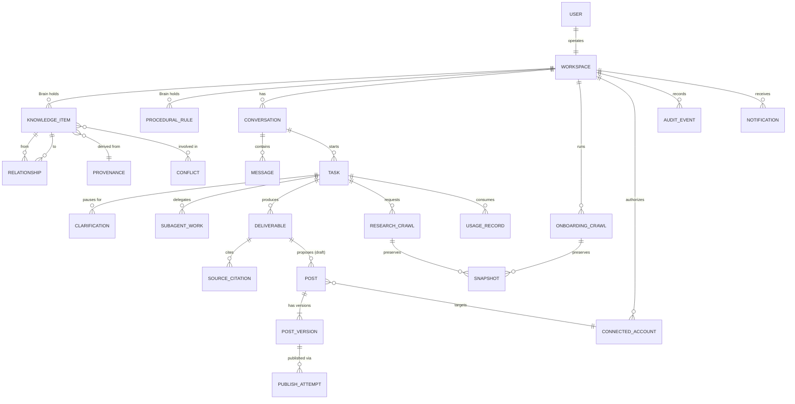
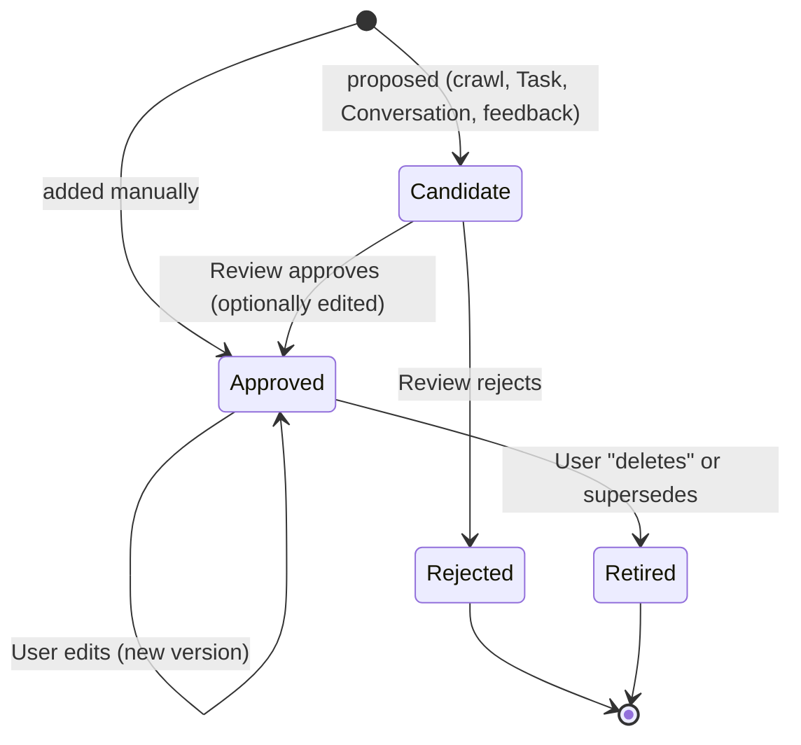
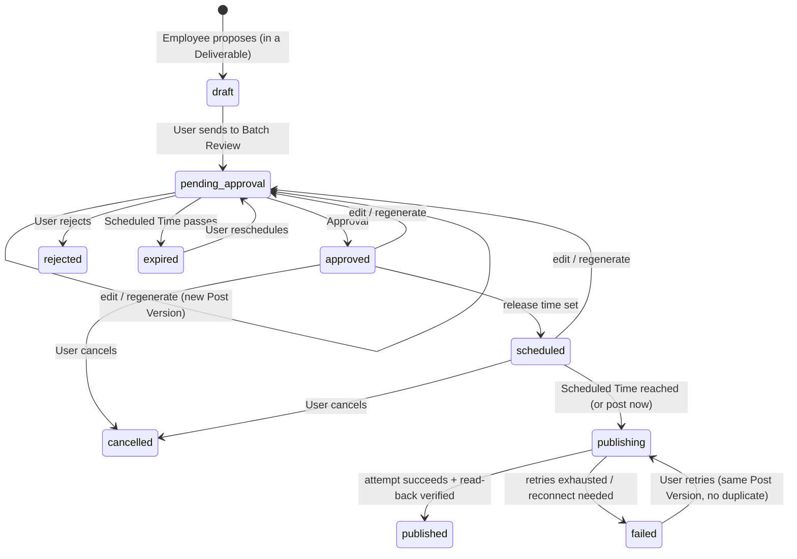
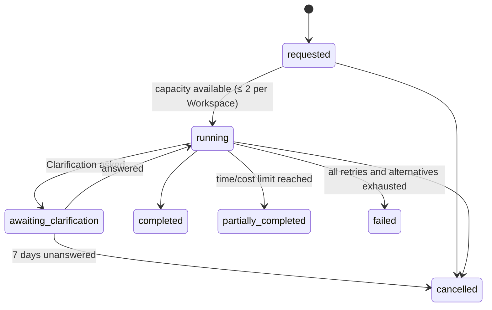

# Core Entities & Relationships

> A conceptual domain model, not a database schema. Attributes listed are the ones the docs make meaningful; types and storage are decided in the architecture step.
> Every entity below belongs to exactly one Workspace (01 DT-4, G2). That ownership is implied and not repeated on each line.
> Terms: [GLOSSARY.md](./GLOSSARY.md). Contexts: [contexts.md](./contexts.md).

## 1. Overview

## 2. Entities by context

### Identity & Workspace

| Entity | Meaning | Key attributes | Invariants |
|---|---|---|---|
| **User** | The single person operating a Workspace | email (verified), credentials, preferred UI language | Exactly one User per Workspace this release (PRD FR-003) |
| **Workspace** | The Business's isolated space; aggregate root of tenancy | Business name, website URL, Business Time Zone, status (active / deletion requested / deleted) | Created automatically at registration (FR-001). Deleting it removes all of its data except a minimal deletion record (01 DT-1). |

### Business Brain

| Entity | Meaning | Key attributes | Invariants |
|---|---|---|---|
| **Knowledge Item** (aggregate root) | One fact about the Business | Knowledge Category (one of 9), title, summary, structured properties, kind (e.g. tone within Brand Rule, pain point within Audience), status, Provenance, freshness, version history | Status ∈ {Candidate, Approved, Rejected, Retired}. Manual entries start Approved; all others start as Candidates (01 BG-1/BG-2). Only Approved items are used by the Employee. No hard delete (BG-3). |
| **Relationship** | Typed, directed link between two Knowledge Items | type ∈ {targets, competes with, has tone, solves pain point, related to}, weight, status | Both ends belong to the same Workspace. Follows the lifecycle of what it connects (PRD FR-020). |
| **Procedural Rule** (aggregate root) | A reviewed instruction on *how* to work for this Business | rule text, scope (e.g. a Dialect, a Platform), origin (edit diff, feedback, post-task review), status | Starts as a Candidate and must be approved before it influences generation (01 BG-5) |
| **Provenance** (value) | Where an item came from | source type ∈ {Onboarding Crawl, Task, Conversation, manual}, Snapshot or Task reference, captured-at | Every Knowledge Item has one. A referenced Snapshot is kept while the item exists (01 DT-2). |
| **Conflict** | Two items that cannot both be true | the items involved, detected-at, resolution (open / resolved by the User) | Never resolved automatically (01 BG-6) |
| **Brand Kit** (view over Knowledge Items) | Logo, colors, typography | detected or not-detected per element | Logo comes only from the Onboarding Crawl (01 BA-1). Colors and font choice are editable Knowledge Items (BA-5). |

### Marketing Employee

| Entity | Meaning | Key attributes | Invariants |
|---|---|---|---|
| **Conversation** (aggregate root) | The ongoing exchange between the User and the Employee | Messages (text, structured form, task status, Deliverable card, knowledge notification, error), language | Persisted in full (PRD FR-033) |
| **Task** (aggregate root) | One unit of requested marketing work | type, request, Constraint Diagnosis, plan, status, frozen configuration, start and end times, cost so far | Status ∈ {requested, running, awaiting clarification, completed, partially completed, failed, cancelled}. At most 2 running per Workspace (01 SC-9). Bounded by time and cost (SC-10). Survives restarts (DL-1). |
| **Clarification** | A pause asking the User for missing information | form fields, per-field "Search Yourself", answers, asked-at, expires-at (asked-at + 7 days) | Answers resume the Task. Expiry cancels the Task with a Notification (01 DL-1). Answers about the Business also become Candidates (BG-2). |
| **Sub-agent Work** | One delegation from the Orchestrator to a Sub-agent | Sub-agent, input summary, result summary, status, user-visible tool labels | Sub-agents never talk to each other directly (PRD §9.5) |
| **Quick Reply** (value on a Message) | A direct answer with no Task | — | Not durable beyond the stored message (01 DL-2) |

### Market Intelligence

| Entity | Meaning | Key attributes | Invariants |
|---|---|---|---|
| **Onboarding Crawl** | First bounded read of the Business's website | URL, pages crawled (≤ 10), progress, outcome (complete / partial / failed), Brand Kit detection | ≤ 5 min. Respects robots.txt (configurable). One at a time per Workspace (01 SC-9, RC-2). |
| **Research Crawl** | Material gathered for a Task | sources tried and skipped, items gathered, Research Signals, time and cost spent | Bounded by the Task's limits. Unreferenced raw data deleted after 7 days (01 DT-3). |
| **Snapshot** | Preserved copy of a crawled page | URL, platform, captured-at | Kept while any Knowledge Item or Deliverable references it (01 DT-2) |
| **Research Signal** (value) | Crawled material showing buyer intent | intent score, phrases (Buyer Vernacular), source | Low-intent material is discarded (TA §7.4) |

### Deliverables

| Entity | Meaning | Key attributes | Invariants |
|---|---|---|---|
| **Deliverable** (aggregate root) | Finished work kept in the Workspace | type ∈ {Research Report, Competitor Analysis, Content Package, Content Calendar, Performance Diagnosis, General}, title, content, originating Task, created-at | Immutable once delivered; follow-up work produces a new Deliverable (*inferred*: the docs have no "edit Deliverable" requirement) |
| **Source Citation** (value) | Reference behind a claim | URL, platform, accessed-at | Required for every research claim (PRD FR-062). Raw content isn't kept with it (01 DT-3). |
| **Performance Report** | The uploaded results file | file, normalized columns, validation outcome | Rejected with a clear error if unrecognized (FR-095). Deterministic KPIs are computed before any AI interpretation. |

### Governed Publishing

| Entity | Meaning | Key attributes | Invariants |
|---|---|---|---|
| **Post** (aggregate root) | One piece of social content for one Connected Account | target Connected Account, Scheduled Time (absolute instant + planning time zone) or "now", status, current Post Version, originating Deliverable | Status ∈ {draft, pending approval, approved, rejected, scheduled, publishing, published, failed, cancelled, expired} (01 PB-3). Editing or regenerating an approved or scheduled Post returns it to pending approval (PB-4/PB-5). Cancel is allowed only before publishing (PB-6). |
| **Post Version** | An unchangeable state of the Post's content | text, hashtags, Brand Visual, platform formatting, created-by (Employee or User edit), created-at | Approval is bound to exactly one Post Version. What is published is that version, byte-for-byte (01 PB-1, G1). |
| **Approval** (value on Post) | The User's consent to publish one Post Version | Post Version, approved-at | Required before any Publish Attempt. Lost when a new version is created. |
| **Publish Attempt** | One try at going live | idempotency key, started-at, outcome (published / failed + platform reason), platform post id and URL, read-back result | At most one successful attempt per Post, ever (01 G1). Automatic retries per PRD §13.3, then manual retry (PB-8). |

### Channel Connections

| Entity | Meaning | Key attributes | Invariants |
|---|---|---|---|
| **Connected Account** (aggregate root) | The Business's account on a Platform, authorized for BusMora | Platform ∈ {Facebook Pages, Instagram Business, X}, platform account id, status (connected / reconnect needed / disconnected), authorization (protected secret), connected-at | Connected only when posting is requested (01 PB-11). Authorization is never readable in plain form outside a publish (TA §9.3). Pilot Meta accounts belong to app testers (EP-3). |

### Usage, Audit & Notifications

| Entity | Meaning | Key attributes | Invariants |
|---|---|---|---|
| **Usage Record** | Measured use of a costly resource | resource kind (model tokens, crawl/proxy, image, X post), quantity, estimated cost, Task | Every costly action records one (01 SC-3) |
| **Audit Event** | Unalterable record of a governed action | action, actor (User / Employee / system), subject, at | Append-only. Removed only by workspace deletion (01 DT-1). |
| **Notification** | In-app attention message | kind, subject link, read/unread | In-app only (01 RT-4) |

### Evaluation (internal)

| Entity | Meaning | Key attributes | Invariants |
|---|---|---|---|
| **Scenario** | Fixed realistic request | category, seeded Workspace, request, expected Deliverable type, rubric dimensions | Unchanged between rounds so results are comparable (EVAL §2) |
| **Evaluation Round** | One full scoring pass | Scenarios run in Treatment and Control, Reviewer scores, disagreements, tie-breaks | Two Reviewers per Deliverable; a third breaks ties (EVAL §4). Blind to configuration (§5). |

## 3. Lifecycles

### Knowledge Item / Procedural Rule

### Post

### Task

