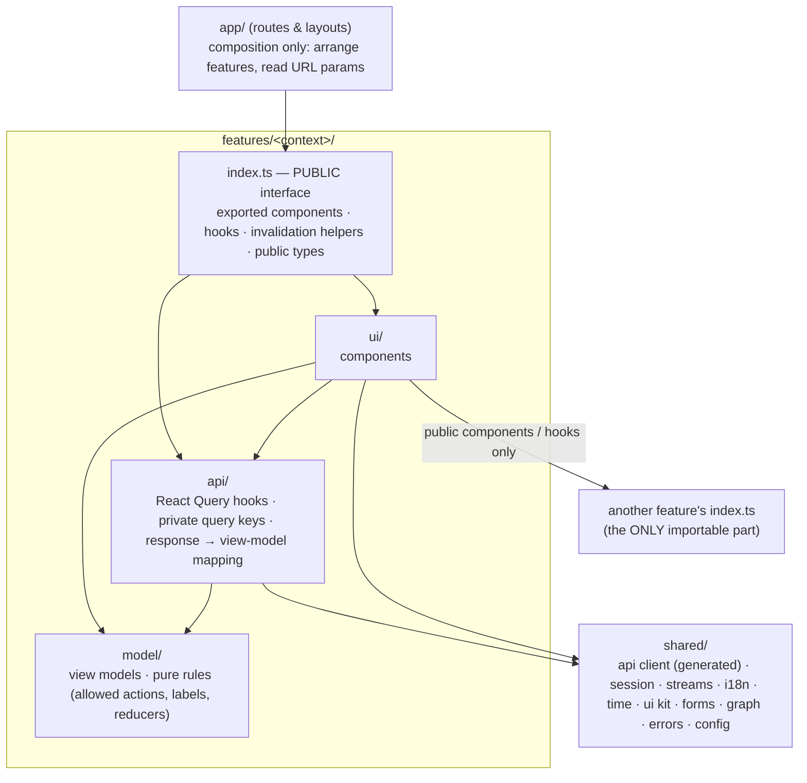

# BusMora — Frontend Technical Design

> **Version:** 2.0 · **Status:** Aligned design; implementation dependencies remain open · **Date:** 2026-10-30
> **Scope:** the internal software architecture of the `busmora-frontend` repository (`busmora-web`, Next.js).
> **Builds on:** [SYSTEM-ARCHITECTURE.md](./SYSTEM-ARCHITECTURE.md) (FE-1 now, FE-3 later; contract; auth), [BACKEND-TECHNICAL-DESIGN.md](./BACKEND-TECHNICAL-DESIGN.md) (API conventions), [domain/](../domain/), [strategy/](../strategy/), and [prd.md](./prd.md).
> **Design only:** no code. Folder structures are trees.
> **Rule kept:** no technology beyond those named in the source documents. Anything else needed is listed as a gap (Appendix A) and not chosen.
> **Reference knowledge:** the repository's `codebase-design` skill (modules, interfaces, seams, depth) and `domain-modeling` (language, ADR format), applied in the same way as the backend design.

---

> **Authority:** [PRD v2.0](./prd.md) governs product behavior and release gates. SYS §9.5 flags incompatible older references; SYS Appendix A maps every requirement. Internal `employee` routes/module names remain stable; product-facing labels use **Marketing Director**. This document specifies design, not implemented capability.

## Table of contents
1. [Recap of system-level decisions](#1-recap-of-system-level-decisions)
2. [Internal architecture pattern](#2-internal-architecture-pattern)
3. [Module (feature) boundaries](#3-module-feature-boundaries)
4. [Folder structure](#4-folder-structure-and-router)
5. [Design patterns](#5-design-patterns)
6. [Client model layer per feature](#6-client-models-and-workflow-contracts)
7. [Data access](#7-data-access)
8. [API consumption conventions](#8-api-consumption-conventions)
9. [Cross-cutting concerns](#9-cross-cutting-concerns-only-what-the-docs-require)
10. [Testing strategy](#10-testing-strategy)
11. [Naming conventions and coding rules](#11-naming-conventions-and-coding-rules)
12. [Walkthrough: adding a feature end to end](#12-walkthrough-adding-a-feature-end-to-end)
13. [Internal decisions (ADRs)](#13-internal-decisions-adrs)
- [Appendix A — Gaps surfaced by this design](#appendix-a--gaps-surfaced-by-this-design)

---

## 1. Recap of system-level decisions

| # | System decision | Consequence for the internal design |
|---|---|---|
| F-1 | **Client-Rendered Application** (SYS ADR-009). The App Router supplies routing and layouts; every application page is a client component; the browser calls `api-http` directly. | All data loading is client-side through React Query. Routes are composition only. |
| F-2 | **Workspace Event Shell later** (FE-3). FE-1 is built to make that move cheap. | One SSE module behind a small interface. Polling isolated per feature. An `events/` slot reserved in each feature. |
| F-3 | **Contract:** code-first `openapi.json` from the backend. The frontend pins a version and generates types with `openapi-typescript`; the client is `openapi-fetch` + React Query (SYS ADR-015). | One generated client in `shared/api`. Features never hand-write request types. |
| F-4 | **Tokens** (SYS ADR-012): 15-minute access token **in memory only**; refresh token in an HttpOnly, `SameSite=Strict` cookie on `/v1/auth/refresh`; `app.` / `api.` same-site subdomains; `Origin` + custom-header check; rotation with reuse detection; multi-tab coordination (`BroadcastChannel` / Web Locks); silent refresh on reload. | One `shared/session` module owns the token. Nothing else touches it. |
| F-5 | **SSE** (SYS ADR-013): a path-scoped HttpOnly **stream cookie** + native `EventSource` with `Last-Event-ID`; reconnect after expiry → 401 → refresh → reopen. | One `shared/streams` module owns every `EventSource`. |
| F-6 | **Canvas:** one stream for the selected conversation’s Task (≤ 2 per workspace); Canvas signals `agent_started`, `agent_tool_used`, `agent_completed`, `agent_error`, `flow_connection`, plus `execution_event` for actual tool/service/workflow/input activity; bounded live replay; whole-message replies, no token streaming (SYS ADR-020). | The Canvas is a pure reducer over signals, plus a reset path. |
| F-7 | **Screens:** auth, confirmed essential Onboarding, Marketing Director and contextual Canvas, Roadmap Discovery/steps/history, Business Brain, document Deliverables, Scheduling Month/Week/List/Unscheduled/Batch Review, Settings and top-bar notifications. | Feature boundaries follow domain ownership; no daily/performance dashboard. |
| F-8 | **i18n:** Arabic RTL and English LTR UI; dates per locale; scheduling in the **Business Time Zone**. | Direction at the document root; logical (start/end) styling; time helpers built on the browser's `Intl`. |
| F-9 | **Two standalone repositories.** The frontend depends on the backend only through the published contract. | No shared code with the backend except generated types. |

**Stack used in this design:**
- **Framework and UI:** Next.js 14+ (App Router), TypeScript, React Flow, Tailwind CSS / shadcn/ui.
- **Data:** React Query, `openapi-typescript`, `openapi-fetch`.
- **Browser and platform built-ins only:** native `EventSource`, `BroadcastChannel`, Web Locks, `Intl`, `crypto.randomUUID`, and Next.js features (layouts, route groups, error/not-found boundaries, `next/font`).
- **Not chosen:** an i18n library, a form library, a Markdown renderer and a graph-layout library are **not** named by the docs (Appendix A).

---

## 2. Internal architecture pattern

### 2.1 Forces
1. **The screen areas in §3.1** map to the backend's bounded contexts. Five people build them in vertical workstreams alongside the backend modules (PRD §13.1).
2. **Many live surfaces** (Canvas, crawl progress, Post statuses, badges) need one consistent approach, which must later switch from polling to a workspace event stream with minimal change.
3. **Strict security rules** on tokens and streams must live in one place.
4. **Arabic-first right-to-left UI** must be the default in every component, not a retrofit.
5. **The same independence rule as the backend:** a change inside one feature must not break or force edits in another.

### 2.2 Alternatives considered

| Alternative | What it is | Fit | Verdict |
|---|---|---|---|
| **A. Type-based folders** | Global `components/`, `hooks/`, `services/`, `types/` | Every feature spreads across four folders. Ownership is invisible and coupling grows silently. Fails forces 1 and 5. | Rejected |
| **B. Feature-Sliced Design (full)** | Fixed layers `app / pages / widgets / features / entities / shared` with strict import rules | Strong boundaries, but the six-layer taxonomy (especially entity vs feature vs widget) costs a student team classification debates. The backend's contexts already give natural slices. | Rejected as a whole (its "public API per slice" and "layers import downward" rules are adopted) |
| **C. Feature modules by bounded context, with internal layers and public interfaces** | `app/` (routes, composition only) → `features/<context>/` (each with `api / model / ui`, one public `index.ts`) → `shared/` (technical kernel) | Mirrors the backend modules one-to-one. One owner per feature. One place each for tokens, streams and the API client. Directly supports the later event-shell switch. | **Chosen** |
| **D. Micro-frontends** | Independently deployed UI pieces | Deployment overhead with no team-scale benefit; contradicts one `busmora-web` deployable | Rejected |
| **E. Global client store as the hub** | All data in one client-side store (Redux-style), API results copied in | Duplicates React Query's server cache and invites stale copies. The docs name React Query as the data layer. | Rejected |

### 2.3 Chosen pattern: feature modules with public interfaces over a shared kernel



**The dependency rule** (enforced in CI by an import-boundary check, §10):
1. `app/` imports **only features' `index.ts`** and `shared/`. Routes contain no data fetching, rules or styling logic beyond layout.
2. Inside a feature:
   - `ui/` may use its own `api/`, its own `model/` and `shared/`.
   - `api/` may use its own `model/` and `shared/`.
   - `model/` is **pure**: no React, no network, no browser APIs.
3. A feature may import **another feature's `index.ts` only**, and only along the allowed directions in §3.3.
4. `shared/` never imports from `features/` or `app/`.
5. Generated code (`shared/api/generated`) is imported only by `shared/api` and by features' `api/` folders. UI never sees raw response types; it sees view models.
6. No cycles between features.

**Why it fits:**
- Each feature is a deep module: a few exported components and hooks hide its queries, keys, mappings and rules.
- Security-sensitive and real-time code each has exactly one home.
- Moving to the event shell touches `shared/streams` plus each feature's new `events/` folder, not the screens.

---

## 3. Module (feature) boundaries

### 3.1 Features

| Feature | Backend owner | Public interface and responsibility |
|---|---|---|
| `auth` | identity | LoginScreen, RegisterScreen, VerifyEmailScreen, ResetPasswordScreen, GoogleReturnScreen, useCurrentUser; email/password and Google, verification links, safe explicit provider linking |
| `onboarding` | identity; crawls/brain via workflow | OnboardingScreen, BusinessInformationForm, OfferingFields, ConversionRouteFields, IntakeConfirmation, CrawlProgressBadge; one persisted editable schema for website/manual setup, confirm before active Brain |
| `roadmap` | tasks | RoadmapScreen, RoadmapDiscoveryScreen, DiscoveryQuestionCard, RoadmapStepCard, RoadmapStepDetails, RoadmapRevisionComparison, RoadmapHistory, useRoadmap, invalidateRoadmap; full vertical steps and saved adaptive drafts |
| `employee` | conversation/tasks | EmployeeScreen, ConversationList, ConversationTaskHistory, StructuredForm, ResearchReturnCard; independent Chat, nine typed message renderers (eight baseline plus post_reference) |
| `canvas` | tasks live projection | TaskCanvas({conversationId,taskId}), useTaskCanvas; actual selected-conversation activity, safe public reducer and durable fallback |
| `brain` | brain | BrainScreen, CandidateReviewScreen, PendingCandidatesBadge, invalidateBrain; nine categories, seven review groups, Graph/List/search/details, current/history/provenance/conflicts, owner edits and proposal decisions |
| `deliverables` | deliverables | DeliverablesScreen, DeliverableViewer, DeliverableCard, AnalysisAttachment, AnalysisMappingPreview, invalidateDeliverables; non-Post documents, immutable versions and Chat-initiated analysis upload only |
| `publishing` | publishing | SchedulingScreen, MonthCalendar, WeekCalendar, PostList, UnscheduledPosts, NewPost, PostEditor, PostDetails, PostReferenceCard, BatchReviewScreen, invalidatePosts; all Post origins, schedules, approvals and safe recovery |
| `connections` | connections | ConnectionsPanel, ConnectPrompt, OAuthReturnScreen; supported Page connection/reconnect/disconnect, distinct from login identity |
| `settings` | identity | SettingsScreen; account/providers, independent region/languages, accessibility/data controls |
| `notifications` | notifications | NotificationBell, invalidateNotifications; read/unread/count and subject deep links, not approvals |

The removed feature modules are absent from the folder tree and routing. Internal `employee` names remain stable; UI says Marketing Director. The API decides eligibility, capacity, state transitions and authority; frontend rules are presentation only.

### 3.2 Shared kernel (`shared/`, no business rules)

| Area | Provides | Seam |
|---|---|---|
| `shared/api` | The single `openapi-fetch` client: base URL, bearer token from `session`, credentials for cookies, idempotency-key header helper, error-envelope normalization, cursor-pagination helpers. `generated/` holds the types. | `ApiClient` (real / test double backed by a mock server, which is a tooling gap) |
| `shared/session` | In-memory access token, silent refresh on load, coordinated refresh across tabs (`BroadcastChannel` + Web Locks), one retry on 401, logout broadcast, unauthenticated redirect signal | Session store (real / test fake) |
| `shared/streams` | The **only** creator of `EventSource`. `subscribeTaskStream(taskId, onSignal, onReset)` returns an unsubscribe function. Validates the SSE envelope; handles heartbeats, reset and 401 → refresh → reopen. | `StreamSource` (native / test fake) |
| `shared/i18n` | Message catalogues (ar, en), `t(key)`, current language, document direction | Adapter over an i18n library (open, OD-7) |
| `shared/time` | Formatting in the Business Time Zone (`Intl`); converting a wall-clock time picked in the business zone into `{ instant, zone }`; relative times | — (pure) |
| `shared/ui` | Owned shadcn/ui components, right-to-left-safe layout primitives, toasts, dialogs, empty/error states, the app shell's navigation | — |
| `shared/forms` | Building blocks for forms: field wrappers, validation messages, idempotent submit | Adapter over a form library (open, OD-19) |
| `shared/graph` | React Flow wrappers used by the Canvas and the Brain graph: node/edge base styles, viewport, left-to-right graph container | Layout algorithm port (library open) |
| `shared/markdown` | Safe rendering of Deliverable Markdown | Adapter over a renderer + sanitizer (open, OD-19) |
| `shared/errors` | Maps error codes to i18n messages; route error boundaries; conflict and reconnect helpers | — |
| `shared/config` | Typed public runtime configuration (api base URL, polling intervals), validated at startup | — |
| `shared/telemetry` | Client error reporting hook | Sink open (OD-13) |

### 3.3 How features communicate: only through public interfaces

**Allowed:**

| Mechanism | When | Rule |
|---|---|---|
| **Page composition** | A route needs several features side by side (Employee screen = `ConversationList` + chat + `TaskCanvas`) | The page in `app/` arranges features' exported components and passes **ids and props only** |
| **Exported component / hook** | One feature renders another's UI inside its own (the chat shows a `DeliverableCard`; a typed Post reference opens Scheduling; Batch Review shows `ConnectPrompt`) | Import only from the other feature's `index.ts`. Props are **public types** declared in that `index.ts` (view-model shapes), never the provider's internal types. |
| **Invalidation helper** | An action in one feature makes another feature's data stale (a Review changes the badge count; a completed Task creates Deliverables) | Call the exported `invalidateX()` helper. **Never** read or write another feature's query keys or cache directly. |
| **Shared kernel** | Session, API client, streams, i18n, time, UI kit | Through `shared/` only |

**Fixed dependency directions:**
```
employee → canvas, deliverables (document/analysis components), publishing (PostReferenceCard), brain (badge)
publishing → connections (ConnectPrompt), notifications (invalidation)
settings → connections
onboarding, roadmap, auth, notifications, canvas, connections, brain, deliverables → shared
app/ → all feature index.ts exports (composition and cross-feature invalidation coordination)
```

Roadmap links to stable Chat/Task routes using server-returned IDs; it does not import employee internals. Cross-feature invalidation after a mutation is coordinated by route-level public callbacks or existing one-way public interfaces, never reverse imports. Deliverables no longer depends on publishing to turn documents into Posts.

**Forbidden:**
1. Importing another feature's `ui/`, `api/`, `model/` or `events/` (deep imports).
2. Reading, writing or invalidating another feature's React Query keys directly.
3. Global mutable state shared between features (module-level variables, a global client store).
4. Creating an `EventSource`, calling `fetch` or touching tokens outside `shared/streams`, `shared/api` and `shared/session`.
5. Passing raw generated API types across a feature's public interface. Features export **their own view-model types**.
6. Business rules in `app/` routes.
7. Cycles in the graph above.

### 3.4 A change inside a feature never breaks another

| Change inside feature F | Other features affected? |
|---|---|
| Component structure, styling, internal components | **No** (only exported components are visible) |
| Query keys, hooks' internals, caching options, polling intervals | **No** (keys are private; others only call `invalidateF()`) |
| Mapping from API types to view models; F's use of a changed API endpoint | **No**, as long as F's exported view-model types keep their shape |
| Internal model rules (allowed actions, labels, reducers) | **No** |
| **Additive change to F's `index.ts`**: new optional prop, new export | **No** |
| **Breaking change to F's `index.ts`**: removing or retyping a prop or export | **Not in place.** Add the new export next to the old one, migrate consumers, then remove the old one. |

**Enforcement:**
- The CI import-boundary check (deep imports fail the build).
- TypeScript compile errors: they appear only if a public type changed, which is visible in review.
- A public-interface test per feature (§10).
- A pull-request rule: any change to a feature's `index.ts` is called out and must be additive.

---

## 4. Folder structure and router

```text
busmora-frontend/
  src/
    app/
      layout.tsx                         # lang/dir/fonts/global styles
      providers.tsx                      # QueryClient/session/i18n/streams
      (public)/
        page.tsx                         # landing
        login/ register/ verify-email/ reset-password/
        auth/google/return/              # no credentials in URL
      (app)/
        layout.tsx                       # session + setup gate; six-area shell + bell
        onboarding/                      # entry/crawl/shared draft/confirmation
        employee/
          [conversationId]/              # stable chat; ?taskId= scoped to this conversation
        roadmap/
          drafts/[draftId]/questions/[questionId]/
          plans/[roadmapId]/steps/[stepId]/
          revisions/[revisionId]/
          history/[roadmapId]/versions/[version]/
        brain/
          candidates/
        deliverables/[id]/
        scheduling/
          new/
          posts/[postId]/                 # desktop panel / mobile detail
          review/                        # Post Batch Review only
        settings/
          connections/
      connect/[platform]/return/         # connected-account OAuth return
      error.tsx
      not-found.tsx
    features/
      auth/ onboarding/ roadmap/ employee/ canvas/ brain/
      deliverables/ publishing/ connections/ settings/ notifications/
      # each: index.ts + api/ + model/ + ui/; optional events/ only for future FE-3
    shared/
      api/generated/                     # pinned OpenAPI, never handwritten
      api/{client,errors,idempotency,pagination}
      session/ streams/ i18n/messages/ time/ ui/ forms/ graph/
      markdown/ errors/ config/ telemetry/
    test/{fakes,builders,architecture}/
  contracts/api/openapi.json
  e2e/ scripts/ public/ ci/
```

All application routes remain client-rendered composition; no BFF, Server Actions or new platform. Root authenticated navigation restores the last valid accessible work path; fallback `/employee`. Initial verified accounts enter `/onboarding`; after confirmation explicitly choose `/employee` or `/roadmap`. Validate destinations against route allowlist and current resource ownership, never follow arbitrary return URLs. Saved last-page preference must contain path/IDs only, scoped to workspace and revalidated; query cache is cleared on identity/workspace changes.

Scheduling view uses URL query state `view=month|week|list|unscheduled`, date, displayZone, status, platform and campaignId. Month is desktop default; mobile may start Week/List. No separate global Canvas page or document-backed Post flow. Negative routing tests reject retired daily/performance paths rather than map them to a renamed replacement.

## 5. Design patterns

### 5.1 Patterns used

| Pattern | Where | Problem it solves |
|---|---|---|
| **Feature module with a public interface** | `features/<context>/index.ts` | Independence between features: internal changes never ripple (§3.4) |
| **Composition at the route** | `app/` pages | Features stay unaware of each other's layout; pages arrange them |
| **Server-state cache (React Query)** | every feature's `api/` | One source of truth for API data: deduplication, refetching, polling, invalidation |
| **Query-key factory (private per feature)** + exported invalidation helpers | `features/*/api` | Keys never leak; cross-feature staleness goes through an interface |
| **View model + mapper** | `api/` maps generated response types → `model/` view models | UI is insulated from contract changes; one place to adapt to a new API version |
| **Pure reducer / state machine** | `canvas/model` (signals → node states), `publishing/model` (allowed actions per Post status) | Predictable, unit-testable UI logic; the Post rules mirror the backend state machine, for display only |
| **Single gateway modules** | `shared/api`, `shared/session`, `shared/streams` | One place for tokens, credentials, retries, error normalization and stream lifecycles (security and FE-3 readiness) |
| **Adapter over open libraries** | `shared/i18n`, `shared/forms`, `shared/markdown`, `shared/graph` layout | The library choice (still open) can land without touching features |
| **Coordinator (leader election across tabs)** | `shared/session` refresh via Web Locks + `BroadcastChannel` | Exactly one refresh at a time; no false reuse detection (SYS ADR-012) |
| **Idempotent command submission** | `shared/api/idempotency` + mutations | One key per user intent, reused on retry, so a double click or network retry never duplicates a Task, approval or upload |
| **Schema-driven rendering** | `employee/ui/structured-form` | Clarification forms come from the server as data (field kinds, meaningful choices/custom input and allowed research actions), so new forms need no frontend release |
| **Error boundary per route segment** | `app/**/error.tsx` + `shared/errors` | A failure in one screen doesn't take down the shell |
| **Polling strategy isolated per feature** | the `refetchInterval` option in the feature's `api/` | Can be swapped for event-driven updates feature by feature (FE-3) |

### 5.2 Patterns deliberately avoided

| Avoided | Why |
|---|---|
| Global client store mirroring API data | Duplicates the React Query cache; stale copies |
| Optimistic updates on governed actions (Approval, Review, publish retry, cancel) | Governance must reflect the backend's verdict: version conflicts, invalid transitions. Optimistic updates are limited to local presentation such as panel selection. Notification read state is persisted and reconciled with the server, with rollback on failure. |
| Server Components, Server Actions, BFF route handlers | Rejected at system level (FE-2). Tokens never go through a Next.js server. |
| Next.js middleware for auth | The access token lives only in browser memory, so middleware can't see it; the session gate is client-side |
| Direct `fetch` / `EventSource` in components | Would bypass auth, credentials, error normalization and reconnect rules |
| Physical left/right styling | Breaks right-to-left; logical start/end utilities only |
| Token-by-token text animation | Replies are whole messages (SYS ADR-020) |
| Shared "utils" with business logic | Business rules live in a feature's `model/` |

---

## 6. Client models and workflow contracts

Generated OpenAPI DTOs are consumed only in feature `api/` mappers; public models below are display projections, never another source of business authority. BACKEND §§6 and 8.2 define the canonical field/state contracts.

| Feature | View models and reducer responsibilities |
|---|---|
| auth | CurrentUser includes providers, hasLocalCredential, verified, version and onboardingComplete. Login/register/Google flow states idle/redirecting/validating/succeeded/cancelled/failed; verification link states sent/validating/verified/expired/invalid |
| onboarding | OnboardingDraftView carries id/version/source/status editing/extracting/ready_for_confirmation/confirmed, fields/provenance/crawl outcome and owner-touched flags. BusinessInformationForm uses the same schema for both branches; draft extraction never maps to active Brain |
| roadmap | RoadmapDraftView (draft/generating/proposed/archived), questionSequenceVersion/currentQuestionId, DiscoveryQuestionView/AnswerView with unanswered/answered/skipped/unknown/not_applicable/researching/confirmed, ResearchLinkView, RoadmapView (proposed/active/archived/rejected), immutable PlanVersionView, StepExecutionView and RevisionView |
| employee | ConversationSummary/Detail with origin direct/wizard_question/roadmap_step, TaskHistory, nine-kind MessageView and generated form projection. Use in Roadmap requires backend-authorized researchLink/result, never a URL-only flag |
| canvas | CanvasState keyed by workspace/conversation/task, nodes by stable actual ID/kind, safe connections, asOfEventId/live/gap. Presentation states planned/active/awaiting_input/held/completed/error/cancelled; reducer has no attempt-counter UI |
| brain | KnowledgeItemView separates lifecycle, epistemic source_observation/owner_claim/ai_hypothesis/owner_decision, approval, verification, currentVersion, provenance/date and conflict/unknown/not_applicable. ReviewGroup supplied by API using DS §9.5 mapping |
| deliverables | DocumentSummary/VersionView: type,title,date,version,content,sources,assumptions,limitations,context/origin refs and staleness. AnalysisUploadView/MappingPreview only in explicit Chat analysis; no recurring results models |
| publishing | PostView: id/version/currentPostVersionId, origin, campaignId?, nullable proposed schedule/destination, exact media/version, status, approval/hold/attempt evidence and allowedActions. CalendarPostView has calendarAt/dateBasis actual or proposed; BatchReviewView stores explicit selected IDs/versions |
| settings/connections | Account providers and local-password applicability; country/currency/IANA zone; UI/conversation/content register; connected/reconnect_needed/disconnected, authorization-generation metadata and impact explanation |
| notifications | NotificationView id/version/kind/typedSubject/deepLink/available/readAt/occurredAt; read/unread/count display only |

### 6.1 Unified intake and Brain

BusinessInformation requires name, description, at least one offering, country/serviceArea and conversionRoute ready with valid routes or explicit not_ready. Offering pricing model fixed/starting_from/quote_required/unknown has optional decimal amount; currency required if amount supplied; quote/unknown never invent amounts. Optional brand/contact/language settings are expandable. Do not expose strategy/weekly-hours gates in onboarding.

Create/resume draft, poll real crawl, map extracted values into editable fields, save with version and owner-touched protection. Display partial/failed source evidence and manual completion immediately. Save/confirmation failures keep local edits for explicit reconciliation; no silent last-write-wins. Confirm exact draft version once; refetch Workspace and Brain through public invalidation and show Chat-or-Roadmap choice. No duplicate initial proposal queue.

Brain Graph/List share current API records; List defaults on mobile. Search/filter, relationships, source/version detail, owner editing, individual proposals and conflicts remain available. A price edit updates current context and invalidates relevant documents/tasks/Posts according to returned impact refs. Do not auto-edit historical documents or approved Posts. Item deletion removes cached content immediately after server denial confirmation, then shows cleanup progress/retention; current and historical retrieval cannot resurrect deleted values.

### 6.2 Roadmap Discovery and research return

Persist save before leaving a question or opening research; show unsaved/error state instead of claiming saved. Versioned PATCH/answer commands are serialized per draft, and generated question changes reconcile by stable IDs. Choice-first forms use 3–4 meaningful options plus Other; actual numbers/links/free text remain real inputs. Known context carries provenance; Unknown/Skip/Not Applicable remain distinct and never fill positive facts.

Research command returns validated researchLinkId/taskId/conversationId/returnPath. Open that conversation, including question context. Result selection calls use-result with displayed draft/question/answer versions, then navigates to returned exact question. Explicit answer confirmation is separate and persists eligible selected decisions; direct Chat/step execution cannot show this action. Reconnect reloads origin from backend. Deleted/changed origins show unavailable/stale; no client URL reconstruction grants authority.

Generation is an authorized durable Task; proposed output is reviewable before activation. One active plan with saved drafts/history; new draft does not replace it. Activation checks displayed proposal/source-draft versions and expected active ID/version. Initial rejection returns to the saved draft without changing an existing active plan. Editing an unactivated proposal invalidates it; generating drafts are locked and archived drafts read-only. Revision comparison uses server diff and exact base/proposal versions; Reject preserves active plan. In-flight Task/result references remain tied to original version.

### 6.3 Step control and independent Chat/Canvas

Full vertical steps retain title/objective/evidence/uncertainty/party/mode/dependencies/inputs/output/completion/effort and source refs. Work states planned/ready/running/awaiting_input/awaiting_approval/completed/blocked/failed/cancelled/skipped/not_applicable/superseded are independent of actionState and Owner-reported Done attestation. Recommended order does not disable a server-eligible step. Backend returned allowedActions/blocker details are authoritative.

Run sends version/stepVersion and resource authorization with one idempotency key, returns existing/new Task/conversation, and navigates to Chat. Reopening links to existing work. The hard two-running-Task workspace limit is separate from plan step counts. Mark as Done sends checklist/evidence and displays owner-reported; Skip explains impact and leaves running Task untouched; Revisit refetches readiness. Cancel is an independent Task action. Counts never treat skipped as completed or completion as commercial success.

Direct Chat works without a Roadmap. Desktop conversation history/main Chat/contextual Canvas; mobile chat-first history panel and Canvas sheet/event list. Eight baseline message renderers plus PostReferenceCard match backend discriminators; document and Post destinations differ. Quick replies use no fabricated Canvas.

**Selection:** fetch `/v1/conversations/{id}/tasks`; choose URL taskId only if returned as related, else latest relevant active Task, else latest durable Task summary. Multi-Task selection lives in that conversation's cards/history. On conversation/task switch unsubscribe prior stream, clear graph, cancel pending snapshot request and advance a subscription generation. Drop responses/events whose workspace/conversation/task/generation no longer match. Other tasks keep running server-side.

**Snapshot/retry reducer:** draw authenticated snapshot, then subscribe after its cursor. Both server snapshot and public SSE suppress recoverable internal attempts, preserving active **Processing**. `agent_error` may become error only with terminal logical outcome; no attempt node or counter. Exhausted recovery/partial completion is shown truthfully. Awaiting Input links to exact form with seven-day expiry. Safe node details omit secrets/private prompts/reasoning. Expired live buffers show durable summaries and gaps, never historical animation replay.

### 6.4 Documents and Scheduling

Document viewer mapping: research_report/competitor_analysis/audience_research/marketing_strategy/positioning_report/campaign_plan/marketing_brief/visual_brief/content_strategy/analytical_report/general → safe Markdown or supported structured/table view. Search/type/date/cursor library; edit/copy/export/reuse/continue/delete and immutable version lineage. No content_posts or authoritative social-content calendar document type. Requested CSV/.xlsx analysis attaches to a Chat Task, validates mapping/period/units/duplicates before confirmation, and creates analytical_report; arithmetic is backend deterministic.

Scheduling queries all first-class Posts, including direct Chat, step, campaign and manual origins. Desktop Month default, Week/List and Unscheduled; mobile Week/List allowed with Month available. Range boundaries are derived in selected IANA zone then sent UTC `[from,to)` with filter-bound cursor. Fetch all needed pages or expose incomplete/loading state. Unscheduled query is explicit, never a fabricated date. Published calendar position uses actual publishedAt; planned and actual dates remain separate in details. Unknown actual date is labelled unavailable.

PostEditor supports text/link and validated single owner image/caption, nullable draft destination/date, preview, zone and allowance. Saving a Draft grants no approval; submit requires complete supported parameters. Connection is requested only when needed. Approved content/date/destination/media/zone/allowance edits produce new versions; no optimistic approved status or drag move before server confirmation. DST ambiguous times require a choice; nonexistent local time is rejected. Default zone change does not alter approved instants.

Bulk review enumerates displayed `{postId,version,postVersionId}`; stale items refetch for renewed inspection, never auto-reapprove. Partial results remain per item; retries reuse the same intent key. ReviewSession is Post instrumentation only. Post Details shows origin/campaign/versions/attempts/evidence. Holds require explicit owner resolution and renewed approval if critical details changed. Uncertain acceptance offers reconcile, not blind retry; reconnect does not release overdue work. Published duplicate creates a new Draft, local deletion does not claim external removal.

### 6.5 Settings and notifications

Providers/verification/local-password applicability, account logout, connections, explicit country/currency/IANA zone, UI ar/en, conversation language and content registers English/Egyptian/Gulf-oriented/MSA are independent. Task-level content override does not change UI. Explain affected schedules before disconnect; no platform deletion claim. Export/deletion shows requested/processing/completed/retry_needed and real retention limits.

NotificationBell polls unread count/list and supports read/unread/read-all. Subject types route to exact conversation/form, document, Post, revision, Brain proposal or connections. Access/unavailable state comes from server; read is not approval. No recoverable-retry or periodic-review notices. Event-driven Task updates and polled notification/Post data are labelled truthfully.

### 6.6 Endpoint consumption and query ownership

Continue with Director / regenerate sends the canonical `revisionTarget` on a conversation message: document identity/version or Post identity/resource version/PostVersion ID. The owning backend contract validates it, preserves lineage and rejects stale edits; an edited Post always needs approval again.

BACKEND §8.2 is canonical. Auth consumes `/auth/*` including Google start/callback return; onboarding `/onboarding/drafts`; roadmap `/roadmap/drafts`, `/roadmap/research-links`, `/roadmaps`, `/roadmap/revisions`; employee `/conversations` and messages; Tasks `/conversations/{id}/tasks`, `/tasks/{id}` and canvas/clarification/budget/cancel; documents `/deliverables`, `/analysis-uploads`, `/media`, `/data-exports`; publishing `/posts`, `/campaigns`, `/batch-review/sessions`; Brain `/brain/*`; settings `/workspace`, `/connections`; notifications `/notifications`. Callback uses backend redirect; browser never validates provider tokens itself.

| Private query family (all include workspace) | Invalidate/refetch on |
|---|---|
| onboardingDraft(id), workspace | save, extraction polling, confirmation; activation also invalidates Brain via route coordinator |
| roadmapDraft(id), discoveryQuestion(id,qid), activeRoadmap, roadmapVersion(id,v), step(id,v,stepId), revision(id) | answer/research-result/confirm/generate/activate/run/skip/revisit/attest/revision; precise returned affected IDs |
| conversations, messages(conversationId,cursor), conversationTasks(conversationId), canvas(conversationId,taskId) | message/status/result/form events and polling; switch guards against late results |
| documents(filters,cursor), document(id,version) | document edits/result creation/context impact/deletion |
| posts(range,zone,filters,cursor), unscheduled(filters,cursor), post(id), campaigns | create/edit/reschedule/approval/hold/publish/reconnect; invalidate old and new ranges plus Unscheduled; no duplicate Post content cache in Deliverables |
| brain(filters), item(id,version), candidates, conflicts | owner edits/proposal/conflict/deletion/intake confirmation |
| notifications, unreadCount, connections, settings | corresponding commands/polling; marking read does not mutate subject caches |

## 7. Data access

### 7.1 API client
- **One client instance** in `shared/api/client`: `openapi-fetch` typed by `shared/api/generated`.
  - Base URL from `shared/config`.
  - Bearer token injected from `shared/session`.
  - `credentials: include` on auth commands that set/use session or OAuth flow cookies, including start/link/login/verification/refresh/logout; secrets remain inside the shared gateways.
- On **401**, the client asks `shared/session` to refresh (coordinated across tabs) and retries **once**. A second 401 signals "unauthenticated", and the shell redirects to login.
- Every non-2xx response is normalized to a typed `ApiError { code, messageKey, details, correlationId, status }` from the backend error envelope.

### 7.2 Queries and mutations (inside each feature's `api/`)
- **Queries:**
  - React Query hooks named `use<Noun>Query` (e.g. `useRoadmapQuery`, `useDiscoveryDraftQuery`, `useDeliverableQuery`).
  - Keys come from a **private** key factory, always including the workspace scope implied by the session (e.g., `['roadmap', workspaceId]`, `['roadmap-draft', workspaceId, draftId]`).
  - Responses are mapped to view models in a `select` step, so components receive view models only.
- **Mutations:**
  - Named `use<Verb><Noun>Mutation` (e.g. `useSkipStepMutation`, `useApplyRoadmapRevisionMutation`, `useBulkApproveMutation`).
  - Each user intent gets an **Idempotency-Key** (`crypto.randomUUID`), held until success or abandonment, so retries reuse it.
  - Commands on Posts carry both resource `version` and immutable `postVersionId`; commands on Knowledge Items carry `version`; commands on Roadmaps carry `version`.
  - On success, invalidate the feature's own keys and call the exported `invalidateX()` helpers of affected features (e.g. applying a revision invalidates active Roadmap, its steps and history).
  - Governed actions are **not optimistic** (§5.2). Step actions and plan activation wait for backend checks of dependencies, versions and authorization.
- **Lists:** cursor pagination (`limit`, `cursor` → `{ items, nextCursor }`). Filters live in the URL search params, so views are shareable and survive reloads.
- **Polling** (FE-1) is declared only in the owning feature's query options:
  - crawl progress while a crawl runs;
  - Post statuses on Batch Review while any Post is scheduled/publishing/submitted/uncertain or awaiting a recovery result;
  - notification badge;
  - pending-Candidate badge.

  Intervals come from `shared/config` (values open).

### 7.3 Real-time
- `canvas` subscribes through `shared/streams.subscribeTaskStream(taskId, …)` while the selected Task is live; only related Tasks may be selected (at most two running per workspace). Signals go through `applySignal`.
- On first load, or on a **reset** event or a replay gap, the Canvas fetches `GET /v1/tasks/{id}/canvas`, redraws from it, and opens the stream with `?after=<asOfEventId>` (BACKEND §8.1.3). Repeated resets are retried a bounded number of times.
- Task-status chat messages are persisted and refetched through the conversation query on live events and while a task is active. Polling recovers missed/expired streams; durable status and action summaries stay accessible after navigation. Reconnect replay is only within the run/grace buffer; finished tasks show recorded summaries, never reconstructed live animation.
- **The future event shell:** `shared/streams` gains `subscribeWorkspaceStream`, each feature adds `events/` handlers that update its own cache, and polling options are removed. Screens don't change.

### 7.4 Local state
- **UI state:** component-local (open panels, selections in Batch Review, draft form values).
- **URL state:** filters, cursors, the selected conversation and Deliverable id.
- **Session state:** only in `shared/session`, never in React context as a raw token.
- **No `localStorage` / `sessionStorage` for tokens, ever.** Non-sensitive preferences (UI language) come from the user's profile through the API.

---

## 8. API consumption conventions

| Topic | Convention |
|---|---|
| **Contract version** | `contracts/api/openapi.json` is pinned. Upgrading is a deliberate pull request: pull the new version, regenerate types, fix compile errors in features' `api/` mappers only. |
| **Generated types** | Never edited. Never exported across a feature's public interface (view models are). |
| **Routing** | Calls use the backend's `/v1` resources and action sub-resources (e.g. `POST /v1/posts/{id}/approve`), exactly as the contract defines. |
| **Validation** | Client-side validation helps the user (required fields, formats). The server's validation is authoritative; `VALIDATION_FAILED` details map onto form fields. |
| **Errors** | `shared/errors` maps codes to i18n messages and actions: `STALE_VERSION` → refetch + "this changed; review again"; `INVALID_TRANSITION` → refetch; `RECONNECT_NEEDED` → show `ConnectPrompt`; `CONTEXT_STALENESS_HOLD` → "pricing/offer changed; review affected post" (FR-48); `BUDGET_CEILING_REACHED` → "budget ceiling reached; extension requested" (FR-27); `ANALYSIS_FILE_UNRECOGNIZED` → show supported mapping/template correction (FR-38); `RATE_LIMITED` → retry later; 5xx → generic message with correlation id. |
| **Idempotency** | Also required for intake save/confirmation, Discovery/research/step/revision decisions, attestations, export/deletion and mapping confirmation. Required header on: send message / start Task, submit for publishing review, approve, bulk approve / reject, start review session, retry publish, uploads, roadmap revisions, budget extension actions. One key per user intent. |
| **Concurrency** | Always send the version the user saw (`postVersionId`, `version`). |
| **Time** | Send `{ instant, zone, latenessAllowanceMinutes }` for Scheduled Times. Show every time in the Business Time Zone, labelled with the zone and delivery allowance. |
| **Asynchronous work** | Treat 202 + id as accepted/queued, including requested with waitingReason=capacity, until recorded execution begins; show truthful status via SSE or polling. |
| **Streams** | Only through `shared/streams`; the stream cookie is sent automatically (native `EventSource` with credentials). |
| **Uploads** | Chat-requested CSV/supported `.xlsx` through `shared/api` with confirmable mapping/validation preview; owner-supplied single image through `/v1/media` with validation/version. Show supported limits and template/correction fallback (FR-31, FR-38). |
| **Pagination** | Cursor-based infinite lists; never compute offsets. |

---

## 9. Cross-cutting concerns (only what the docs require)

### 9.1 Authentication and authorization
- **App load:**
  1. `shared/session` calls the refresh endpoint (cookie + required custom header).
  2. On success it holds the 15-minute access token in memory. The backend also sets the stream cookie.
  3. On failure, the `(app)` layout redirects to login.
- **Multi-tab:**
  - One tab refreshes, holding a Web Lock; the others receive the new token over `BroadcastChannel`.
  - Logout is broadcast to all tabs; explicit revocation/deletion closes streams and clears workspace query caches. Cookie-expiry tolerance never overrides revocation.
  - The server's 10-second grace window covers races.
- **Authorization:** one role (the User of the workspace). The UI hides nothing for permission reasons; the backend enforces workspace scope. A 403/404 shows not-found.
- **OAuth connect:** the browser is sent to the api's start URL; the api handles the platform callback and redirects to `/connect/[platform]/return`, which refetches `connections` and returns to the pending Post for review; it never implicitly approves, sends or releases overdue work.

- **Google login/link:** POST start/link through shared/api, then navigate to authorizationUrl. Backend callback performs OIDC/state/PKCE/nonce checks and sets normal sessions; `/auth/google/return` refreshes through shared/session and routes to setup/valid destination. Handle cancellation, expired flow and account collision without disclosing accounts or accepting URL tokens. Linking requires existing-account login and recent reauthentication, separate from Google signup. Narrow Lax flow cookie is backend-managed; existing Strict refresh/stream cookies are unchanged.
- **Email verification:** read link token only to submit verify-email; clear sensitive URL state immediately and exclude it from telemetry/referrers. Expired/invalid/replayed links show safe resend flow. Registration has only email/password; Google-only accounts do not display a required local password.

### 9.2 Configuration
`shared/config` reads Next.js public environment variables, validates them once at startup, and exposes typed values:
- api base URL;
- polling intervals;
- pagination page size;
- the upload size limit, when defined.

No secrets exist in the frontend.

### 9.3 Logging and error reporting
- Client errors go through `shared/telemetry` with the correlation id from `ApiError` (sink open, OD-13).
- Tokens, cookies, form contents and personal data are never logged.

### 9.4 Error handling
- **Route-level error boundaries** keep the shell alive.
- **Feature-level** empty, error and retry states use shared components.
- **Mutation errors** are mapped by code (§8).
- **Network loss:** queries retry with backoff, except 4xx. Streams reconnect natively. Offline operation is not committed; stale approval/data-control commands wait for server confirmation.

### 9.5 Caching
- React Query is the only cache. Stale times per query are defined in each feature's `api/`.
- No service worker and no persistent cache, because offline mode is not planned.

### 9.6 Internationalization and right-to-left
- The document root carries `lang` and `dir` from the UI language (ar → rtl, en → ltr). Switching language switches both without a reload.
- Styling uses **logical** utilities only (start/end, inline padding/margin); physical left/right classes are forbidden.
- Icons with direction (arrows, chevrons) flip by direction.
- **Graph canvases** (Canvas, Brain graph) render inside a fixed left-to-right coordinate container so layout math stays stable; labels inside nodes follow the UI language.
- Text from generated content is shown with its own direction (Arabic or English, including mixed text with product names in English).
- An Arabic + Latin font pair is loaded through `next/font` (Ubuntu + IBM Plex Sans Arabic per DESIGN-SYSTEM §3.1).
- **Dates and times:** `shared/time` formats with `Intl.DateTimeFormat` in the **Business Time Zone** and the UI locale. Wall-clock picks are converted to `{ instant, zone }` by a pure helper that handles daylight-saving transitions and is unit-tested.

### 9.7 Background work
None in the frontend beyond polling (§7.2) and live streams (§7.3). Long Tasks continue on the server when the browser closes (FR-23; NFR-05); on return, queries show the result.

### 9.8 Evaluation instrumentation (required by EVAL §8)
- Batch Review session timing: `publishing` starts a session when the Batch Review screen opens (`POST /v1/batch-review/sessions`) and ends it when every Post is decided (`finished`) or the User leaves the screen (`left`). The backend measures activity and closes abandoned sessions itself (BACKEND §8.1.2).
- "Approve/reject all remaining" sends the undecided Posts on screen with their versions to `POST /v1/posts/bulk-approve` / `bulk-reject` and shows the per-item outcomes (BACKEND §8.1.1).
- Edits and approvals are captured server-side from the normal commands.

---

## 10. Testing strategy

Frameworks are still open (OD-12); this strategy is framework-neutral. **The public interface is the test surface**, matching the backend.

| Layer / target | What is tested | How |
|---|---|---|
| **Feature `model/`** | Pure rules: `applySignal`, `allowedActions(status)`, message-kind mapping, form answer assembly | In-process unit tests, table-driven (every Post status, every signal) |
| **`shared/time`** | Formatting in a zone; wall-time → instant across daylight-saving changes in Egypt and GCC zones | Pure unit tests |
| **`shared/session`** | Silent refresh, 401 → single refresh → retry, multi-tab single refresh, logout broadcast | Unit tests with fake channel and lock |
| **`shared/streams`** | Envelope validation, heartbeat, reset, reconnect with `Last-Event-ID`, 401 → refresh → reopen | Tests with a fake `StreamSource` |
| **Feature `api/`** | Hooks map responses to view models, send idempotency keys and versions, invalidate the right helpers | Tests against an API mock generated from the pinned contract (tool open) |
| **Feature public interface** | Each feature's exported components and hooks render and behave as documented, in Arabic (RTL) and English (LTR) | Component tests through `index.ts` only |
| **Architecture** | Import boundaries (§2.3, §3.3), no `EventSource`/`fetch`/token access outside shared gateways, no physical left/right classes | Static checks in CI (tool open) |
| **Contract** | Generated types are up to date with the pinned version; the app compiles | CI step |
| **End-to-end journeys** | Email-link/Google auth; both intake branches → confirmation → Chat/Roadmap; Wizard save/research/exact return; full steps/skip/revisit/attestation/revision; conversation-local Canvas/retry masking; document/Post separation; manual/undated/calendar Posts; exact bulk/reschedule/context/uncertain recovery; scoped CSV/.xlsx analysis; deletion/disconnect and mobile RTL/LTR | Against the backend running in Docker Compose (cross-repo setup open, OD-17) |

---

### 10.1 Release-level verification

Verify active AC-01–25 and AC-27–58 against real backend workflows, with the 40 redesign checks mapped in System Appendix A. Include Google takeover/link/replay/cancellation, verification expiry/resend, concurrent intake edits/late crawl, Wizard persistence/exact-question return/stale links, plan activation races, dependency changes after Skip, two conversations with late SSE responses, recoverable versus terminal failure, nullable schedule/range pagination/DST/history, mixed bulk outcomes, reschedule reapproval, targeted holds and unavailable notification subjects. Negative route/model tests ensure removed features cannot reappear.

Retain source-injection, arithmetic unknown/zero/duplicate/currency/formula safety, deletion and restore/cache suppression, budget refusal and parent allowance, actual Page formats/ordinary-owner access, AR/EN mobile/keyboard/reduced motion and four-register human quality checks. Mocks/screenshots are not evidence of native execution or release readiness. PRD §10 gates remain unchanged in rigor; this documentation records no implementation pass.

## 11. Naming conventions and coding rules

### 11.1 Naming

| Item | Convention | Example |
|---|---|---|
| Domain terms | Glossary terms only | `PostView`, `CandidateReviewScreen`, `TaskCanvas` |
| Files | kebab-case | `batch-review-screen.tsx`, `allowed-actions.ts`, `use-posts-query.ts` |
| Components | PascalCase; screens end with `Screen` | `DeliverableViewer`, `BrainScreen` |
| Hooks | `use<Noun>Query`, `use<Verb><Noun>Mutation`, `use<Thing>` | `usePostsQuery`, `useApprovePostMutation`, `useTaskCanvas` |
| View models | `<Noun>View` | `KnowledgeItemView` |
| Invalidation helpers | `invalidate<Feature>()` | `invalidatePosts()` |
| i18n keys | `<feature>.<area>.<key>` | `publishing.actions.approve` |
| Routes | kebab-case, nouns | `/scheduling/review`, `/brain/candidates` |

### 11.2 Coding rules
1. **Features speak only through `index.ts`.** No deep imports, no foreign query keys, no shared mutable state (§3.3).
2. **Routes compose; features implement.** No data fetching or rules in `app/`.
3. **Only `shared/api` talks HTTP, only `shared/streams` opens streams, only `shared/session` touches tokens.**
4. **UI receives view models, never generated response types.**
5. **No hard-coded user-facing strings**; every label goes through `shared/i18n`.
6. **Logical styling only** (start/end); never left/right.
7. **Times are formatted only through `shared/time`**, in the Business Time Zone.
8. **Every non-idempotent command carries an idempotency key**; every governed command carries the version the user saw.
9. **No optimistic updates on governed actions.**
10. **Generated code is never edited**; contract upgrades are deliberate pull requests.
11. **Public interface changes are additive**; a breaking change adds a new export first.
12. **Strict TypeScript:** no implicit `any`; exhaustive switches over statuses and message kinds.
13. **No tokens, cookies or personal data in logs or telemetry.**
14. **The Canvas holds no durable state**; on reset, it refetches.

---

## 12. Walkthrough: adding a feature end to end

**Example: "Reschedule an expired or overdue-held Post"**, the frontend half of the backend walkthrough.

| # | Step | Where | What to do |
|---|---|---|---|
| 1 | **Confirm the language** | domain/GLOSSARY.md | Post, Expired Post, Scheduled Time, Business Time Zone |
| 2 | **Locate the owning feature** | §3.1 | `publishing` |
| 3 | **Wait for or pull the contract** | `contracts/api` | The backend merges `POST /v1/posts/{id}/reschedule` (signature first). Pull the new version and regenerate `shared/api/generated`. The build must pass unchanged elsewhere, because the change is additive. |
| 4 | **Model rule** | `publishing/model/allowed-actions` | Allow reschedule for expired/eligible overdue-held posts, with unresolved uncertain sends blocked by the backend. Unit-test the full status table. |
| 5 | **Mutation** | `publishing/api` | Add `useReschedulePostMutation`. It sends `{version,postVersionId,scheduledTime:{instant,zone,latenessAllowanceMinutes}}`, with the time built by `shared/time` from the user's pick and an idempotency key. On success it invalidates its own Post keys; if the badge depends on it, it calls `invalidateNotifications()`. |
| 6 | **UI** | `publishing/ui` | Add a "Reschedule" action and a date-time picker in the Business Time Zone (zone labelled). Map errors: `INVALID_TRANSITION` / `STALE_VERSION` → refetch and explain. |
| 7 | **i18n** | `shared/i18n/messages/publishing` | Add Arabic and English strings; check right-to-left layout. |
| 8 | **Public interface** | `publishing/index.ts` | Nothing to export (the action is internal to Batch Review), so no other feature changes. |
| 9 | **Tests** | `publishing` model, api and public-interface tests; e2e | Model table; mutation sends key/version/zone; Batch Review shows the action only for eligible expired/held Posts in both directions; e2e: expire → reschedule → pending approval. |
| 10 | **Review checklist** | pull request | No deep imports; no physical left/right classes; no new `fetch`/`EventSource`; contract version bumped deliberately |

---

## 13. Internal decisions (ADRs)

### FTD-ADR-01 — Feature modules by bounded context with public interfaces
- **Context:** the screen areas in §3.1, five students, and a requirement that changes inside one area never break another.
- **Decision:**
  - `features/<context>/` mirrors the backend modules, with `api/`, `model/` and `ui/` layers.
  - `index.ts` is the only importable surface; routes in `app/` compose features.
- **Considered:** type-based folders; full Feature-Sliced Design; micro-frontends; a global store hub (§2.2).
- **Consequences:** clear ownership, and the same mental model as the backend. Boundaries are enforced by CI import checks and additive public-interface rules.

### FTD-ADR-02 — React Query is the only server-state store
- **Decision:** all API data lives in React Query, keyed privately per feature. Cross-feature staleness goes through exported `invalidateX()` helpers.
- **Considered:** a global client store; sharing query keys across features.
- **Consequences:** no duplicate caches, and a feature's keys can change freely.

### FTD-ADR-03 — Three gateway modules: `shared/api`, `shared/session`, `shared/streams`
- **Context:** the token, cookie and stream rules (SYS ADR-012/013) are security-critical, and FE-3 will replace polling with a workspace stream.
- **Decision:** only these modules call HTTP, hold the token and open `EventSource`.
- **Considered:** calls from each feature directly: rules would be duplicated and drift.
- **Consequences:** one place to review security. The move to FE-3 changes `shared/streams` plus per-feature `events/` handlers only.

### FTD-ADR-04 — View models at feature boundaries; generated types stay inside `api/`
- **Decision:** features map generated response types to their own view models, and export only view models.
- **Considered:** using generated types throughout the UI.
- **Consequences:** a contract upgrade touches mappers, not components or other features.

### FTD-ADR-05 — No optimistic updates on governed actions
- **Decision:** Approval, Review, publish retry, cancel and reschedule wait for the backend's response, then invalidate.
- **Considered:** optimistic UI for speed.
- **Consequences:** a slightly slower feel on those actions, in exchange for the UI never showing a state the backend rejected (version conflicts, invalid transitions).

### FTD-ADR-06 — Polling isolated in the owning feature (FE-1), replaceable by events (FE-3)
- **Decision:** polling is declared only in feature query options, with intervals from config.
- **Considered:** a global poller.
- **Consequences:** FE-3 migrates feature by feature.

### FTD-ADR-07 — Right-to-left by default: document direction + logical styling; graphs in a left-to-right container
- **Decision:**
  - `dir`/`lang` on the root, switching with the UI language.
  - Logical utilities only.
  - Graph canvases use a fixed left-to-right coordinate space with localized labels.
- **Considered:** mirroring graph coordinates in right-to-left: layout complexity for no clarity gain.
- **Consequences:** a lint rule against physical classes (tool open).

### FTD-ADR-08 — Time handled with `Intl` in the Business Time Zone
- **Decision:** `shared/time` formats with `Intl` and converts wall time to `{ instant, zone }` with a pure, tested helper. No date library.
- **Considered:** adding a date library (not in the docs).
- **Consequences:** daylight-saving edge cases are covered by dedicated tests.

### FTD-ADR-09 — Client-side session gate; no Next.js middleware auth
- **Decision:** the `(app)` layout gates on `shared/session` after a silent refresh.
- **Considered:** middleware redirects. They can't see an in-memory token.
- **Consequences:** a brief loading state on first load.

### FTD-ADR-10 — Schema-driven Structured Forms
- **Decision:** `employee/ui/structured-form` renders forms from the server's message payload (field kinds, meaningful options/custom values and authorized research actions).
- **Considered:** a hard-coded component per form.
- **Consequences:** new Clarification forms need no frontend release. The renderer must cover all documented field kinds, including numeric/link/custom and valid special-answer states.

### FTD-ADR-11 — Adapters over still-open libraries
- **Decision:** i18n, forms, Markdown rendering and graph layout sit behind `shared/*` adapters.
- **Consequences:** when OD-7 / OD-19 / the layout choice are made, only the adapter changes.

### FTD-ADR-12 — Owned UI kit
- **Decision:** shadcn/ui components are copied into `shared/ui` (owned code), adapted once for right-to-left and the brand.
- **Consequences:** features use only `shared/ui`, with no direct styling of third-party components.

---

### FTD-ADR-13 — Context belongs to the conversation and persisted Discovery

The selected conversation controls Canvas Task selection. Discovery/research return is persisted and validated by the backend, while URL IDs provide navigation only. This avoids workspace-wide mixed graphs and lost question context after reconnect. Feature queries remain private and generated contracts remain the only API type source.

### FTD-ADR-14 — Scheduling owns Post presentation

Publishing feature renders every Post origin through calendar, Unscheduled, editor and Post Batch Review. Document renderers expose non-Post artifacts only; typed post_reference messages link to Scheduling. No duplicated Post content or document-conversion UI is retained.

## Appendix A — Gaps surfaced by this design

These are not decided here. They add to SYS §9.2 and the backend's Appendix A.

| # | Gap | Needed for | Related |
|---|---|---|---|
| FG-1 | i18n library (catalogues, plurals, interpolation) | `shared/i18n` | OD-7 |
| FG-2 | Form library and validation display | `shared/forms` | OD-19 |
| FG-3 | Markdown renderer + sanitizer | `shared/markdown`, Deliverable viewer | OD-19 |
| FG-4 | Graph auto-layout algorithm/library for the Brain graph (and Canvas positions) | `shared/graph` | new |
| FG-5 | Test frameworks; API mock server from OpenAPI; end-to-end tool | §10 | OD-12, OD-17 |
| FG-6 | Import-boundary and styling lint tooling (deep imports, physical left/right classes) | §2.3, §11 | new (matches backend G-2) |
| FG-7 | Client error-reporting sink | `shared/telemetry` | OD-13 |
| FG-8 | Resolved: Ubuntu + IBM Plex Sans Arabic | `next/font`; DESIGN-SYSTEM §3.1 | design decision |
| FG-9 | Values: polling intervals, page sizes, upload size limit, Canvas grace window | `shared/config` | OD-18 |
| FG-10 | **Contract additions:** (a) bulk approve/reject with versions, (b) Batch Review session start/end and (c) the Canvas snapshot are **resolved** in BACKEND §8.1. (d) Review-section mapping is resolved in DESIGN-SYSTEM §9.5; verify API parity. | §6, §7.3, §9.8 | backend API |
| FG-11 | Design targets resolved in DESIGN-SYSTEM §§12–13; verification still required | all UI | FR-43; NFR-07 |
| FG-12 | Workspace in the URL or implied by the token. Routes in §4 assume it is implied; if it moves into the path, `app/(app)/` gains a `[workspaceId]` segment and query keys take it from the route. | §4, §7.2 | OD-20 |

### Phase and implementation limits

Phase 2 contains secure local/Google identity, essential confirmed setup, independent Chat/Canvas, Brain, saved Discovery/full Roadmap, documents, Scheduling and governed Facebook organic publishing, Settings/notifications and requested supported analysis. Phase 3 Social Import/Instagram Business/X/future authorized analytics, Phase 4+ image generation/billing and **Phase 5 Meta Ads Management** are deferred. Future Ads UX intends eligible Business/Ad Account connection, permissions, creatives/targeting/campaign setup, explicit budget/spend authorization, verified launch, supported metrics and controlled changes inside BUSMORA. API access, account eligibility, formats and Pixel/Conversions API measurement require separate validation; no current Ads tool or automatic spending.

Implementation gaps include existing form/i18n/renderer/test libraries, calendar range limits, validated DST conversion behavior, Google callback/link browser tests, numeric upload/resource/retention limits and adaptive-question evaluation. These are implementation choices, not permission to omit approved behavior. No active Today Dashboard, Outcomes & Reviews or Now/Next/Later model exists in this router or feature inventory (AC-56–58).
