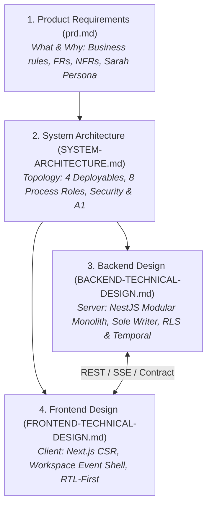

# Core Specifications (`core/`)

This directory houses the **canonical, non-negotiable core specifications** for the **BusMora** platform. Together, these four foundational documents define the end-to-end contract across product requirements, overall system architecture, backend implementation, and frontend design.

---

## The Four Core Pillars

### 1. [Product Requirements Document (`prd.md`)](./prd.md)
* **Scope:** Authoritative functional requirements (FR), non-functional requirements (NFR), and acceptance criteria for the autonomous AI Marketing Employee.
* **Key Sections:** Marketing Employee persona, Sub-agent orchestration (Strategist, Copywriter, Social Poster, Analyst), Business Brain knowledge management, Governed Safe Publishing workflows, and bilingual (Arabic/English) requirements.

### 2. [System Architecture v1.0 (`SYSTEM-ARCHITECTURE.md`)](./SYSTEM-ARCHITECTURE.md)
* **Scope:** Canonical system-level topology, deployable units, inter-process communication, and security posture for the 24-week MVP.
* **Key Decisions:**
  * **4 Deployables / 8 Process Roles:** `busmora-web`, `busmora-api` (HTTP + Scheduler), `busmora-workers` (Temporal + Scheduled Publisher + Ingestion Crawler), `busmora-ai` (Temporal Workers + Internal HTTP).
  * **Platform-Centred Backend (Option B1):** `busmora-api` is the single owner and sole writer of all PostgreSQL domain tables.
  * **Amendment A1 (Internal HTTP):** Direct synchronous HTTP on private loopback for fast interactive chat replies ($\le 3\text{s}$) and Brain semantic search.
  * **Dual-Memory Brain:** Semantic memory (PostgreSQL concept graph + Qdrant vectors) + procedural rules.
  * **Security & Multi-Tenancy:** Row-Level Security (RLS) tenant isolation and envelope encryption (AWS KMS / Tink) for OAuth credentials and Brand Kits.

### 3. [Backend Technical Design (`BACKEND-TECHNICAL-DESIGN.md`)](./BACKEND-TECHNICAL-DESIGN.md)
* **Scope:** Internal software design and code organization of `busmora-backend`.
* **Key Mechanisms:**
  * **NestJS Modular Monolith:** 13 business modules strictly matching the bounded contexts.
  * **Encapsulated Contracts:** Modules communicate exclusively through public `contract/` interfaces; direct cross-module table access is strictly prohibited.
  * **Ambient Unit of Work:** Atomic transactional persistence via Drizzle ORM.
  * **Read-Only Python Views:** Python workers execute complex vector/graph queries using dedicated read-only credentials enforced by RLS.
  * **Durable Orchestration:** Temporal workflows for background campaigns, market intelligence crawling, and batch publishing.

### 4. [Frontend Technical Design (`FRONTEND-TECHNICAL-DESIGN.md`)](./FRONTEND-TECHNICAL-DESIGN.md)
* **Scope:** Internal client architecture and state management of `busmora-frontend`.
* **Key Mechanisms:**
  * **Client-Side Rendered (CSR):** Next.js 14+ SPA optimized for interactive workspace state and continuous SSE streaming.
  * **Prepared for Workspace Event Shell (FE-3):** Modular context-based directory structure (`features/brain`, `features/publishing`, `features/chat`) ready for event-driven multi-panel canvas.
  * **State & Sync:** Server cache managed via TanStack React Query; interactive UI states managed via Zustand.
  * **Security & Tokens:** Short-lived access tokens (15 min) in memory only; secure refresh token in HttpOnly `SameSite=Strict` cookie with reuse detection.
  * **MENA First:** Built-in RTL layout direction, Arabic typography, and dialect formatting.

---

## Interconnection with Related Directories

* [**Domain-Driven Design (`../domain/`)**](../domain/): Tactical aggregates, bounded contexts, domain events, and the canonical [Glossary](../domain/GLOSSARY.md).
* [**Product & Business Strategy (`../strategy/`)**](../strategy/): Business model, defensibility moat, MVP 24-week boundaries, and historical decision records.
* [**Research & Benchmarks (`../research/`)**](../research/): Customer discovery findings and technical benchmark evidence behind architectural decisions.
