# BusMora — System Architecture

> **Version:** 2.0 · **Status:** Aligned design; open decisions in §9 · **Date:** 2026-10-30
> **Built from:** [PRD (prd.md)](./prd.md), [strategy/](../strategy/) (supporting strategy, subject to the PRD), [research/technical/](../research/technical/) (00 through 04 benchmark records), and [domain/](../domain/).
> **Scope:** the complete architecture of the first release (the planned 24-week Phase 2 Marketing Director release), plus its planned growth path. This document is self-contained; the source files hold the detailed evidence behind it.
> **Authority:** PRD v2.0 (30 October 2026) governs product scope and release gates. Existing engineering choices are retained where compatible; older-source conflicts are recorded in §9.5. Design coverage is not implementation or release evidence.
> **Source aliases:** SYS means this document; BACKEND/BTD and FTD mean the linked technical designs. D/DR = [decision registry](../strategy/decision-registry.md); 01 = [constraints](../research/technical/01-constraints.md); 04 = [architecture decision](../research/technical/04-decision.md); EVAL = [evaluation](../strategy/evaluation.md); BM = [business model](../strategy/business-model-value-proposition.md); MVP = [release scope](../strategy/mvp-definition.md). Historical TA references have been replaced with current design sections.

---

## Table of contents
1. [Overview & goals](#1-overview--goals)
2. [Constraints, quality attributes and technology stack](#2-constraints-quality-attributes-and-technology-stack)
3. [Domain model & bounded contexts](#3-domain-model--bounded-contexts)
4. [Backend architecture](#4-backend-architecture)
5. [Frontend architecture](#5-frontend-architecture)
6. [Backend ↔ frontend contract](#6-backend--frontend-contract)
7. [Cross-cutting concerns and growth path](#7-cross-cutting-concerns-and-growth-path)
8. [Architecture decision records](#8-architecture-decision-records)
9. [Risks, gaps and open questions](#9-risks-gaps-and-open-questions)
10. [PRD alignment matrix](#appendix-a--prd-v20-alignment-and-acceptance-evidence)

---

## 1. Overview & goals

### 1.1 What BusMora is

BUSMORA is an Arabic-first AI Marketing Director for owner-operated service businesses, with experienced marketers as secondary users. Egyptian and named GCC cohorts require separate suitable evaluation; no regional product-market fit is asserted. Minimal owner-confirmed onboarding seeds persistent Business Brain. Owners then choose independent Chat or separate adaptive Roadmap Discovery. Genuine conversation-linked Canvas shows actual Tasks. Complete actionable steps support execution, owner-reported completion, Skip/Revisit and approved revisions. Documents live in Deliverables; first-class social Posts live in Scheduling with governed Facebook Page organic publishing. Settings and focused in-app notifications complete the six-area application.

Phase 2 is the binding production-ready target; this design is not implementation evidence. Five students over approximately 24 weeks/~2,400 productive hours (1,800 development including tests plus 600 stabilization) remain planning assumptions to re-estimate after redesign. All active AC-01–25 and AC-27–58 must pass; FR-47 and AC-26 are retired. No paid pilot or fixed external-tester count is required.

### 1.2 Users and actors

| Actor | Responsibility |
|---|---|
| Owner | One primary owner per Workspace; controls knowledge, task/resource authorization, plan activation/revisions and exact publishing approvals |
| Marketing Director | Fast Router, dynamic bounded Orchestrator and actual research/analysis/drafting specialists; deterministic services enforce authority |
| Operators/evaluation reviewers | Audited infrastructure recovery and frozen-rubric evaluation; suitable native review in all four content registers |
| External systems | Google identity provider; authorized Facebook Pages in Phase 2; permitted public research sources, model/tool providers and existing managed infrastructure |

### 1.3 Core journeys

1. **Authenticate:** email/password-only signup → secure expiring verification link → onboarding; or Google code/OIDC signup/login with safe explicit account linking. Existing session architecture remains.
2. **Confirm essential context:** website crawl/extraction or manual entry → same editable persisted form → owner confirms exact version → Brain activation. Five required groups: name, description, one or more offerings, country/service area, conversion/contact route state (including not ready). Pricing is optional and supports fixed/starting_from/quote_required/unknown. No strategy interview or weekly-hours question.
3. **Choose work:** Chat with Marketing Director or Create My Roadmap. Brain is directly available. Returning owners reopen last valid accessible page or Director, preserving authorized deep links.
4. **Discover a Roadmap:** saved adaptive goal/questions/answers reuse current Brain; question-specific research creates durable origin links, returns through Use in Roadmap to the exact question, then owner confirms. Generate a complete proposed plan and explicitly activate it.
5. **Execute/revise:** launch any eligible step through Director with real dependency/authority checks; two running Tasks maximum per Workspace. Owner external work is attested, Skip differs from completion/cancellation, Revisit recomputes eligibility. Strategic diff needs approval; one active plan plus drafts/history.
6. **Create outputs:** typed results create non-Post documents or independent Publishing Posts. Mixed campaigns link both without duplicating Post content. Direct Chat has no Roadmap prerequisite.
7. **Manage Posts:** Scheduling Month/Week/List and Unscheduled, manual New Post, versioned editor/detail, exact individual/bulk approval, scheduling, deterministic dispatch and reconciliation. Published history uses actual dates; critical fact changes hold only affected Posts.
8. **Analyze when asked:** supported CSV/.xlsx attached to explicit Chat work uses validated mapping and deterministic math, then saves a one-off analytical report. No periodic performance workflow or automatic strategy revision.

Canvas relationship is **Conversation → related Tasks → selected Task**. Recoverable internal attempts stay Processing, with operator diagnostics separate; exhausted failures surface truthfully. Business Brain uses current eligible knowledge, provenance and explicit owner adoption; deletion suppresses primary and derived retrieval.

### 1.4 Architecture goals

| # | Goal | Why |
|---|---|---|
| AG-1 | **No external write without approval.** Dispatch uses the exact approved version and execution parameters; retries reconcile provider evidence and hold uncertain results rather than risk a duplicate. Platform processing is outside our control. | The product's governance promise (PRD §7, FR-34–36, D-16, D-50) |
| AG-2 | **Durable long-running work.** Tasks, clarification waits (up to 7 days) and scheduled posts (up to a month) survive restarts and closed browsers. | PRD NFR-05, FR-23, §4.6 |
| AG-3 | **Grounding in eligible context with provenance and trust labels**, measurable against a document-only control route | D-20–D-25, EVAL §5 |
| AG-4 | **Real-time transparency** through the authentic Canvas rendering recorded execution events | D-17, D-34, FR-22 |
| AG-5 | **Tenant isolation in every store** | PRD NFR-03, AC-17 |
| AG-6 | **Arabic-first**: right-to-left UI and native dialect generation across 4 registers | D-06, D-07, FR-43–44 |
| AG-7 | **Planned for 5 students over 24 weeks (~2,400 assumed hours)**, with vertical workstream ownership | D-05, PRD §13.1 |
| AG-8 | **Domain-neutral seams** so future channels, tools, and employees can be added without redesign | D-02, D-03, MVP §9 |

### 1.5 In and out of scope for this release
- **In (Phase 2 Release Contract, 24 weeks):** everything listed in §1.1, as the committed production-ready release (PRD §3).
- **Phase 3 (Post-MVP Product Expansion):** Social Profile URL onboarding (P3-01); Instagram Business and X publishing connectors (P3-02); connected platform analytics APIs (P3-03).
- **Phase 4+ (Creation & Commercial Expansion):** Native AI image generation (P4-01); subscriptions and billing administration (payment provider unselected) (P4-02).
- **Phase 5 — Meta Ads Management:** deferred eligible Business/Ad Account connection, setup/creatives/targeting, explicit budgets/spending, supported launch/metrics and controlled changes inside BUSMORA; access/eligibility/formats/measurement require independent validation (§7.9).
- **Out of Scope (Explicit Non-Goals):**
  - Multi-user workspaces; live website/CMS builder; paid ad campaign management/spending; direct messaging (WhatsApp/DM) bots.
  - Automatic background market scrapers; numeric business health scores; enterprise organizations.

---

## 2. Constraints, quality attributes and technology stack

### 2.1 Binding constraints

| # | Constraint | Source |
|---|---|---|
| K-01 | **5 students, 24 weeks (~2,400 productive hours)**, Phase 2 binding release contract, vertical workstream ownership (18 weeks development + 6 weeks stabilization) | D-04, D-05; PRD §13.1 |
| K-02 | **Four deployables:** `busmora-web`, `busmora-api`, `busmora-workers`, `busmora-ai`. Each may run several **process roles** (same code, different entrypoint); a role is not a new service. | D-26 |
| K-03 | **Two standalone repositories:** `busmora-backend` (api, workers, ai) and `busmora-frontend` (web) | 01 R-5 |
| K-04 | `core/prd.md` (v2.0) is the binding release contract. PRD v2.0 takes precedence over the decision registry, technical designs and older supporting documents; conflicts are recorded in §9.5. | PRD §1.2, 01 R-1 |
| K-05 | **The stack is fixed** (§2.4). Missing tools are filled only by explicit decision. | 01; 04 §9 |
| K-06 | Single Marketing Director; no admin or marketplace machinery | D-01, D-03 |
| K-07 | No in-product billing this release; **usage and cost metering per workspace from day one** (Phase 4+ billing) | 01 SC-2, SC-3, P4-02 |
| K-08 | Publishing in Phase 2: **Facebook Pages only** (Meta Graph API). Supported formats: text/link and single owner-supplied image with caption. Initial development runs under Meta tester mode; release gate AC-30 requires verifying production configuration for ordinary owners without developer-role accounts. Instagram Business and X are Phase 3. | PRD §3.2, FR-33, AC-30; 01 EP-1–EP-4 |
| K-09 | Brand assets extracted from website crawl or guided intake; text-first assets and owner-supplied media in Phase 2; native AI image generation in Phase 4+ | PRD FR-30, FR-31, P4-01 |
| K-10 | Dialects: Egyptian Conversational, Gulf-oriented, Modern Standard Arabic, plus English | PRD FR-32, FR-44; 01 SC-5 |
| K-11 | Region: a single region in Frankfurt (**provisional**, not yet a gate). Cloud provider deferred. | 01 HR-1, HR-2 |

### 2.2 Quality attributes and targets

PRD §10.2 supplies binding release gates. Earlier numerical infrastructure targets remain **provisional engineering hypotheses**, not PRD requirements or achieved measurements. Freeze task-specific limits, declared release load, rubrics and severity definitions by week 2 using early slices; changes need documented rationale and cannot lower gates to hide a failure.

| Attribute | Contract / target | Source |
|---|---|---|
| Latency/resources | Provisional p95: quick reply ≤3 s, task acknowledgement ≤2 s, Canvas event delivery ≤500 ms, content ≤30 s/piece, research and crawl ≤5 min. Validate task-specific timeout, cost and concurrency ceilings at declared load; disclose allowances and obtain approval for extensions. | NFR-06; PRD §10.2 |
| Availability/recovery | Earlier 99% uptime, RPO 0 for committed primary data, and RTO ≤1 h are engineering objectives requiring provider/topology evidence. Test backup/restore and rollback; do not promise zero loss without evidence. Derived indexes are rebuildable subject to deletion controls. | NFR-05, NFR-09; OD-21 |
| Publishing | All retry/concurrency/cancellation/revocation/version/context/late/uncertain scenarios pass with real platform and ordinary-owner evidence. No exactly-once external guarantee. | FR-33–36; AC-12–13, AC-23, AC-28, AC-30 |
| Scale | Hard limit of at most two running Tasks and one crawl per workspace; other load targets remain provisional. The historical 100-workspace stubbed load experiment tests local capacity only; actual release load and real-provider evidence remain required. No fixed pilot count. | NFR-05–06; PRD §10.2 |
| Security | Tenant isolation, KMS credentials, URL/redirect validation, prompt-injection boundaries, safe spreadsheet parsing/export and rate limits; zero critical truthfulness/control violations in the release suite. | NFR-03–04; AC-17, AC-27 |
| Privacy/lifecycle | Owner export, correction, deletion and disconnection; legitimate prices, business budgets and aggregate outcomes are allowed. Reject credentials and unnecessary personal/financial records. Define active cleanup, backup expiry, audit minimum and restore suppression. | FR-13, FR-42; NFR-09 |
| Localization | Complete Arabic/English mobile and keyboard journeys; separate UI, conversation and campaign language; all four content registers reviewed appropriately. | FR-32, FR-43–44; NFR-07 |
| Observability | Redacted action/tool/error records and usage, including failed/retried/child work; no secrets or private reasoning. | NFR-08 |
| Quality | ≥80% held-out cases pass the frozen human rubric without major correction overall **and within each register**; all audited consequential claims supported or explicitly owner claims/hypotheses. All active AC-01–25 and AC-27–58 pass; no unresolved critical/high recovery/security defects. | PRD §10.2 |
| Cost | Historical $0.40/task and $0.05/search are provisional sizing inputs only. Admission uses owner-authorized task allowances, concurrent reservations and explicit extension approval; internal usage approval is not customer charging. | FR-27; NFR-06 |

### 2.3 Evaluation framework used to choose the architecture
- **Hard gates:**
  - **G1** no unapproved or duplicate publish.
  - **G2** tenant isolation in every store.
  - **G3** durable primary data and tested recovery, with derived stores rebuildable; the earlier zero-loss objective requires evidence (§2.2).
  - **G5** consistent with PRD v2.0; retain compatible registry decisions and flag conflicts.
  - The region gate (G4) is withheld until the region study is done.
- **Weighted criteria (sum 100):**

  | Criterion | Weight |
  |---|---|
  | C1 delivery feasibility | 20 |
  | C2 reliability | 15 |
  | C3 security and isolation | 15 |
  | C4 operational simplicity | 12 |
  | C5 latency and real-time | 10 |
  | C6 AI-quality enablers | 10 |
  | C7 observability and testability | 8 |
  | C8 extensibility | 6 |
  | C9 scalability headroom | 4 |

- **Results:** see ADR-003 and ADR-009 in §8.

### 2.4 Technology stack

**Retained engineering selections (the PRD leaves technology selection to supporting designs):**

| Layer | Technologies |
|---|---|
| Frontend (`busmora-web`) | Next.js 14+ (App Router), TypeScript, React Flow, Tailwind CSS / shadcn/ui, SSE with `Last-Event-ID` reconnects, React Query |
| Platform API (`busmora-api`) | NestJS 10+ (TypeScript), Passport.js + JWT, Argon2id, Drizzle ORM, SSE gateway reading Redis Streams, Temporal TypeScript SDK, ioredis, class-validator + Swagger (`@nestjs/swagger`) |
| Workers and AI (`busmora-workers`, `busmora-ai`) | Python 3.11+, FastAPI + Uvicorn, LangGraph, LiteLLM, Scrapling, Temporal Python SDK, Qdrant client, SQLAlchemy / asyncpg, Pydantic v2, MCP SDK |
| Data and infrastructure | PostgreSQL 16+, Qdrant, Redis 7+, Temporal Cloud (+ Temporal UI), Cloud KMS, S3-compatible object storage, Docker Compose (local) |
| Observability | Langfuse |

**Gap-fills chosen by explicit decision** (04 §9):

| Tool | Purpose |
|---|---|
| Ajv | Runtime validation of Temporal payloads against JSON Schema on the TypeScript side |
| openapi-typescript + openapi-fetch | Typed API types and client, generated from OpenAPI |
| oasdiff | Breaking-change check on the published API contract |
| Browser built-ins (native `EventSource`, `BroadcastChannel`, Web Locks) | SSE client; coordinating token refresh across tabs |

**Deferred provider choices:** LLM providers (decided by an Arabic-quality bake-off), embedding model, object-storage vendor, rotating-proxy vendor, cloud provider (D-39–D-42; 01 HR-2). The native image model and composition stack remain Phase 4+ decisions.

---

## 3. Domain model & bounded contexts

### 3.1 Ubiquitous language (key terms)

| Term | Meaning | Not to be confused with |
|---|---|---|
| **Business** | The real company BusMora works for | "Customer" (ambiguous) |
| **Workspace** | The Business's isolated space in BusMora | Account, tenant |
| **User** | The single person operating a Workspace | Owner, marketing person |
| **Business Brain** | The Workspace's versioned business context with provenance, epistemic state and owner data controls | Knowledge base |
| **Knowledge Item** | One business observation, claim, hypothesis or decision, in one of nine **Knowledge Categories**: Company Profile, Offering, Audience, Brand Rule, Positioning, Strategic Goal, Channel, Competitor, Company Fact | Node, entity |
| **Relationship** | A typed, directed link between Knowledge Items: targets, competes with, has tone, solves pain point, related to | Edge |
| **Procedural Rule** | A reviewed instruction on *how* to work for this Business (style, dialect), learned from edits and feedback | — |
| **Candidate** | A proposed Knowledge Item or Procedural Rule not yet reviewed | — |
| **Review** | The User's individual approve, edit-and-approve or reject decision on one Candidate | Approval |
| **Retirement** | Withdrawing current information for legitimate historical versioning; distinct from owner-requested deletion | Deletion |
| **Brand Voice / Dialect / Brand Kit** | How the Business sounds; its Arabic register; the logo, colors and fonts detected from its website | — |
| **Marketing Director / Orchestrator / Sub-agent** | Product persona; planning runtime; dynamically selected specialists. `employee` remains an internal configuration/module name. | Fixed agent-count product promise |
| **Conversation / Quick Reply / Task** | The chat; an immediate answer that starts no work; one unit of requested marketing work | Job, workflow |
| **Constraint Diagnosis** | An evidence-linked primary constraint hypothesis across the five diagnostic lenses, including alternatives and uncertainty | — |
| **Clarification / Research this** | A pause in a Task asking for missing info through a form; the option to let the Employee research a field | — |
| **Canvas** | Conversation-local actual Task execution view with durable summary fallback | Decision canvas |
| **Onboarding Crawl / Research Crawl / Snapshot** | The first website read; material gathered for a Task; a preserved crawled page | — |
| **Research Signal / Buyer Vernacular** | Crawled material showing buyer intent; buyers' own words | — |
| **Deliverable** | Non-Post versioned documents: research, analysis, strategy, briefs and planning reports | Artifact, output |
| **Post / Post Version** | Publishing-owned social content, which may be an undated/unconnected draft; an immutable version of its content and publishing parameters | Snapshot |
| **Approval** | Consent to publish one specific Post Version as-is | Review |
| **Batch Review** | Where the User approves, edits, regenerates, rejects or cancels many Posts | — |
| **Publish Attempt / Read-back Verification** | One try to go live; confirming afterwards that the post exists on the platform | — |
| **Platform / Connected Account** | Facebook Pages in Phase 2; Instagram Business/X in Phase 3; a workspace-authorized destination | Channel (a Brain category) |
| **Usage Record / Audit Event / Notification** | Metered resource use; an append-only governed-action record subject to minimal retention and deletion policy; an in-app message | — |

### 3.2 Bounded contexts

| Context | Type | Owns |
|---|---|---|
| **Business Brain** | **Core** | Knowledge Items, Relationships, Procedural Rules, Candidates and Review, Retirement, Conflicts, Provenance, Brand Kit facts |
| **Marketing Employee** | **Core** | Conversations, Quick Replies, Tasks, Constraint Diagnosis, Clarifications, Sub-agent work, the Canvas feed, text/visual briefs, saved Discovery, Roadmaps/steps, owner attestations and requested analysis |
| **Governed Publishing** | **Core** | Posts, Post Versions, Batch Review, Approvals, Scheduled Times, Publish Attempts, read-back |
| **Market Intelligence** | Supporting | Onboarding and Research Crawls, Snapshots, Research Signals, the 7-day crawl cache |
| **Deliverables** | Supporting | Non-Post documents, versions, Source Citations, Analysis Uploads and applicable media/export storage |
| **Channel Connections** | Supporting | Connected Accounts, authorization state, Reconnect Needed |
| **Evaluation** (internal) | Supporting | Scenarios, Evaluation Rounds, Reviewer scores, Treatment and Control runs |
| **Identity & Workspace** | Generic | Users, auth-provider identities/optional local credentials, Workspaces/settings, onboarding drafts/confirmation and owner deletion requests |
| **Usage Metering** | Generic | Usage Records |
| **Audit Trail** | Generic | Audit Events |
| **Notifications** | Generic | In-app Notifications |

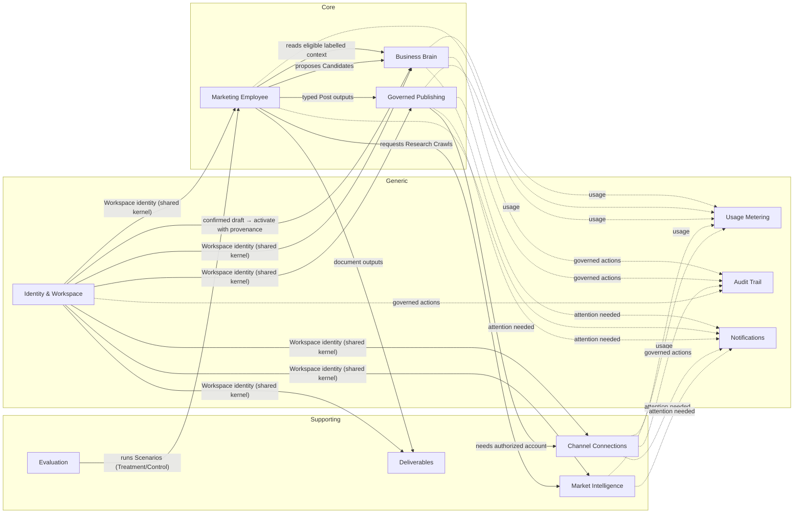

**Boundary rules:**
- **Review ≠ Approval.** Review is a knowledge decision; Approval is a publishing decision.
- **Channel ≠ Platform.** A Channel is where the business markets (a Brain category); a Platform is where BusMora can publish.
- **Snapshot ≠ Post Version.** A Snapshot preserves a crawled page; a Post Version freezes Post content.
- **Deliverables are historical work, not current authority.** AI interpretations proposed for persistence enter Candidates; saved source observations remain labelled observations.
- **Canvas animation is a live view.** Durable task/work/action summaries provide recorded history; transient reconnect replay is not historical re-animation.

### 3.3 Brain and intake governance

Initial website observations and extraction results are not active Brain knowledge. `identity` owns editable OnboardingDraft; `crawls` owns raw observations/snapshots. Website/manual paths use identical BusinessInformation. Owner confirmation of the exact draft emits OnboardingConfirmed; Brain activates in the same PostgreSQL transaction, indexed after commit. Late extraction cannot overwrite owner-touched fields. No duplicate initial Candidate approval queue.

Current owner-confirmed intake, later explicit owner facts/decisions and approved AI proposals are eligible with their epistemic labels. Owner confirmation/adoption is not independent verification. Separate source type/date, extraction status, verification, approval, current/superseded lifecycle, unknown and not-applicable. AI durable proposals from research/Chat/reports enter individual Pending Brain Updates; saving a report adopts no claims. Reimports expose conflicts rather than overwrite decisions.

The nine categories remain company_profile/offering/audience/brand_rule/positioning/strategic_goal/channel/competitor/company_fact. Seven proposal groups and typed-subtype mapping are defined in DESIGN-SYSTEM §9.5 and returned by Brain API. Graph and mobile-default accessible List share records, search/filter/detail/relationships, provenance, editing and conflicts.

A price edit from EGP 5,000 to EGP 8,000 creates the new current version, supersedes the old for future retrieval, flags only dependent tasks/documents and holds affected scheduled Posts. No automatic content rewrite, regeneration or send. Owner resolution and new approval of changed Post parameters are required. Deleted/pending/rejected/retired/superseded context is suppressed from current queries, Qdrant, every graph hop, summaries/checkpoints and historical/control retrieval. Deletion suppression precedes asynchronous cleanup; restore reapplies it (§4.5).

### 3.4 State machines and independent authority

**Authentication and intake**
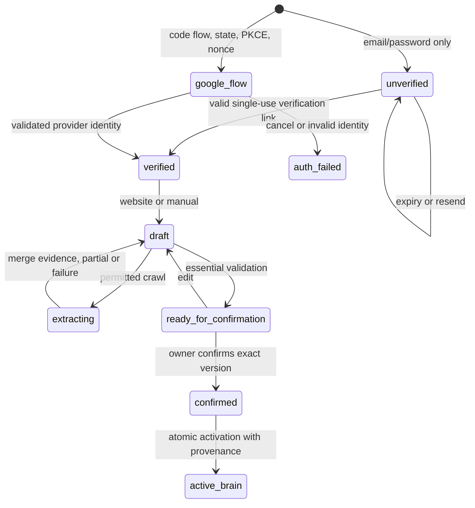
Matching email alone is not identity linking. Existing-account login/recent reauthentication and an explicit link intent are required. Failed callback never creates a session. Draft and extraction states grant no retrieval eligibility.

**Knowledge lifecycle**
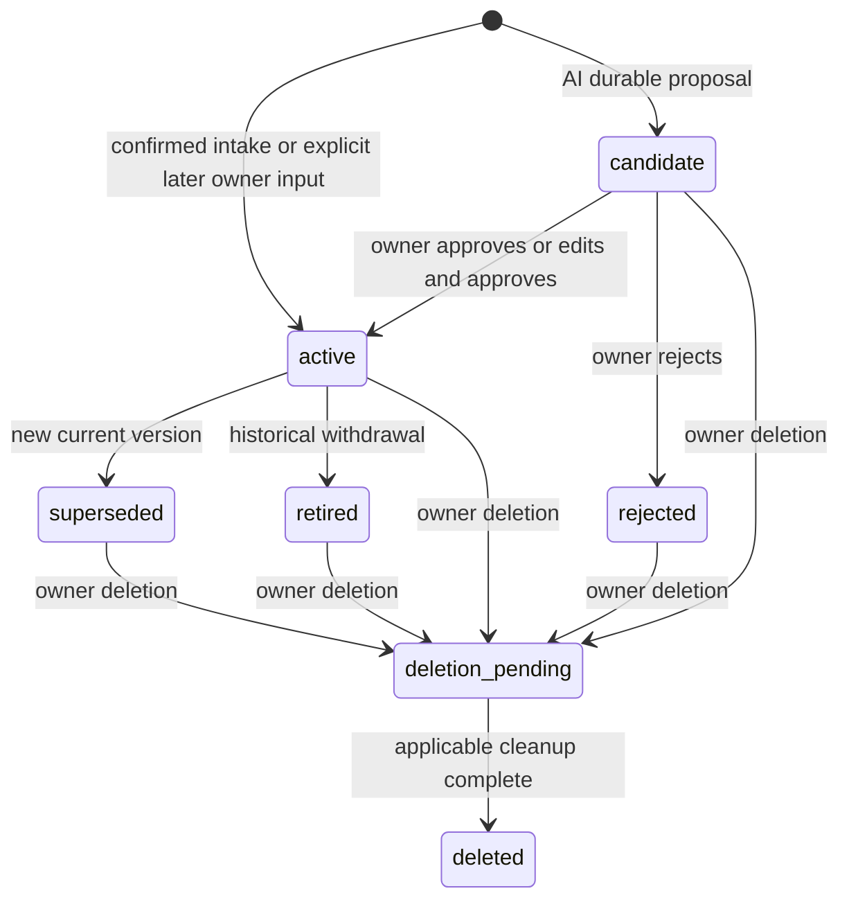

**Discovery and Roadmap**
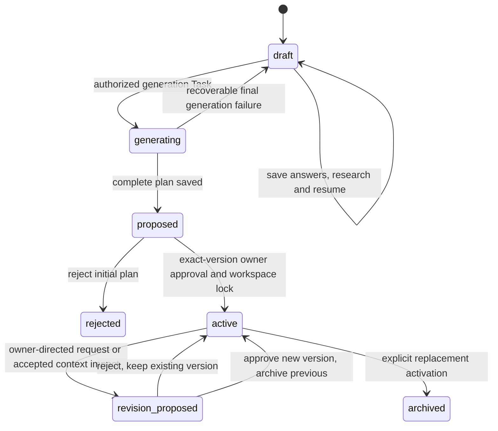
Question answer state: unanswered → answered → confirmed; unanswered/answered may become skipped, unknown or not_applicable explicitly; research sets researching, selected result returns answered pending confirmation. Reanswer invalidates prior answer confirmation and rechecks dependent questions. Editing an unactivated proposal invalidates it and returns its source draft to draft; initial rejection leaves the active plan untouched. Generation locks draft writes and activation checks the source draft version and archives the source. RoadmapDraft persists draft/generating/proposed/archived separately from Roadmap proposed/active/archived/rejected. StrategicRevision persists proposed/approved/rejected/superseded. One active plan per Workspace is enforced transactionally; saved drafts do not compete for authority.

**Step work**
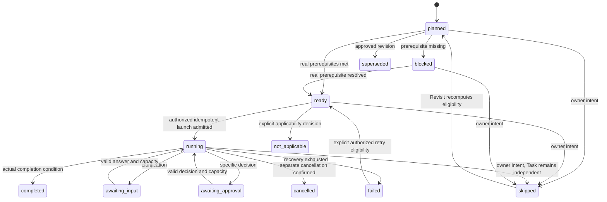
Diagram illustrates core transitions; skip is available for every applicable non-historical step and does not cancel an active Task. Completed execution evidence remains historical if the owner skips future plan participation. `StepExecution` stores workState, independent platform actionState and `OwnerAttestation.status=none|reported_done`. Owner-reported Done is a label/attestation, never platform verification. Skipped is not completion; dependent steps remain blocked unless an approved alternate route changes their prerequisites. Revisit starts no Task. No compulsory periodic learning state exists.

**Task runtime and public Canvas**
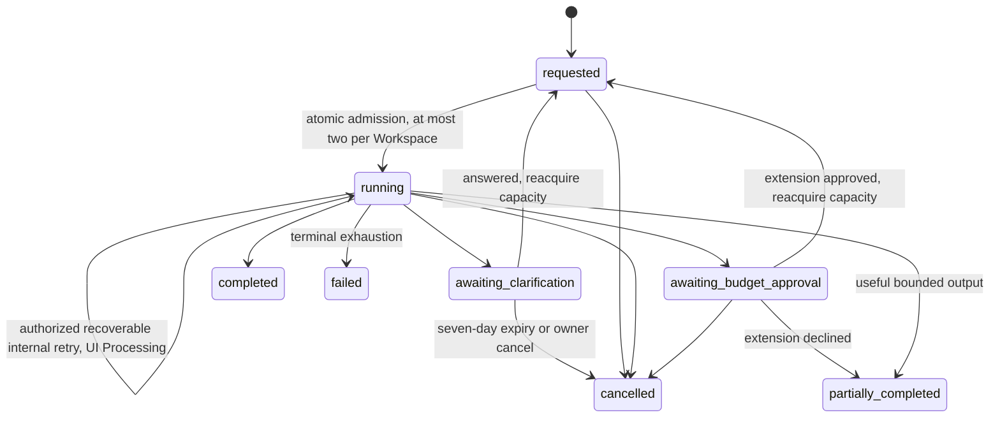
Public Canvas maps requested to recorded planned state, running (including recoverable retries) to active/Processing, clarification/budget waits to awaiting_input, real holds to held, and final logical outcomes to completed/error/cancelled. Partial results explicitly label completed versus failed work; no synthesized attempt graph. Selection is Conversation → related Tasks → selected Task; only actual node/connection records appear. Changing conversation does not cancel other Tasks.

**Documents and Post Versions**
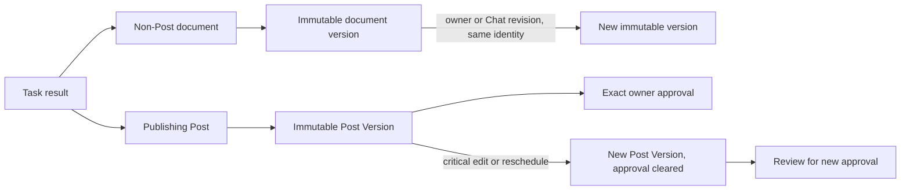
Deletion/redaction is a separate governed operation, not ordinary mutable version editing. A mixed campaign can link both outputs; documents never auto-create Posts.

**Post lifecycle**
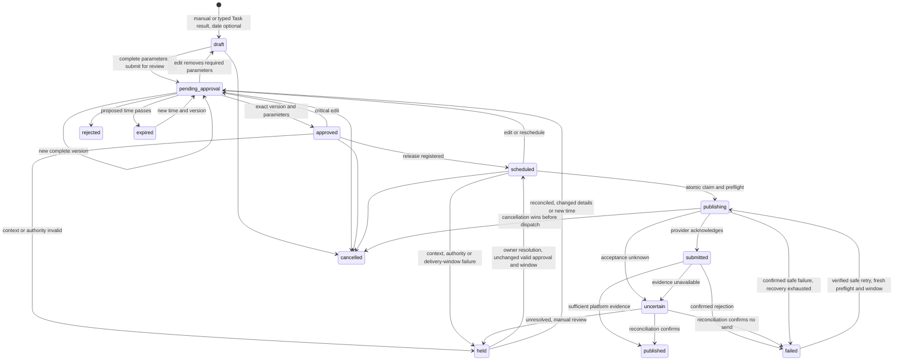

Approval binds Post Version, exact text/link/media version/hash, destination, scheduled UTC instant/planning IANA zone, lateness allowance, owner and current authorization generation. Undated drafts never dispatch. Every approval-critical change clears approval. A workspace-zone default change moves no approved instant. Pending dates are proposals; published calendar placement uses actual publishedAt. Local deletion claims no external removal; duplicating published content creates a fresh Draft.

**Attempt and hold handling**
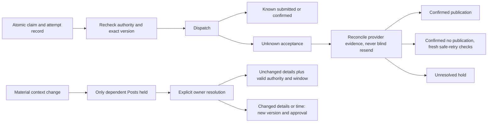
Hold resolution cannot clear unresolved external uncertainty into a resend. Cancel after provider acceptance reports the actual effect; it cannot undo it. Retain platform IDs/URLs, request IDs, attempt timestamps and verification basis.

**Connections and notifications**
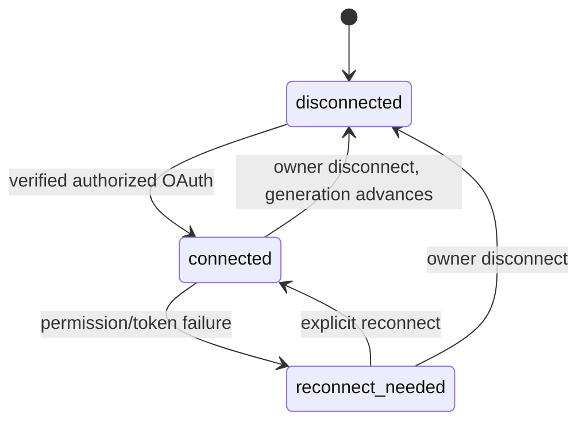
Reconnect revalidates authority but never releases overdue or uncertain work automatically. Notification lifecycle unread ↔ read is independent of subject approval/resolution; `read-all` applies through the displayed server timestamp. Deleted/inaccessible subjects resolve to unavailable, not another tenant's resource.

### 3.5 Public events and module boundaries

Public envelope is `{eventId,workspaceId,actor,subjectId,subjectVersion,occurredAt,correlationId,payload}`; events are versioned `.v1`, contain minimal safe references, and map from internal domain events. The API writes audit, usage, notification and relevant conversation messages in the same transaction; no message bus. External workflow/index signals occur after commit, with deterministic IDs and reconciliation.

| Owner | Events and consumers |
|---|---|
| identity | UserRegistered, EmailVerified, AuthIdentityLinked, SessionRevoked, WorkspaceCreated/SettingsChanged/DeletionRequested/Deleted, BusinessTimeZoneChanged, OnboardingDraftUpdated, OnboardingConfirmed; Brain consumes confirmation atomically |
| crawls | OnboardingCrawlStarted/Completed/Failed, BrandKitDetected, ResearchCrawlCompleted, SourceSkipped; extraction returns draft proposals through identity-owned activities |
| brain | OnboardingKnowledgeActivated, KnowledgeImported/OwnerProvided/CandidateProposed/ItemApproved/CandidateRejected/ItemEdited/ItemRetired, KnowledgeConflictDetected, RelationshipAdded/Retired/Deleted, ProceduralRuleApproved, ContextVersionChanged, KnowledgeDeletionRequested/Completed; tasks/documents/publishing react only for their dependent work |
| tasks | TaskRequested/Started/Completed/PartiallyCompleted/Failed/Cancelled, ClarificationRequested/Answered/Expired, TaskBudgetExtensionRequested/Approved/Rejected, ResourceConsumed; RoadmapDraftUpdated, RoadmapProposed, RoadmapActivated, RoadmapRejected, DiscoveryAnswerSaved/Confirmed, QuestionResearchStarted, ResearchResultSelected, StepLaunched, StepSkipped, StepRevisited, StepNotApplicable, OwnerImplementationAttested, StrategicRoadmapRevisionProposed/Approved/Rejected |
| deliverables | DeliverableCreated/VersionCreated/DeletionRequested, AnalysisUploadCreated/Rejected, AnalysisMappingConfirmed, DataExportRequested/Completed; no Post-creation subscriber |
| publishing | PostDrafted/VersionCreated/SubmittedForApproval/Approved/Rejected/Scheduled/Rescheduled/HeldOnStaleness/HoldResolved/Cancelled/Expired/Submitted/OutcomeUncertain/Published/PublishFailed, PublishAttemptRecorded, CampaignCreated, ReviewSessionStarted/Ended |
| connections | AccountConnected/ReconnectNeeded/Disconnected; authorization generation changes block future sends |
| notifications | Read-state mutations only; consumes terminal Task/input/result, Post approval/publication/hold/uncertainty, reconnect, Brain proposal and proposed revision events; no attempt-level notices |

`tasks → publishing` is the narrow new result-creation contract edge. `publishing → deliverables` validates immutable owner media; `conversation → deliverables/publishing` validates typed document/Post revision targets. `conversation → tasks` remains; TaskRequested consumers create linked conversations atomically for Wizard/step launches without a reverse call. Identity confirmation activates Brain via `brain → identity` event subscription. Other modules never read/write foreign tables; cross-context refs are IDs validated at their owning command boundary. Existing support modules and deployment boundaries remain unchanged.

Canvas public signals are separate: five baseline agent/handoff types plus execution_event for actual safe tool/service/workflow/input/hold transitions. Recoverable retry events remain diagnostic only. Redis stream and state hash update atomically; durable summaries remain after live-buffer expiry.

### 3.6 Discovery research and execution sequences

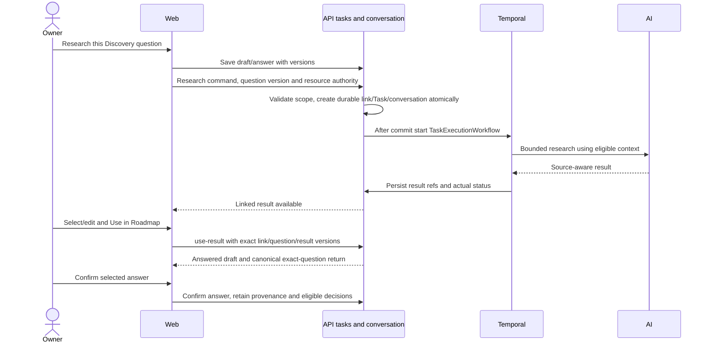

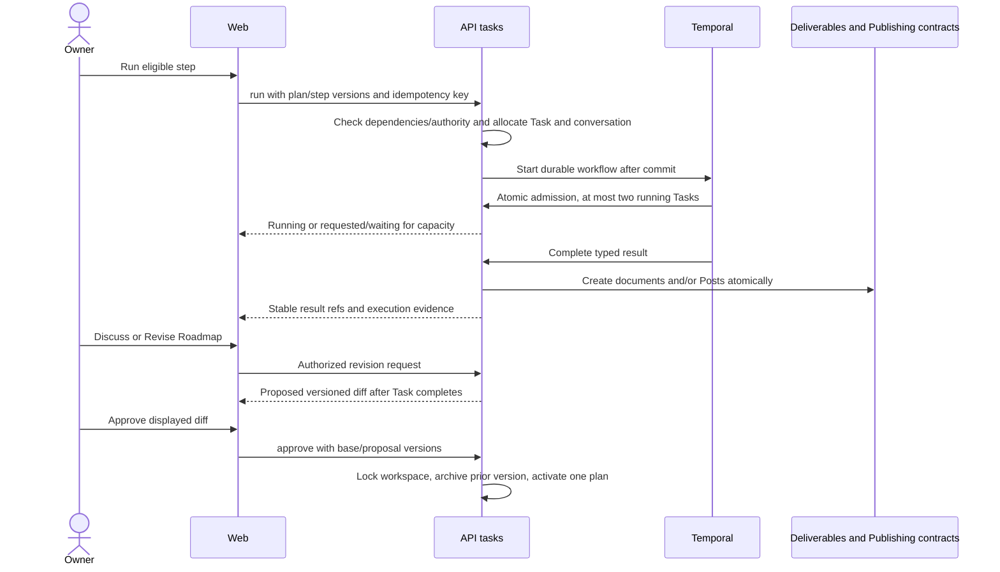

### 3.7 Shared persisted contracts and relationships

BACKEND §§6.1–6.8 and §8.2 define canonical DTOs. Identity owns auth identities, optional local credentials, workspace and onboarding draft/confirmation. Crawls owns raw snapshots and source evidence. Tasks owns Discovery draft/questions/answers/research links, goals/practical constraints, Roadmaps/immutable versions/steps, execution projections, dependencies/decisions/attestations and resource reservations. Conversation owns messages; every Task has a non-null conversationId. Document/Post results retain workspace, Task/conversation and optional roadmap/version/step/campaign origins. Publishing owns campaign grouping, Posts/versions/approvals/holds/schedule/attempts and Post Batch Review sessions. Notifications owns read-state records only.

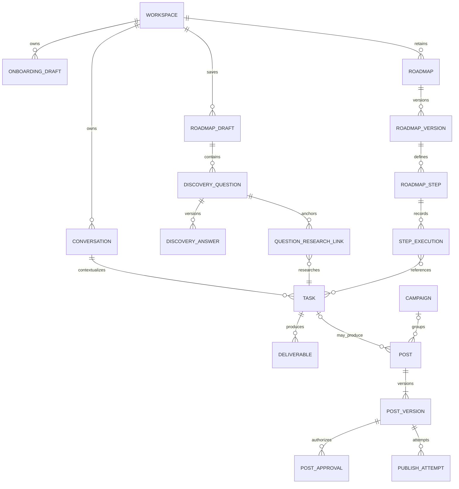
Relationships show logical references, not cross-module SQL joins/foreign keys. Manual Posts need no Task or Deliverable. Workspace-scoped uniqueness/locks enforce one active Roadmap, current versions and task admission. BACKEND §7.6 distinguishes fresh schema from real deployment migration: retain historical audit/attempt evidence and replay safety, suppress unconfirmed legacy intake before retrieval, retire only exclusive obsolete storage/jobs, preserve `review_sessions` for Posts and prevent destructive undocumented drops.

Requests for supported one-off CSV/.xlsx analysis attach to an authorized Chat Task and generic analysis upload. Confirm schema mapping/source/period/granularity/units/currency/IDs; reject incompatible totals, duplicates and ambiguous inputs. Unknown is not zero; deterministic code computes supported ratios with explicit denominators, ROAS only with attributed revenue/spend and ROI with stated profit/cost basis. Formula/macros never execute; exports prevent formula injection. Result is an analytical document, with no periodic capture, cadence, dashboard or automatic plan revision.

Plan approval, Task authorization, resource extension, knowledge adoption, document acceptance, owner attestation and exact Post approval remain separate decisions. No LLM, source text or saved document can create external authority. A target is not a forecast; completed work and publication are not commercial impact.

## 4. Backend architecture

### 4.1 Style
**"Platform-Centred" with one amendment:**
- **`busmora-api` (NestJS) is the single owner and only writer of all domain data**, the Brain included.
- **Python services are stateless compute** reached through **Temporal**.
- **Amendment A1:** two read-only synchronous paths go over **internal HTTP** to `busmora-ai`, for **quick replies** and **Brain retrieval**.

### 4.2 Diagram
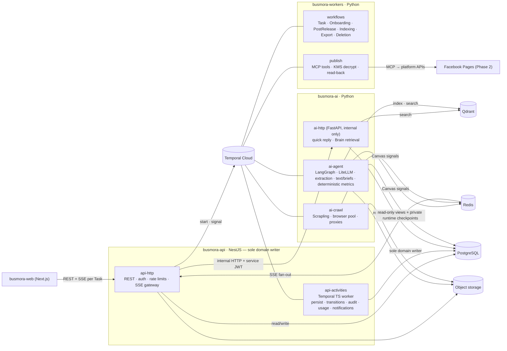

### 4.3 Components (process roles)

| Deployable | Role | Responsibilities |
|---|---|---|
| `busmora-web` | `web` | Serves the frontend (§5) |
| `busmora-api` (NestJS) | `api-http` | Public REST API; user auth (Argon2id, JWT, refresh rotation); rate limiting; OAuth consent callbacks + KMS encryption; uploads; SSE gateway reading Redis Streams; Temporal client (starts and signals workflows); internal HTTP client to `ai-http` |
| | `api-activities` | Temporal **TypeScript activity worker** hosting the "platform" activities: persist task progress and results, open and cancel Clarifications, save intake drafts, activate confirmed context and persist AI proposals, claim and record Post publishing, write audit, usage and notification rows |
| `busmora-workers` (Python) | `workers-workflows` | Workflow definitions: `TaskExecutionWorkflow`, `OnboardingWorkflow`, `PostReleaseWorkflow` (one active release per Post; ID includes schedule revision), `IndexingWorkflow`, `DataDeletionWorkflow`, `DataExportWorkflow`, `WorkspaceDeletionWorkflow`. Sequencing only; no domain rules. |
| | `workers-publish` | MCP publishing tools (`publish_facebook` in Phase 2; `publish_instagram`, `publish_x` prepared for Phase 3); KMS decryption in memory; idempotent dispatch; read-back verification; token refresh. **No database access.** |
| `busmora-ai` (Python) | `ai-http` | **Internal-only** FastAPI: Router and quick replies; Brain retrieval (seed + 1–2 hops). **Never writes domain data.** |
| | `ai-agent` | Temporal activity worker: LangGraph (Router, Orchestrator, Sub-agents), LiteLLM, knowledge extraction, embedding and Qdrant indexing, text/visual briefs, deterministic requested CSV/.xlsx KPI computation; emits Canvas signals |
| | `ai-crawl` | Temporal activity worker: Scrapling crawlers with a bounded headless-browser pool, rotating proxies, sanitization, intent qualification |

### 4.4 Bounded contexts → components

| Context | Rules and state (owner) | Durable process | Compute |
|---|---|---|---|
| Business Brain | api `brain` module | `IndexingWorkflow` reconciles import, owner input, approval, edits and eligibility changes; deletion purges derived data | ai: extraction, embeddings, retrieval (`ai-http` for synchronous search) |
| Marketing Employee | api `conversation` and `tasks` modules | `TaskExecutionWorkflow` | ai: Router (`ai-http`), Orchestrator, Sub-agents (`ai-agent`) |
| Governed Publishing | api `publishing` module (state machine) | `PostReleaseWorkflow` per Post/schedule revision | `workers-publish` |
| Market Intelligence | api `crawls` module (records, Snapshot metadata) | `OnboardingWorkflow`; crawl steps inside Tasks | `ai-crawl` |
| Deliverables | api `deliverables` module | — | ai produces content |
| Channel Connections | api `connections` module | Refresh inside the publish path | `workers-publish` |
| Identity & Workspace | api `identity` module | `WorkspaceDeletionWorkflow` | — |
| Usage, Audit, Notifications | api modules (same-transaction rows) | — | — |
| Evaluation | api `evaluation` module | Scenario run = `TaskExecutionWorkflow` with a frozen Treatment/Control flag | ai |

**Extensibility seam:** Employee configuration, Capabilities and Task records are api-owned records. The active configuration is **frozen into every workflow input**, so in-flight work is unaffected by later edits.

### 4.5 Data architecture

| Store | Holds | Who writes | Notes |
|---|---|---|---|
| **PostgreSQL 16+** (source of truth) | All domain state, one schema per context: identity, brain (`brain_nodes`, `brain_edges`, `brain_procedural_rules`), conversation, tasks, deliverables, publishing (posts, post versions, publish attempts), connections (KMS-encrypted credential envelopes), crawl metadata, audit (append-only), usage, notifications, evaluation | **`busmora-api` only.** Drizzle is the single migration toolchain. | Recovery objectives + point-in-time restore, to be verified (§2.2) |
| PostgreSQL runtime schema | LangGraph checkpoints | `ai-agent` | Not authoritative domain state; may contain private context copies subject to deletion and resume revalidation |
| PostgreSQL retrieval views | `brain_read` for eligible current context/relationships/adopted rules; module-owned `conversation_read`, `tasks_read`, `deliverables_read` for eligible labelled historical work, sources and dependencies | read by `ai-agent` and `ai-http` through **read-only roles**, with **row-level security** on the workspace | Python never writes domain tables |
| **Qdrant** (derived) | Embeddings of eligible context and eligible historical/control chunks. Payload: workspace, item/version, lifecycle, approval, epistemic kind, provenance, retrieval eligibility and deletion generation; always revalidate against PostgreSQL. | `ai-agent` | Rebuilt from PostgreSQL + object storage by `IndexingWorkflow` |
| **Redis 7+** (derived) | Refresh-token families (with rotation state); per-Task Canvas streams (replay buffer); crawl-cache keys (7-day TTL) | api, ai | Loss affects only sessions, live replay and the cache |
| **Object storage** (S3-compatible) | Crawl Snapshots, Chat-requested CSV/.xlsx analysis uploads, owner-supplied publishing media and export packages (short-lived signed media URLs for Facebook) | ai (Snapshots), api (uploads/exports). Metadata rows are written only by api. | Keys: `{workspace_id}/{source_type}/{timestamp}_{filename}` |
| **Temporal Cloud** | In-flight workflow state and references | workflows | Large content travels by reference, never inline |

**Retention and deletion (FR-13, FR-41–42, NFR-09):**
- Owner-facing item, relationship and historical-deliverable deletion is distinct from retirement. Commit a deletion request and retrieval deny marker atomically; freeze conflicting publication and exclude affected content from queries immediately. A durable `DataDeletionWorkflow` performs module-owned cleanup and reports requested/processing/completed/retry_needed states. Whole-workspace deletion uses the same policy at workspace scope.
- Remove/redact source payloads, versions, edges, Qdrant points (including control chunks), caches, conversations/derived summaries, checkpoints, media, export packages, traces and affected artifacts where applicable. Where lawful minimal history remains, retain metadata only; an artifact whose support was deleted must lose that evidentiary basis and cannot leak the source through a summary/citation. Deletion wins over reference retention and late indexing/jobs.
- Non-deleted Snapshots may be retained while legitimately referenced, including historical versions; unreferenced raw research data has a provisional seven-day retention. Provider retention, active cleanup deadlines, backup expiry and minimal audit fields/durations must be finalized before release (OD-21). Do not copy deleted content into audit records or deletion markers.
- Backups cannot be promised instantly erased. Keep a protected suppression ledger of deletion/disconnection identifiers and generations beyond applicable backup lifetime. Restore into isolation, reapply suppressions, invalidate credentials/jobs, reconcile possible external sends and rebuild only eligible indexes before reopening access. Test this procedure; unknown outcomes remain held.
- Disconnect removes usable credentials and blocks future sends without implicitly deleting an already published platform post. Existing signed media URLs and provider-held copies have explicit expiry/retention limits; explain any owner action required. No automatic repost/removal is implied.
- Export packages cover selected Brain/history data and applicable original media using text/Markdown/CSV, with source/version/status metadata, tenant checks, formula-safe CSV and expiring download access. Deletion also invalidates outstanding export access. Every record/object/job is attributable to a workspace.

### 4.6 Communication

| Interaction | Path | Durable? |
|---|---|---|
| User → system | Browser → `api-http` (REST) | — |
| Quick reply | `api-http` → **`ai-http`** (Router + reply) → api stores the reply | No (re-send on failure) |
| Complex request | `ai-http` returns the classification → **api** writes the Task, starts `TaskExecutionWorkflow`, acknowledges | Yes |
| Ambiguous request | `ai-http` returns a clarifying question; api stores it | No |
| Brain search outside the agent graph | `api-http` → **`ai-http`** retrieval (eligible, labelled, workspace-scoped) | Read-only |
| Agent work, crawling, extraction, indexing, text/briefs, KPIs | Temporal activities | Yes |
| Persisting any result | Temporal activity on `api-activities` | Yes |
| Live progress | `ai-agent` / `ai-crawl` → Redis Streams (keyed by Task) → `api-http` SSE → browser | Live only |

**Key flows:**
1. **Task.**
   - api writes the Task (`requested`) and starts `TaskExecutionWorkflow` (workflow id = Task id). The response acknowledges the task within 2 s.
   - The workflow calls `platform.start_task` (capacity check), then loops `ai.run_agent_step`: LangGraph runs until an interrupt, completion or a step budget, checkpointing and emitting Canvas signals. `platform.record_progress` persists each step.
   - `platform.complete_task` writes typed non-Post Deliverables and/or Publishing Posts, Candidates, usage, audit and notifications in **one transaction**.
2. **Clarification.**
   - A step returns a form → `platform.open_clarification`.
   - The workflow waits for a `clarification_answered` signal (sent by api after validating the answer) or a **7-day timer**.
   - On answer, reacquire a running capacity slot, then resume LangGraph from its revalidated checkpoint. On timeout, `platform.cancel_task` runs and the User is notified.
3. **Review.** REST → api `brain` module (validation, write, audit) → `IndexingWorkflow`.
4. **Batch Review and publish.**
   - Submitting a fully specified Post for approval starts `PostReleaseWorkflow` with its proposed time; it can expire unapproved work but cannot dispatch it. Undated drafts have no release timer. Approval registers the authorized schedule; all dispatch preconditions remain required.
   - Approve, edit, regenerate (AI before approval only), reject, cancel and reschedule are api writes.
   - At the Scheduled Time, `platform.claim_post` **atomically** checks the Post:
     - exact version/media/destination/time/zone/allowance approved, current connection authorized, no cancellation/context hold, within delivery window → atomically record attempt and move to `publishing`; recheck authority at dispatch;
     - still pending → it expires when its scheduled time passes; overdue approved work → `held`;
     - anything else → the workflow ends.
   - `workers.publish` decrypts in memory, calls the MCP tool with **idempotency key = Post Version id**, and reconciles available platform evidence. `platform.record_publish_result` stores submitted/confirmed/failed/uncertain outcomes; unresolved acceptance is held, not retried. A local key is not proof of external idempotency.
5. **Onboarding.** Website path: OnboardingWorkflow → bounded permitted crawl (provisional ≤10 relevant pages/5 minutes, robots.txt respected) → structured extraction → identity-owned editable draft merge. Manual starts the same form. Owner confirmation atomically activates Brain with provenance; unconfirmed data is never eligible. Partial/sparse/inaccessible/unsupported/timeout outcomes preserve usable fields and offer manual completion. Text extraction never verifies speed, forms, mobile/visual quality. Registration collects no business facts; intake collects only the five essential groups in §1.3.
6. **Platform connection (lazy).** Drafts need no connection. Review/publishing prompts for an authorized Page only when necessary. API validates OAuth state and encrypts received platform tokens with KMS, keyed by workspace/integration/credential version. Connection is not Post approval; reconnect never releases overdue/uncertain work automatically.
7. **Roadmap.** Discovery persistence and question-specific research precede authorized generation. Step/revision work uses TaskExecutionWorkflow with durable origins and version checks (§3.6). No additional periodic planning workflow exists.

**Guardrails on internal HTTP (A1):**
1. Only two endpoint families: quick reply / routing, and Brain retrieval. Anything more needs a new decision record.
2. `ai-http` never writes domain data.
3. Internal network only, with no public ingress.
4. Every call is authenticated with the internal service JWT (§4.7).
5. Timeouts are bounded so the quick reply stays under 3 s; on failure the user re-sends.
6. Retrieval honours the same Treatment/Control flag as agent runs.
7. The `trace_id` claim is propagated into Langfuse.

### 4.7 Authentication and security

| Concern | Design |
|---|---|
| **User login** | Email/password with Argon2id and single-use expiring verification links; Google authorization-code OIDC with state/PKCE S256/nonce and validated issuer/audience/signature/expiry/subject/verified-email; optional local credentials; safe explicit linking (§4.7.1) |
| **Access token** | JWT, **15 min**, carrying user and active workspace; held **only in browser memory** |
| **Refresh token** | Random, stored in Redis, **rotated on every use with reuse detection** (a reused token revokes the whole login session). Sent as an `HttpOnly; Secure; SameSite=Strict` cookie with `Path=/v1/auth/refresh`. **7-day sliding idle window**, **30-day absolute maximum**. |
| **Same-site deployment** | `app.<domain>` (web) and `api.<domain>` (api) under one registrable domain |
| **Request forgery** | The refresh endpoint checks the `Origin` header **and** requires a custom header |
| **Multi-tab** | One tab refreshes and shares the result (`BroadcastChannel` / Web Locks); the server accepts the just-rotated token for **10 s**. On page reload the app refreshes silently. |
| **SSE auth** | A short-lived `HttpOnly; Secure; SameSite=Strict` **stream cookie** with `Path=/v1/streams`, issued together with each access token. The browser's native `EventSource` sends it, including on reconnects with `Last-Event-ID`. Open streams survive cookie expiry, but logout/session revocation, workspace deletion or access revocation closes them and invalidates replay access. A reconnect with an expired cookie gets 401 → the client refreshes → the stream reopens. |
| **Internal HTTP (api → ai)** | Private network plus a **60-second internal service JWT** signed with a dedicated **asymmetric key pair**. Claims: `aud=busmora-ai`, `workspace_id`, `user_id`, `trace_id`. `ai-http` holds only the public key and takes the workspace only from the verified claim. Its database role is read-only, with row-level security on the workspace. |
| **Temporal Cloud** | **One API key per process role**, loaded from a secrets store; mTLS as a fallback |
| **Tenant isolation** | Workspace in the JWT → every query; in every workflow input; in every Qdrant filter, object key and Redis key; Langfuse tags. Database roles: api read-write; ai read-only views + private runtime checkpoints; workers none. |
| **OAuth credentials** | KMS envelope encryption in api; **decrypted only in `workers-publish`**, in memory, never logged. Plaintext never exists in `busmora-ai`, where untrusted crawled text is processed. |
| **Prompt injection** | Crawled content is sanitized (HTML, scripts and styles stripped), quarantined inside explicit data boundaries, and treated as data by system instructions. Each Sub-agent gets only its own tools; publishing tools live in a different process. |
| **SSRF** | Validate allowed URL schemes, DNS results and every redirect against private/reserved addresses; sources cannot request internal fetches or private-data searches |
| **Rate limiting** | Public endpoints limited in `api-http`; domain-level cooldown in crawlers |

#### 4.7.1 Google identity and verification links

`identity.auth_identities` keys provider identity by `(issuer,subject)` with uniqueness, separate from optional Argon2id local credentials. Email collisions never silently merge accounts. Sign in to the existing account, recently reauthenticate, and begin an explicit link-intent flow; callback binds that owner and provider identity. Cancelled/invalid/replayed flows establish no session. Registration email/password fields contain no business details. Verification/reset tokens are high-entropy, hashed, single-use, expiring and resend/rate-limited; generic public responses limit account enumeration.

API creates a short-lived one-time server flow with state/PKCE verifier/nonce/allowlisted return path and a narrowly scoped SameSite=Lax browser correlation cookie for the top-level provider callback. Existing refresh/stream cookies stay Strict; callback correlation never relies on them being sent cross-site. Validate OIDC claims and signature/JWKS before binding identity; consume flow once. Issue normal session cookies and redirect to `/auth/google/return` without credentials in URL; frontend uses ordinary silent refresh. Provider tokens are transient identity input, not persisted publishing credentials. Google login and Facebook connection are separate authorization domains. Configuration/library, token lifetimes/JWKS behavior and browser tests remain implementation verification requirements, not invented production evidence.

### 4.8 External integrations

| Integration | Where | Notes |
|---|---|---|
| **Google OIDC** | API identity flow only | Login/signup/link with code/PKCE/state/nonce and strict claim validation; existing session architecture; no automatic email merge |
| **Meta Graph API** (Facebook Pages) | OAuth in `api-http`; publishing in `workers-publish` via MCP | One BusMora Meta app. **Tester mode** for initial dev; release gate AC-30 requires verified production configuration for ordinary owners. Text/link and single owner-supplied image with caption. (Instagram Content Publishing is Phase 3). |
| **X API** (Phase 3) | Same split | Deferred integration; verify then-current access, formats, quotas and authorization before activation. |
| **Reddit, YouTube, Facebook Ads Library, competitor sites, open web** | `ai-crawl` | Existing Scrapling retrieval adapter retained; public search/discovery provider strategy remains an early evidence-backed decision (OD-22). Use permitted accessible sources, source gaps and alternatives, not promised comprehensive/private access. Cache retains freshness labels. |
| **LLM providers** (via LiteLLM) | `ai-agent`, `ai-http` | "Light" models (routing, extraction) and "heavy" models (planning, writing); provider chosen by an Arabic-quality bake-off, with a fallback |
| **Embedding model** | `ai-agent` | Early quality/cost bake-off; image models deferred to Phase 4+ |
| **Cloud KMS** | api (encrypt), `workers-publish` (decrypt) | Envelope encryption |
| **Object storage** | api, ai | S3-compatible; vendor chosen in Sprint 1 |
| **Temporal Cloud** | all Python roles, `api-http`, `api-activities` | Managed durable execution |
| **Langfuse** | ai roles | Traces, tokens, cost, prompt version |
| **Email** (verification, reset) | `api-http` | Provider not yet chosen |

### 4.9 Deployment topology
- **8 process roles from 4 images:** `web`, `api-http`, `api-activities`, `workers-workflows`, `workers-publish`, `ai-http`, `ai-agent`, `ai-crawl`.
- **Public ingress:** `web` and `api-http` only. Everything else sits on the private network.
- **Managed services:** PostgreSQL, Redis, Qdrant, Temporal Cloud, KMS, object storage, Langfuse.
- **Scaling:** `api-http`, `ai-http` and `ai-agent` scale horizontally. `ai-crawl` is capped by its browser pool. One workflow worker and one publish worker suffice for the pilot.
- **Region:** a single region in Frankfurt (provisional; the cloud provider is deferred).
- **Local development:** Docker Compose runs the same roles. The frontend repository consumes the backend through its published contract (§6).
- **Workflow versioning:** workflows live up to a month, so changes to running workflow code must stay compatible with in-flight runs (§7.7).

---

## 5. Frontend architecture

### 5.1 Style
**"Client-Rendered Application"** for this release. The App Router provides routing and layouts; every application page is a client component. The browser talks directly to `api-http`. The **"Workspace Event Shell"** is the planned next step (§7.9), and this release is built to make that move cheap.

### 5.2 Structure and routes

Two repositories remain separate. `busmora-frontend` uses `app/` for client route composition, feature `api/model/ui` modules exposing only index.ts, and shared api/session/streams/i18n/time/UI/forms/graph gateways. Generated OpenAPI types stay in feature API mappers. Frontend §4 gives the full tree.

| Area | Route and scope |
|---|---|
| Public/auth | `/`, `/register`, `/login`, `/verify-email`, `/reset-password`, `/auth/google/return` |
| Initial setup | `/onboarding`: website/manual shared draft form and confirmation; Social Import disabled Phase 3 |
| Marketing Director | `/employee`, `/employee/[conversationId]`; related Task selection, Chat/Canvas/history and exact form links |
| Roadmap | `/roadmap`, `/roadmap/drafts/[draftId]/questions/[questionId]`, `/roadmap/plans/[roadmapId]/steps/[stepId]`, `/roadmap/revisions/[revisionId]`, `/roadmap/history/[roadmapId]/versions/[version]` |
| Business Brain | `/brain`, `/brain/candidates`; graph/list, categories/groups, provenance/versions, manual edits/relationships, conflicts and individual proposals |
| Deliverables | `/deliverables`, `/deliverables/[id]`: non-Post document search/filter/pagination/view/edit/version/export/reuse/delete |
| Scheduling | `/scheduling`, `/scheduling/new`, `/scheduling/posts/[postId]`, `/scheduling/review`; Month/Week/List/Unscheduled, editor/detail and Post Batch Review |
| Settings | `/settings`, `/settings/connections`; providers, region, independent languages, accessibility and data controls; `/connect/[platform]/return` for connected-account OAuth |

### 5.3 UX and component responsibilities

The six primary nav entries are Marketing Director, Roadmap, Business Brain, Deliverables, Scheduling, Settings. Notification Bell is top-bar context, not a dashboard. Onboarding completion offers Chat or Roadmap; return login restores last valid accessible page or Director, with authorized deep links. No global Canvas page or task selector.

Desktop Director has history/main Chat/contextual Canvas; mobile is Chat-first with accessible history/Canvas sheet and event list. Keep eight baseline message kinds, add typed post_reference to Scheduling; whole replies, no token streaming. Choice-first forms use meaningful options/custom input plus legitimate unknown/skip/not-applicable; numeric/text/link values remain real inputs. Only backend-validated Wizard research exposes Use in Roadmap.

Discovery components persist/resume adaptive questions. Roadmap is full vertical steps and real dependency blockers, with detail/actions/owner attestation/Skip/Revisit and explicit revision diff. Brain List defaults on mobile without removing Graph. Deliverables viewer retains sources/assumptions/context and immutable lineage.

Scheduling desktop Month default includes real proposed/scheduled/historical records, day details and status/platform/campaign filters; Week/List and Unscheduled remain available on mobile. Editor saves undated/unconnected drafts, previews exact content/media/destination/time/zone/allowance, then requests governed review. Drag or form reschedule invalidates approval. Batch approval enumerates exact displayed versions and reports partial failures; ReviewSession remains Post-only instrumentation. Actual publication dates, held/failed/uncertain recovery, connection generation and no blind retry are visible.

Settings distinguishes Google-only accounts, region/time defaults and three language dimensions; changing default zone does not move approved Posts. Notifications deep-link to exact Tasks/forms/documents/Posts/revisions/proposals/connections; read state grants no permission, deleted subjects show unavailable. AR/EN/RTL/mobile/reduced-motion rules and graphite/mint/light-workspace visual identity remain DESIGN-SYSTEM responsibilities.

### 5.4 Data flow
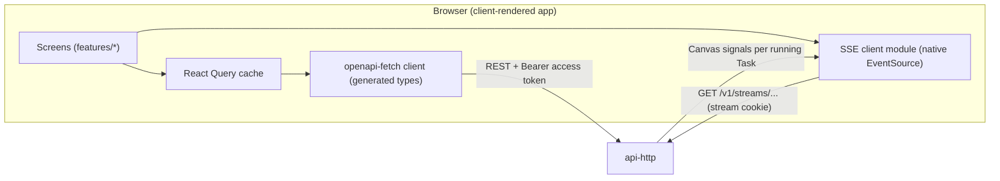

- **Queries and mutations** go through React Query hooks backed by the generated `openapi-fetch` client.
- **Live Canvas:** a stream for the selected conversation’s related Task; at most two running Tasks per Workspace, with native `Last-Event-ID` replay.
- **Other live state** (crawl progress, Post statuses, badges) is refreshed by **polling**, configured in one place per feature.

### 5.5 State
- **Server state:** the React Query cache.
- **UI and form state:** local to components.
- **Language and direction:** a client context sets the document's `dir`.
- **Session:** the access token in memory only; the refresh token and stream cookie are HttpOnly and invisible to scripts.

### 5.6 Communication and auth
- The browser calls `api.<domain>` from `app.<domain>`, which is same-site.
- Every request carries `Authorization: Bearer <access token>`.
- On 401, the app refreshes once (coordinated across tabs) and retries.
- Requests to the refresh endpoint carry the required custom header.

### 5.7 Deployment
`busmora-web` runs as a container serving the application.

### 5.8 Built to move to the Workspace Event Shell later
1. **Feature folders per bounded context.** Each will later gain an `events/` handler.
2. **One SSE client module** behind a small interface (subscribe → typed envelope → reconnect). Moving to one workspace-wide stream changes only this module.
3. **The SSE event envelope is used from day one** (§6.4).
4. **Polling is isolated** per feature, so it can be replaced by event-driven cache updates.

---

## 6. Backend ↔ frontend contract

### 6.1 Surfaces

| Surface | Between | Form |
|---|---|---|
| Commands and queries | web → api | REST/JSON, described by OpenAPI |
| Server push | api → web | SSE: one stream per Task now, one workspace stream later |
| Auth and session | web ↔ api | Auth endpoints + cookie and token rules, declared as OpenAPI security schemes |
| Platform-connection redirects | browser ↔ api ↔ Facebook (Phase 3 adapters deferred) | Start URL, api-handled callback, return route into the app |
| Uploads | web → api | Explicit Chat analysis CSV or supported .xlsx with mapping preview; single owner-supplied image via media validation (FR-31, FR-38) |

### 6.2 Pipeline (code-first)
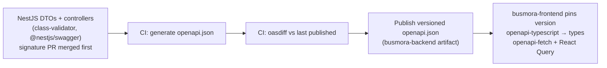

- **Contracts defined first** (ADR-015) is met by merging the DTO and controller-signature pull request before the implementation.
- **`oasdiff`** blocks unintended breaking changes.
- **SSE event payloads** are DTOs registered explicitly with `@nestjs/swagger`, so they are typed in the frontend.

### 6.3 Conventions and route overview

BACKEND §8.2 is the canonical endpoint/DTO/transition/error/event catalogue. `/v1/auth/*` covers local/Google identity, linking and sessions. Identity owns `/workspace` and `/onboarding/drafts`. Conversation owns `/conversations`/messages; the conversation adapter validates the parent and calls `TasksApi.listForConversation` for `/conversations/{id}/tasks`. Tasks owns `/tasks/{id}`/canvas/clarifications/budget/cancel, `/roadmap/drafts`, `/roadmap/research-links`, `/roadmaps`/versions/steps and `/roadmap/revisions`. Brain owns `/brain/*`; deliverables owns `/deliverables`, `/analysis-uploads`, `/media`, `/data-exports`; publishing owns `/posts`, `/campaigns`, `/batch-review/sessions`; connections and notifications own their resources. `/data-deletions/{id}` reports identity-owned cleanup requests.

Each significant mutation declares owner, input/output DTO, valid states, failures and audit/event effects in BACKEND §8.2. All authenticated commands are Workspace-scoped, reject forged origins and require idempotency keys; resource version and immutable Post Version checks prevent stale edits/approval. Public auth callbacks use one-time protected flow tokens instead of caller-supplied tenant authority. Error envelope is `{error:{code,messageKey,details,correlationId}}`; 400 validation, 401 unauthenticated, 403 genuine forbidden, 404 cross-tenant/unavailable, 409 stale/invalid transition/idempotency conflict, 422 domain precondition, 429 rate limit, 503 dependency unavailable. Accepted asynchronous work is 202, not completed.

Lists use filter-bound stable cursors; calendar is `[from,to)` UTC range derived from selected IANA display zone, with actual/proposed date basis and explicit unscheduled=true query. Times retain approved instant/planning zone/allowance. Numeric pricing uses optional decimal-string amount plus currency, never a zero default. File parsing/media limits and mapping confirmation precede analysis/approval.

Prospective contract uses only redesigned resources. If old deployed clients exist, follow BACKEND §7.6 expand/migrate/contract and publish versioned compatibility without preserving active removed workflows. `oasdiff`, generated frontend types, canonical Pydantic Temporal schemas/Ajv and replay checks remain required.

### 6.4 SSE envelope

| Field | Meaning |
|---|---|
| `id` | Monotonic per stream; used for `Last-Event-ID` replay |
| `event` | Event type: five legacy agent/handoff signals plus `execution_event`; workspace-wide domain-event fan-out deferred |
| `data.workspace` | Workspace id |
| `data.task` | Required Task id for task streams; validated against selected conversation’s Task list |
| `data.occurred_at` | When it happened (UTC) |
| `data.payload` | Type-specific body with stable node ID/kind, recorded logical state, terminal flag where applicable, safe action/evidence refs; no attempt counters, secrets or private reasoning |

Streams also carry heartbeats, and send a **reset** event when a reconnect falls outside the replay window. The client then refetches through queries.

### 6.5 Contracts inside the backend repository
- **Temporal payloads between Python and TypeScript:**
  - **Pydantic models are canonical**, and JSON Schema is exported from them.
  - Plain TypeScript types are generated from that schema.
  - Payloads are validated at runtime with **Ajv**; class-validator stays for HTTP DTOs only.
  - **CI checks** that the types haven't drifted and that **schema evolution is additive**: new fields optional, nothing removed or retyped while any in-flight workflow may replay it.
- **`ai-http`:** FastAPI's OpenAPI spec generates the typed TypeScript client used by `busmora-api`.

---

## 7. Cross-cutting concerns and growth path

### 7.1 Multi-tenancy
- The workspace is the tenant boundary everywhere: JWT claim, every PostgreSQL query (plus row-level security on the views Python reads), workflow inputs, Qdrant payload filters, object-storage prefixes, Redis keys, Langfuse tags, and the internal service JWT.
- One user per workspace this release.

### 7.2 Security
See §4.7. Untrusted crawled text and publishing credentials **never share a process**, and an LLM is **never** in the publishing path after Approval.

### 7.3 Reliability and idempotency
- **Durability:**
  - Temporal resumes tasks, clarification waits and scheduled releases after crashes.
  - PostgreSQL is the source of truth; recovery objectives require tested evidence (§2.2).
  - Qdrant and Redis are rebuildable.
- **Publishing safely under uncertainty (FR-34–36):**
  - one active `PostReleaseWorkflow` per Post, with schedule revision in its workflow ID;
  - an atomic claim on the approved Post Version;
  - idempotency key = Post Version id;
  - the attempt is recorded **before** calling the platform, and read back before any retry. Where no reliable provider idempotency or read-back exists, hold the uncertain attempt; never infer exactly-once external behavior.
- **Retries:**
  - Agents: up to three tool/sub-agent retries under the retained operation policy, then authorized alternatives; exhaustion yields terminal failure/partial result. Recoverable attempts stay Running / Processing in public Canvas; private diagnostics retain each attempt.
  - Crawling: site unreachable → 2 retries; rate limit → backoff, then skip the source; CAPTCHA → skip, use alternatives, notify.
  - Publishing: at most two provisional retries for established retry-safe failures, after preflight/reconciliation within the approved window; otherwise hold.
  - Time and cost limits produce a **Partial Result**.
- **If Temporal Cloud is unavailable:** tasks, onboarding crawls, publishing and indexing pause. Quick replies (over `ai-http`), Brain editing, Batch Review edits and Deliverables browsing keep working.

### 7.4 Observability and evaluation
- **Tracing:** Langfuse traces every LLM call with workspace, Task, model, prompt version and cost. Temporal UI shows every workflow. The internal service JWT carries `trace_id` across the HTTP path.
- **Product instrumentation** (stored in PostgreSQL): clarification and correction events, approvals, edits and publishes, Batch Review session timing.
- **Evaluation:**
  - A fixed scenario set runs on seeded workspaces in **Treatment** (Brain) and **Control** (documents only), with the same model and prompts.
  - It is scored blind by suitable human reviewers (two with a third for ties as the retained design). Appropriate regional review is required for named Gulf audiences; Egyptian/MSA results cannot stand in for missing Gulf evidence.
  - PRD §10 gates govern: all active AC-01–25 and AC-27–58; zero critical truth/control violations in the release suite; ≥80% held-out usefulness pass overall and per content register; support or explicit owner/hypothesis labels for all audited consequential claims; no unresolved critical/high recovery/security defects; real publishing and production-owner access; deterministic imports/metrics; nonblocking AR/EN mobile journeys; measured runtime/resources at declared load. No finite suite proves zero future risk.
  - Start with approximately 24 authored cases, held-out from prompt tuning, contrast pairs, fixed sources plus a small live set; record denominators, coverage, reviewer basis and uncertainty. Synthetic fixtures never count as customer outcomes. Include qualification/conversion, healthy acquisition but weak repeat demand, low-volume/long-cycle and capacity-limited cases.
  - Track confirmed setup, chosen workflow, accepted Task/artifact, execution/attestation and later return use, with no mandatory periodic review funnel. Measure active owner time separately from background latency; compare equivalent current-process workflows and actual cost per accepted artifact/Task. Neither technical completion nor repeat use establishes ROI, demand or paid-pilot validation. Legacy comparison targets remain supplemental.

### 7.5 Internationalization and time
- UI, conversation and task/campaign content languages are independent; task overrides preserve the other choices. Store country, currency and IANA timezone explicitly, never infer them from language. Gulf-oriented content follows the named country/audience and requires suitable regional review (FR-32, FR-44).
- Arabic right-to-left and English left-to-right UI; native generation in Egyptian, Gulf or MSA Arabic and English, including mixed language (product names kept in English).
- One **Business Time Zone** per workspace. Scheduled Times are stored as UTC instants plus their planning zone, so daylight-saving changes are handled. Changing the zone never moves approved or scheduled Posts.

### 7.6 Cost control
- `tasks` owns task authorization, allowance reservations, extension decisions and consumption ledger; `usage` records reportable usage. Reserve worst-case bounded resources before concurrent calls, including child work, failures and retries; settle against actual usage. Unbounded providers cannot run autonomously.
- Numeric task/search limits from older research are provisional configuration, constrained by owner-authorized limits. Research stops at sufficient evidence, repetition, exhausted access or allowance. A budget increase pauses until explicit owner approval states resources, time/cost effect and benefit; refusal preserves the best supported partial result. No evasion through tools, retries or equivalent tasks.
- UI exposes allowance, consumption and extensions. Business marketing budget, internal computation allowance and external-spend authority are distinct. Future billing is Phase 4+ and no provider or pricing model is selected (FR-27, FR-45; NFR-06).

### 7.7 Configuration and versioning
- Each workflow receives a frozen configuration.
- Prompt templates are version-controlled, and their version is recorded per run.
- Workflow code changes stay compatible with in-flight runs.
- The API contract and Temporal payload schemas evolve additively.

### 7.8 Testing approach (as far as the docs define it)
- **Boundaries for stubbing:** LLM, crawler and platform APIs are stubbed at Temporal activity boundaries and at the `ai-http` client.
- **Rules:** domain rules are tested in NestJS.
- **Sequencing:** workflow sequencing and timers are tested in Python.
- **Contracts:** checked by `oasdiff` and the schema-drift checks.
- **Scenarios:** run on seeded workspaces.
- **Load:** the historical 100-workspace stubbed experiment measures local capacity; verify actual runtime/resource ceilings at a declared release load before release.
- The test frameworks themselves are still to be chosen (§9.2).

### 7.9 Growth path from MVP to later phases

| Phase | What changes | Seam that makes it possible |
|---|---|---|
| **Phase 2 Release Contract (24 weeks)** | Everything in §1–§6 committed to production readiness; confirmed setup, Discovery/full steps, independent Chat/local Canvas, documents, Scheduling/Facebook and scoped requested analysis; frozen evaluation suite | — |
| **Phase 3 (Product Expansion)** | Social Profile URL onboarding (P3-01); Instagram Business and X publishing connectors (P3-02); connected platform analytics (P3-03) | Platform enum, MCP tool interface in `workers-publish`, and lazy OAuth flows already architected in domain neutrality |
| **Phase 4+ (Creation & Commercial Expansion)** | Native AI image generation (P4-01); in-product billing, plan quotas and payment integration with provider unselected (P4-02) | Usage Records already exist per workspace and Task; internal allowance admission already applies in `platform.start_task`; later commercial quotas may extend it |
| **Phase 5 — Meta Ads Management** | Future eligible Meta Business/Ad Account connect, permission inspection, strategy/creatives, supported campaign/targeting setup, explicit budget/spend approval, verified launch, supported metrics and owner-controlled optimization inside BUSMORA | Independently validate production API access, eligibility/formats and measurement (Pixel/Conversions API where needed); campaign approval never grants unlimited future spend; no current Ads endpoints/tools |
| **Frontend: Workspace Event Shell (FE-3)** | One workspace-wide SSE stream carries Canvas signals **and** UI events (badges, Post statuses, crawl progress, Deliverables); polling removed | The single writer (`busmora-api`) emits UI events where it already writes audit and notification rows; the envelope (§6.4) and the SSE client module (§5.8) are already in place |
| **Second Employee** (e.g. Sales) | New Sub-agents, Capabilities and screens | Domain-neutral Employee configuration, frozen per run; the approval and execution semantics and the Brain are reusable; new feature folders in the frontend |
| **Scale beyond the initial release** | Horizontal scaling of the stateless roles | To be evaluated using declared-load tests; no capacity result is asserted |

---

## 8. Architecture decision records

Format: the ADR format of the repository's `domain-modeling` skill (title, context, decision and why, plus optional status, considered options and consequences). An "architecture-decision-records" skill was requested but isn't installed, so this format substitutes for it. All records are **Accepted** unless marked otherwise.

### ADR-001 — Product docs are the single source of truth
- **Context:** an earlier pitch deck described a different system: Neo4j, an admin "Employee Builder", LinkedIn, other observability tools, a four-agent roster.
- **Decision:** `core/prd.md` v2.0 is the authoritative product/release contract. Compatible technical decisions remain valid; conflicting registry/older statements are flagged in §9.5 and cannot override it.
- **Rejected:** treating the deck as canonical. Every deck-only item traced to deleted, superseded specifications.
- **Consequences:** one consistent design. Implementation details are recorded here; a product-contract change cannot be invented by a technical design. The PRD revision ledger records approved product changes; historical decisions cannot override v2.0.

### ADR-002 — Four deployables and two standalone repositories
- **Context:** the decision registry fixes four services. The technical architecture showed a single monorepo.
- **Decision:**
  - Four deployables (`web`, `api`, `workers`, `ai`), each allowed to run several process roles.
  - **Two standalone repositories:** `busmora-backend` and `busmora-frontend`.
- **Rejected:**
  - the monorepo, replaced by your decision for clearer ownership;
  - a fifth deployable for the MCP server; it lives in the worker tier instead.
- **Consequences:** the frontend depends only on the published API contract. Full-stack local development across the repositories is still to be defined.

### ADR-003 — Backend style: Platform-Centred (api is the single writer)
- **Context:** three options were benchmarked against the gates and weighted criteria:

  | Option | Score |
  |---|---|
  | B1 Platform-Centred | **79.8** |
  | B2 Workflow-Centred | 73.2 |
  | B3 Context-Owned | 65.6 |

- **Decision:** B1. `busmora-api` (NestJS) owns every domain rule and is the only writer; Python services are stateless compute behind Temporal.
- **Rejected:**
  - **B2 Workflow-Centred** (one long-lived Temporal workflow per Post, Task, Brain and account). It is race-free by construction, but puts Temporal on nearly every user write and requires advanced Temporal features that the team has no documented experience with.
  - **B3 Context-Owned** (schema per service; integration by HTTP, events and Temporal). It has the best latency and extensibility, but has three integration styles, 10 process roles, the most tenant-enforcement points, and needs a migration tool outside the stack.
- **Consequences:**
  - The fewest isolation points and one migration toolchain.
  - Persistence crosses languages through Temporal: **Temporal TypeScript SDK also runs an activity worker** (accepted deviation from the technical architecture).
  - The B1-versus-B2 ranking was sensitive to two judgement cells; a walking-skeleton spike verifies B1's feasibility.

### ADR-004 — Internal HTTP for quick replies and Brain retrieval (amendment A1)
- **Context:** B1's weakest criterion was latency. The quick-reply path crossed Temporal 8 times before the LLM call. The api also cannot query Qdrant itself, because only Python has the client.
- **Decision:**
  - `busmora-api` calls an internal-only `ai-http` service for **quick replies** and **read-only Brain retrieval**.
  - The api remains the sole writer.
  - Exactly two endpoint families are allowed.
- **Rejected:**
  - routing everything through Temporal: too slow for the 3-second target;
  - moving Brain ownership to `busmora-ai` (B3-style): it would break the single-writer model and the single migration toolchain.
- **Consequences:**
  - The quick path drops from 8 legs to 2.
  - An accepted deviation from the "communication via Temporal" principle.
  - `ai-http` becomes one more tenant-enforcement point, secured by ADR-010.
  - Indicative score 80.8.

### ADR-005 — No AI in the publishing path after Approval
- **Context:** the technical architecture showed a Social Poster agent inside the task graph, but publishing happens at scheduled times, possibly weeks later.
- **Decision:**
  - The Social Poster Sub-agent only formats Posts **before** Approval and produces the immutable Post Version.
  - A deterministic `PostReleaseWorkflow` publishes **exactly that version** through MCP tools in `workers-publish`.
- **Rejected:**
  - agent dispatch at publish time: an LLM could alter approved content;
  - a mix of agent dispatch for "post now" and deterministic dispatch for scheduled posts.
- **Consequences:** exact approved request payloads, local duplicate suppression and evidence-based reconciliation without a live agent run. Platform transformations/delay and uncertain outcomes remain outside an exactly-once guarantee.

### ADR-006 — Approval lifecycle bound to Post Versions
- **Context:** FR-34–36 require version-bound approval, cancellation limits, delivery windows and uncertain-result recovery.
- **Decision:** the states in §3.4, including `cancelled`, `expired`, `submitted`, `uncertain` and `held`:
  - Approval binds to immutable text/media, account, schedule, zone and delivery allowance in one Post Version.
  - A critical edit creates a new Post Version and clears approval; complete parameters return to pending_approval, incomplete ones to draft.
  - Unapproved pending posts may expire at schedule time; approved overdue posts are held for a new time and approval.
  - Every social-post output, from a calendar or a one-off request, can enter Batch Review.
- **Rejected:**
  - a fixed 24-hour approval timer;
  - forcing every single-post draft into a campaign or publishing action; drafts remain usable/exportable alone (FR-29).
- **Consequences:** a clear lifecycle that the frontend and backend share.

### ADR-007 — Knowledge graph in PostgreSQL with Qdrant vectors
- **Context:** the Brain needs relational integrity, graph traversal and semantic search.
- **Decision:** `brain_nodes` and `brain_edges` in PostgreSQL (1–2 hop traversal) with Qdrant for vector seeds (D-20, D-22).
- **Rejected:**
  - **Neo4j:** a second database to operate;
  - **pgvector:** weak at heavy metadata filtering;
  - **Pinecone:** not open source, provider-hosted, and excluded on cost.
- **Consequences:**
  - One source of truth, and Qdrant is rebuildable.
  - Retrieval runs in Python, which reads the api-owned eligibility views with provenance and current-version validation (§3.3, §4.5). The document-only control route obeys the same deletion/rejection/supersession controls.

### ADR-008 — Single migration toolchain: Drizzle
- **Context:** both NestJS and Python touch PostgreSQL.
- **Decision:** Drizzle, owned by `busmora-api`, defines every domain table. Python only reads (and writes its runtime schema).
- **Rejected:**
  - Prisma (from an early team note; the technical architecture names Drizzle);
  - a separate Python-side migration tool (not in the stack).
- **Consequences:** the schema is unambiguous, and Python must adapt to the views the api exposes.

### ADR-009 — Frontend: client-rendered now, Workspace Event Shell later
- **Context:** the frontend benchmark scored:

  | Option | Score |
  |---|---|
  | FE-1 Client-Rendered | **83.4** |
  | FE-3 Workspace Event Shell | 71.2 |
  | FE-2 Server-First BFF | 58.6 |

- **Decision:** FE-1 for this release, built FE-3-ready; FE-3 is the planned evolution.
- **Rejected:**
  - **FE-2 Server-First BFF:** tokens stay out of the browser, but it brings the steepest learning curve, a second server tier holding streams, and a proxy hop on the Canvas;
  - **FE-3 now:** the richest event contract and extra backend work too early.
- **Consequences:** the access token lives in browser memory (mitigated by ADR-012); non-Canvas state is polled until FE-3.

### ADR-010 — Internal service JWT for api → ai calls
- **Context:** internal HTTP needs authentication and tamper-proof tenant scoping.
- **Decision:**
  - A private network.
  - A 60-second JWT signed with a dedicated asymmetric key. Claims: `aud=busmora-ai`, `workspace_id`, `user_id`, `trace_id`.
  - `ai-http` verifies with the public key only.
  - Read-only database role with row-level security.
- **Rejected:**
  - a shared secret with a plain `X-Workspace-Id` header: the workspace isn't protected, and both sides can mint;
  - HMAC request signing: acceptable, but symmetric.
- **Consequences:** a key pair to manage; its rotation method is still open.

### ADR-011 — Temporal Cloud authentication per process role
- **Decision:** one Temporal Cloud API key per process role, loaded from a secrets store; mTLS as a fallback.
- **Rejected:** a single shared key, which would make rotation and revocation all-or-nothing.
- **Consequences:** depends on choosing a secrets store. Payload encryption is a separate open decision (OD-1).

### ADR-012 — Tokens and sessions
- **Decision:**
  - A 15-minute access token in memory only.
  - A rotating refresh token with reuse detection, in an `HttpOnly; Secure; SameSite=Strict` cookie scoped to `/v1/auth/refresh`.
  - Same-site subdomains; `Origin` and custom-header checks on refresh.
  - Multi-tab coordination with a 10-second server grace window.
  - A 7-day sliding idle window and a 30-day absolute maximum.
- **Rejected:**
  - tokens in `localStorage`: readable by any injected script;
  - long-lived access tokens;
  - cross-site hosting: it would force `SameSite=None` and full CSRF handling.
- **Consequences:** a silent refresh on every page load, and refresh coordination code in the frontend.

### ADR-013 — SSE authentication with a scoped stream cookie
- **Decision:**
  - A short-lived HttpOnly cookie scoped to `/v1/streams` with the browser's native `EventSource`.
  - Open streams survive cookie expiry only, not explicit revocation/deletion.
  - Reconnect after expiry: 401 → refresh → reopen with `Last-Event-ID`.
- **Rejected:**
  - `@microsoft/fetch-event-source` with header tokens: unmaintained, and needs custom reconnect logic;
  - tokens in URL query strings: they leak into logs.
- **Consequences:** native reconnection and replay, with no extra dependency.

### ADR-014 — Python ↔ TypeScript payload contracts
- **Decision:**
  - Pydantic is canonical; JSON Schema is exported from it.
  - Generated TypeScript types; Ajv runtime validation.
  - CI checks for drift and for additive-only evolution.
  - The `ai-http` client is generated from FastAPI's OpenAPI spec.
- **Rejected:**
  - Zod: a second validation library next to class-validator;
  - hand-written mirrored types: drift risk.
- **Consequences:** payload changes go through the schema first, and in-flight workflows stay replayable.

### ADR-015 — Code-first API contract
- **Decision:**
  - `@nestjs/swagger` generates `openapi.json` in CI, published as a versioned artifact.
  - The frontend uses `openapi-typescript` + `openapi-fetch` + React Query.
  - The DTO-signature pull request merges first.
  - `oasdiff` gates breaking changes.
  - SSE payloads are registered as DTOs.
- **Rejected:** spec-first, i.e. a hand-authored OpenAPI file plus a drift check. It means duplication, and needs extra tooling.
- **Consequences:** the frontend waits for the backend's signature pull request, but always has an exact, typed contract.

### ADR-016 — Single region, Frankfurt (Provisional)
- **Context:** earlier research assumed managed components and LLM processing outside MENA. Current provider/residency evidence must be established before deployment; this ADR is a provisional topology choice, not a verified current region catalogue.
- **Decision (provisional):** a single region in Frankfurt, resting on the premise that no pilot customer needs in-country hosting. **Not yet a gate.** Under study.
- **Rejected:**
  - splitting data stores into MENA with services in Frankfurt: data still leaves MENA, and every step crosses regions;
  - hard in-region residency: it would require self-hosting Temporal and in-region LLMs.
- **Consequences:** customer data leaves MENA in any case. Linked to OD-1.

### ADR-017 — No in-product billing this release
- **Decision:** billing is Phase 4+; no mandatory paid pilot or charging arrangement is selected. Internal usage limits and actual cost metering are required from day one.
- **Rejected:**
  - minimal in-app billing (checkout + access gating);
  - full tiers, quotas and gating.
- **Consequences:** prices are derived later from real usage data. Commercial pricing and payment provider remain open; business budgets, outcome metrics and resource control remain Phase 2 requirements.

### ADR-018 — One platform app, tester mode for dev with production release gate (AC-30)
- **Decision:**
  - One BusMora Meta app for Facebook Pages native publishing in Phase 2; Instagram Business and X are deferred to Phase 3 (K-08).
  - Initial development runs in Meta tester mode. Release gate AC-30 requires verifying production configuration for ordinary owners without developer-role accounts before release.
- **Rejected:** customers bringing their own developer apps; multi-platform publishing in Phase 2.
- **Consequences:** a mandatory Sprint-1 check that tester-mode posts are publicly visible. Production app review and release verification gate (AC-30) must be cleared for release. Required review, access and verification depend on the selected app configuration and must be evidenced; unresolved access blocks Phase 2, with no assumed approval timeline.

### ADR-019 — Website/guided brand context, text-first assets and bounded uploads
- **Decision:** website observations and manual owner input populate an editable draft, activated only after owner confirmation. Missing logo/colors use business-name text, neutral palette and existing fonts without blocking work. Phase 2 creates editable text/visual briefs and supports text/link or one owner-supplied publishing image; CSV and supported `.xlsx` parsing for explicitly requested analysis retain their safety/validation contract.
- **Excluded:** arbitrary document/PDF ingestion, a design editor and native AI image generation (Phase 4+). A publishing-media upload is not a full brand-asset management product.
- **Consequences:** validate actual supported media and show missing/invalid states before approval. Brand claims require inspectable support, qualification or omission; approval does not verify facts or testimonial rights (FR-30–31).

### ADR-020 — Live-only Canvas, whole-message replies
- **Decision:** Canvas replay covers reconnects during a run plus a short grace window; replies arrive as complete messages.
- **Rejected:**
  - storing every Canvas event so past runs can be re-watched;
  - token-by-token streaming.
- **Consequences:** Redis holds only short-lived replay buffers. Durable task/work/action summaries and accessible lists support later owner inspection; Langfuse supports redacted operator diagnostics. Neither reconstructs unavailable historical live animation.

---

### ADR-021 — Confirmed intake and independent workflows

The approved redesign separates essential setup from strategy: identity persists website/manual drafts and Brain activates only after exact owner confirmation. Director Chat needs no Roadmap. Tasks owns saved adaptive Discovery and durable question/research links, rejecting URL-only linkage because it loses authority/context across navigation and reconnect. Existing process, store and module boundaries remain.

### ADR-022 — One active complete step plan

Tasks retains one active Roadmap with immutable versions, saved drafts and archived history, using workspace lock plus uniqueness for atomic activation. Execution order is recommended and real dependencies are validated. Owner Skip/Revisit and owner-reported completion preserve execution evidence; material strategic diffs require explicit approval. In-flight Task/Post origins stay fixed across revision.

### ADR-023 — Posts are Publishing-owned outputs

Task result assembly calls document and Post contracts directly, with shared source/campaign references. Document-to-Post auto-creation is removed to avoid two authoritative copies and to support manual/undated Posts. Scheduling is their single user-facing home. Existing deterministic publishing, exact approvals, attempts and reconciliation remain.

### ADR-024 — Conversation-local logical execution presentation

Canvas follows selected conversation and related Task, not workspace-global selection. Public stream/snapshot projection keeps recoverable internal attempts Processing and reports exhausted logical failures; private telemetry preserves diagnostics. This improves truthful comprehension without weakening operation-specific retries or publishing uncertainty controls.

## 9. Risks, gaps and open questions

### 9.1 Risks

| # | Risk | Mitigation |
|---|---|---|
| R-01 | Pilot posts in Meta tester mode may be visible only to app-role users | Mandatory Sprint-1 check: publish from a tester's Page and verify public visibility; release gate AC-30 requires verifying production configuration for ordinary owners without developer-role accounts |
| R-02 | Production access requirements/evidence unresolved for the selected app configuration | Tester mode for initial development; production verification gate AC-30 ensures ordinary owners can connect and publish without developer roles |
| R-03 | Customer data leaves MENA through Temporal Cloud and LLM providers | Region decision provisional; OD-1 (payload encryption) open |
| R-04 | Python ↔ TypeScript activity contracts drift | Pydantic-canonical schemas, generated types, Ajv, CI drift and evolution checks (ADR-014) |
| R-05 | Month-long workflows break on incompatible deploys | Workflow versioning discipline; additive payload evolution |
| R-06 | Quick-reply p95 exceeds 3 s | Internal HTTP path (ADR-004); measured in the walking-skeleton spike |
| R-07 | A tenant-scoping bug in `ai-http` | Workspace only from the verified service-JWT claim; read-only role with row-level security; tests |
| R-08 | Scope creep on internal HTTP | Guardrail: two endpoint families only; new ones need a decision record |
| R-09 | Duplicate post if a platform accepted the post but the attempt wasn't recorded | Record before dispatch, preserve provider IDs/evidence, reconcile and hold if acceptance cannot be established; no blind retry |
| R-10 | Sparse brand context or invalid owner media | Guided corrections, neutral fallbacks, text-only drafts and explicit media validation (ADR-019) |
| R-11 | Polyglot complexity for a 5-person team (B1 feasibility judged 4/5) | Walking-skeleton spike: a Python workflow calling a TypeScript activity, end to end |
| R-12 | Budget unknown | Freeze owner-authorized resource limits and measured operating costs early; commercial pricing remains deferred |

### 9.2 Open decisions and gaps (deferred by choice; to be resolved later)

| # | Item |
|---|---|
| OD-1 | Temporal payload encryption, and a codec server for Temporal UI |
| OD-2 | Cloud provider; region as a gate (G4) |
| OD-3 | Commercial pricing/payment provider (Phase 4+); Phase 2 operating allowances and business budgets cannot be deferred |
| OD-4 | Provider bake-offs: LLMs, embeddings, object storage, proxies; native image model only in Phase 4+ |
| OD-5 | Secrets store (needed by Temporal keys, the service-JWT private key and app secrets) |
| OD-6 | Service-JWT key rotation and public-key distribution |
| OD-7 | i18n/RTL library for the frontend |
| OD-8 | JSON Schema → TypeScript type generator (plain types only) |
| OD-9 | Trace propagation through Temporal (the HTTP path is covered) |
| OD-10 | Email delivery provider |
| OD-11 | Phase 4+ only: native image generation/composition, Arabic shaping, rights and costs |
| OD-12 | Test frameworks (TypeScript, Python, end-to-end, contract) and a load-test tool |
| OD-13 | Application logs, metrics and error tracking beyond Langfuse and Temporal UI |
| OD-14 | Rate-limiting mechanism for public endpoints |
| OD-15 | Local Temporal for Docker Compose |
| OD-16 | CI/CD, image registry, production runtime and orchestration, ingress/TLS; environments (dev, staging, prod) |
| OD-17 | Full-stack local development and end-to-end tests across the two repositories |
| OD-18 | Domain details: CSV/.xlsx templates, recognized fields, parser and media limits; how the crawler discovers open-web pages; typed proposal-group mapping verification (defined in DESIGN-SYSTEM §9.5); length of the Canvas replay grace window; Redis Streams retention |
| OD-19 | Markdown rendering and sanitization for Deliverables; form library for structured forms; required text/Markdown/CSV/original-media export; designed PDF/Word export excluded from Phase 2 |
| OD-20 | Current API Workspace is implied by verified session/token (§6.3); only a future multi-workspace UI URL convention is deferred |
| OD-21 | Platform lead, initial design by week 4 and tested before release: active cleanup deadlines, audit minimum, provider/trace retention, backup expiry/suppression and restore/rollback evidence; validate recovery objectives rather than promise zero loss |
| OD-22 | AI/evaluation leads, by week 2: public search/discovery + retrieval provider baseline (regional quality, access, grounding, stopping, cost/latency and bounded reservations); retained Scrapling adapter is not evidence of complete search capability |
| OD-23 | Integration lead, start week 1 and record by week 2: selected Facebook production access path, review/verification requirements, committed format support and real ordinary-owner evidence; unresolved AC-30 blocks release |
| OD-25 | Identity lead: Google OIDC library/consent/JWKS and callback browser tests, verification/reset TTLs and mail delivery policy; safe linking/session contract already decided in §4.7.1 |
| OD-26 | Platform/UX leads: calendar page/range limits, adaptive-question policy evaluation, current deployment/data inventory before any compatibility migration; no invented legacy evidence |
| OD-24 | Evaluation/UX leads, by week 2: freeze held-out rubrics, severity definitions, release load/task limits and regional reviewers; verify all PRD §10 gates before release |

### 9.3 Implementation gaps (requirements remain binding)
Accessibility and browser design targets are defined in [DESIGN-SYSTEM.md](./DESIGN-SYSTEM.md) §§12–13. Numeric upload/rate limits, retention durations, provider data-handling constraints, support runbooks and operating-load evidence still need implementation decisions. None permits omitting required data controls, languages, native publishing or recovery.

### 9.4 Spikes required in the walking skeleton
1. A Python workflow calling a TypeScript activity, end to end (prompt → api → Temporal → workers → ai stub → SSE).
2. Quick-reply p95 through `ai-http` with the light model, against the 3-second target.
3. Meta tester-mode public visibility.

### 9.5 Source reconciliation and authority

Only these five core files are updated in this redesign. Older domain/strategy/research files remain historical rationale where compatible and cannot override the owner-approved PRD v2.0. No missing external plan silently changes scope.

| Source conflict | Resolved current contract |
|---|---|
| v1.1 intake active immediately, optional review, goal/capacity in setup | Unified essential draft; exact owner confirmation before Brain activation; strategy moves to saved Discovery |
| v1.1 Today Dashboard, Outcomes & Reviews, Now/Next/Later | Retired current product concepts; no active routes/jobs/models or replacement dashboard; FR-47 and AC-26 reserved as retired |
| Old document-to-Post event / content package origin requirement | Typed direct result creation through Publishing; manual Posts, null schedules and campaign grouping; non-Post documents remain Deliverables |
| Earlier password-required User and unspecified verification | Optional LocalCredential plus subject-keyed AuthIdentity; verification links and safe Google account linking |
| Global task selection or per-attempt Canvas errors | Conversation-local Task mapping; recoverable retries stay Processing, final failure explicit |
| Approval-only retrieval, retirement-only deletion, historical uncontrolled chunks | Current confirmed-intake/owner/approved knowledge eligible with provenance; immediate deletion suppression and governed cleanup/restore across all derived stores |
| Older mandatory performance learning / file imports with review triggers | Explicit Chat-initiated one-off analysis retains mapping/math safety without recurring jobs or automatic plan revision |
| Prior image/multiplatform Phase 2 promises, fixed agent roster, unverified safety/performance claims | Facebook organic verified formats only; real dynamic work; future Phase 3/4/5 distinctly deferred; finite tests and external access require evidence |

Preserve earlier engineering benchmarks as comparative rationale only, not measured production outcomes. Keep ordinary-owner Facebook access, provider/format validation, numeric retention/resources and deployment/recovery as named implementation dependencies. Updated docs do not assert code exists or tests have passed.

## Appendix A — PRD v2.0 alignment and acceptance evidence

This matrix covers the five revised files dated 30 October 2026. The PRD is authoritative; DS = Design System, FTD = Frontend Technical Design, BTD = Backend Technical Design, SYS = this document. Locations below specify required design/implementation surfaces, **not passed implementation tests**. Every active requirement and acceptance scenario needs a release-ledger owner, implementation reference, fixture/load conditions, result and evidence. Retired FR-47/AC-26 are not silently reassigned.

### A.1 Individual requirements

| ID / requirement | Owning module | DS | FTD | BTD | SYS | Acceptance |
|---|---|---|---|---|---|---|
| FR-01 — Accounts and workspace | identity | §10.2 | §6 | §6.1; 8.2 | §4.7.1 | AC-17, AC-29, AC-31, AC-32 |
| FR-02 — Navigation | identity / frontend shell | §10.1 | §4 | §8.2 | §5.2–5.3 | AC-34, AC-56 |
| FR-03 — Website import | identity / crawls / brain | §10.3 | §6.1 | §6.1; 6.6; 8.2 | §3.3; 4.6 | AC-01, AC-27 |
| FR-04 — Confirmed intake | identity / crawls / brain | §10.3 | §6.1 | §6.1; 6.6; 8.2 | §3.3; 4.6 | AC-01, AC-03 |
| FR-05 — Completion choice | identity / crawls / brain | §10.3 | §6.1 | §6.1; 6.6; 8.2 | §3.3; 4.6 | AC-34 |
| FR-06 — Unified essential business form | identity / crawls / brain | §10.3 | §6.1 | §6.1; 6.6; 8.2 | §3.3; 4.6 | AC-02, AC-21, AC-33 |
| FR-07 — Social import visibility | identity / crawls / brain | §10.3 | §6.1 | §6.1; 6.6; 8.2 | §3.3; 4.6 | AC-16 |
| FR-08 — Structured memory | brain | §10.7 | §6.1 | §6.5; 7.5; 9.9 | §3.3; 4.5 | AC-03, AC-38 |
| FR-09 — Epistemic and lifecycle state | brain | §10.7 | §6.1 | §6.5; 7.5; 9.9 | §3.3; 4.5 | AC-03, AC-27 |
| FR-10 — Update rules | brain | §10.7 | §6.1 | §6.5; 7.5; 9.9 | §3.3; 4.5 | AC-03, AC-23 |
| FR-11 — Historical work | brain | §10.7 | §6.1 | §6.5; 7.5; 9.9 | §3.3; 4.5 | AC-05, AC-15, AC-38 |
| FR-12 — Interactive graph | brain | §10.7 | §6.1 | §6.5; 7.5; 9.9 | §3.3; 4.5 | AC-03, AC-29 |
| FR-13 — Owner data controls | brain | §10.7 | §6.1 | §6.5; 7.5; 9.9 | §3.3; 4.5 | AC-15, AC-17 |
| FR-14 — Business-aware diagnosis | tasks | §10.4–10.5 | §6.2–6.3 | §6.4.1; 8.2 | §3.4; 3.6–3.7 | AC-04, AC-18, AC-19, AC-20, AC-21 |
| FR-15 — Marketing scope | tasks | §10.4–10.5 | §6.2–6.3 | §6.4.1; 8.2 | §3.4; 3.6–3.7 | AC-04, AC-24 |
| FR-16 — Complete actionable Roadmap | tasks | §10.4–10.5 | §6.2–6.3 | §6.4.1; 8.2 | §3.4; 3.6–3.7 | AC-04, AC-45, AC-46, AC-57 |
| FR-17 — Direct Chat | conversation / tasks | §10.6 | §6.3 | §6.3–6.4; 8.2 | §5.3; 6.3–6.4 | AC-05, AC-22 |
| FR-18 — Choice-first clarification | conversation / tasks | §10.6 | §6.3 | §6.3–6.4; 8.2 | §5.3; 6.3–6.4 | AC-35, AC-37 |
| FR-19 — Fast Router | tasks / AI compute | §10.6 | §6.3; 7.3 | §6.4.2; 8.1.3; 9.7 | §3.4; 7.3; 7.6 | AC-06 |
| FR-20 — Dynamic Orchestrator | tasks / AI compute | §10.6 | §6.3; 7.3 | §6.4.2; 8.1.3; 9.7 | §3.4; 7.3; 7.6 | AC-06, AC-09, AC-41 |
| FR-21 — Specialist capabilities | tasks / AI compute | §10.6 | §6.3; 7.3 | §6.4.2; 8.1.3; 9.7 | §3.4; 7.3; 7.6 | AC-06, AC-07 |
| FR-22 — Authentic conversation-local Canvas | tasks / AI compute | §10.6 | §6.3; 7.3 | §6.4.2; 8.1.3; 9.7 | §3.4; 7.3; 7.6 | AC-07, AC-42 |
| FR-23 — Durable work and retry presentation | tasks / AI compute | §10.6 | §6.3; 7.3 | §6.4.2; 8.1.3; 9.7 | §3.4; 7.3; 7.6 | AC-17, AC-43, AC-44 |
| FR-24 — Dynamic multi-source research | tasks / crawls / brain | §10.4; 10.6; 10.8 | §6.2–6.4 | §6.4.2; 9.10 | §4.8; 7.6 | AC-08, AC-27 |
| FR-25 — Research output | tasks / crawls / brain | §10.4; 10.6; 10.8 | §6.2–6.4 | §6.4.2; 9.10 | §4.8; 7.6 | AC-08, AC-18 |
| FR-26 — Evidence quality | tasks / crawls / brain | §10.4; 10.6; 10.8 | §6.2–6.4 | §6.4.2; 9.10 | §4.8; 7.6 | AC-08, AC-27 |
| FR-27 — Per-task research budget | tasks / crawls / brain | §10.4; 10.6; 10.8 | §6.2–6.4 | §6.4.2; 9.10 | §4.8; 7.6 | AC-09 |
| FR-28 — Modular research capability | tasks / crawls / brain | §10.4; 10.6; 10.8 | §6.2–6.4 | §6.4.2; 9.10 | §4.8; 7.6 | AC-08, AC-09 |
| FR-29 — Flexible output size | deliverables / publishing | §10.8–10.9 | §6.4 | §6.7–6.8.1; 8.2 | §3.7; 4.6 | AC-10, AC-22 |
| FR-30 — Brand understanding and claim integrity | deliverables / publishing | §10.8–10.9 | §6.4 | §6.7–6.8.1; 8.2 | §3.7; 4.6 | AC-10, AC-22 |
| FR-31 — Text-first assets | deliverables / publishing | §10.8–10.9 | §6.4 | §6.7–6.8.1; 8.2 | §3.7; 4.6 | AC-10, AC-12 |
| FR-32 — Language and audience fit | deliverables / publishing | §10.8–10.9 | §6.4 | §6.7–6.8.1; 8.2 | §3.7; 4.6 | AC-11, AC-22 |
| FR-33 — Connected Facebook Page | publishing / connections | §10.9 | §6.4 | §6.8–6.9; 8.1.1–8.2 | §3.4; 7.3 | AC-12, AC-30, AC-54 |
| FR-34 — Review and approval | publishing / connections | §10.9 | §6.4 | §6.8–6.9; 8.1.1–8.2 | §3.4; 7.3 | AC-12, AC-13, AC-51, AC-52 |
| FR-35 — Scheduled execution | publishing / connections | §10.9 | §6.4 | §6.8–6.9; 8.1.1–8.2 | §3.4; 7.3 | AC-13, AC-28, AC-52, AC-54 |
| FR-36 — Verification and recovery | publishing / connections | §10.9 | §6.4 | §6.8–6.9; 8.1.1–8.2 | §3.4; 7.3 | AC-12, AC-28, AC-53 |
| FR-37 — Other external actions | publishing / connections | §10.9 | §6.4 | §6.8–6.9; 8.1.1–8.2 | §3.4; 7.3 | AC-16, AC-24, AC-58 |
| FR-38 — Requested file analysis | deliverables / tasks | §10.14 | §6.4 | §6.7; 8.2; 9.10 | §3.7 | AC-14, AC-25 |
| FR-39 — Goal-based interpretation | deliverables / tasks | §10.14 | §6.4 | §6.7; 8.2; 9.10 | §3.7 | AC-14, AC-25 |
| FR-40 — Evidence governance | deliverables / tasks | §10.14 | §6.4 | §6.7; 8.2; 9.10 | §3.7 | AC-14, AC-45 |
| FR-41 — Document Deliverables | deliverables / publishing | §10.8–10.9 | §6.4 | §6.7–6.8.1; 8.2 | §3.7; 4.6 | AC-15, AC-47 |
| FR-42 — Context reuse | brain | §10.7 | §6.1 | §6.5; 7.5; 9.9 | §3.3; 4.5 | AC-03, AC-15, AC-38 |
| FR-43 — Full localization and responsive access | identity / all UI | §10.10; 11–12 | §6.5; 9.6 | §8.2; 9.10 | §7.5 | AC-11, AC-29, AC-50 |
| FR-44 — Independent language choices | identity / all UI | §10.10; 11–12 | §6.5; 9.6 | §8.2; 9.10 | §7.5 | AC-11, AC-29, AC-52 |
| FR-45 — Goal and practical constraints | tasks | §10.4–10.5 | §6.2–6.3 | §6.4.1; 8.2 | §3.4; 3.6–3.7 | AC-04, AC-18, AC-19, AC-20, AC-21 |
| FR-46 — Executable steps | tasks | §10.4–10.5 | §6.2–6.3 | §6.4.1; 8.2 | §3.4; 3.6–3.7 | AC-04, AC-24, AC-39, AC-40 |
| FR-47 — Retired recurring-performance feature | None active | §10.15 exclusion | §4 exclusion | §7.6 historical treatment | §9.5 | AC-56; AC-26 retired |
| FR-48 — Context impact and freshness | brain | §10.7 | §6.1 | §6.5; 7.5; 9.9 | §3.3; 4.5 | AC-23 |
| FR-49 — Honest capability and handoff contract | tasks | §10.4–10.5 | §6.2–6.3 | §6.4.1; 8.2 | §3.4; 3.6–3.7 | AC-16, AC-24 |
| FR-50 — Authentication | identity | §10.2 | §6 | §6.1; 8.2 | §4.7.1 | AC-31, AC-32 |
| FR-51 — Roadmap Discovery | tasks | §10.4–10.5 | §6.2–6.3 | §6.4.1; 8.2 | §3.4; 3.6–3.7 | AC-36, AC-38 |
| FR-52 — Exact-question research | tasks | §10.4–10.5 | §6.2–6.3 | §6.4.1; 8.2 | §3.4; 3.6–3.7 | AC-37 |
| FR-53 — Step control | tasks | §10.4–10.5 | §6.2–6.3 | §6.4.1; 8.2 | §3.4; 3.6–3.7 | AC-24, AC-39, AC-40, AC-41 |
| FR-54 — Plan lifecycle and revision | tasks | §10.4–10.5 | §6.2–6.3 | §6.4.1; 8.2 | §3.4; 3.6–3.7 | AC-45, AC-46 |
| FR-55 — Scheduling | publishing / connections | §10.9 | §6.4 | §6.8–6.9; 8.1.1–8.2 | §3.4; 7.3 | AC-48, AC-49, AC-50, AC-51, AC-52, AC-53, AC-54 |
| FR-56 — Settings and notifications | identity / connections / notifications | §10.10–10.11 | §6.5 | §6.9–6.10; 8.2 | §5.3 | AC-34, AC-54, AC-55 |
| FR-57 — Output ownership | deliverables / publishing | §10.8–10.9 | §6.4 | §6.7–6.8.1; 8.2 | §3.7; 4.6 | AC-22, AC-47, AC-48, AC-49 |
| FR-58 — Removed surface exclusion | identity / frontend shell | §10.1 | §4 | §8.2 | §5.2–5.3 | AC-56, AC-57 |
| NFR-01 — Truthful state | All owning modules | §§12–13 | §§8–10 | §§7.5, 9–10 | §§4.5, 4.7, 7 | AC-03, AC-07, AC-16, AC-23, AC-27, AC-42, AC-43, AC-44 |
| NFR-02 — Source integrity | All owning modules | §§12–13 | §§8–10 | §§7.5, 9–10 | §§4.5, 4.7, 7 | AC-08, AC-23, AC-27 |
| NFR-03 — Workspace security | All owning modules | §§12–13 | §§8–10 | §§7.5, 9–10 | §§4.5, 4.7, 7 | AC-17, AC-27, AC-28, AC-31, AC-32, AC-37 |
| NFR-04 — Untrusted input handling | All owning modules | §§12–13 | §§8–10 | §§7.5, 9–10 | §§4.5, 4.7, 7 | AC-17, AC-25, AC-27 |
| NFR-05 — Durable execution and recovery | All owning modules | §§12–13 | §§8–10 | §§7.5, 9–10 | §§4.5, 4.7, 7 | AC-17, AC-28, AC-36, AC-41, AC-54 |
| NFR-06 — Resource accountability | All owning modules | §§12–13 | §§8–10 | §§7.5, 9–10 | §§4.5, 4.7, 7 | AC-09, AC-17, AC-41 |
| NFR-07 — Accessible bilingual operation | All owning modules | §§12–13 | §§8–10 | §§7.5, 9–10 | §§4.5, 4.7, 7 | AC-11, AC-29, AC-35, AC-50 |
| NFR-08 — Observability | All owning modules | §§12–13 | §§8–10 | §§7.5, 9–10 | §§4.5, 4.7, 7 | AC-17, AC-28, AC-43, AC-44 |
| NFR-09 — Data control | All owning modules | §§12–13 | §§8–10 | §§7.5, 9–10 | §§4.5, 4.7, 7 | AC-15, AC-17, AC-23 |

### A.2 Acceptance scenarios and evidence

All 57 active scenarios below require real implementation evidence. AC-26 remains a historical retirement record. For native capabilities use genuine Facebook/source/Task evidence; mocks support failure injection only. Preserve all PRD §10 gates: ≥80% usefulness overall and per content register, zero critical truth/control violations in the finite suite, no unresolved critical/high security/recovery defects, grounded claims, usable AR/EN mobile journeys, production ordinary-owner access and measured declared-load/resource limits.

| Scenario | Requirements | Observable evidence required |
|---|---|---|
| AC-01 — Website onboarding | FR-03, FR-04 | Crawl prefills a validated editable draft; no Brain eligibility before exact-version owner confirmation; sources and partial fields survive. |
| AC-02 — Manual onboarding | FR-06 | The same form accepts essential fields only, supports a not-ready conversion route and leads to Chat/Roadmap choice without strategy questions. |
| AC-03 — Brain governance | FR-04, FR-08, FR-09, FR-10, FR-12, FR-42 | The owner explores and edits the graph, distinguishes imported from confirmed or inferred items, and approves, edits, rejects, exports, or deletes applicable information |
| AC-04 — Diagnosis and Roadmap | FR-14, FR-15, FR-16, FR-45, FR-46 | Separate Discovery produces a complete actionable proposed plan; evidence, uncertainty, real dependencies and completion conditions are visible; activation/revision require approval. |
| AC-05 — Direct work | FR-11, FR-17 | The owner launches a supported task from chat without completing preceding roadmap tasks; the task reuses relevant Brain context and history |
| AC-06 — Dynamic orchestration | FR-19, FR-20, FR-21 | Simple input avoids fabricated specialist work; complex tasks vary planning/delegation with context inside shared tool/iteration/time/concurrency limits; ordinary UI actions do not require AI routing |
| AC-07 — Authentic Canvas | FR-21, FR-22 | Only the selected conversation’s actual Task nodes/events appear, with safe detail/list and exact form links; no fictional progress or history. |
| AC-08 — Multi-source research | FR-24, FR-25, FR-26, FR-28 | Research dynamically examines distinct relevant supported source types, verifies claim support, distinguishes duplicated sources, exposes gaps/contradictions, and links implications to an actionable next task; access/stopping limits produce honest partial results |
| AC-09 — Research budget | FR-20, FR-27, FR-28 | Parent, child, concurrent and retried work stay within the authorized allowance; attempted increases pause for owner approval; refusal preserves a bounded result without tool/task budget evasion |
| AC-10 — Campaign creation | FR-29, FR-30, FR-31 | The owner can request either a single item or an editable text-first campaign, with brand-aware copy, channel details, visual briefs, and owner media when needed |
| AC-11 — Language experience | FR-32, FR-43, FR-44 | The complete application works in Arabic RTL and English LTR; separate interface, conversation, and content-language choices work across the agreed registers |
| AC-12 — Facebook publishing | FR-31, FR-33, FR-34, FR-36 | An authorized Page accepts each committed format after exact individual/batch approval; a scheduled job publishes for real, retains platform evidence, and handles retries without duplicate publication; unsupported/missing media is rejected before approval |
| AC-13 — Approval invalidation | FR-34, FR-35 | Editing approved content, media, destination, time/timezone, or delivery allowance prevents dispatch under the old approval until the new details are approved |
| AC-14 — Requested file analysis | FR-38, FR-39, FR-40 | Explicit Chat tasks accept valid CSV and .xlsx through mapping/validation and deterministic math; result is a one-off document, with no recurring jobs or automatic revision. |
| AC-15 — History and control | FR-11, FR-13, FR-41, FR-42 | Deliverables and task history are retrievable and reusable; the owner can export or delete them and disconnect a linked account |
| AC-16 — Honest availability | FR-07, FR-37, FR-49 | Social Profile Import is visibly disabled and labelled Coming Soon; Instagram Business, X, connected analytics, native image generation, and billing are not represented as operational until implemented |
| AC-17 — Operational readiness | FR-01, FR-13, FR-23 | Security, isolation, integration, failure and recovery, observability, and end-to-end checks pass against the implemented workflows |
| AC-18 — New service business with unknown audience/baseline | FR-14, FR-25, FR-45 | Unknown/not-applicable remains explicit; propose useful evidence or offer work without invented audience proportions, CAC, or growth forecasts |
| AC-19 — Many inquiries, few qualified conversations | FR-14, FR-45 | Investigate qualification, offer, response process, and alternative explanations before automatically recommending more posting or spend |
| AC-20 — Material practical constraints | FR-14, FR-45 | Discovery respects relevant assets, permissions, budget and fulfillment; no standard weekly-hours onboarding question or unsupported paid execution. |
| AC-21 — No website but working messaging/marketplace route | FR-06, FR-14, FR-45 | The actual route informs the plan; no unnecessary site requirement or simulated social import |
| AC-22 — One scoped Arabic Post | FR-17, FR-29, FR-30, FR-32, FR-57 | Direct Chat creates a Publishing Post visible in Scheduling without forced research/campaign or a duplicate Deliverable. |
| AC-23 — Offer/price changes after approval | FR-10, FR-48 | Affected work becomes stale and conflicting scheduled posts are held; owner resolution is recorded; edits/rescheduling require fresh approval; unrelated work remains usable |
| AC-24 — Best task needs an unsupported connector | FR-15, FR-37, FR-46, FR-49, FR-53 | Supply usable owner instructions/artifacts and a completion checklist; distinguish attested implementation from system-verified execution |
| AC-25 — Unknown outcomes, zero denominator, duplicated or incompatible data | FR-38, FR-39 | Unknown never becomes zero; invalid ratios are withheld; repeated/overlapping totals, currencies and metric definitions are flagged before combining; provenance/period remain inspectable |
| AC-26 — Retired | Retired | Removed v1.1 recurring work/review-cycle acceptance; identifier reserved, not a release test. |
| AC-27 — Contradictory or malicious public source | FR-03, FR-09, FR-24, FR-26 | Conflict remains visible; source instructions cannot authorize tools, override knowledge, raise budgets, leak private data, or redirect retrieval to internal resources |
| AC-28 — Timeout, revocation, cancellation race, or overdue publish | FR-35, FR-36 | Reconcile or hold uncertain outcomes; no blind duplicate, unauthorized late dispatch, or silent send after reconnection; cancellation state and platform acceptance remain honest |
| AC-29 — Mobile mixed-script review and approval | FR-01, FR-12, FR-43, FR-44 | Text/media, destination, date/time/timezone, status and controls are legible and usable in Arabic RTL and English LTR; keyboard/detail alternatives and independent language settings work |
| AC-30 — Intended ordinary owner connects and publishes | FR-33 | The production configuration supports the owner's actual access path and genuine publication; developer-role account success alone cannot satisfy the gate |
| AC-31 — Email verification link | FR-01, FR-50 | Email/password-only signup sends a single-use expiring link; invalid/expired/replayed tokens fail, resend works, verification continues to Onboarding. |
| AC-32 — Google identity | FR-01, FR-50 | Signup/login validate state/PKCE/nonce/claims; cancellation is safe, matching email never silently links, explicit reauthenticated link succeeds without takeover. |
| AC-33 — Optional offering pricing | FR-06 | Multiple offerings accept fixed, starting-from, quote-required and unknown models; optional amounts require currency and missing values never become zero. |
| AC-34 — Completion and return routing | FR-02, FR-05, FR-56 | After confirmation Chat and Create My Roadmap are available; later login restores an authorized last page/deep link or Director. |
| AC-35 — Choice-first forms | FR-18 | Current Brain personalizes meaningful choices plus Other; legitimate unknown/skip/not-applicable and real numeric/text fields work. |
| AC-36 — Wizard persistence | FR-51 | Close/reopen after edits and adaptive branching: saved draft/questions/statuses restore; conflicts do not overwrite another edit. |
| AC-37 — Question research and return | FR-18, FR-52 | Save → linked conversation/task → selected evidence-aware result → exact question → confirmation survives switching/reconnect; forged/cross-tenant origins fail. |
| AC-38 — Knowledge reuse | FR-08, FR-11, FR-42, FR-51 | Later Discovery reuses confirmed current answers/provenance; stale/conflicting facts are flagged and skipped/unknown answers never become positive knowledge. |
| AC-39 — Execute step | FR-46, FR-53 | Eligible step launch checks authority/dependencies and creates one Task under double click/retry; reopening does not relaunch. |
| AC-40 — Skip and Revisit | FR-46, FR-53 | Record intent/time, preserve non-completion, explain blocked dependents and alternate paths; Revisit recalculates readiness without cancelling running work. |
| AC-41 — Task capacity across conversations | FR-20, FR-53 | Two running Tasks in different conversations continue; third remains truthfully requested/waiting, with atomic admission on release. |
| AC-42 — Conversation Canvas switching | FR-22 | Switching conversation changes selected Canvas; late old-stream events cannot contaminate it; conversation-local history selects other related Tasks. |
| AC-43 — Recoverable retry UX | FR-23 | Authorized transient retries remain Processing with no failure flash/attempt counter/notification; internal diagnostics retain causes. |
| AC-44 — Terminal failure | FR-23 | After operation-specific recovery is exhausted, show truthful failed or partial result and supported recovery; never conceal it as Processing. |
| AC-45 — Strategic revision | FR-16, FR-40, FR-54 | Diff includes added/modified/removed-or-superseded/dependency changes; stale approval fails, reject preserves active plan, accepted revision is atomic. |
| AC-46 — One active Roadmap | FR-16, FR-54 | Concurrent activations cannot create two active plans; drafts survive, archived versions and original execution references remain inspectable. |
| AC-47 — Document lineage | FR-41, FR-57 | Research saves a non-Post Deliverable; owner/Chat edits create a new immutable version of the same artifact with sources/context and staleness labels. |
| AC-48 — Manual New Post | FR-55, FR-57 | Create/edit a draft in Scheduling without a connected Page; subsequent publishing requires connection and exact-version approval. |
| AC-49 — Unscheduled | FR-55, FR-57 | Null publishing date appears only in Unscheduled; no invented calendar date or release workflow dispatch. |
| AC-50 — Calendar views | FR-43, FR-55 | Month/Week/List and range/filter pagination agree; proposed dates are visibly unapproved; mobile and keyboard alternatives work across DST. |
| AC-51 — Bulk approval | FR-34, FR-55 | Only enumerated displayed versions are decided; stale/missing/ineligible items report per-item failure and retry cannot approve a newer unseen version. |
| AC-52 — Rescheduling | FR-34, FR-35, FR-44, FR-55 | Drag/form change of an approved Post creates a new version and invalidates approval; timezone default change never moves an approved instant. |
| AC-53 — Historical publication | FR-36, FR-55 | Confirmed Posts appear at actual publishedAt, not an obsolete proposed date; duplicate creates a new Draft and local deletion claims no platform removal. |
| AC-54 — Connection recovery | FR-33, FR-35, FR-55, FR-56 | Disconnect blocks sends and advances authorization generation; reconnect does not release overdue/uncertain work without fresh checks/approval as required. |
| AC-55 — Contextual notifications | FR-56 | Read/unread/count and mark-all-read work; exact form/Post/document/revision/proposal/settings links validate access and deleted subjects show unavailable. |
| AC-56 — Removed route absence | FR-02, FR-58 | Active router/OpenAPI/module/job inventories contain no Today or Outcomes/recurring-review resources, including renamed substitutes. |
| AC-57 — Step model absence checks | FR-16, FR-58 | Active schemas/components/DTOs/events contain no Now/Next/Later or horizon properties, board controls or planning-column limits. |
| AC-58 — Deferred Meta Ads | FR-37 | Phase 5 vision is consistent across documents/UI; no current Ads connector/tool/spend permission is advertised or executable. |

### A.3 Forty approved redesign checks

Each row resolves through A.1 to product requirement, UX, frontend/backend implementation contract and owner, then through A.2 to testable evidence. Multiple checks may use one coherent acceptance scenario; they remain individually reviewable.

| # | Approved capability / exclusion | Acceptance |
|---|---|---|
| 1 | Email/password and verification link | AC-31 |
| 2 | Google signup/login and linking | AC-32 |
| 3 | Website extraction into confirmed draft | AC-01 |
| 4 | Same manual intake form | AC-02 |
| 5 | No website, messaging/marketplace route | AC-21 |
| 6 | Missing/non-fixed pricing | AC-33 |
| 7 | First Chat-or-Roadmap choice | AC-34 |
| 8 | Direct Chat without Roadmap | AC-05 |
| 9 | Choice-first clarification | AC-35 |
| 10 | Wizard persistence | AC-36 |
| 11 | Question research and exact return | AC-37 |
| 12 | Reuse confirmed Brain answers | AC-38 |
| 13 | Complete plan, no fixed planning columns | AC-04 |
| 14 | Start supported step | AC-39 |
| 15 | External owner-reported completion | AC-24 |
| 16 | Skip and Revisit | AC-40 |
| 17 | Skipped dependency impact | AC-40 |
| 18 | Two concurrent conversations/Tasks | AC-41 |
| 19 | Conversation-local Canvas switch | AC-42 |
| 20 | Recoverable retry stays Processing | AC-43 |
| 21 | Truthful terminal failure | AC-44 |
| 22 | Revision diff and approval | AC-45 |
| 23 | One active plan plus drafts/history | AC-46 |
| 24 | Research document in Deliverables | AC-47 |
| 25 | Post solely in Scheduling | AC-22 |
| 26 | Manual New Post | AC-48 |
| 27 | Unscheduled drafts | AC-49 |
| 28 | Month/Week/List views | AC-50 |
| 29 | Bulk exact-version review | AC-51 |
| 30 | Reschedule needs new approval | AC-52 |
| 31 | Price change holds affected Posts | AC-23 |
| 32 | Uncertain Facebook recovery | AC-28 |
| 33 | Actual historical publication dates | AC-53 |
| 34 | Disconnect/reconnect send protection | AC-54 |
| 35 | Deletion suppresses retrieval | AC-15 |
| 36 | Contextual notification links | AC-55 |
| 37 | One-off requested analysis only | AC-14 |
| 38 | Removed route absence | AC-56 |
| 39 | Removed planning-model property absence | AC-57 |
| 40 | Future-only Phase 5 Meta Ads | AC-58 |

### A.4 Phase controls and implementation gaps

| Contract | Current design and future evidence boundary |
|---|---|
| P3-01 | Social Profile Import is disabled in Onboarding; future source authorization, confirmation and eligibility require real implementation. |
| P3-02 | Instagram Business/X are independently deferred; publishing credentials, formats and permissions must be verified separately. |
| P3-03 | Future authorized connected analytics requires its own experience design; no current recurring-review subsystem is retained. |
| P4-01–02 | Native image generation and billing remain future work; owner media and internal usage governance remain current. |
| P5-01 | Future Meta Business/Ads management inside BUSMORA; independently verified account/API/format/metric access and explicit budgets/spend/change authorization; Pixel/Conversions API may be needed. AC-58 checks honest deferral only. |
| PRD §§11, 13 | Re-estimate five-person/24-week capacity, retain six-week stabilization, no guaranteed external approval timeline or presumed later-phase capacity. |

Remaining decisions are implementation work: Google provider/library/configuration and browser tests; Facebook production access/format/evidence; adaptive-question evaluation and calendar query limits; file/media/parser limits; numeric runtime/resource/retention policies; provider/secrets/observability/deployment choices; real restore/rollback and regional-language evidence. None permits changing approved product behavior or claiming implementation completion.

### A.5 Documentation validation

Validated 30 October 2026 against these five revised Markdown files. This is documentation evidence only: application code, runtime tests, provider access, measured performance and production readiness are not asserted.

| Consistency check | Result and design evidence |
|---|---|
| No active Today feature | Pass: no active navigation, route, API, module, workflow or acceptance obligation; retirement/negative checks remain explicit. |
| No active Outcomes & Reviews feature | Pass: requested one-off analysis remains; exclusive recurring jobs/models are retired and Post Batch Review is preserved. |
| No active Now/Next/Later model | Pass: full vertical steps and dependency contracts replace planning columns; negative schema checks are AC-57. |
| Roadmap Creation separate from Onboarding | Pass: five essential intake groups, then independent Chat-or-Roadmap choice; saved adaptive Discovery owns strategy. |
| Google authentication across layers | Pass: optional local credentials, subject-based OIDC identity, safe explicit linking, callback/session contracts and UX; real provider validation remains pending implementation. |
| Initial crawl confirmation | Pass: source evidence → editable persisted draft → exact-version owner confirmation → active Brain; no duplicate initial proposal queue. |
| Conversation-local Canvas | Pass: every Task has conversationId; related-task selection and stale-response guards prevent cross-conversation display. |
| Retry behavior | Pass: recoverable internal attempts remain Processing; terminal failure and external publishing uncertainty retain truthful distinct recovery. |
| Deliverables/Scheduling ownership | Pass: documents belong to deliverables; first-class Posts belong to publishing; typed result contracts and Chat references preserve origins. |
| Calendar and Post approvals | Pass: Month/Week/List/Unscheduled, manual drafts, actual publication dates, exact-version bulk decisions, reschedule reapproval and targeted holds agree. |
| Phase 5 Meta Ads deferred | Pass: future vision in all five documents; no current Ads execution or spending authority. |
| Requirements and acceptance synchronized | Pass: 57 active FRs, nine NFRs and 57 active ACs mapped; FR-47/AC-26 explicitly retired; all 40 requested redesign checks resolve to active criteria. |

Automated document checks passed: 18 Mermaid blocks parsed with Mermaid 11.12.2; 130 Markdown tables have consistent cells; code fences balance; 85 relative file/heading links resolve; explicitly named numeric cross-document section references resolve; PRD and Appendix A acceptance titles/pass conditions match exactly; requirement IDs and all 40 case mappings resolve. Both original Design System CSS blocks are unchanged. A contextual legacy-term review found only intentional retirement/negative checks, ordinary language or legitimate publishing review terminology. Scoped `git diff --check` passes for all five files. Existing unrelated workspace changes were left intact; the documentation edits are uncommitted.

These checks validate the written specification. The release evidence in A.2 must still be produced against implemented software, real external integrations and the stated evaluation/load conditions. See A.4 and §9.2 for unresolved implementation decisions.
