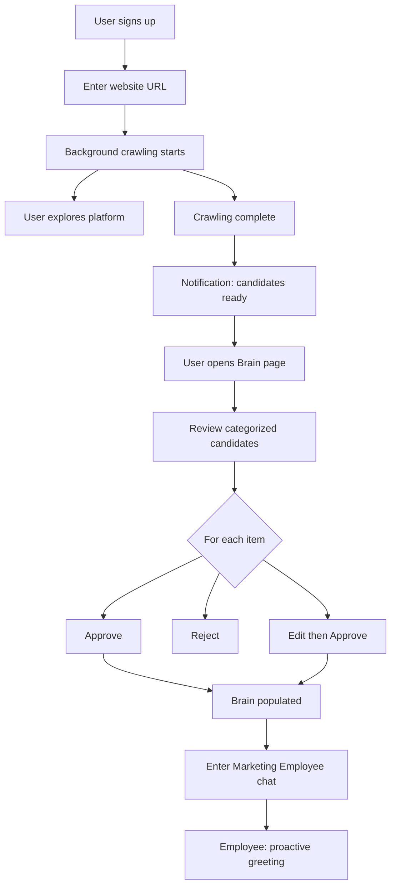
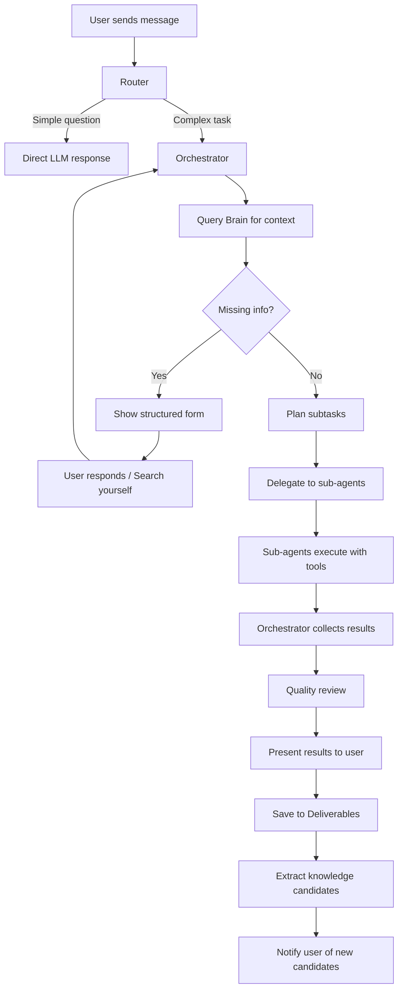
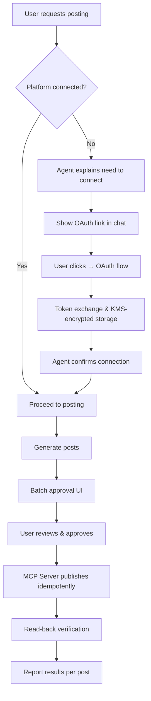

# Product Requirements Document (PRD)

## AI Marketing Employee — BusMora Platform

> Version 2.0 — October 2026
> Status: Baselined — reflects the decisions in [decision-registry.md](../strategy/decision-registry.md).

---

## Table of Contents

1. [Product Overview](#1-product-overview)
2. [Goals & Objectives](#2-goals--objectives)
3. [Target Users & Personas](#3-target-users--personas)
4. [Use Cases](#4-use-cases)
5. [Functional Requirements](#5-functional-requirements)
6. [Non-Functional Requirements](#6-non-functional-requirements)
7. [User Journeys & Workflows](#7-user-journeys--workflows)
8. [AI Employee Behavior](#8-ai-employee-behavior)
9. [Sub-Agent Orchestration](#9-sub-agent-orchestration)
10. [Business Brain & Knowledge Management](#10-business-brain--knowledge-management)
11. [Approval & Execution Rules](#11-approval--execution-rules)
12. [External Integrations](#12-external-integrations)
13. [Error Handling & Edge Cases](#13-error-handling--edge-cases)
14. [Acceptance Criteria](#14-acceptance-criteria)
15. [Success Metrics](#15-success-metrics)
16. [Out of Scope](#16-out-of-scope)

---

## 1. Product Overview

### 1.1 Product Name
**BusMora** — Autonomous AI Marketing Employee Platform for SMBs.

### 1.2 One-Liner
An autonomous AI marketing employee that understands your business, researches your competitors, creates culturally authentic Arabic content, plans your campaigns, and publishes to your social media—functioning as an **Autonomous Execution Layer** that turns decisions into completed workflows from a single interface.

### 1.3 Product Type
Multi-tenant SaaS platform with AI agent orchestration and durable execution workflows.

### 1.4 Core Concept
The platform provides each company with a dedicated **Marketing Employee**—an AI execution agent that acts as an intelligent marketing department head. Unlike generic AI chatbots that act as "Manual Work Multipliers" (leaving the user trapped in endless prompting, editing, and tool-hopping), this employee:

- **Eliminates Tool Amnesia** via a persistent, reviewed Business Brain.
- **Orchestrates specialized sub-agents** to convert strategic decisions into multi-step workflows.
- **Gathers authentic market data** by crawling actual platforms (Reddit, YouTube, Facebook Ads Library, competitor websites).
- **Escapes the Editing Trap** by producing culturally resonant Arabic copy (Egyptian conversational, Gulf lifestyle, MSA) grounded in real audience sentiment.
- **Executes real actions** by delivering assets to a rapid Batch Review UI and publishing directly to social media with read-back verification.
- **Gets smarter over time** by extracting knowledge from completed tasks back into the Brain.

### 1.5 Delivery Strategy
**One release, full scope.** The complete Marketing Employee — research, analysis, content, campaign planning, performance interpretation, and approved social publishing — ships in a **single 6-month (24-week)** release built by four students with vertical end-to-end ownership. The architecture is domain-neutral so a future controlled Employee can be added without redesign.

---

## 2. Goals & Objectives

### 2.1 Business Goals
| Goal | Measure |
|---|---|
| Ship a real, production-quality product (not a demo) | Real businesses completing real marketing tasks |
| Produce an **evidence-backed product decision** | Documented user evidence from the paid pilot supporting a go / pivot / extend decision |
| Validate willingness to pay | **1–3 paid pilot businesses** onboarded and using the product |
| Complete the graduation project with distinction | Full working product + technical documentation |

### 2.2 User Goals
| Goal | Measure |
|---|---|
| Save time by eliminating tool-hopping and prompt babysitting | Self-reported 5–10 hours saved weekly by pilot users |
| Escape the "Editing Trap" | ≥ 75% of generated content accepted with zero or minor edits |
| Get authentic market & competitor insights without manual crawling | Research reports with real, sourced data |
| Produce consistent, culturally resonant Arabic content | Reviewer scores ≥ 4 across dialect and brand fit |
| Have a marketing partner that retains context permanently | Zero tool amnesia; Brain grows with approved knowledge |

---

## 3. Target Users & Personas

### 3.1 Primary Persona: "Sarah" — The Solo Marketer

| Attribute | Detail |
|---|---|
| **Age** | 25–35 |
| **Role** | Marketing Coordinator OR Business Owner handling marketing |
| **Company Size** | 5–50 employees |
| **Company Type** | E-commerce, direct-to-consumer, services, local business in Egypt or the GCC |
| **Marketing Experience** | Intermediate — understands marketing fundamentals but lacks execution bandwidth |
| **Tech Comfort** | Comfortable with SaaS tools, social media, basic AI |
| **Languages** | Arabic-first, bilingual (Arabic + English); requires authentic regional dialects |
| **Current Tools** | Canva, ChatGPT, Buffer/Hootsuite, manual spreadsheet calendars |
| **Budget** | Willing to pay $50–$150/mo for an execution tool that actually saves time, but price-sensitive |

### 3.2 Pain Points
1. **The "Manual Work Multiplier" Trap:** AI tools promise automation but only draft text, leaving formatting, asset creation, scheduling, and distribution as an exhausting second job.
2. **The "Editing Trap" & Babysitting Burden:** Spends more time cleaning up generic, robotic AI text ("AI slop") than writing from scratch.
3. **The "Amnesia of Tools":** Wastes 30 minutes every morning re-explaining company context, products, and brand voice to "blank-slate" AI models.
4. **Tool-Hopping & Fragmentation:** Juggling 4–6 siloed point tools (research, drafting, design, scheduling) that remain "tab-isolated."
5. **The "Pan-Arabic Myth":** Global tools produce stiff, translated Modern Standard Arabic (MSA) that feels unnatural and converts poorly compared to localized Egyptian or Gulf registers.
6. **Prohibitive Agency Costs:** Cannot justify $1,500–$3,000/mo agency retainers or full-time marketing hires.

### 3.3 Jobs to Be Done
- "Turn my business decisions into finished campaigns without manual handoffs or tool-hopping."
- "Write content that sounds like my brand in authentic Arabic (Egyptian or Gulf) without me having to rewrite it."
- "Remember everything about my business permanently so I never have to re-explain my context."
- "Uncover what competitors are advertising and what customers complain about in real online communities."
- "Let me review and approve a week's worth of content in 15 minutes, then publish and verify it automatically."
- "Diagnose our monthly performance without needing a data analyst."

---

## 4. Use Cases

| ID | Use Case | Actor | Description |
|---|---|---|---|
| UC-01 | **Onboarding** | Business Owner | Sign up, enter website URL, review extracted knowledge, set up Brain |
| UC-02 | **Market Research** | Marketing Person | Request market analysis for a product/segment; receive report with real data from Reddit, YouTube, Web |
| UC-03 | **Competitor Analysis** | Marketing Person | Request competitor deep-dive; receive comparison of competitor websites, ads, content, positioning |
| UC-04 | **Content Creation** | Marketing Person | Request social media posts, articles, ad copy; receive on-brand content in Arabic/English, with brand-template visuals |
| UC-05 | **Brain Management** | Business Owner | View, edit, add, approve, or reject knowledge items in the Business Brain |
| UC-06 | **Knowledge Discovery** | System | Extract reusable knowledge from completed tasks; present as candidates for Brain |
| UC-07 | **Workflow Monitoring** | Any User | Watch real-time agent workflow visualization while task executes |
| UC-08 | **Deliverables Access** | Any User | Browse and retrieve all AI-generated outputs (reports, content, calendars, diagnoses) |
| UC-09 | **Campaign Planning** | Marketing Person | Request content calendar for a period; receive structured plan with posts, timing, platforms |
| UC-10 | **Social Media Posting** | Marketing Person | Connect social accounts; approve posts from calendar; system publishes with read-back verification |
| UC-11 | **Batch Approval** | Business Owner | Review group of scheduled posts; approve, reject, or edit each; bulk actions |
| UC-12 | **Platform Connection** | Business Owner | Connect Facebook, Instagram, X accounts via OAuth on-demand |
| UC-13 | **Performance Interpretation** | Marketing Person | Upload a performance CSV; receive a structured diagnosis with prioritized recommendations |

---

## 5. Functional Requirements

### 5.1 SaaS Platform Foundation

#### FR-001: User Registration
- User can register with email + password.
- Email verification required.
- Creates a personal workspace automatically upon registration.

#### FR-002: Authentication
- Email/password login with Argon2id-hashed passwords.
- JWT access tokens + Redis-backed rotating refresh tokens.
- Password reset flow.

#### FR-003: Workspace
- Each user has one workspace.
- Workspace is isolated from other users (multi-tenant).
- Single-user access (no team invitations in this release).

#### FR-004: Navigation
- Main navigation includes:
  - **Marketing Employee** (chat interface)
  - **Brain** (knowledge management page)
  - **Deliverables** (AI-generated outputs)
  - **Settings** (account, connected platforms)

---

### 5.2 Website Crawling & Onboarding

#### FR-010: Website URL Input
- During onboarding, user enters their company website URL.
- System validates the URL is accessible.
- Crawling starts as a **background job** — user is NOT blocked.

#### FR-011: Background Crawling
- System crawls publicly accessible pages of the website.
- Respects robots.txt (configurable).
- Extracts text content from HTML pages.
- Follows internal links to a configurable depth.
- Handles common page structures (headers, footers, nav, main content).
- Timeout: max 5 minutes per website.
- Max pages: bounded onboarding crawl (default: 10 key pages).

#### FR-012: Knowledge Extraction from Crawl
- Extracted text is processed by LLM to identify:
  - Company description and industry.
  - Products and services (names, descriptions, prices if found).
  - Target audience indicators.
  - Brand messaging and tone.
  - Contact information and locations.
  - FAQ content.
  - Any other business-relevant information.
- Each extracted piece of knowledge becomes a **Knowledge Candidate**.

#### FR-013: Knowledge Candidate Review
- User receives a **notification** when crawling is complete.
- Brain page shows a **notification badge** with pending candidates count.
- Candidates are displayed in **categorized sections**:
  - Company Info
  - Products & Services
  - Brand & Messaging
  - Audience & Market
  - Contact & Locations
  - Policies & FAQ
  - Other
- Candidates are reviewed **individually** (no bulk approval) so knowledge quality stays deliberate.
- For each candidate, user can:
  - ✅ **Approve** — adds to Brain as confirmed knowledge.
  - ❌ **Reject** — discards the candidate.
  - ✏️ **Edit** — modify the content, then approve.
  - ➕ **Add New** — manually add knowledge not found by crawler.

#### FR-014: Crawl Status
- User can see crawling progress (pages crawled, estimated completion).
- User can continue using the platform while crawling runs.

---

### 5.3 Business Brain

#### FR-020: Brain Schema (Relational Concept Graph)
The Brain represents company knowledge as a **Concept Graph** consisting of Major Business Entity Nodes (`brain_nodes`) interconnected by Semantic Relationship Edges (`brain_edges`):

1. **Entity Nodes (`brain_nodes`):**
   - Each node represents a distinct, high-level business entity across **nine canonical categories**:
     - `company_profile`: Mission, values, history, team size, headquarters.
     - `offering`: Product/service name, pricing, features, USPs.
     - `audience`: Demographics, psychographics, pain points, behavioral patterns.
     - `brand_rule`: Brand tone/voice guidelines, core messaging, visual identity rules.
     - `positioning`: How the company differentiates in its market.
     - `strategic_goal`: Business and marketing objectives.
     - `channel`: Active marketing channels and their roles.
     - `competitor`: Competitor profile, perceived strengths/weaknesses, active offers.
     - `company_fact`: Verifiable, reusable facts about the company.
   - Node Fields: `id`, `category`, `title`, `summary`, `properties` (JSONB structured fields), `status` (`candidate` | `approved` | `rejected` | `retired`), `source`, `source_detail`, provenance and freshness metadata, timestamps.

2. **Relationship Edges (`brain_edges`):**
   - Edges explicitly connect related concept nodes using a strict semantic enum:
     - `TARGETS`: `[Offering Node] ──► [Audience Node]`
     - `COMPETES_WITH`: `[Offering/Brand Node] ──► [Competitor Node]`
     - `HAS_TONE`: `[Brand Rule Node] ──► [Tone Node]`
     - `SOLVES_PAIN_POINT`: `[Offering Node] ──► [Pain Point Node]`
     - `RELATED_TO`: General bidirectional semantic association.
   - Edge Fields: `id`, `source_node_id`, `target_node_id`, `relation_type`, `weight`, `created_at`.

#### FR-021: Brain Page UI (Interactive Graph & Management Canvas)
- **Visual Graph Canvas (React Flow):** Renders approved and candidate nodes as an interactive, draggable network graph. Edge lines display relationship labels.
- **Node Inspection & Editing:** Clicking any node opens a structured side panel/modal allowing the user to view, edit JSON properties, or retire the node (soft delete preserving audit history).
- **Candidate Review Stream:** Shows notification badges for pending candidate nodes/edges extracted from crawling or completed tasks.
- **Manual Node & Edge Creation:** Users can add new nodes and manually draw edges between existing entities.
- **Filter & Search:** Filter by category, relationship type, or full-text search.
- **Provenance View:** Each node exposes its source and the raw snapshot it was derived from.

#### FR-022: Brain Retrieval (Vector Seed + 1–2 Hop Expansion)
- Agents query the Brain via a high-performance two-stage pipeline:
  1. **Vector Seed:** Query embedding similarity search in Qdrant retrieves the most relevant approved concept nodes.
  2. **Relational Expansion:** SQL traversal in PostgreSQL retrieves connected neighbor nodes within **1–2 hops** via `brain_edges`.
- Combined seed + neighbor graph context is injected into agent prompts, ensuring cohesive, cross-functional understanding without context bloat.
- A parallel **document-only control retrieval route** supports the Brain value measurement in [evaluation.md](../strategy/evaluation.md).

#### FR-023: Knowledge Lifecycle
- **Candidate → Approved**: User explicitly approves.
- **Candidate → Rejected**: User explicitly rejects.
- **Approved → Edited**: User modifies content.
- **Approved → Retired**: Superseded or outdated knowledge is retired with an audit record.
- Knowledge from website crawling starts as `candidate`.
- Knowledge from conversations starts as `candidate`.
- Knowledge from task results starts as `candidate`.
- Manual knowledge is immediately `approved`.
- Conflicts between knowledge items are surfaced to the user rather than auto-resolved.
- All promotions, edits, approvals, and retirements are recorded in an **append-only audit log**.

---

### 5.4 Chat Interface

#### FR-030: Chat Layout
- Split layout:
  - **Left panel**: Chat conversation.
  - **Right panel**: Workflow Visualization Canvas.
- Responsive — on mobile, canvas is hidden or toggled.

#### FR-031: Message Types
The chat supports the following message types:

| Type | Direction | Description |
|---|---|---|
| **Text Message** | User → Agent | Free-text user input |
| **Text Response** | Agent → User | Agent's text reply |
| **Structured Form** | Agent → User | Form with fields, dropdowns, checkboxes + "Search yourself" option per field |
| **Task Status** | System → User | "Searching...", "Analysis completed", etc. |
| **Deliverable Card** | Agent → User | Rendered output (report, content, calendar, diagnosis) with download/view actions |
| **Knowledge Notification** | System → User | "3 new knowledge items for review" with link to Brain |
| **Error Message** | System → User | Transparent error notification when retries fail |

#### FR-032: Structured Forms in Chat
- Agent can present forms with:
  - Text input fields.
  - Single-select radio options.
  - Multi-select checkboxes.
  - Dropdown selectors.
  - Each field has an optional **"Search yourself"** button that tells the agent to research the answer instead of waiting for user input.
- User submits form → response sent as structured data to agent.

#### FR-033: Chat History
- All conversations are persisted.
- User can scroll back through history.
- Previous conversations accessible from a sidebar/list.

---

### 5.5 Workflow Visualization Canvas

#### FR-040: Canvas Layout
- Displayed alongside the chat (right panel).
- Shows a **node graph** representing the current task workflow.

#### FR-041: Node Types
| Node | Representation |
|---|---|
| **Orchestrator** | Central hub node |
| **Market Research Agent** | Specialized node |
| **Competitor Analysis Agent** | Specialized node |
| **Content Writer Agent** | Specialized node |
| **Campaign Planner Agent** | Specialized node |
| **Social Media Poster Agent** | Specialized node |

#### FR-042: Visual States
- **Idle**: Node is gray/dimmed.
- **Active**: Node is highlighted/animated (agent currently working).
- **Completed**: Node shows green checkmark.
- **Error**: Node shows red indicator (only if error is user-visible).

#### FR-043: Connections
- Animated directional connections (edges) show flow between nodes:
  - Orchestrator → Sub-Agent: "delegated task".
  - Sub-Agent → Orchestrator: "returned results".
- Connections appear dynamically as the workflow progresses.

#### FR-044: Tool Usage Display
- When a sub-agent uses a tool, the canvas shows an **abstracted label** (not internal tool names):
  - "Searching Reddit" (not `crawl_reddit()`)
  - "Analyzing competitor website" (not `scrape_url()`)
  - "Writing content" (not `llm_generate()`)
- Displayed as a subtitle under the active agent node.

#### FR-045: Real-Time Updates
- Canvas updates in real-time via **Server-Sent Events (SSE)** with `Last-Event-ID` replay.
- Backend emits events:
  - `agent_started`: { agent_id, agent_name, task_summary }
  - `agent_tool_used`: { agent_id, tool_label }
  - `agent_completed`: { agent_id, result_summary }
  - `agent_error`: { agent_id, error_summary }
  - `flow_connection`: { from_agent, to_agent, direction }
- On reconnect, missed events are replayed from the Redis Stream buffer without interrupting the running workflow.

#### FR-046: Different Workflows
- The canvas shows that **different tasks produce different workflows**.
- A market research task might only use Orchestrator → Market Research.
- A complex task might use Orchestrator → Market Research → Competitor Analysis → Content Writer.
- The user sees that the agent chooses different paths based on the task.

---

### 5.6 Deliverables System

#### FR-050: Deliverables Storage
- All AI-generated outputs are stored persistently.
- Each deliverable has:
  - `id`: Unique identifier.
  - `title`: Descriptive title (e.g., "Competitor Analysis — Company X").
  - `type`: `research_report` | `competitor_analysis` | `content_posts` | `content_calendar` | `performance_diagnosis` | `general`.
  - `content`: The actual output (markdown or structured data).
  - `task_id`: Reference to the originating task.
  - `created_at`: Timestamp.

#### FR-051: Deliverables Page
- User can browse all deliverables.
- Filter by type and date.
- View any deliverable in full.
- Download as PDF or Markdown (stretch goal).

---

### 5.7 Market Research Agent

#### FR-060: Capabilities
- Receives research request from Orchestrator (topic, scope, focus areas).
- Crawls data from:
  - **Reddit**: Relevant subreddits, posts, comments.
  - **YouTube**: Video titles, descriptions, top comments.
  - **Web**: General web pages relevant to the query.
- Analyzes gathered data using LLM.
- Produces a structured research report.

#### FR-061: Research Report Structure
```
📊 Market Research Report: [Topic]

1. Executive Summary
2. Market Overview
   - Market size and trends
   - Key players
3. Consumer Insights
   - Pain points (from Reddit/YouTube comments)
   - Preferences and behaviors
   - Common questions and concerns
4. Opportunities
   - Unmet needs
   - Emerging trends
5. Threats & Challenges
6. Recommendations
7. Sources
   - List of URLs/posts/videos used with brief descriptions
```

#### FR-062: Source Attribution
- Every claim in the report must cite its source.
- Sources include: URL, platform, date accessed.
- User can verify by clicking source links.

---

### 5.8 Competitor Analysis Agent

#### FR-070: Capabilities
- Receives competitor analysis request from Orchestrator.
- If competitor names are provided, crawls:
  - Competitor websites (products, pricing, messaging, positioning).
  - Facebook Ads Library (active ads for the competitor).
- If competitor names are NOT provided, the Orchestrator asks the user or delegates to Market Research first.

#### FR-071: Competitor Report Structure
```
🔍 Competitor Analysis: [Competitor Name]

1. Company Overview
   - What they do, their positioning
2. Products & Pricing
   - Product lineup, pricing strategy
3. Online Presence
   - Website quality and messaging
   - Social media activity
4. Advertising
   - Active ads from Facebook Ads Library
   - Ad messaging and creative themes
5. Strengths & Weaknesses
6. Comparison with Your Company
   - Side-by-side comparison using Brain data
7. Strategic Recommendations
8. Sources
```

---

### 5.9 Content Writer Agent

#### FR-080: Capabilities
- Receives content request from Orchestrator with:
  - Content type (social post, article, ad copy).
  - Platform (Instagram, Facebook, X, general).
  - Topic or brief.
  - Brain context (brand voice, audience, products).
  - Research context (if Market Research was run first).

#### FR-081: Content Output
- Each piece of content includes:
  - **Main text / caption** in the requested language.
  - **Hashtags** (platform-appropriate).
  - **Suggested image/visual description**, or a generated **brand-template visual** when the channel requires an image.
  - **Platform-specific formatting** (character limits for X, emoji usage, etc.).

#### FR-082: Brand Voice Adherence
- Content Writer MUST use the brand voice defined in the Brain.
- If no brand voice is defined, Content Writer asks Orchestrator to clarify with user.
- Content adapts tone, vocabulary, and style to match the brand.

#### FR-083: Bilingual Content
- User can request content in Arabic, English, or both.
- Content is generated natively in the requested language (not translated).
- Arabic content uses appropriate dialect if specified in Brain.

---

### 5.10 Image Generation

#### FR-085: Brand-Template Visuals
- For image-required channels, the system produces a **brand-template composite**: a generated background/imagery plus a deterministic brand overlay (logo, colors, typography).
- Brand assets are detected strictly from the website crawl (no direct document or PDF ingestion); if undetectable, clean fallbacks (business name as text, neutral palette, default fonts) are used and remain editable in the Brain.
- Generated visuals are cached by template and dimension.
- Every generated visual is human-approved before publishing.

---

### 5.11 Campaign Planner Agent

#### FR-090: Capabilities
- Receives campaign planning request from Orchestrator.
- Generates a **Content Calendar** based on:
  - Brain knowledge (products, audience, brand voice).
  - Research results (if available).
  - User-specified parameters (duration, platforms, frequency).

#### FR-091: Content Calendar Structure
```
📅 Content Calendar: [Period]

Week 1:
├── Mon Oct 5 — Instagram
│   Post: "[content]"
│   Hashtags: #...
│   Visual: "[description or generated visual]"
├── Wed Oct 7 — Facebook
│   Post: "[content]"
│   ...
└── Fri Oct 9 — X
    Post: "[content]"
    ...

Week 2:
├── ...
```

#### FR-092: Calendar Customization
- User can specify:
  - Time period (1 week, 2 weeks, 1 month).
  - Platforms to include.
  - Posting frequency per platform.
  - Focus themes or products.
  - Special dates or events.

---

### 5.12 Performance Interpretation

#### FR-095: CSV Intake & Diagnosis
- User uploads a performance CSV.
- System validates and normalizes the schema (clear error if headers are unrecognized).
- Deterministic KPIs are computed (e.g. CTR, conversion rate, CPC changes).
- Orchestrator produces a structured **Performance Diagnosis** with prioritized recommendations.
- The diagnosis is saved as a deliverable and reusable facts become Brain candidates.

---

### 5.13 Social Media Poster Agent

#### FR-100: Capabilities
- Receives approved posts from the Batch Approval workflow.
- Posts to connected platforms via MCP Server.
- Reads each post back to verify it exists, and reports success/failure per post.

#### FR-101: Supported Platforms
| Platform | API | Auth |
|---|---|---|
| Facebook Pages | Meta Graph API | OAuth 2.0 (Page Access Token) |
| Instagram Business | Instagram Graph API (Content Publishing) | OAuth 2.0 (via Meta) |
| X (Twitter) | X API v2 | OAuth 2.0 |

#### FR-102: MCP Server Tools
```
publish_facebook(page_id, message, image_url?) → { post_id, url }
publish_instagram(account_id, caption, image_url) → { media_id, url }
publish_x(text, media_ids?) → { tweet_id, url }
```

#### FR-103: Posting Preconditions
- Platform must be connected (OAuth tokens exist and are valid).
- Post must be in `approved` status.
- Each publish is **idempotent** — retries and reconnects never produce duplicates.
- If tokens are expired, system attempts silent refresh. If refresh fails, notifies user to re-connect.

---

## 6. Non-Functional Requirements

### NFR-001: Performance
| Metric | Target |
|---|---|
| Website crawl completion | ≤ 5 minutes for typical website |
| Chat response (simple query) | ≤ 3 seconds |
| Task start acknowledgment | ≤ 2 seconds |
| Research task completion | ≤ 5 minutes |
| Content generation | ≤ 30 seconds per piece |
| Canvas update latency | ≤ 500ms from backend event |

### NFR-002: Reliability
| Metric | Target |
|---|---|
| Platform uptime | ≥ 99% (excluding planned maintenance) |
| Task completion success rate | ≥ 85% |
| Posting success rate (with read-back) | ≥ 95% |
| Data loss | Zero tolerance for Brain data and deliverables |

### NFR-003: Security
| Requirement | Implementation |
|---|---|
| Data isolation | Each workspace's data is logically isolated. No cross-tenant data access. |
| Token storage | OAuth tokens encrypted with cloud KMS envelope encryption. |
| API keys | All secrets stored in secure vault, never in code. |
| Authentication | Argon2id passwords; JWT access tokens; rotating Redis refresh tokens. |
| Input sanitization | All user inputs sanitized before processing. |
| Prompt injection defense | Crawled content sanitized and quarantined within explicit data boundaries; system prompts protected from manipulation. |

### NFR-004: Scalability
- System capacity sized for paid pilot (1–3 workspaces; ≤ 2 concurrent tasks and 1 crawl per workspace).
- Architecture supports ≥ 100 concurrent workspaces, proven via a stubbed load test with mocked LLM and crawler calls.
- Crawling jobs should be queued and rate-limited to prevent resource exhaustion.
- Agent tasks should be queued and processed asynchronously via durable workflows.

### NFR-005: Observability
- Logging for all agent actions, tool calls, and errors.
- Monitoring for task durations, success rates, and error rates.
- LLM tracing, token, and cost tracking per workspace via Langfuse.

### NFR-006: Internationalization
- UI supports Arabic (RTL) and English (LTR).
- Content generation supports both languages natively.
- Date/time formatting respects user locale.

---

## 7. User Journeys & Workflows

> Detailed user journeys are documented in [MVP Definition](../strategy/mvp-definition.md#6-core-user-journeys). Key workflows below.

### 7.1 Onboarding Workflow



### 7.2 Task Execution Workflow



### 7.3 Lazy OAuth Workflow



---

## 8. AI Employee Behavior

### 8.1 Personality & Communication Style
- **Professional but friendly** — not robotic, not overly casual.
- **Proactive** — suggests next steps, identifies gaps, offers help.
- **Transparent** — explains what it's doing and why.
- **Bilingual** — communicates in the language the user uses. Can switch mid-conversation.
- **Business-aware** — uses company-specific terminology from the Brain.

### 8.2 Proactive Behaviors
| Trigger | Action |
|---|---|
| First conversation | Greet user, highlight missing Brain information, suggest filling gaps |
| Missing critical info for a task | Ask via structured form before proceeding |
| Task completed | Suggest related tasks ("Shall I write content based on this research?") |
| New knowledge candidates | Notify user to review |
| Long idle period | (Future) Suggest tasks based on Brain content and season |

### 8.3 Autonomy Rules
| Action | Autonomy Level |
|---|---|
| Querying the Brain | ✅ Fully autonomous |
| Crawling public websites for research | ✅ Fully autonomous |
| Choosing which sub-agents to use | ✅ Fully autonomous |
| Deciding task execution order | ✅ Fully autonomous |
| Retrying failed tool calls | ✅ Fully autonomous (up to 3 retries) |
| Adding knowledge candidates | ✅ Autonomous (user reviews later) |
| Generating content | ✅ Autonomous (user reviews output) |
| Posting to social media | ❌ Requires explicit user approval |
| Spending money (ads) | ❌ Not supported |
| Modifying approved Brain knowledge | ❌ Requires user action |
| Connecting new platforms | ❌ Requires user OAuth action |

---

## 9. Sub-Agent Orchestration

### 9.1 Architecture Overview

```
User Message
    ↓
[Router] ← classifies: simple question vs. complex task
    ↓ (if complex task)
[Orchestrator]
    ├── Query Brain for context (Semantic + Procedural Memory)
    ├── Diagnose business bottleneck (Discovery vs. Positioning vs. Conversion)
    ├── Identify missing information
    ├── Ask user via structured forms (if needed)
    ├── Plan subtasks and dependencies
    ├── Delegate to sub-agents:
    │   ├── [Market Research Agent] ← crawling tools + intent qualifier
    │   ├── [Competitor Analysis Agent] ← crawling tools + ad intelligence
    │   ├── [Content Writer Agent] ← LLM + Brain context + dialect tuning
    │   ├── [Campaign Planner Agent] ← LLM + Brain + Research
    │   └── [Social Media Poster Agent] ← MCP Server tools
    ├── Collect and review results
    ├── Combine into final output
    ├── Extract knowledge candidates (Semantic & Procedural updates)
    └── Present to user
```

### 9.2 Router Logic

| Input Pattern | Classification | Routing |
|---|---|---|
| Greeting ("Hello", "Hi") | Simple | Direct response (lightweight LLM) |
| Simple question about the system | Simple | Direct response |
| "Analyze competitors" | Complex task | Orchestrator |
| "Do market research" | Complex task | Orchestrator |
| "Write posts for me" | Complex task | Orchestrator |
| "Create a content calendar" | Complex task | Orchestrator |
| "What went wrong last month?" (with CSV) | Complex task | Orchestrator |
| Ambiguous | Clarification | Ask user before routing |

### 9.3 Orchestrator Responsibilities
1. **Context loading**: Retrieve relevant Brain knowledge for the task.
2. **Gap analysis**: Identify missing information that would affect task quality.
3. **Clarification**: Present structured forms for missing info.
4. **Planning**: Decompose task into subtasks with dependencies.
5. **Delegation**: Assign subtasks to appropriate sub-agents.
6. **Monitoring**: Track sub-agent progress, emit visualization events.
7. **Error recovery**: Handle sub-agent failures (retry, fallback, notify user).
8. **Quality review**: Verify sub-agent outputs are coherent and complete.
9. **Assembly**: Combine sub-agent outputs into a final deliverable.
10. **Knowledge extraction**: Identify reusable knowledge from results.

### 9.4 Sub-Agent Selection Logic

| Task Type | Primary Agent | May Also Use |
|---|---|---|
| Market research | Market Research | — |
| Competitor analysis | Competitor Analysis | Market Research (for context) |
| Write content (with research) | Content Writer | Market Research (first) |
| Write content (Brain has enough context) | Content Writer | — |
| Content calendar | Campaign Planner | Content Writer (for each post) |
| Post to social media | Social Media Poster | — |
| Complex campaign | Market Research → Competitor Analysis → Campaign Planner → Content Writer | All four in sequence |

### 9.5 Inter-Agent Communication
- Sub-agents do NOT communicate directly with each other.
- All communication goes through the Orchestrator.
- Orchestrator passes relevant output from one agent as input to the next.
- This prevents cascading errors and maintains control.

---

## 10. Business Brain & Dual-Memory Architecture

### 10.1 Dual-Memory Architecture

The Business Brain acts as the company's permanent marketing operating system by dividing institutional knowledge into two distinct memory stores:

1. **Semantic Memory (Relational Concept Graph):**
   * Stores foundational facts about the company, products, target audience segments, canonical brand guidelines, and identified competitors across `brain_nodes` and `brain_edges`.
   * Solves "tool amnesia" and ensures factual grounding on every campaign.
2. **Procedural Memory (Workflow Calibration & Feedback Store):**
   * Stores calibrated guidelines on *how* to execute: approved regional dialect registers (Egyptian conversational vs Gulf lifestyle), stylistic rules derived from previous human edits, successful hook patterns, and post-task evaluations.
   * Prevents repeating stylistic mistakes and ensures the AI gets progressively sharper over time.

### 10.2 Knowledge Sources

| Source | Target Memory | Trigger | Initial Status | Requires Review? |
|---|---|---|---|---|
| **Website Crawling** | Semantic | Onboarding (background job) | `candidate` | Yes — user reviews in Brain page |
| **Conversations** | Semantic / Procedural | Agent detects reusable facts or tone rules | `candidate` | Yes — user reviews via notification |
| **Task Results & Edits** | Procedural | Post-task extraction & user edit diffs | `candidate` | Yes — user reviews via notification |
| **Manual Entry** | Semantic | User adds via Brain page | `approved` | No — user's own input is trusted |

### 10.3 Knowledge Classification

The system classifies discovered information into four types:

| Type | Description | Action |
|---|---|---|
| **Task-Specific** | Only relevant to the current task | Do NOT add to Brain |
| **Reusable Business Knowledge** | General company info useful across tasks | Create Knowledge Candidate |
| **Temporary Context** | Short-lived information | Do NOT add to Brain |
| **Sensitive Information** | Passwords, financial data, personal info | Do NOT add to Brain; warn user |

### 10.3 Knowledge Extraction from Tasks

After each task completion:
1. Orchestrator reviews the task output.
2. Identifies information that is:
   - Factual (not speculative).
   - About the company, market, or competitors (not task logistics).
   - Potentially useful for future tasks.
3. Creates Knowledge Candidates with:
   - Category assignment.
   - Source reference (task ID).
   - Confidence indicator.
4. User receives notification to review.

### 10.4 Knowledge Retrieval Strategy (Vector Seed + 1–2 Hop Expansion)

When an agent needs Brain context:
1. **Stage 1 (Vector Seed in Qdrant):** Query vector is matched against `brain_nodes` embeddings (filtered strictly by `workspace_id` and `status = 'approved'`). The most similar concept nodes are retrieved.
2. **Stage 2 (Relational Expansion in PostgreSQL):** Traverses `brain_edges` linked to the seed nodes to fetch neighbor entities within 1–2 hops (e.g. if the seed is an *Offering*, fetches its connected *Target Audience*, *Brand Rule*, and direct *Competitors*).
3. **Graph Context Assembly:** The seed nodes, neighbor nodes, and explicit edge labels are assembled into a structured JSON/XML context block.
4. **Context Window Protection:** Bounded traversal with a strict token ceiling to ensure zero context bloat while providing complete relational awareness.

---

## 11. Approval & Execution Rules

### 11.1 Approval Requirements

| Action | Approval Required? | Approval Type |
|---|---|---|
| Research and analysis | No | Results shown in chat |
| Content generation | No | Content shown in chat; any social post can be sent to Batch Review for publishing |
| Content Calendar generation | No | Calendar shown for review; items sent to Batch Review |
| Publishing a post | **Yes** | Batch Review (binds to an immutable `PostVersion`) |
| Connecting a platform | **Yes** | OAuth consent flow (prompted lazily) |

### 11.2 Approval State Machine

A simplified, explicit state machine governs every externally visible action:
`draft → pending_approval → approved | rejected → scheduled → publishing → published | failed`
(with `cancelled` and `expired` states supported)

- **Version Binding:** An approval binds to a single, immutable `PostVersion`. Any edit or regeneration creates a new version and returns the post to `pending_approval`.
- **Expiry:** A post still pending when its scheduled time passes becomes `expired` (can be rescheduled).
- **Cancellation:** Allowed from `approved` or `scheduled` before `publishing`.
- Each transition records an audit event.
- Each execution attempt is stored with an idempotency key and verified via read-back.

### 11.3 Batch Approval Workflow

1. Campaign Planner generates a Content Calendar with multiple posts.
2. Posts are displayed in a **Batch Review UI**:
   - Grid/list view of all posts.
   - Each post shows: platform icon, date/time, content preview, status.
   - User can:
     - ✅ Approve individual post.
     - ❌ Reject individual post.
     - ✏️ Edit post content, then approve.
     - ✅✅ Approve all remaining.
     - ❌❌ Reject all remaining.
3. Approved posts are queued for scheduling.
4. Durable workflows release each post at its scheduled time.
5. System publishes via MCP Server tools, idempotently.
6. Each post is read-back verified.
7. Results (success/failure) shown per post.

---

## 12. External Integrations

### 12.1 Data Gathering (Custom Crawling)

| Platform | Method | Data Collected |
|---|---|---|
| **Reddit** | Custom crawler (Scrapling) | Posts, comments, upvotes, subreddit info |
| **YouTube** | Custom crawler | Video titles, descriptions, top comments, view counts |
| **Facebook Ads Library** | Custom crawler | Active ads, ad copy, ad creatives, advertiser info |
| **Competitor Websites** | Custom crawler | Page content, product info, pricing, messaging |
| **General Web** | Custom crawler | Page content relevant to search queries |

Crawling runs behind rotating proxies with a bounded headless-browser pool.

### 12.2 Social Media Posting

| Platform | API | Auth Method | Key Limitations |
|---|---|---|---|
| **Facebook Pages** | Meta Graph API v21+ | OAuth 2.0 (Page Access Token) | Pilot runs in Meta Tester Mode (≤ 50 testers); production requires Business Verification + App Review |
| **Instagram Business** | Instagram Content Publishing API | OAuth 2.0 (via Meta) | 50 posts/24h limit; two-step container model; JPEG format only; public URL required |
| **X (Twitter)** | X API v2 | OAuth 2.0 | Pay-per-use: $0.015/plain post, $0.20/post with URL |

### 12.3 OAuth Token Management
- Tokens encrypted at rest with cloud KMS envelope encryption.
- Automatic token refresh when possible.
- If refresh fails → notify user to re-connect.
- Token status visible in Settings page.
- User can disconnect platforms at any time.

---

## 13. Error Handling & Edge Cases

### 13.1 Crawling Errors

| Error | Handling |
|---|---|
| Website unreachable | Retry 2x → notify user "Could not access your website" |
| Rate limited by platform | Exponential backoff → retry → if persistent, skip source |
| CAPTCHA / bot detection | Skip source → use alternative sources → transparent notification |
| Empty/useless content extracted | Don't create candidates for items with no useful info |
| Crawl takes too long | Timeout at 5 min → deliver partial results with notification |

### 13.2 Agent Errors

| Error | Handling |
|---|---|
| Sub-agent fails | Orchestrator retries up to 3 times |
| All retries fail | Orchestrator uses alternative approach (different source/agent) |
| All alternatives fail | Transparent notification to user with explanation |
| LLM returns hallucinated data | Source attribution required — unsourced claims flagged |
| Agent exceeds time limit | Timeout → deliver partial results → notify user |
| Context window exceeded | Truncate oldest Brain context → log warning |

### 13.3 Posting Errors

| Error | Handling |
|---|---|
| OAuth token expired | Attempt refresh → if fail, notify user to re-connect |
| Platform API error | Retry 2x → notify user with specific error |
| Content rejected by platform | Show platform's rejection reason → suggest fix |
| Partial batch failure | Show per-post status: which succeeded, which failed |
| Rate limit hit | Queue remaining posts → retry after cooldown |
| Duplicate publish request | Idempotency key prevents a second post |

### 13.4 Edge Cases

| Scenario | Behavior |
|---|---|
| User's website has no useful content | Inform user; suggest manual Brain population |
| User asks task outside marketing scope | Politely decline: "I'm your Marketing Employee. This seems like a [sales/support] question. I focus on marketing tasks." |
| User asks in a language other than Arabic/English | Respond in English with note that Arabic and English are supported |
| Brain has conflicting information | Flag conflict to user via notification; ask which is correct |
| Very long task (>10 minutes) | Show progress updates in chat + canvas; don't block the UI |
| User closes browser during task | Task continues in background; results available when user returns |

---

## 14. Acceptance Criteria

| ID | Criterion |
|---|---|
| AC-01 | User can register, enter a website URL, and see crawled knowledge candidates within 5 minutes |
| AC-02 | Knowledge candidates are displayed in categorized sections with approve/reject/edit, reviewed individually |
| AC-03 | Approved knowledge appears in the Brain page and is used by the Marketing Employee |
| AC-04 | Marketing Employee greets user proactively and identifies missing Brain information |
| AC-05 | User can request market research and receive a report with data from at least 2 real sources |
| AC-06 | User can request competitor analysis and receive a structured comparison report |
| AC-07 | User can request content and receive on-brand posts matching Brain's brand voice, with a brand-template visual where required |
| AC-08 | Workflow visualization shows real-time agent activity during task execution via SSE |
| AC-09 | Deliverables are saved and browsable in the Deliverables page |
| AC-10 | System extracts knowledge candidates from task results and notifies user |
| AC-11 | Chat supports structured forms with "Search yourself" option |
| AC-12 | System handles Arabic and English input/output with full RTL support |
| AC-13 | Each workspace's data is isolated from other workspaces |
| AC-14 | User can request a content calendar and receive a structured weekly/monthly plan |
| AC-15 | User can connect Facebook, Instagram, and X accounts via OAuth |
| AC-16 | Batch Review UI shows all planned posts with approve/reject/edit actions |
| AC-17 | Approved posts are published to the correct platform successfully and verified by read-back |
| AC-18 | Failed posts show clear error messages and can be retried without duplicates |
| AC-19 | OAuth connection is lazy — triggered only when posting is requested |
| AC-20 | User can upload a performance CSV and receive a structured diagnosis |
| AC-21 | Every knowledge promotion, approval, and publish action is recorded in an append-only audit log |

---

## 15. Success Metrics

### 15.1 Release Success

The primary measure of success is an **evidence-backed product decision**: the pilot produces documented evidence (usage, acceptance, reported time saved) that supports a go / pivot / extend conclusion, alongside **1–3 paid pilot businesses**.

### 15.2 Product Quality Targets

These are internal quality targets measured by the evaluation process in [evaluation.md](../strategy/evaluation.md):

| Metric | Target | Measurement |
|---|---|---|
| Onboarding completion | ≥ 70% | % of signups who review at least one Brain candidate |
| Crawl quality | ≥ 80% | % of candidates approved (not rejected) |
| Task completion | ≥ 85% | % of tasks that produce a usable result |
| Time to value | ≤ 15 min | Time from signup to first useful output |
| Research quality | Real data | Reports contain verifiable, sourced data |
| Content relevance | ≥ 75% | % of content usable without major edits (PRD §2.2 / EVAL) |
| Arabic quality | Meets rubric | All dimensions ≥ 4, none < 3 |
| Brain value | ≥ 50% fewer clarifications/corrections | Blind treatment vs. document-only control |
| Brain growth | ≥ 20 items | Approved items after 5 tasks |
| Posting success | ≥ 95% | % of approved posts published and read-back verified |
| Calendar adoption | ≥ 50% | % of active users who generate a calendar |
| Platform connection | ≥ 60% | % of active users connecting at least one platform |

---

## 16. Out of Scope

| Feature | Reason | When |
|---|---|---|
| Other AI Employees | Vertical focus | Post-MVP |
| LinkedIn posting | Organization-page API approval is selective and often denied | Post-MVP |
| TikTok posting | Strict UI audit requirements | Post-MVP |
| Paid ad management | Spends real money | Post-MVP |
| Automatic performance analytics APIs | Permission-heavy integrations; CSV input covers the use case | Post-MVP |
| Multi-user workspaces | Single user sufficient for persona | Post-MVP |
| Document upload | Brain populated via crawling, conversations, and tasks | Post-MVP |
| Advanced Brain governance automation | Conflicts surfaced to humans | Post-MVP |
| Mobile native app | Web responsive is sufficient | Post-MVP |
| Offline mode | SaaS requires connectivity | Not planned |
| White-labeling | Not needed for target market | Not planned |
