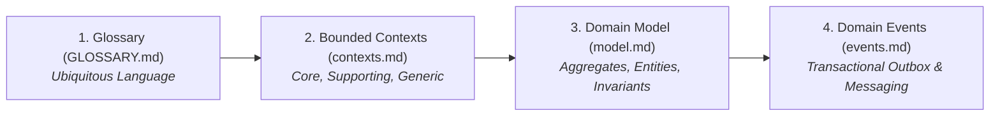

# Domain-Driven Design (`domain/`)

This directory documents the **Domain-Driven Design (DDD)** model for the BusMora platform. It establishes the ubiquitous language, defines strict bounded contexts, models tactical domain aggregates, and catalogues domain events.

---

## Specification Documents

### 1. [Glossary & Ubiquitous Language (`GLOSSARY.md`)](./GLOSSARY.md)
* The single source of truth for terminology across code, database schemas, UI text, and documentation.
* Enforces exact terminology (e.g. `KnowledgeItem` instead of "Node", `Post` instead of "Publication", `Review` vs `Approval`).
* Defines lifecycle states, time zone semantics, and banned terminology.

### 2. [Bounded Contexts (`contexts.md`)](./contexts.md)
* Classifies the 11 system contexts:
  * **Core Subdomain:** *Business Brain* (the platform's durable moat).
  * **Supporting Subdomains:** *Marketing Employee*, *Market Intelligence*, *Governed Publishing*.
  * **Generic Subdomains:** *Tenant & Identity*, *Brand Profile*, *Subscription & Billing*, *Audit & Compliance*, *Notification & Delivery*, *Observability & Telemetry*, *Integration Gateway*.
* Defines clear boundaries, upstream/downstream relationships, and ownership rules.

### 3. [Tactical Domain Model (`model.md`)](./model.md)
* Aggregates, entity lifecycles, and value objects per bounded context:
  * **Post Aggregate:** `Draft` $\rightarrow$ `PendingApproval` $\rightarrow$ `Approved` $\rightarrow$ `Dispatched` $\rightarrow$ `Published` / `Failed` / `Expired`.
  * **Knowledge Aggregate:** Concept nodes, verified relationships, procedural rules, and candidate verification workflows.
  * **Task & Clarification Aggregates:** Long-running conversational intents, approval gates, and human-in-the-loop interactions.

### 4. [Domain Events Catalog (`events.md`)](./events.md)
* Authoritative catalog of immutable domain facts:
  * Naming conventions: Past tense, PascalCase (e.g. `PostApproved`, `KnowledgeItemRetired`, `TenantOnboarded`).
  * Event envelope schemas and transactional outbox persistence rules.
  * In-process dispatching for same-transaction consistency and Redis Streams transport for cross-process choreography.
