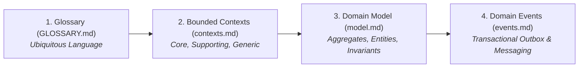

# Domain-Driven Design (`domain/`)

This directory documents the **Domain-Driven Design (DDD)** model for the BusMora platform. It establishes the ubiquitous language, defines strict bounded contexts, models tactical domain aggregates, and catalogues domain events.

---

## Specification Documents

### 1. [Glossary & Ubiquitous Language (`GLOSSARY.md`)](./GLOSSARY.md)
* The single source of truth for terminology across code, database schemas, UI text, and documentation.
* Enforces exact terminology (e.g. `Marketing Director`, `KnowledgeItem` instead of "Node", `Post` instead of "Publication", `Review` vs `Approval`, `Imported Context`, `Context Staleness Hold`, `Honest Handoff`).
* Defines lifecycle states, time zone semantics, and banned terminology.

### 2. [Bounded Contexts (`contexts.md`)](./contexts.md)
* Classifies the system contexts:
  * **Core Contexts:** *Business Brain* (the platform's durable moat), *Marketing Employee* (AI Marketing Director diagnosis, planning, execution), *Governed Publishing* (exact-version approval, verified Facebook publishing).
  * **Supporting Contexts:** *Market Intelligence* (multi-source research with per-task budgets), *Deliverables* (reports, packages, CSV/.xlsx performance), *Channel Connections* (Facebook in Phase 2; Instagram/X in Phase 3), *Evaluation* (internal 24-case benchmark suite).
  * **Generic Contexts:** *Identity & Workspace*, *Usage Metering*, *Audit Trail*, *Notifications*.
* Defines clear boundaries, upstream/downstream relationships, and ownership rules.

### 3. [Tactical Domain Model (`model.md`)](./model.md)
* Aggregates, entity lifecycles, and value objects per bounded context:
  * **Post Aggregate:** `Draft` $\rightarrow$ `PendingApproval` $\rightarrow$ `Approved` $\rightarrow$ `Scheduled` $\rightarrow$ `Publishing` $\rightarrow$ `Published` / `Failed` / `Cancelled` / `Expired` / `Held` (context staleness).
  * **Knowledge Aggregate:** Concept nodes, verified relationships, procedural rules, imported context, and pending brain update workflows.
  * **Task & Roadmap Aggregates:** Long-running conversational intents, Now/Next/Later roadmap tasks, per-task research budgets, and human-in-the-loop approvals.

### 4. [Domain Events Catalog (`events.md`)](./events.md)
* Authoritative catalog of immutable domain facts:
  * Naming conventions: Past tense, PascalCase (e.g. `PostApproved`, `PostHeld`, `ContextStalenessDetected`, `ResearchBudgetExtensionRequested`, `KnowledgeItemRetired`).
  * Event envelope schemas and transactional outbox persistence rules.
  * In-process dispatching for same-transaction consistency and Redis Streams transport for cross-process choreography.
