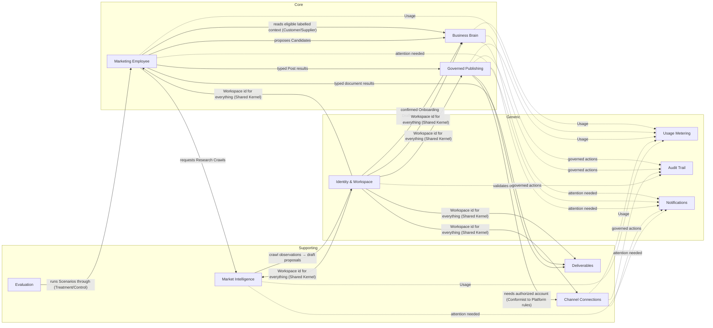

# Bounded Contexts

> Sources: [core/prd.md](../core/prd.md) (PRD v2.0, authoritative), [SYSTEM-ARCHITECTURE.md](../core/SYSTEM-ARCHITECTURE.md) §3.2, [strategy/](../strategy/), and the historical [00-requirements-analysis.md](../research/technical/00-requirements-analysis.md) / [01-constraints.md](../research/technical/01-constraints.md). Vocabulary: [GLOSSARY.md](./GLOSSARY.md).
> Contexts are **language and ownership boundaries**, not deployables. Their mapping onto the four services (D-26) is in SYSTEM-ARCHITECTURE §4.4.

## 1. Classification

| Context | Type | Why this classification | Owns | Key sources |
|---|---|---|---|---|
| **Business Brain** | **Core** | The documented moat: persistent, provenance-labelled business context | Knowledge Items, Relationships, Procedural Rules, Pending Brain Updates (Candidates) and Review, Retirement, Deletion, Conflicts, Context Versions and staleness (FR-48), Provenance, Brand Kit facts | PRD §5.3; D-19–D-25, D-43, D-57 |
| **Marketing Employee** (Director) | **Core** | The product itself: diagnosis, independent Chat, Roadmap Discovery and execution, dynamic specialists, dialect-aware Arabic generation across 4 registers, honest handoffs (FR-49) | Conversations, Quick Replies, Tasks and budgets, Constraint Diagnosis, Clarifications, Sub-agent work, the Canvas feed, Roadmap Drafts, Discovery Questions/Answers, Question Research Links, Roadmaps / Versions / Steps, Step Executions, Owner Attestations, Strategic Revisions | PRD §§4.2–4.3, 5.4–5.6, 5.12–5.13; D-44, D-55, D-59, D-63–D-66, D-68 |
| **Governed Publishing** | **Core** | Approval-governed, verified publishing is a stated differentiator (D-10b, D-16, D-46, D-50) | Posts (incl. undated drafts), Post Versions, Campaign grouping, Approvals, ScheduledTime, Holds, Publish Attempts, reconciliation, Read-back Verification, Review Sessions; Facebook Pages in Phase 2 | PRD §§4.4, 5.8, FR-55, FR-57; D-13, D-50, D-67 |
| **Market Intelligence** | Supporting | Specialized retrieval that serves the core rather than being the product | Onboarding Crawls, Research Crawls, Snapshots, Research Signals, Buyer Vernacular, the 7-day crawl cache | PRD FR-03, FR-24–28; D-32, D-45 |
| **Deliverables** | Supporting | Storage and browsing of non-Post documents | Document Deliverables and immutable versions, Source Citations, Analysis Uploads (CSV / `.xlsx`, requested one-off analysis only), export packages | PRD FR-38–41, FR-57 |
| **Channel Connections** | Supporting | Platform-specific integration with BusMora rules (tester mode for development, AC-30 production gate, lazy connection) | Connected Accounts, authorization state and generation, Reconnect Needed | PRD FR-33, FR-56; D-54 |
| **Evaluation** | Supporting (internal) | Required to prove the product claims; used by the team, not by Users | Scenarios, Evaluation Rounds, Reviewer scores, Treatment and Control runs | PRD §10; EVAL; D-33, D-37, D-38, D-60 |
| **Identity & Workspace** | Generic | Sign-up, login and tenancy, plus initial setup | Users, Auth Identities (email / Google), optional Local Credentials, Workspaces and settings (country, currency, zone, languages), Onboarding Drafts and confirmation, deletion requests | PRD FR-01, FR-04–06, FR-50; D-29, D-61, D-62 |
| **Usage Metering** | Generic | Metering, with no billing in Phase 2 | Usage Records | PRD NFR-06; D-35 |
| **Audit Trail** | Generic | Append-only recording of governed actions | Audit Events | PRD FR-13, NFR-09; D-19 |
| **Notifications** | Generic | In-app messages with exact subject links | Notifications and read state | PRD FR-56 |

## 2. Context map

## 3. Relationships

| Upstream → Downstream | Nature | What flows | Rule |
|---|---|---|---|
| Identity & Workspace → Business Brain | Published event (same transaction) | `OnboardingConfirmed` with the exact confirmed draft | Brain activates only confirmed values, with provenance; unconfirmed drafts are never eligible (FR-04). |
| Market Intelligence → Identity & Workspace | Customer/Supplier | Crawl observations and extracted field proposals | Merged into the editable draft; late extraction never overwrites owner-touched fields. Crawled content is untrusted data, never instructions (NFR-04). |
| Business Brain → Marketing Employee | Customer/Supplier | Current eligible Knowledge Items, Relationships, approved Procedural Rules, Brand Kit, each with its epistemic label | The Director reads only eligible context and never changes it directly; deleted / pending / rejected / superseded data is suppressed (FR-42). |
| Marketing Employee → Business Brain | Published events | Proposed Candidates from Tasks, Conversations, confirmed Discovery answers and edit feedback | AI proposals enter Pending Brain Updates; confirmed owner answers are owner-provided facts (FR-10, FR-52). |
| Marketing Employee → Market Intelligence | Customer/Supplier | Research Crawl requests, bounded by the Task budget | Exceeding the budget pauses for owner approval; otherwise a Partial Result (FR-27). |
| Marketing Employee → Deliverables | Customer/Supplier | Non-Post documents with Source Citations | Every material claim has an inspectable basis (FR-26). |
| Marketing Employee → Governed Publishing | Customer/Supplier | Typed Post results with origin refs | Posts are created directly in Publishing; no document-to-Post copy (FR-57, ADR-023). |
| Governed Publishing → Channel Connections | Conformist | Use of a Connected Account for a Publish Attempt | Platform rules dictate (Facebook Pages in Phase 2). Connection is asked for only when needed. |
| Governed Publishing ↔ Marketing Employee | Separated after Approval | Before Approval, the Director drafts Post Versions. After Approval, no AI involvement. | **No AI after Approval** (ADR-005). |
| Identity & Workspace → all | Shared Kernel | Workspace identity; country, currency, business time zone, language defaults | Everything is workspace-attributable (G2). |
| All → Audit Trail / Usage Metering / Notifications | Published events | Domain events (see [events.md](./events.md)) | Audit Events are append-only with minimal metadata (NFR-09). |
| Evaluation → Marketing Employee | Customer/Supplier (internal) | Seeded Workspaces, Scenario runs in Treatment or Control | Same model and prompts in both configurations (EVAL §5). |

## 4. Boundary rules worth remembering

1. **Review ≠ Approval.** Review is a knowledge decision in the Business Brain. Approval is a publishing decision in Governed Publishing. Roadmap activation and revision approval are a third, separate decision.
2. **Channel ≠ Platform.** "Channel" is a Brain category describing where the Business markets. "Platform" is a destination BusMora can publish to (Facebook Pages in Phase 2).
3. **Snapshot ≠ Post Version.** A Snapshot preserves a crawled page; a Post Version freezes Post content for Approval.
4. **Deliverables are not knowledge, and Posts are not Deliverables.** Facts in a document reach the Brain only as Candidates; social Posts live only in Scheduling.
5. **Done ≠ verified.** Owner-reported completion, verified publication and commercial impact are different facts.
6. **The Canvas is a live, conversation-local view, not a record.** Durable history lives in Tasks, Deliverables, Posts and Audit Events.
