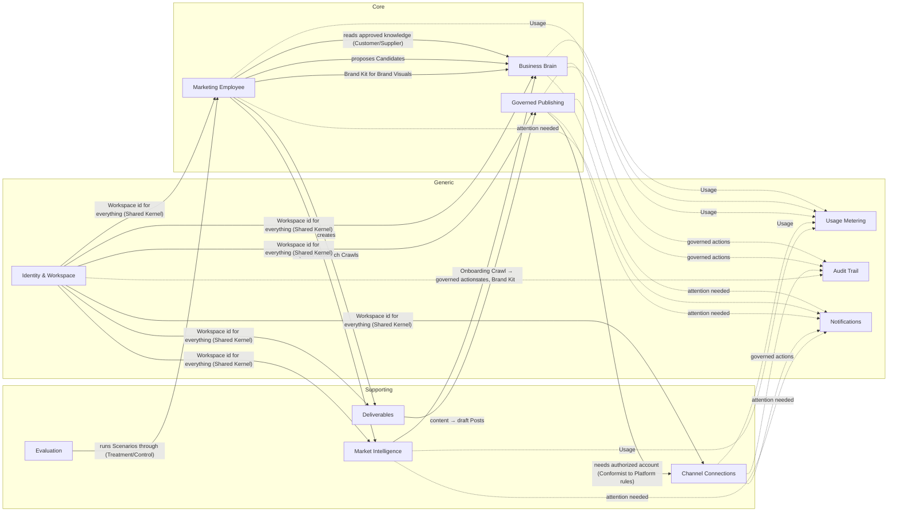

# Bounded Contexts

> Sources: [strategy/](../strategy/) & [core/prd.md](../core/prd.md) (canonical per 01 R-1), [00-requirements-analysis.md](../research/technical/00-requirements-analysis.md) and [01-constraints.md](../research/technical/01-constraints.md). Vocabulary: [GLOSSARY.md](./GLOSSARY.md).
> Contexts are **language and ownership boundaries**, not deployables. How they map onto the four services (D-26) is decided in the architecture step.

## 1. Classification

| Context | Type | Why this classification | Owns | Key sources |
|---|---|---|---|---|
| **Business Brain** | **Core** | The documented moat: "the durable advantage is the Business Brain" (DISC §4); "Brain Moat" pillar | Knowledge Items, Relationships, Procedural Rules, Imported Context, Pending Brain Updates, Candidate Review, Retirement, Conflicts, Context Staleness Holds (FR-48), Provenance, Brand Kit facts | PRD §5.3, §10; D-19–D-25, D-43, D-57; 01 BG-1–BG-7, BA-5 |
| **Marketing Employee** | **Core** | The product itself: AI Marketing Director diagnosis (5 STAR lenses), Now/Next/Later roadmap (FR-16, FR-46), dynamic delegation, dialect-aware Arabic generation across 4 registers, visual briefs, and honest handoffs (FR-49) | Conversations, Quick Replies, Tasks, Constraint Diagnosis, Now/Next/Later Roadmap, Clarifications, Sub-agent work, the Canvas feed, content and visual briefs | PRD §5.4–5.5, §5.9–5.12, §8–9; D-44, D-55, D-59; 01 DL-1–DL-3, RT-1–RT-3 |
| **Governed Publishing** | **Core** | The "Execution Layer" and "Anti-Goodhart" pillars: approval-governed, verified publishing is a stated differentiator (D-10b, D-16, D-46, D-50) | Posts, Post Versions, Review & Approvals, Scheduled Times & Lateness Allowances, Context Holds (FR-48), Publish Attempts, Read-back Verification (Facebook Pages in Phase 2; Instagram/X in Phase 3) | PRD §5.8, FR-33–36; D-13, D-50; 01 PB-1–PB-12 |
| **Market Intelligence** | Supporting | Custom and specialized (intent qualification, D-45), but it serves the core rather than being the product | Onboarding Crawls, Dynamic Multi-Source Research Crawls, Per-Task Research Budgets (FR-27), Snapshots, Research Signals, Buyer Vernacular, the 7-day crawl cache | PRD §5.2, §5.6, FR-24–28; TA §7; 01 RC-1–RC-3, DT-3 |
| **Deliverables** | Supporting | Necessary storage and browsing of finished work; little differentiation | Deliverables and their Source Citations, Performance Reports (CSV and Excel `.xlsx`), Manual Aggregate Observations (FR-38, FR-47) | PRD §5.9–5.10, FR-38–41; 01 DD-1 |
| **Channel Connections** | Supporting | Platform-specific integration work (Meta, X) with BusMora-specific rules (tester model, lazy connection) | Connected Accounts, authorization state, Reconnect Needed | PRD §5.13, §12.2–12.3; 01 EP-1–EP-5, PB-11 |
| **Evaluation** | Supporting (internal) | Required to prove the three product claims; used by the team, not by Users | Scenarios, Evaluation Rounds, Reviewer scores, Treatment and Control runs | EVAL; D-33, D-37, D-38 |
| **Identity & Workspace** | Generic | Standard sign-up, login and tenancy | Users, Workspaces, Business Time Zone, workspace deletion | PRD §5.1; D-29; 01 PB-12, DT-1, DT-4 |
| **Usage Metering** | Generic | Standard metering, with no billing this release | Usage Records | 01 SC-2, SC-3, EP-2 |
| **Audit Trail** | Generic | Append-only recording of governed actions | Audit Events | PRD FR-023, §11.2, AC-21; D-19 |
| **Notifications** | Generic | In-app messages only | Notifications | PRD FR-013, FR-031, §13; 01 RT-4 |

## 2. Context map

## 3. Relationships

| Upstream → Downstream | Nature | What flows | Rule |
|---|---|---|---|
| Business Brain → Marketing Employee | Customer/Supplier | Approved Knowledge Items, Relationships, approved Procedural Rules, Brand Kit | The Employee **only reads approved** knowledge (PRD FR-022, §10.4). It **never changes** approved knowledge (PRD §8.3). |
| Marketing Employee → Business Brain | Published events | Proposed Candidates from Tasks, Conversations and edit feedback | Everything the Employee proposes enters as a Candidate (01 BG-2, BG-5) |
| Market Intelligence → Business Brain | Published events | Onboarding Crawl Candidates, Brand Kit detection, Snapshots for Provenance | Crawled content is untrusted data and never instructions (TA §9.2) |
| Marketing Employee → Market Intelligence | Customer/Supplier | Research Crawl requests, bounded by time and budget | ≤ 5 min and ≤ the task cost ceiling; otherwise a Partial Result (01 SC-10) |
| Marketing Employee → Deliverables | Published events | Finished Deliverables with Source Citations | Every research claim is cited (PRD FR-062) |
| Deliverables → Governed Publishing | Customer/Supplier | Post drafts from Content Packages and Content Calendars | Any social-post content can enter Batch Review; nothing reaches a Platform any other way (01 PB-10) |
| Governed Publishing → Channel Connections | Conformist | Use of a Connected Account for a Publish Attempt | Platform rules dictate (formats, limits, Instagram 50/24h). Lazy connection prompt (01 EP-4, PB-11) |
| Governed Publishing ↔ Marketing Employee | Separated after Approval | Before Approval, the Social Posting Sub-agent prepares Post Versions. After Approval, no Employee involvement. | **No AI after Approval** (01 PB-1) |
| Identity & Workspace → all | Shared Kernel | Workspace identity; Business Time Zone | Everything is workspace-attributable (01 DT-4, G2) |
| All → Audit Trail / Usage Metering / Notifications | Published events | Domain events (see [events.md](./events.md)) | Audit Events are append-only and survive everything except workspace deletion (01 DT-1) |
| Evaluation → Marketing Employee | Customer/Supplier (internal) | Seeded Workspaces, Scenario runs in Treatment or Control | Same model and prompts in both configurations (EVAL §5) |

## 4. Boundary rules worth remembering

1. **Review ≠ Approval.** Review is a knowledge decision in the Business Brain. Approval is a publishing decision in Governed Publishing. They share no lifecycle.
2. **Channel ≠ Platform.** "Channel" is a Brain category describing where the Business markets, which may include channels BusMora cannot publish to. "Platform" is a publishing destination BusMora supports.
3. **Snapshot ≠ Post Version.** A Snapshot preserves a crawled page; a Post Version freezes Post content for Approval.
4. **Deliverables are not knowledge.** A Competitor Analysis is a Deliverable. Facts it contains reach the Brain only as Candidates.
5. **The Canvas is a live view, not a record.** It is fed by the Marketing Employee during a run (01 RT-1). Durable history lives in Tasks, Deliverables and Audit Events.
