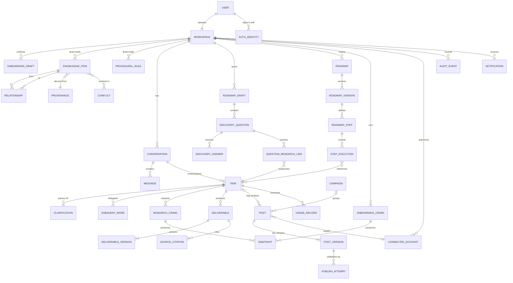
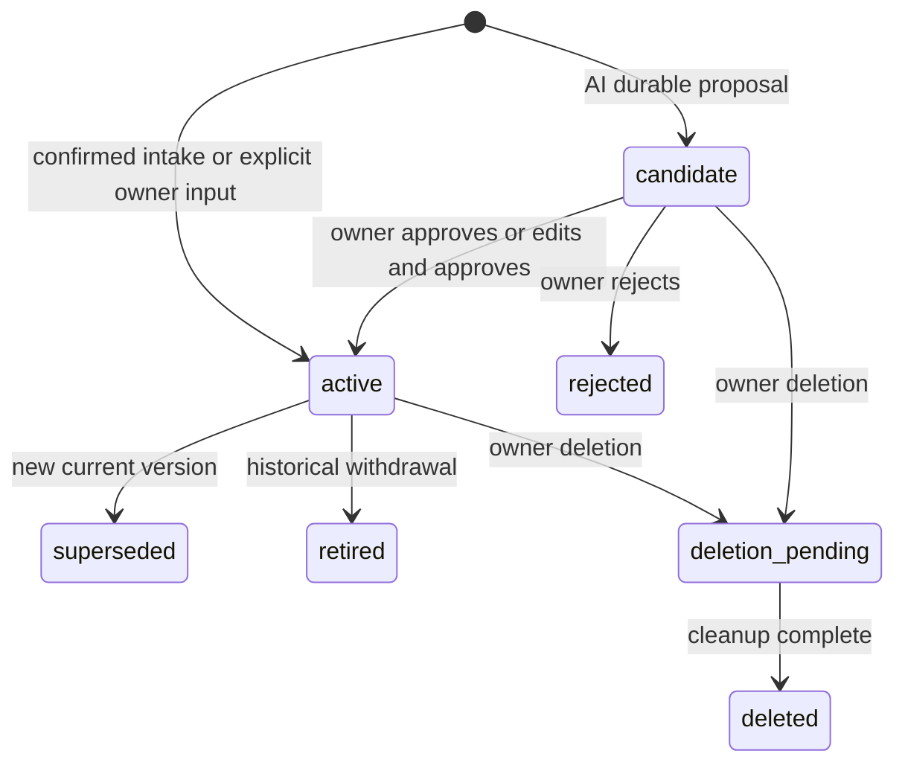
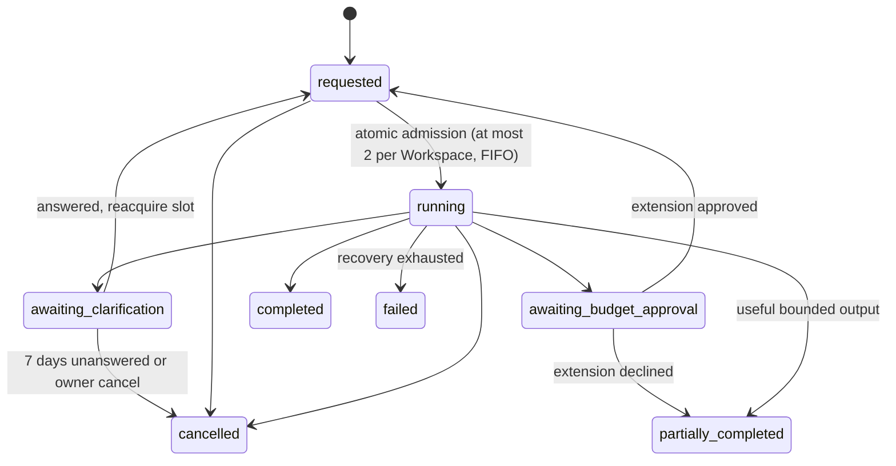
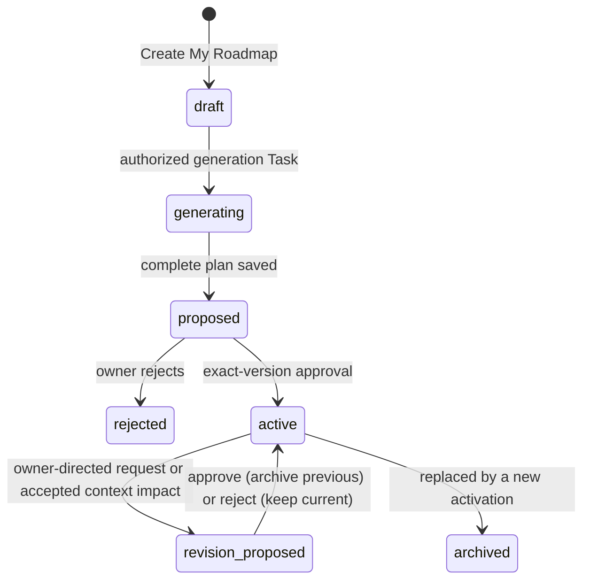
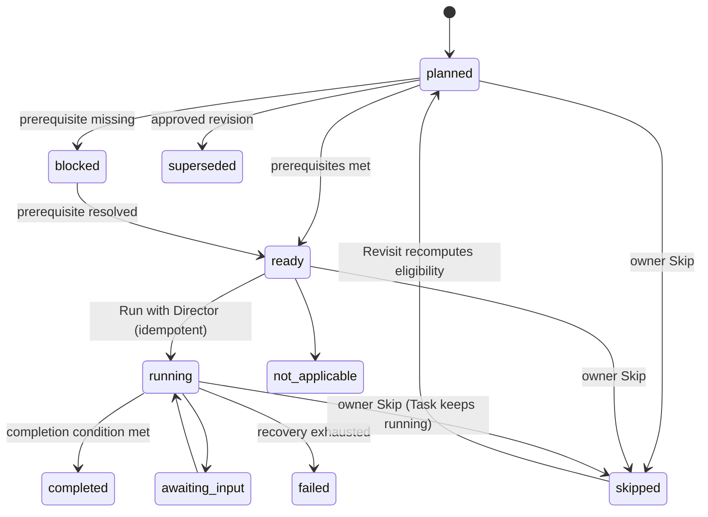
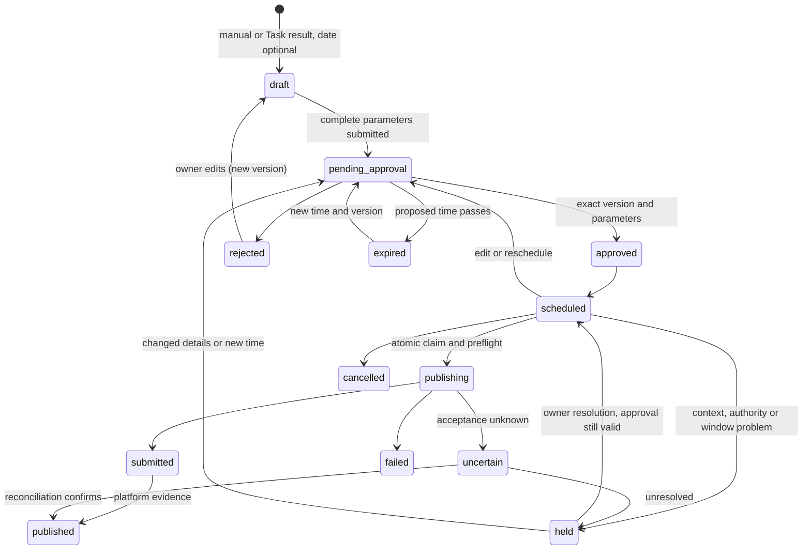

# Core Entities & Relationships

> A conceptual domain model, not a database schema. Attributes listed are the ones the docs make meaningful; types and storage are defined in [BACKEND-TECHNICAL-DESIGN.md](../core/BACKEND-TECHNICAL-DESIGN.md) §6.
> Aligned with [PRD v2.0](../core/prd.md). Authoritative state machines live in [SYSTEM-ARCHITECTURE.md](../core/SYSTEM-ARCHITECTURE.md) §3.4; this file summarizes them.
> Every entity below belongs to exactly one Workspace (01 DT-4, G2). That ownership is implied and not repeated on each line.
> Terms: [GLOSSARY.md](./GLOSSARY.md). Contexts: [contexts.md](./contexts.md).

## 1. Overview

Relationships are logical references, not cross-module foreign keys. A manual Post needs no Task or Deliverable; documents never auto-create Posts.

## 2. Entities by context

### Identity & Workspace

| Entity | Meaning | Key attributes | Invariants |
|---|---|---|---|
| **User** | The single person operating a Workspace | email (verified), optional Local Credential (Argon2id), preferred UI language | Exactly one primary owner per Workspace in Phase 2 (FR-01). Google-only Users have no password. |
| **Auth Identity** | A sign-in identity for the User | provider, issuer, subject, provider email (metadata only) | Unique by issuer + subject. Matching email never links accounts; linking needs sign-in, recent reauthentication and explicit intent (FR-50). |
| **Workspace** | The Business's isolated space; aggregate root of tenancy | country, currency, IANA business time zone, independent UI / conversation / content language defaults, status (active / deletion requested / deleted) | Created at registration with no business facts. Deletion follows the data-control policy (FR-13, NFR-09). |
| **Onboarding Draft** | The editable essential-intake form | source (website / manual), version, status (editing / extracting / ready for confirmation / confirmed), Business Information fields, per-field provenance | Website and manual paths use the same form. Nothing in it is Brain knowledge until the owner confirms that exact version (FR-04, FR-06). |
| **Business Information** (value) | The five essential groups | name, description, one or more Offerings, country / service area, conversion route state (ready + routes, or not ready) | Offering pricing model ∈ {fixed, starting from, quote required, unknown}; an amount is optional and requires a currency; missing price is never zero (AC-33). |

### Business Brain

| Entity | Meaning | Key attributes | Invariants |
|---|---|---|---|
| **Knowledge Item** (aggregate root) | One business observation, claim, hypothesis or decision | Knowledge Category (one of 9), title, summary, structured properties, kind, Epistemic Status (Observation, Owner Claim, Hypothesis, Decision), lifecycle, Provenance, freshness, version history | Lifecycle ∈ {active, candidate, rejected, superseded, retired, deletion pending, deleted}. Confirmed intake and explicit owner input start active; AI-proposed durable facts start as Candidates (Pending Brain Update). Only current eligible items participate in retrieval. Owner deletion is real deletion, distinct from Retirement (FR-09, FR-10, FR-13). |
| **Relationship** | Typed, directed link between two Knowledge Items | type ∈ {targets, competes with, has tone, solves pain point, related to}, weight, status | Both ends belong to the same Workspace; retrieval requires eligible endpoints and edge. |
| **Procedural Rule** (aggregate root) | A reviewed instruction on *how* to work for this Business | rule text, scope (e.g. a Dialect, a Platform), origin (edit diff, feedback), status | Starts as a Candidate and must be approved before it influences generation (01 BG-5). |
| **Provenance** (value) | Where an item came from | source type ∈ {Onboarding Draft confirmation, Task, Conversation, Discovery answer, owner input}, Snapshot or Task reference, captured-at | Every Knowledge Item has one. Confirmation is not independent verification. |
| **Conflict** | Two items that cannot both be true | the items involved, detected-at, resolution (open / resolved by the User) | Never resolved automatically; reimports reveal conflicts rather than overwrite decisions. |
| **Context Version** | The version of decision-critical context a piece of work used | changed item, dependent Tasks / documents / Posts | A material change (offer, price, audience, service area, claim support) flags dependent work and holds only conflicting scheduled Posts (FR-48). |
| **Brand Kit** (view over Knowledge Items) | Logo, colors, typography, tone cues | detected or not-detected per element | Detected from the website or supplied by the owner; neutral fallbacks never block work. |

### Marketing Employee (Director)

| Entity | Meaning | Key attributes | Invariants |
|---|---|---|---|
| **Conversation** (aggregate root) | The ongoing exchange between the User and the Director | Messages (eight baseline kinds plus `post_reference`), origin (direct / wizard question / roadmap step), language | Persisted in full. Every Task has a non-null conversation (FR-57). |
| **Task** (aggregate root) | One unit of requested marketing work | origin, type, request, Constraint Diagnosis, plan, status, budget, cost so far | Status ∈ {requested, running, awaiting clarification, awaiting budget approval, completed, partially completed, failed, cancelled}. At most 2 running per Workspace; paused Tasks release their slot and reacquire it FIFO. Survives restarts (FR-23, FR-53). |
| **Task Budget / Resource Reservation** | The authorized resource allowance of a Task | time, tokens, tool calls, paid-source allowance, cost ceiling; reserved / settled usage | Children and retries share the parent allowance; any increase needs explicit owner approval (FR-27). |
| **Clarification** | A pause asking the User for missing information | choice-first form fields, per-field "Research this", answers, asked-at, expires-at (asked-at + 7 days) | Answers return the Task to requested. Expiry cancels it with a Notification. Durable facts in answers become Candidates. |
| **Sub-agent Work** | One delegation from the Orchestrator to a specialist | specialist, input summary, result summary, status, user-visible tool labels | Specialists never talk to each other directly. Only recorded work appears on the Canvas. |
| **Quick Reply** (value on a Message) | A direct answer with no Task | — | Starts no specialist work (FR-19). |
| **Roadmap Draft** | Saved, resumable Discovery | goal, constraints, current question, status ∈ {draft, generating, proposed, archived} | Survives browser closure; locked while generating (FR-51). |
| **Discovery Question / Answer** | One adaptive question and its versioned answers | question version, reason; answer status ∈ {unanswered, answered, skipped, unknown, not applicable, researching, confirmed}, provenance | Skip / Unknown / Not Applicable never become positive facts. |
| **Question Research Link** | Durable link from a question to its research Task | draft, question version, conversation, Task, selected result, status | Backend-validated; only this link enables "Use in Roadmap" (FR-52). |
| **Roadmap** (aggregate root) | The owner's complete step plan | status ∈ {proposed, active, archived, rejected}, immutable versions | Exactly one active Roadmap per Workspace, enforced atomically (FR-54). |
| **Roadmap Step** | One executable step in a Roadmap Version | title, objective, rationale / evidence / uncertainty, responsible party, execution mode ∈ {analysis draft, connected execution, owner execution, blocked, later phase}, inputs, dependencies, expected output, completion condition, effort | Order is a recommendation; only real dependencies block. No Now/Next/Later or horizon property (FR-46, AC-57). |
| **Step Execution** | What actually happened to a step | work state, platform action state, Owner Attestation, Task / document / Post refs | Work state, platform action and owner-reported completion are independent. Skip is not completion or cancellation (FR-53). |
| **Strategic Revision** | A proposed diff to the active Roadmap | base version, added / modified / removed-or-superseded / dependency changes, rationale, status ∈ {proposed, approved, rejected, superseded} | Applies only after exact-version owner approval; rejection keeps the active plan; never authorizes publishing or spend. |

### Market Intelligence

| Entity | Meaning | Key attributes | Invariants |
|---|---|---|---|
| **Onboarding Crawl** | First bounded read of the Business's website | URL, pages crawled (provisional ≤ 10 relevant pages), progress, outcome (complete / partial / failed) | Provisional ≤ 5 min; respects robots.txt; one at a time per Workspace. Results only prefill the Onboarding Draft. |
| **Research Crawl** | Material gathered for a Task | sources tried and skipped, items gathered, Research Signals, resources spent | Bounded by the Task's budget. Unreferenced raw data has a provisional 7-day retention. |
| **Snapshot** | Preserved copy of a crawled page | URL, platform, captured-at | Kept while legitimately referenced, unless the owner deletes the supported content. |
| **Research Signal** (value) | Crawled material showing buyer intent | intent score, phrases (Buyer Vernacular, original wording), source, date | Public comments are sampled observations, not survey results (FR-25). |

### Deliverables

| Entity | Meaning | Key attributes | Invariants |
|---|---|---|---|
| **Deliverable** (aggregate root) | A non-Post document kept in the Workspace | type (research report, competitor analysis, audience research, strategy, positioning, campaign plan, brief, visual brief, content strategy, analysis report, general), title, origin refs (Task / conversation / step / campaign), context, sources, assumptions, limitations | Each edit creates a new immutable Deliverable Version of the same document. Social Posts are never Deliverables (FR-41, FR-57). |
| **Source Citation** (value) | Reference behind a claim | URL, platform, accessed / published date | A citation must actually support its claim (FR-26). |
| **Analysis Upload** | A CSV or `.xlsx` file attached to an explicit Chat request | file, template mapping, period, units / currency, validation outcome | Formulas and macros never execute; deterministic code computes supported metrics; unknown is not zero. Produces a one-off analysis document only (FR-38–40). |

### Governed Publishing

| Entity | Meaning | Key attributes | Invariants |
|---|---|---|---|
| **Post** (aggregate root) | One piece of social content | target Connected Account (optional until review), ScheduledTime (`{ instant, zone, latenessAllowanceMinutes }`) or `null` for an Unscheduled draft, status, current Post Version, origin ∈ {direct chat, wizard research, roadmap step, manual}, campaign ref | Status ∈ {draft, pending approval, approved, rejected, scheduled, held, publishing, submitted, uncertain, published, failed, cancelled, expired}. Lives only in Scheduling. |
| **Campaign** | A grouping of related Posts and documents | name, Task / step refs | Groups without duplicating Post content. |
| **Post Version** | An unchangeable state of the Post's content | text / link, validated owner media ref, exact destination, ScheduledTime, created-by, created-at | Any approval-critical edit or reschedule creates a new version and clears approval. |
| **Approval** (value on Post Version) | The User's consent to publish one Post Version | version, destination, ScheduledTime, authorization generation, approved-at | Required before any Publish Attempt; dispatch rechecks it immediately before sending (FR-34–35). |
| **Publish Attempt** | One try at going live | idempotency key, started-at, outcome (submitted / published / failed / uncertain + platform reason), platform post id and URL, read-back result | Recorded before dispatch. Uncertain outcomes are reconciled or held, never blindly resent (FR-36). |
| **Review Session** | One Batch Review sitting | opened / closed at, decided Posts | Measured on the server for evaluation; not a performance review. |

### Channel Connections

| Entity | Meaning | Key attributes | Invariants |
|---|---|---|---|
| **Connected Account** (aggregate root) | The Business's account on a Platform, authorized for BusMora | Platform ∈ {Facebook Page (Phase 2); Instagram Business, X (Phase 3)}, platform account id, status (connected / reconnect needed / disconnected), authorization generation, protected credential | Connected only when needed. Disconnect advances the generation and blocks future sends; reconnect never releases overdue or uncertain work (FR-56, AC-54). |

### Usage, Audit & Notifications

| Entity | Meaning | Key attributes | Invariants |
|---|---|---|---|
| **Usage Record** | Measured use of a costly resource | resource kind (model tokens, search, crawl/proxy, platform call), quantity, estimated cost, Task | Every costly action records one, including failed and retried calls (NFR-06). |
| **Audit Event** | Unalterable record of a governed action | action, actor (User / Director / system), subject, at | Append-only; keeps minimal metadata, never copies deleted content (NFR-09). |
| **Notification** | In-app attention message | kind, exact subject link, read / unread | Read state grants no approval; deleted subjects show unavailable. No retry notifications (FR-56). |

### Evaluation (internal)

| Entity | Meaning | Key attributes | Invariants |
|---|---|---|---|
| **Scenario** | Fixed authored business case | category, contrast pair, seeded Workspace, request, rubric dimensions, held-out flag | Held-out cases are never used for prompt tuning; synthetic fixtures never count as customer evidence (PRD §10.1). |
| **Evaluation Round** | One full scoring pass | Scenarios run in Treatment and Control, Reviewer scores, disagreements, tie-breaks | Two Reviewers per output, a third breaks ties; blind to configuration. |

## 3. Lifecycles (summary)

### Knowledge Item

### Task

### Roadmap

### Roadmap Step

### Post

