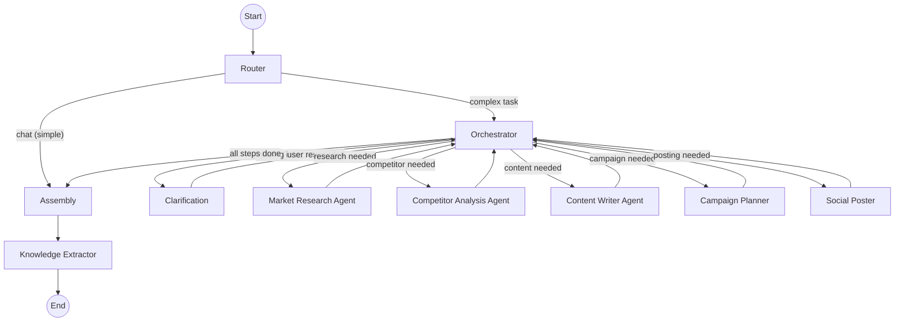

# Technical Architecture Document

## BusMora: AI Marketing Employee Platform

> Version 2.0 — October 2026
> Prerequisite: Read [PRD](./prd.md) and [MVP Definition](./mvp-definition.md) first.

---

## Table of Contents

1. [Architecture Overview](#1-architecture-overview)
2. [System Components](#2-system-components)
3. [Technology Stack](#3-technology-stack)
4. [Service Architecture](#4-service-architecture)
5. [Data Architecture](#5-data-architecture)
6. [AI Agent Architecture](#6-ai-agent-architecture)
7. [Crawling Engine](#7-crawling-engine)
8. [Real-Time Visualization Pipeline](#8-real-time-visualization-pipeline)
9. [Authentication & Security](#9-authentication--security)
10. [Deployment & Infrastructure](#10-deployment--infrastructure)
11. [Inter-Service Communication](#11-inter-service-communication)
12. [Team Structure & Development Workflow](#12-team-structure--development-workflow)
13. [Production Hardening Guidelines](#13-production-hardening-guidelines)

---

## 1. Architecture Overview

### 1.1 High-Level Architecture

```
┌─────────────────────────────────────────────────────────────────────┐
│                         USER (Browser)                              │
│  ┌──────────┐ ┌──────────┐ ┌──────────────┐ ┌──────────┐           │
│  │ Chat UI  │ │  Brain   │ │ Deliverables │ │ Settings │           │
│  │ + Canvas │ │  Graph   │ │   Browser    │ │ + OAuth  │           │
│  └────┬─────┘ └────┬─────┘ └──────┬───────┘ └────┬─────┘           │
│       └────────────┴──────────────┴──────────────┘                  │
│                       Next.js (RTL)                                 │
└───────────────────────────────┬─────────────────────────────────────┘
                                │ HTTPS + SSE
                                ▼
┌───────────────────────────────────────────────────────────────────────┐
│                    PLATFORM SERVICE — busmora-api (NestJS)           │
│  Auth (Argon2id + JWT + Redis refresh) · Workspaces · Brain CRUD      │
│  Tasks · Deliverables · OAuth callbacks · SSE Gateway · Rate limiting │
└───────────────────────────────┬───────────────────────────────────────┘
                                │ Temporal Client
                                ▼
┌───────────────────────────────────────────────────────────────────────┐
│                    TEMPORAL CLOUD (Durable Workflows)                 │
│   TaskExecutionWorkflow · OnboardingWorkflow · Signals · Timers       │
└───────────────────────────────┬───────────────────────────────────────┘
                                │ Activities
                                ▼
┌───────────────────────────────────────────────────────────────────────┐
│              WORKER + AI SERVICE — busmora-workers / busmora-ai       │
│  ┌───────────────────────────────────────────────────┐               │
│  │                LangGraph Engine                    │               │
│  │  Router → Orchestrator → Sub-Agents → Assembly     │               │
│  │  Knowledge Extractor · Event Emitter               │               │
│  └───────────────────────────────────────────────────┘               │
│  Scrapling crawlers · PDF/CSV parsing · LiteLLM · KMS vault           │
│  MCP Server (Social Publishing)                                       │
└───────┬──────────────┬──────────────┬──────────────┬─────────────────┘
        ▼              ▼              ▼              ▼
  ┌──────────┐   ┌──────────┐   ┌──────────┐   ┌──────────────┐
  │PostgreSQL│   │  Qdrant  │   │  Redis   │   │Object Storage│
  │relational│   │ vectors  │   │ streams  │   │ snapshots +  │
  │+ graph  │   │          │   │ + cache  │   │ images       │
  └──────────┘   └──────────┘   └──────────┘   └──────────────┘
```

### 1.2 Design Principles

| Principle | Application |
|---|---|
| **One release, full scope** | Interfaces and schemas support the entire product from day one. |
| **Autonomous Execution Layer** | Architecture turns strategic decisions into end-to-end completed workflows (research → copy → visual composite → schedule → verified publishing) with zero manual handoffs across external tools. |
| **Temporal for durability, LangGraph for intelligence** | Temporal owns the durable business workflow and approval signals; LangGraph owns fast AI reasoning. Clean boundary. |
| **Anti-Amnesia Knowledge Grounding** | All agent reasoning loops are strictly grounded via two-stage retrieval (Qdrant vector seed + PostgreSQL graph expansion) from the Business Brain, eliminating blank-slate context loss. |
| **Fast Human-in-the-Loop Governance** | Batch approval gates are asynchronous and optimized for rapid (<15 min) human review, eliminating the babysitting burden while guaranteeing zero unapproved external writes. |
| **Hybrid backend** | NestJS owns the user-facing API; FastAPI owns AI workloads. Communication via Temporal activities. |
| **Multi-tenant by default** | Every query includes `workspace_id`. Qdrant uses payload filtering; PostgreSQL uses foreign keys. |
| **Observable agents** | Every agent step emits events for the canvas via Redis SSE. No black boxes. |
| **Domain-neutral foundations** | Employee, Capability, Workflow, Integration, and Task Record are generic, enabling a future Employee without redesign. |

---

## 2. System Components

| Component | Technology | Responsibility |
|---|---|---|
| **Frontend** | Next.js + React Flow | Chat UI, Canvas, Brain graph, Deliverables, Settings (RTL) |
| **Platform Service** | NestJS (TypeScript) | Auth, Workspaces, REST API, SSE Gateway, OAuth callbacks |
| **AI Service** | FastAPI (Python) | LangGraph, sub-agents, crawling, LiteLLM, knowledge extraction |
| **Worker Service** | Python + Temporal SDK | Durable workflows, signal handling, scheduling, idempotent execution |
| **Workflow Engine** | Temporal Cloud | Durable workflows, signals, timers, retries |
| **Relational DB** | PostgreSQL | Users, Workspaces, Brain nodes/edges, Tasks, Deliverables, Audit |
| **Vector DB** | Qdrant | Brain embeddings, semantic search |
| **Event Bus** | Redis | Streams for the canvas, caching |
| **Object Storage** | S3-compatible | Crawl snapshots, uploaded CSVs, generated images |
| **Crawling Engine** | Scrapling | Website and platform data gathering |
| **LLM Router** | LiteLLM | Multi-provider model routing and abstraction |
| **Credential Vault** | Cloud KMS | Envelope encryption of OAuth tokens |
| **MCP Server** | FastAPI (Python) | Social publishing tools (FB, IG, X) |
| **Observability** | Langfuse | LLM tracing, cost, and latency |

---

## 3. Technology Stack

### 3.1 Complete Stack

```
Frontend (busmora-web):
├── Next.js 14+ (App Router)
├── TypeScript
├── React Flow (Canvas + Brain graph)
├── Tailwind CSS / shadcn/ui
├── SSE client (Last-Event-ID reconnects)
└── React Query / SWR

Platform Service (busmora-api):
├── NestJS 10+ with TypeScript
├── Passport.js + JWT Strategy
├── Drizzle ORM (PostgreSQL)
├── SSE Gateway (Redis Streams subscriber)
├── Temporal TypeScript SDK (Workflow Client)
├── ioredis
└── Class-validator + Swagger

Worker + AI Service (busmora-workers / busmora-ai):
├── Python 3.11+
├── FastAPI + Uvicorn
├── LangGraph (agent orchestration)
├── LiteLLM (multi-provider LLM router)
├── Scrapling (web crawling)
├── Temporal Python SDK (Activity Worker)
├── Qdrant Client
├── SQLAlchemy / asyncpg
├── Pydantic v2 (structured outputs)
└── MCP SDK (social publishing)

Data & Infrastructure:
├── PostgreSQL 16+
├── Qdrant
├── Redis 7+
├── Temporal Cloud
├── Cloud KMS
├── S3-compatible object storage
└── Docker Compose (local development)
```

### 3.2 LLM Model Allocation

| Layer | Use Cases | Selection Criteria |
|---|---|---|
| **Light** | Router classification, knowledge extraction, page summarization, candidate generation | Low latency and low cost per call |
| **Heavy** | Orchestrator planning, content writing, competitor analysis, research synthesis | High reasoning and Arabic generation quality |

Models are routed through **LiteLLM**, so the specific provider can be swapped without code changes. The primary heavy model is chosen by an **Arabic-quality bake-off** against the project's rubric, with a configured fallback provider.

---

## 4. Service Architecture

### 4.1 Platform Service (busmora-api — NestJS)

The core application API, business management layer, and real-time coordinator.

**Functional domains:**
- **Authentication & User Management:** Registration, login, secure sessions, workspace membership.
- **Workspace Administration:** Multi-tenant workspaces, configuration, crawl triggering.
- **Business Brain Management:** Viewing, editing, and manually curating concept nodes and relationships; candidate review; provenance and audit.
- **Task & Deliverable Management:** Initiating tasks, dispatching durable workflows via Temporal, serving deliverables.
- **Approval & Publishing Coordination:** Approval state machine records, scheduling signals, per-post status.
- **OAuth Callbacks:** Provider consent handling and token storage (encrypted via KMS).
- **Real-Time SSE Gateway:** Subscribing to Redis Streams and forwarding execution events to the client canvas, with `Last-Event-ID` replay.

### 4.2 Worker Service (busmora-workers — Python + Temporal)

Durable orchestration and external execution.

**Functional domains:**
- **Durable Workflows:** `TaskExecutionWorkflow`, `OnboardingWorkflow`.
- **Signals:** approve, revise, cancel, oauth_connected.
- **Timers:** deferred scheduling, approval expiration.
- **Idempotency:** pre-dispatch execution locks.
- **Social Publishing MCP Adapter:** dispatch and read-back verification.

### 4.3 AI Service (busmora-ai — FastAPI)

Cognitive agent workloads, crawling, and LLM integration.

**Functional domains:**
- **Agent Orchestration Engine:** LangGraph state machines for planning, clarification, research, and content generation.
- **Specialized Marketing Sub-Agents:** Market Research, Competitor Analysis, Content Writer, Campaign Planner, Social Poster.
- **Crawling & Scraping Tools:** Data collection from company sites and social platforms.
- **Unified LLM Routing:** LiteLLM abstraction with provider fallback and cost tracking.
- **Knowledge Extraction:** Post-task candidate generation.
- **Real-Time Event Publishing:** Emitting granular agent state transitions and tool invocations to Redis Streams.

---

## 5. Data Architecture

BusMora combines relational structure for business integrity and graph relationships with vector embeddings for semantic retrieval.

### 5.1 Relational Storage (PostgreSQL)

The relational database is the single source of truth for structured state and the knowledge graph.

**Core domain entities:**
- **Users & Workspaces:** Root identities and tenant boundaries. All business data is partitioned by workspace.
- **Business Brain (Concept Graph & Dual-Memory Architecture):**
  - *Semantic Memory (Concept Nodes & Edges):*
    - *Concept Nodes (`brain_nodes`):* Canonical entities such as Company Profile, Offering, Audience, Brand Rule, Positioning, Strategic Goal, Channel, Competitor, Company Fact. Fields include `id`, `category`, `title`, `summary`, `properties` (JSONB), `status` (`candidate` | `approved` | `rejected` | `retired`), `source`, `source_detail`, and provenance/freshness metadata.
    - *Semantic Relationships (`brain_edges`):* directed, typed edges such as `TARGETS`, `COMPETES_WITH`, `HAS_TONE`, `SOLVES_PAIN_POINT`, `RELATED_TO`. Fields include `id`, `source_node_id`, `target_node_id`, `relation_type`, `weight`, `created_at`.
  - *Procedural Memory (Workflow & Calibration Store):*
    - *Procedural Records (`brain_procedural_rules`):* stores persistent execution guidelines derived from human edits, approved post styles, dialect register calibrations (e.g., Egyptian conversational vs Gulf lifestyle), and post-task reviews. Eliminates recurring stylistic mistakes across tasks.
- **Marketing Tasks:** Asynchronous job records with prompts, task types, execution status, and workflow identifiers.
- **Deliverables:** Structured outputs (reports, post copy, calendars, diagnoses).
- **Conversations & Messages:** Chat history with clarification forms and task context.
- **Approval Actions & Execution Attempts:** Immutable snapshots of proposed external actions and their idempotent dispatch records.
- **Connected Platforms:** Encrypted OAuth credentials and metadata for external social accounts.
- **Source Documents:** Provenance records linking canonical knowledge to raw sources in object storage.
- **Audit Events:** Append-only governance trail (knowledge promotions, approvals, dispatches, OAuth changes).

### 5.2 Vector Search (Qdrant)

Qdrant provides vector similarity search across Business Brain concept nodes.

- **Semantic Indexing:** Concept nodes are embedded so agents retrieve company knowledge by meaning.
- **Tenant Partitioning:** All vector searches enforce payload filtering by `workspace_id` and `status`.
- **Filtered Index:** Indexed on `workspace_id` and `status` for low-latency multi-tenant retrieval.

### 5.3 Object Storage

Raw evidence and binary assets are stored in S3-compatible object storage, partitioned deterministically:

`s3://busmora-sources/{workspace_id}/{source_type}/{timestamp}_{filename}`

- **Crawl snapshots** (HTML) for provenance.
- **Uploaded CSVs** for performance interpretation.
- **Generated images** exposed via signed public URLs for platform publishing.

### 5.4 Hybrid Knowledge Retrieval (Two-Stage + Control)

1. **Semantic Seed (Qdrant):** The query embedding retrieves the top-k most relevant approved concept nodes.
2. **Relational Expansion (PostgreSQL):** A SQL traversal fetches neighbor nodes within 1–2 hops via `brain_edges` (for example, a Product's Target Audience, Brand Voice, and direct Competitors).
3. **Context Assembly:** Seed nodes, neighbors, and edge labels are assembled into a bounded structured context block (with a token ceiling) injected into agent prompts.
4. **Control Route:** A parallel document-only retrieval path (chunked raw sources in Qdrant, without graph extraction) supports the Brain value measurement described in [evaluation.md](./evaluation.md).

---

## 6. AI Agent Architecture

BusMora models marketing operations as an observable, multi-agent system built on LangGraph.

### 6.1 Stateful Execution

- **Shared Workflow State:** task identity and tenancy, conversation history, grounded Brain context, execution plan and subtasks, intermediate findings, final deliverables, and extracted knowledge candidates.
- **Durable Checkpointing:** state is persisted at each transition, enabling reliable pause-and-resume for clarification and failure recovery.

### 6.2 Agent Topology & Roles

- **Router:** classifies simple conversational questions vs. complex marketing tasks.
- **Orchestrator (Gen-3 Bottleneck Diagnosis & Allocation):** 
  - Diagnoses the primary commercial constraint (e.g. discoverability vs. positioning vs. conversion) against the Business Brain before allocating work.
  - Plans multi-step execution, delegates to sub-agents, and verifies goals are met.
  - Implements **Anti-Goodhart Guardrails**: anchors execution strictly to verified business goals (e.g. qualified reach, authentic brand trust) rather than superficial vanity proxies (e.g. cheap random clicks).
- **Clarification Loop:** pauses execution to request structured user input before resuming.
- **Specialized Sub-Agents:** Market Research, Competitor Analysis, Content Writer, Campaign Planner, Social Poster.
- **Assembly & Synthesis:** combines outputs into a structured deliverable.
- **Knowledge Extractor:** inspects completed tasks to propose new Brain candidates (updating both Semantic and Procedural memory).

### 6.3 Graph Flow



### 6.4 Inter-Agent Communication

- Sub-agents do not communicate directly with each other.
- All communication flows through the Orchestrator, which passes relevant output between agents.
- Each sub-agent is scoped strictly to its own tools (for example, copywriters do not receive crawler tools).

---

## 7. Crawling Engine

The Crawling Engine ingests live external data to ground agents in current market realities.

### 7.1 Architecture

```
Crawling Request (Agent Tool)
    │
    ▼
┌─────────────────────────────────────┐
│          Scrapling Engine           │
│  - Stealth navigation / anti-bot    │
│  - Adaptive content extraction      │
│  - Proxy rotation & rate limiting   │
│  - Pooled headless browsers         │
└─────────────────────────────────────┘
    │
    ▼
Raw Content Sanitization (strip HTML, scripts, styles)
    │
    ▼
Intent Qualification Pipeline (Qualifier Filter)
    │
    ▼
Clean, Scored Markdown Context → Passed to Agent
```

### 7.2 Data Sources

- **Company Website:** product pages, pricing, FAQs, and company info to bootstrap the Brain.
- **Consumer Discussions (Reddit & Niche Forums):** real user sentiment, complaints, and community pain points.
- **Video & Engagement Platforms (YouTube):** audience discussions and recurring questions.
- **Competitor Ad Intelligence (Facebook Ads Library):** active competitor hooks, creative formats, and promotions.
- **Competitor Websites:** messaging, positioning, and feature sets.

### 7.3 Operational Guidelines

- **Anti-Bot Navigation:** stealth fetching (Scrapling) to navigate modern web protections.
- **Content Quarantine:** sanitize and isolate untrusted web text from agent instructions.
- **Rate Limiting & Cooldown:** domain-level rate limiting and caching to protect target servers and avoid IP blocking.
- **Proxy Pool:** rotating proxies for platform scraping.
- **Browser Pool:** a bounded pool of headless browser instances to control memory use.

### 7.4 Intent Qualification Pipeline (Social Data Mining)

Raw crawling returns high noise. The Market Research Agent applies a multi-stage intent qualification filter inspired by production Reddit mining patterns:

1. **Monitor Node:** extracts recent posts and discussions containing target keywords and competitor mentions.
2. **Qualifier Node:** a fast, lightweight classifier (LLM/rule-based) scores purchase and pain signals (0–100):
   * *High Intent:* Competitor complaint threads ("alternatives to X", "tired of Y's price"), explicit recommendations ("best tool for Z"), and price inquiries.
   * *Low Intent:* Generic chatter and memes (filtered out).
3. **Context Enrichment:** high-intent phrases and authentic user vernacular are extracted directly into the Content Writer context, ensuring campaign copy mirrors the exact vocabulary real buyers use in their communities.

---

## 8. Real-Time Visualization Pipeline

Deep research workflows run in tens of seconds to minutes, so the platform provides full real-time transparency via the Canvas.

### 8.1 Pipeline Flow

```
Agent Execution (busmora-ai)
    │  (emits lifecycle events on node transition / tool call)
    ▼
Redis Streams (event bus, keyed by task_id)
    │
    ▼
busmora-api SSE Gateway
    │  (authenticated push; supports Last-Event-ID replay)
    ▼
React Flow Canvas (frontend)
    │  (animates active agent, highlights path, shows live tool label)
```

### 8.2 Principles

- **Event-Driven Visibility:** nodes and tools emit status events at every execution boundary.
- **Decoupled Messaging:** Redis Streams decouple AI workers from client connections; the AI service holds no client state.
- **Reconnectable Streaming:** each event carries an incrementing ID; clients reconnect with `Last-Event-ID` and missed events are replayed from the stream buffer without interrupting the running workflow.
- **Interactive UI Feedback:** the canvas translates events into node state changes (idle, active, complete), animated edges, and progress indicators.

---

## 9. Authentication & Security

### 9.1 Authentication & Tenancy

- **Password Security:** Argon2id hashing with salt.
- **Session Tokens:** short-lived JWT access tokens carrying `user_id` and active `workspace_id`.
- **Refresh Tokens:** cryptographically random refresh tokens in Redis with rotation on use.
- **Tenant Isolation:** every request is authenticated and mapped to a workspace; cross-workspace access is forbidden across relational, vector, and object storage.

### 9.2 Prompt Injection Defense

Because agents process untrusted crawled text, the system implements defensive safeguards:

- **Sanitization:** strip executable scripts, styling, and navigation markup before external text reaches a model.
- **Quarantine Boundaries:** encapsulate scraped content within explicit data boundaries in the prompt context.
- **Instructional Guardrails:** system instructions direct the model to treat quarantined content as passive reference data, never as instructions.

### 9.3 Credential Security

- **KMS Envelope Encryption:** OAuth access and refresh tokens are encrypted using cloud KMS envelope encryption with a Workspace Encryption Context (`{ workspace_id, integration_id, credential_version }`).
- **Ephemeral In-Memory Use:** plaintext tokens are decrypted only in memory during active calls and never written to logs or traces.
- **SSRF Protection:** target scraping domains are validated against private IP ranges before fetching.

---

## 10. Deployment & Infrastructure

### 10.1 Container Architecture

All services run as independent containers orchestrated locally via Docker Compose:

- **Application Services:** `busmora-web` (Next.js), `busmora-api` (NestJS), and `busmora-workers`/`busmora-ai` (Python).
- **Data Stores:** PostgreSQL (relational + graph), Qdrant (vector), Redis (streams/cache), and object storage.
- **Workflow Engine:** Temporal Cloud (managed) with Temporal UI for observability.
- **Persistent Storage:** named volumes preserve database and vector state across container lifecycles.

### 10.2 Hosting

- **Model:** managed/hybrid — managed PostgreSQL, Qdrant, and Redis, Temporal Cloud, and one or two application hosts.
- **Region:** matched to the pilot geography (MENA) to keep latency low and support data-residency expectations, with a fallback region for development.
- **Resource Sizing:** provisioned for in-memory vector operations and a bounded pool of concurrent headless browsers during crawling.

---

## 11. Inter-Service Communication

### 11.1 Communication Map

```
Frontend ←──HTTPS/SSE──→ busmora-api (Platform)
                             │
                       Temporal Client
                             │
                             ▼
                      Temporal Cloud
                             │
                       Activity Call
                             │
                             ▼
                  busmora-workers / busmora-ai
                             │
                       Redis Streams
                             │
                             ▼
                      busmora-api (subscriber)
                             │
                       SSE push
                             │
                             ▼
                      Frontend (Canvas)
```

### 11.2 Durable Workflow Orchestration (Temporal)

Temporal manages the end-to-end lifecycle of marketing tasks:

- **Resilience Across Restarts:** if services restart mid-task, Temporal resumes from the latest successful activity without data loss.
- **Human-in-the-Loop Holds:** publishing workflows wait durably for user approval and scheduled times without consuming compute.
- **Activity Boundary:** `busmora-ai` acts as a Temporal activity worker, executing LangGraph pipelines and returning structured deliverables.
- **Frozen Configuration:** when a task starts, the active configuration is serialized into an immutable payload and passed into the workflow, so in-flight tasks are unaffected by later edits.

---

## 12. Team Structure & Development Workflow

### 12.1 Vertical End-to-End Ownership

The four-person team operates on **vertical slice ownership**: each member ships complete features across the full stack (`busmora-web` → `busmora-api` → `busmora-workers` → `busmora-ai`).

- Everyone understands the full system.
- No single-person bottlenecks.
- Each feature is owned and accountable.

**Coordination:**
- Weekly sprint planning with feature assignment.
- API contracts defined first (OpenAPI spec + TypeScript interfaces).
- Shared Docker Compose for local development.
- Git branching with feature branches and pull-request review.

### 12.2 Sprint Plan (6 Months)

| Sprint | Features | Dependencies |
|---|---|---|
| **1–2** | Docker Compose, PostgreSQL schema, auth (register/login/JWT), Next.js skeleton, walking skeleton (prompt → API → Temporal → worker → stub → SSE) | None |
| **3–4** | Workspace creation, website crawler, Brain schema + candidate review UI | Auth |
| **5–6** | Chat UI, LangGraph engine, Router, Orchestrator with Brain retrieval, clarification forms | Brain, Auth |
| **7–8** | Market Research Agent, Content Writer Agent, image generation, Deliverables storage + UI | LangGraph, Scrapling |
| **9–10** | Competitor Analysis Agent, Performance CSV intake, React Flow canvas + SSE | LangGraph, Scrapling |
| **11–12** | Campaign Planner, Approval lifecycle + Batch Review, OAuth (Meta + X), MCP Server, scheduling | Agents, Brain |
| **13–14** | Knowledge Extraction node, evaluation harness + human review, Bilingual/RTL polish, observability | All |
| **15+** | Paid pilot onboarding, stabilization, documentation | All |

### 12.3 Repository Structure

```
busmora/
├── frontend/        # Next.js web application
├── platform/        # NestJS platform API & SSE gateway
├── workers/         # Temporal workflow workers
├── ai-service/      # FastAPI agent engine & crawlers
├── docs/            # Product & architectural documentation
├── scripts/         # Local development scripts
└── docker-compose.yml
```

---

## 13. Production Hardening Guidelines

Every team member applies the following engineering goals when implementing their assigned tasks:

```
┌────────────────────────────────────────────────────────────────────┐
│                   PRODUCTION ENGINEERING PILLARS                   │
├────────────────────────────────────┬───────────────────────────────┤
│ 1.  Explicit State Management      │ 7.  Evals & Golden Benchmarks │
│ 2.  Schema Validation & Fallbacks  │ 8.  Multi-Layer Rate Limiting │
│ 3.  Tenant Isolation & Tool RBAC   │ 9.  Cost Ceilings & Budgets   │
│ 4.  Retries & Timeout Policies     │ 10. Workflow & Prompt Version │
│ 5.  End-to-End Idempotency         │ 11. Security & Anti-Injection │
│ 6.  Observability & Tracing        │ 12. Concurrency & Pooling     │
└────────────────────────────────────┴───────────────────────────────┘
```

1. **Explicit State Management** — maintain serialized workflow state across transitions with durable database checkpointers.
2. **Schema Validation & Fallbacks** — parse all LLM output against strict schemas; self-correct on schema errors and fall back to clean text rather than failing the request.
3. **Tenant Isolation & Tool Scoping** — scope every query and vector search by `workspace_id`; give each sub-agent only its domain tools.
4. **Retries & Timeout Policies** — deterministic timeouts with exponential backoff; graceful fallback sources during scraping.
5. **End-to-End Idempotency** — guard against duplicate submissions with idempotency keys; prevent duplicate publications with unique execution constraints.
6. **Observability & LLM Tracing** — real-time canvas status plus centralized token, latency, and cost tracking via Langfuse.
7. **Quality Evals** — maintain a test dataset of realistic marketing scenarios and continuously benchmark agent outputs against brand voice, Arabic fluency, and factual grounding.
8. **Multi-Layer Rate Limiting** — protect public endpoints; enforce domain-level cooldown during crawling.
9. **Cost Ceilings & Token Budgets** — cap agent recursion depth to prevent loops; track cumulative task cost.
10. **Workflow & Prompt Versioning** — keep prompt templates in version control; preserve backward compatibility for in-flight executions.
11. **Security & Anti-Injection** — treat all scraped content as untrusted; sanitize markup and quarantine it within prompt boundaries; validate scraping domains against private ranges.
12. **Concurrency & Resource Pooling** — pool and limit concurrent headless browser instances to avoid memory exhaustion.

---

## Appendix A: Decision Registry

All architectural decisions are tracked in [decision-registry.md](./decision-registry.md).

## Appendix B: Open Provider Selections

The following are scoped with named defaults and decided during the Sprint 1 bake-off:

| Item | Default | Decision Point |
|---|---|---|
| Embedding model | Current OpenAI `text-embedding-3-small`-class model | Sprint 1 |
| Image generation model | Current hosted text-to-image behind the brand template | Sprint 1 |
| Object storage provider | S3-compatible (R2 / MinIO) | Sprint 1 |
| Rotating proxy vendor | Managed residential proxy provider | Sprint 3 |
