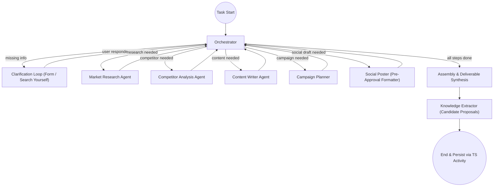

# Technical Architecture Document

## BusMora: AI Marketing Employee Platform

> Version 2.0 — October 2026
> Prerequisite: Read [PRD](./prd.md) and [MVP Definition](./mvp-definition.md) first.

---

## Table of Contents

1. [Architecture Overview](#1-architecture-overview)
2. [System Components](#2-system-components)
3. [Technology Stack](#3-technology-stack)
4. [Service Architecture](#4-service-architecture)
5. [Data Architecture](#5-data-architecture)
6. [AI Agent Architecture](#6-ai-agent-architecture)
7. [Crawling Engine](#7-crawling-engine)
8. [Real-Time Visualization Pipeline](#8-real-time-visualization-pipeline)
9. [Authentication & Security](#9-authentication--security)
10. [Deployment & Infrastructure](#10-deployment--infrastructure)
11. [Inter-Service Communication](#11-inter-service-communication)
12. [Team Structure & Development Workflow](#12-team-structure--development-workflow)
13. [Production Hardening Guidelines](#13-production-hardening-guidelines)

---

## 1. Architecture Overview

### 1.1 High-Level Architecture

```
┌────────────────────────────────────────────────────────────────────────┐
│                         USER (Browser)                                 │
│  ┌──────────┐ ┌──────────┐ ┌──────────────┐ ┌──────────┐ ┌──────────┐  │
│  │ Chat UI  │ │  Canvas  │ │    Brain     │ │Deliverab.│ │ Settings │  │
│  └────┬─────┘ └────┬─────┘ └──────┬───────┘ └────┬─────┘ └────┬─────┘  │
│       └────────────┴──────────────┴──────────────┴────────────┘        │
│                       busmora-web (Next.js 14+ RTL)                    │
└───────────────────────────────┬────────────────────────────────────────┘
                                │ HTTPS (REST) + SSE per Task
                                ▼
┌────────────────────────────────────────────────────────────────────────┐
│               PLATFORM SERVICE — busmora-api (NestJS)                  │
│       ★ SOLE DOMAIN WRITER · Drizzle Migrations · Single Source ★       │
│  ┌─────────────────────────────────┐ ┌───────────────────────────────┐ │
│  │ api-http: Auth · Workspaces ·   │ │ api-activities (TS Worker):   │ │
│  │ REST · SSE Gateway · KMS Encrypt│ │ Persist steps · Transitions · │ │
│  │ Rate limiting · Temporal Client │ │ Candidates · Audit · Usage    │ │
│  └────────────────┬────────────────┘ └───────────────▲───────────────┘ │
└───────────────────┼───────────────────────────────────┼────────────────┘
                    │ Internal HTTP (A1)                │
                    │ (Quick reply ≤ 3s / Retrieval)    │
                    ▼                                   │
┌───────────────────────────────┐                       │ Activities
│ busmora-ai (ai-http, FastAPI) │                       │
└───────────────────────────────┘                       │
                    ▲                                   │
                    │                                   │
┌───────────────────┴───────────────────────────────────┴────────────────┐
│                    TEMPORAL CLOUD (Durable Workflows)                  │
│   TaskExecutionWorkflow · OnboardingWorkflow · PostReleaseWorkflow     │
└───────────────────────────────┬────────────────────────────────────────┘
                                │ Activities
                                ▼
┌────────────────────────────────────────────────────────────────────────┐
│              WORKER + AI COMPUTE (Python Stateless)                    │
│  ┌──────────────────────────────────────────────────────────────────┐  │
│  │ busmora-workers: workers-workflows (Sequencing)                  │  │
│  │                  workers-publish (MCP tools, KMS Decrypt, Verify)│  │
│  ├──────────────────────────────────────────────────────────────────┤  │
│  │ busmora-ai:      ai-agent (LangGraph Engine · LiteLLM · Extractor│  │
│  │                  ai-crawl (Scrapling crawlers · Proxies · Pool)  │  │
│  └──────────────────────────────────────────────────────────────────┘  │
└───────┬──────────────┬──────────────┬──────────────┬───────────────────┘
        ▼              ▼              ▼              ▼
  ┌──────────┐   ┌──────────┐   ┌──────────┐   ┌──────────────┐
  │PostgreSQL│   │  Qdrant  │   │  Redis   │   │Object Storage│
  │(Single   │   │(Vectors, │   │(Streams  │   │(Snapshots,   │
  │Writer)   │   │Derived)  │   │ & Cache) │   │ Visuals, CSV)│
  └──────────┘   └──────────┘   └──────────┘   └──────────────┘
```

### 1.2 Design Principles

| Principle | Application |
|---|---|
| **One release, full scope** | Interfaces and schemas support the entire product from day one across two standalone repositories (`busmora-backend` and `busmora-frontend`). |
| **Platform-Centred (Sole Writer)** | `busmora-api` (NestJS) is the single owner and only writer of all domain data. Python services are stateless compute behind Temporal and never write domain tables. |
| **Temporal for durability, LangGraph for intelligence** | Temporal owns durable workflows, approval holds, and scheduling; LangGraph owns fast AI reasoning. |
| **Fast synchronous path (Amendment A1)** | Two synchronous internal HTTP calls from `api-http` to `ai-http` (quick reply ≤ 3s and Brain retrieval) bypass Temporal latency. |
| **Deterministic publishing without LLM** | After human approval, publishing is deterministic and byte-for-byte via MCP tools in `workers-publish` with read-back verification. |
| **Anti-Amnesia Knowledge Grounding** | All agent reasoning loops are strictly grounded via two-stage retrieval (Qdrant vector seed + PostgreSQL graph expansion) from the Business Brain. |
| **Fast Human-in-the-Loop Governance** | Batch approval gates are asynchronous and optimized for rapid (<15 min) human review bound to immutable Post Versions. |
| **Multi-tenant by default** | Every query, activity, vector search, Redis key, and storage object enforces `workspace_id`. |
| **Observable agents** | Every agent step emits events for the canvas via Redis SSE. No black boxes. |
| **Domain-neutral foundations** | Employee, Capability, Workflow, Integration, and Task Record are generic, enabling a future Employee without redesign. |

---

## 2. System Components

The system is deployed across **four deployables** executing **eight process roles**:

| Deployable | Process Role | Technology | Responsibility |
|---|---|---|---|
| `busmora-web` | `web` | Next.js 14+ (RTL), React Flow, React Query | Client-rendered frontend: Chat UI, Canvas, Brain graph, Batch Review, Settings |
| `busmora-api` | `api-http` | NestJS 10+, Passport, ioredis | REST API, auth (Argon2id + JWT + refresh rotation), KMS envelope encryption, SSE gateway from Redis Streams, Temporal client, internal HTTP client |
| | `api-activities` | NestJS (Temporal TS SDK) | **Sole domain writer**: Temporal TypeScript activity worker persisting task progress, candidate items, post claims, audit, usage, and notifications |
| `busmora-workers` | `workers-workflows` | Python 3.11+, Temporal Python SDK | Workflow definitions (`TaskExecutionWorkflow`, `OnboardingWorkflow`, `PostReleaseWorkflow`, `IndexingWorkflow`, `WorkspaceDeletionWorkflow`). Sequencing only; no DB access |
| | `workers-publish` | Python, MCP SDK | Social publishing tools (FB, IG, X); KMS decryption in memory; deterministic dispatch; read-back verification; token refresh |
| `busmora-ai` | `ai-http` | FastAPI, Uvicorn | Internal-only HTTP: Router classification and quick replies (≤ 3s); Brain retrieval |
| | `ai-agent` | Python, LangGraph, LiteLLM, Qdrant | LangGraph orchestrator & sub-agents, LiteLLM routing, knowledge extraction, Brand Visual generation, CSV KPIs; emits Canvas signals |
| | `ai-crawl` | Python, Scrapling | Scrapling crawlers with headless browser pool, rotating proxies, sanitization, intent qualification |
| **Managed Data** | PostgreSQL 16+ | Drizzle ORM (API owned) | Single source of truth (RPO 0): users, workspaces, Brain concept graph, tasks, deliverables, posts, audit trail, usage |
| | Qdrant | Vector DB | Derived vector embeddings of approved knowledge; filtered by `workspace_id` and `status` |
| | Redis 7+ | In-memory store | Refresh token families, per-task Canvas streams, crawl cache (7-day TTL) |
| | Object Storage | S3-compatible | HTML crawl snapshots, uploaded CSVs, generated Brand Visuals |
| | Temporal Cloud | Orchestration Engine | Managed durable execution, timers, signals, and retries |
| | Cloud KMS | Secrets Vault | Envelope encryption of platform OAuth credentials |
| | Langfuse | Observability | LLM tracing, tokens, latency, and cost metering per workspace |

---

## 3. Technology Stack

### 3.1 Complete Stack

```
Frontend (busmora-web):
├── Next.js 14+ (App Router, Client-Rendered)
├── TypeScript
├── React Flow (Canvas + Brain graph)
├── Tailwind CSS / shadcn/ui (Logical start/end classes for RTL)
├── Native EventSource with stream cookies (Last-Event-ID reconnects)
└── openapi-fetch + React Query

Platform Service (busmora-api):
├── NestJS 10+ with TypeScript
├── Passport.js + JWT Strategy + Argon2id
├── Drizzle ORM (Single migration toolchain for PostgreSQL 16+)
├── SSE Gateway (Redis Streams subscriber + Canvas snapshot cache)
├── Temporal TypeScript SDK (Client + Activities Worker)
├── ioredis
├── Class-validator + @nestjs/swagger (Code-first OpenAPI)
└── Ajv (Runtime validation of Temporal payloads)

Worker + AI Service (busmora-workers / busmora-ai):
├── Python 3.11+
├── FastAPI + Uvicorn (ai-http, internal only)
├── LangGraph (agent orchestration & checkpointers)
├── LiteLLM (multi-provider LLM router with Arabic bake-off)
├── Scrapling (web crawling & browser pool)
├── Temporal Python SDK (Workflow Worker & Publish Worker)
├── Qdrant Client (vector search with tenant filtering)
├── SQLAlchemy Core / asyncpg (Read-only views for approved knowledge)
├── Pydantic v2 (Canonical schemas for contracts and structured output)
└── MCP SDK (Social Publishing in workers-publish)

Data & Infrastructure:
├── PostgreSQL 16+ (PITR, RPO=0)
├── Qdrant (rebuildable)
├── Redis 7+ (rebuildable)
├── Temporal Cloud (+ Temporal UI)
├── Cloud KMS
├── S3-compatible object storage
└── Docker Compose (local development)
```

### 3.2 LLM Model Allocation

| Layer | Use Cases | Selection Criteria |
|---|---|---|
| **Light** | Router classification, knowledge extraction, page summarization, candidate generation | Low latency and low cost per call |
| **Heavy** | Orchestrator planning, content writing, competitor analysis, research synthesis | High reasoning and Arabic generation quality |

Models are routed through **LiteLLM**, so the specific provider can be swapped without code changes. The primary heavy model is chosen by an **Arabic-quality bake-off** against the project's rubric, with a configured fallback provider.

---

## 4. Service Architecture

### 4.1 Platform Service (busmora-api — NestJS)

The core application API, business management layer, and **sole domain writer** of all PostgreSQL state.

**Functional domains:**
- **Authentication & User Management:** Registration, login, secure in-memory JWT sessions, rotating Redis refresh tokens, workspace membership.
- **Workspace Administration:** Multi-tenant workspaces, business time zone, configuration, crawl triggering.
- **Business Brain Management:** Viewing, editing, manual curation, candidate review; provenance and audit. Manages `brain_read` views with RLS consumed by Python.
- **Task & Deliverable Management:** Initiating tasks, dispatching durable workflows via Temporal, serving deliverables.
- **Approval & Publishing Coordination:** Approval state machine records, `PostVersion` snapshots, claim atomic locks, and Batch Review sessions.
- **OAuth Callbacks:** Provider consent handling and token storage (encrypted via KMS envelope encryption).
- **Real-Time SSE Gateway:** Subscribing to Redis Streams and forwarding execution events to the client canvas, with `Last-Event-ID` replay and Redis canvas state snapshotting for fast resets.
- **Activity Worker (`api-activities`):** TypeScript Temporal worker hosting persistence activities for workflow progress, candidates, audit, usage metering, and notifications in single ACID transactions.

### 4.2 Worker Service (busmora-workers — Python + Temporal)

Durable orchestration and external execution. Has **no direct database access**.

**Functional domains:**
- **Durable Workflows (`workers-workflows`):** `TaskExecutionWorkflow`, `OnboardingWorkflow`, `PostReleaseWorkflow`, `IndexingWorkflow`, `WorkspaceDeletionWorkflow`. Sequencing only; all domain checks call `api-activities`.
- **Signals:** clarification_answered, approve, revise, cancel.
- **Timers:** deferred scheduling (up to 30 days), clarification expiry (7 days).
- **Idempotency:** workflow IDs match resource IDs (`task-{id}`, `post-{id}`).
- **Social Publishing Role (`workers-publish`):** MCP tools (`publish_facebook`, `publish_instagram`, `publish_x`); decrypts KMS tokens in memory only; byte-for-byte dispatch of approved `PostVersion`; read-back verification.

### 4.3 AI Service (busmora-ai — FastAPI & LangGraph)

Cognitive agent workloads, crawling, and LLM integration. Never writes domain tables.

**Functional domains:**
- **Synchronous HTTP API (`ai-http`):** Internal-only FastAPI service (Amendment A1) handling Router classification, conversational quick replies (p95 ≤ 3s), and read-only Brain retrieval over Qdrant and `brain_read` PostgreSQL views.
- **Agent Orchestration Engine (`ai-agent`):** LangGraph state machines for planning, clarification, research, and content generation. Checkpoints saved in technical `ai_runtime` schema.
- **Specialized Marketing Sub-Agents:** Market Research, Competitor Analysis, Content Writer, Campaign Planner, Social Poster (formats posts before approval).
- **Crawling & Scraping Tools (`ai-crawl`):** Data collection from company sites and social platforms using Scrapling, rotating proxies, and a bounded browser pool.
- **Unified LLM Routing:** LiteLLM abstraction with provider fallback and cost tracking in Langfuse.
- **Knowledge Extraction:** Post-task candidate generation proposed back to `api-activities`.
- **Real-Time Event Publishing:** Emitting granular agent state transitions and tool invocations to Redis Streams and atomic Canvas state hash.

---

## 5. Data Architecture

BusMora combines relational structure for business integrity and graph relationships with vector embeddings for semantic retrieval.

### 5.1 Relational Storage (PostgreSQL)

The relational database is the single source of truth for structured state and the knowledge graph.

**Core domain entities:**
- **Users & Workspaces:** Root identities and tenant boundaries. All business data is partitioned by workspace.
- **Business Brain (Concept Graph & Dual-Memory Architecture):**
  - *Semantic Memory (Concept Nodes & Edges):*
    - *Concept Nodes (`brain_nodes`):* Canonical entities such as Company Profile, Offering, Audience, Brand Rule, Positioning, Strategic Goal, Channel, Competitor, Company Fact. Fields include `id`, `category`, `title`, `summary`, `properties` (JSONB), `status` (`candidate` | `approved` | `rejected` | `retired`), `source`, `source_detail`, and provenance/freshness metadata.
    - *Semantic Relationships (`brain_edges`):* directed, typed edges such as `TARGETS`, `COMPETES_WITH`, `HAS_TONE`, `SOLVES_PAIN_POINT`, `RELATED_TO`. Fields include `id`, `source_node_id`, `target_node_id`, `relation_type`, `weight`, `created_at`.
  - *Procedural Memory (Workflow & Calibration Store):*
    - *Procedural Records (`brain_procedural_rules`):* stores persistent execution guidelines derived from human edits, approved post styles, dialect register calibrations (e.g., Egyptian conversational vs Gulf lifestyle), and post-task reviews. Eliminates recurring stylistic mistakes across tasks.
- **Marketing Tasks:** Asynchronous job records with prompts, task types, execution status, and workflow identifiers.
- **Deliverables:** Structured outputs (reports, post copy, calendars, diagnoses).
- **Conversations & Messages:** Chat history with clarification forms and task context.
- **Approval Actions & Execution Attempts:** Immutable snapshots of proposed external actions and their idempotent dispatch records.
- **Connected Platforms:** Encrypted OAuth credentials and metadata for external social accounts.
- **Source Documents:** Provenance records linking canonical knowledge to raw sources in object storage.
- **Audit Events:** Append-only governance trail (knowledge promotions, approvals, dispatches, OAuth changes).

### 5.2 Vector Search (Qdrant)

Qdrant provides vector similarity search across Business Brain concept nodes.

- **Semantic Indexing:** Concept nodes are embedded so agents retrieve company knowledge by meaning.
- **Tenant Partitioning:** All vector searches enforce payload filtering by `workspace_id` and `status`.
- **Filtered Index:** Indexed on `workspace_id` and `status` for low-latency multi-tenant retrieval.

### 5.3 Object Storage

Raw evidence and binary assets are stored in S3-compatible object storage, partitioned deterministically:

`s3://busmora-sources/{workspace_id}/{source_type}/{timestamp}_{filename}`

- **Crawl snapshots** (HTML) for provenance.
- **Uploaded CSVs** for performance interpretation.
- **Generated images** exposed via signed public URLs for platform publishing.

### 5.4 Hybrid Knowledge Retrieval (Two-Stage + Control)

1. **Semantic Seed (Qdrant):** The query embedding retrieves the top-k most relevant approved concept nodes.
2. **Relational Expansion (PostgreSQL):** A SQL traversal fetches neighbor nodes within 1–2 hops via `brain_edges` (for example, a Product's Target Audience, Brand Voice, and direct Competitors).
3. **Context Assembly:** Seed nodes, neighbors, and edge labels are assembled into a bounded structured context block (with a token ceiling) injected into agent prompts.
4. **Control Route:** A parallel document-only retrieval path (chunked raw sources in Qdrant, without graph extraction) supports the Brain value measurement described in [evaluation.md](./evaluation.md).

---

## 6. AI Agent Architecture

BusMora models marketing operations as an observable, multi-agent system built on LangGraph.

### 6.1 Stateful Execution

- **Shared Workflow State:** task identity and tenancy, conversation history, grounded Brain context, execution plan and subtasks, intermediate findings, final deliverables, and extracted knowledge candidates.
- **Durable Checkpointing:** state is persisted at each transition, enabling reliable pause-and-resume for clarification and failure recovery.

### 6.2 Agent Topology & Roles

- **Router:** classifies simple conversational questions vs. complex marketing tasks.
- **Orchestrator (Gen-3 Bottleneck Diagnosis & Allocation):** 
  - Diagnoses the primary commercial constraint (e.g. discoverability vs. positioning vs. conversion) against the Business Brain before allocating work.
  - Plans multi-step execution, delegates to sub-agents, and verifies goals are met.
  - Implements **Anti-Goodhart Guardrails**: anchors execution strictly to verified business goals (e.g. qualified reach, authentic brand trust) rather than superficial vanity proxies (e.g. cheap random clicks).
- **Clarification Loop:** pauses execution to request structured user input before resuming.
- **Specialized Sub-Agents:** Market Research, Competitor Analysis, Content Writer, Campaign Planner, Social Poster.
- **Assembly & Synthesis:** combines outputs into a structured deliverable.
- **Knowledge Extractor:** inspects completed tasks to propose new Brain candidates (updating both Semantic and Procedural memory).

### 6.3 Graph Flow & Router Execution Paths

The Router classifies incoming messages into three distinct execution paths:
1. **Simple chat:** Answered directly via synchronous internal HTTP (`ai-http`) in ≤ 3 seconds, bypassing Temporal and graph assembly.
2. **Ambiguous request:** Returns a clarifying question directly to the user before starting heavy workflows.
3. **Complex task:** Enters the durable `TaskExecutionWorkflow`, which invokes the LangGraph state machine below.



### 6.4 Inter-Agent Communication

- Sub-agents do not communicate directly with each other.
- All communication flows through the Orchestrator, which passes relevant output between agents.
- Each sub-agent is scoped strictly to its own tools (for example, copywriters do not receive crawler tools).

---

## 7. Crawling Engine

The Crawling Engine ingests live external data to ground agents in current market realities.

### 7.1 Architecture

```
Crawling Request (Agent Tool)
    │
    ▼
┌─────────────────────────────────────┐
│          Scrapling Engine           │
│  - Stealth navigation / anti-bot    │
│  - Adaptive content extraction      │
│  - Proxy rotation & rate limiting   │
│  - Pooled headless browsers         │
└─────────────────────────────────────┘
    │
    ▼
Raw Content Sanitization (strip HTML, scripts, styles)
    │
    ▼
Intent Qualification Pipeline (Qualifier Filter)
    │
    ▼
Clean, Scored Markdown Context → Passed to Agent
```

### 7.2 Data Sources

- **Company Website:** product pages, pricing, FAQs, and company info to bootstrap the Brain.
- **Consumer Discussions (Reddit & Niche Forums):** real user sentiment, complaints, and community pain points.
- **Video & Engagement Platforms (YouTube):** audience discussions and recurring questions.
- **Competitor Ad Intelligence (Facebook Ads Library):** active competitor hooks, creative formats, and promotions.
- **Competitor Websites:** messaging, positioning, and feature sets.

### 7.3 Operational Guidelines

- **Anti-Bot Navigation:** stealth fetching (Scrapling) to navigate modern web protections.
- **Content Quarantine:** sanitize and isolate untrusted web text from agent instructions.
- **Rate Limiting & Cooldown:** domain-level rate limiting and caching to protect target servers and avoid IP blocking.
- **Proxy Pool:** rotating proxies for platform scraping.
- **Browser Pool:** a bounded pool of headless browser instances to control memory use.

### 7.4 Intent Qualification Pipeline (Social Data Mining)

Raw crawling returns high noise. The Market Research Agent applies a multi-stage intent qualification filter inspired by production Reddit mining patterns:

1. **Monitor Node:** extracts recent posts and discussions containing target keywords and competitor mentions.
2. **Qualifier Node:** a fast, lightweight classifier (LLM/rule-based) scores purchase and pain signals (0–100):
   * *High Intent:* Competitor complaint threads ("alternatives to X", "tired of Y's price"), explicit recommendations ("best tool for Z"), and price inquiries.
   * *Low Intent:* Generic chatter and memes (filtered out).
3. **Context Enrichment:** high-intent phrases and authentic user vernacular are extracted directly into the Content Writer context, ensuring campaign copy mirrors the exact vocabulary real buyers use in their communities.

---

## 8. Real-Time Visualization Pipeline

Deep research workflows run in tens of seconds to minutes, so the platform provides full real-time transparency via the Canvas.

### 8.1 Pipeline Flow

```
Agent Execution (busmora-ai)
    │  (emits lifecycle events on node transition / tool call)
    ▼
Redis Streams (event bus, keyed by task_id)
    │
    ▼
busmora-api SSE Gateway
    │  (authenticated push; supports Last-Event-ID replay)
    ▼
React Flow Canvas (frontend)
    │  (animates active agent, highlights path, shows live tool label)
```

### 8.2 Principles

- **Event-Driven Visibility:** nodes and tools emit status events at every execution boundary.
- **Decoupled Messaging:** Redis Streams decouple AI workers from client connections; the AI service holds no client state.
- **Reconnectable Streaming:** each event carries an incrementing ID; clients reconnect with `Last-Event-ID` and missed events are replayed from the stream buffer without interrupting the running workflow.
- **Interactive UI Feedback:** the canvas translates events into node state changes (idle, active, complete), animated edges, and progress indicators.

---

## 9. Authentication & Security

### 9.1 Authentication & Tenancy

- **Password Security:** Argon2id hashing with salt.
- **Session Tokens:** short-lived JWT access tokens carrying `user_id` and active `workspace_id`.
- **Refresh Tokens:** cryptographically random refresh tokens in Redis with rotation on use.
- **Tenant Isolation:** every request is authenticated and mapped to a workspace; cross-workspace access is forbidden across relational, vector, and object storage.

### 9.2 Prompt Injection Defense

Because agents process untrusted crawled text, the system implements defensive safeguards:

- **Sanitization:** strip executable scripts, styling, and navigation markup before external text reaches a model.
- **Quarantine Boundaries:** encapsulate scraped content within explicit data boundaries in the prompt context.
- **Instructional Guardrails:** system instructions direct the model to treat quarantined content as passive reference data, never as instructions.

### 9.3 Credential Security

- **KMS Envelope Encryption:** OAuth access and refresh tokens are encrypted using cloud KMS envelope encryption with a Workspace Encryption Context (`{ workspace_id, integration_id, credential_version }`).
- **Ephemeral In-Memory Use:** plaintext tokens are decrypted only in memory during active calls and never written to logs or traces.
- **SSRF Protection:** target scraping domains are validated against private IP ranges before fetching.

---

## 10. Deployment & Infrastructure

### 10.1 Container Architecture

All services run as independent containers orchestrated locally via Docker Compose:

- **Application Services:** `busmora-web` (Next.js), `busmora-api` (NestJS), and `busmora-workers`/`busmora-ai` (Python).
- **Data Stores:** PostgreSQL (relational + graph), Qdrant (vector), Redis (streams/cache), and object storage.
- **Workflow Engine:** Temporal Cloud (managed) with Temporal UI for observability.
- **Persistent Storage:** named volumes preserve database and vector state across container lifecycles.

### 10.2 Hosting

- **Model:** managed/hybrid — managed PostgreSQL, Qdrant, and Redis, Temporal Cloud, and application hosts.
- **Region:** Single Frankfurt region (`eu-central-1` / `europe-west3`, provisional) adopted because managed dependencies (Temporal Cloud, Langfuse Cloud) do not offer MENA regions, and pilot customers do not require in-country hosting.
- **Resource Sizing:** provisioned for in-memory vector operations and a bounded pool of concurrent headless browsers during crawling.

---

## 11. Inter-Service Communication

### 11.1 Communication Map

```
Frontend (Next.js) ←──HTTPS (REST) + SSE──→ busmora-api (api-http)
                                                   │
                                      ┌────────────┴────────────┐
                         Internal HTTP│(A1)                     │Temporal Client
                     (Quick replies / │                         ▼
                      Brain retrieval)│                  Temporal Cloud
                                      ▼                         │
                               busmora-ai                       ├─────────────────┐
                               (ai-http)                        │Activities       │Activities
                                                                ▼                 ▼
                                                   busmora-api       busmora-workers
                                                   (api-activities   & busmora-ai
                                                    Sole Writer)     (ai-agent, ai-crawl,
                                                        │             workers-publish)
                                                        ▼                 │
                                                    PostgreSQL            │Canvas Signals
                                                    (Source of Truth)     ▼
                                                                     Redis Streams
                                                                          │
                                                                          ▼
                                                                     busmora-api
                                                                     (SSE Gateway)
                                                                          │
                                                                          ▼
                                                                     Frontend Canvas
```

### 11.2 Durable Workflow Orchestration (Temporal)

Temporal manages the end-to-end lifecycle of marketing tasks:

- **Resilience Across Restarts:** if services restart mid-task, Temporal resumes from the latest successful activity without data loss.
- **Human-in-the-Loop Holds:** publishing workflows wait durably for user approval and scheduled times without consuming compute.
- **Activity Boundary:** `busmora-ai` acts as a Temporal activity worker, executing LangGraph pipelines and returning structured deliverables.
- **Frozen Configuration:** when a task starts, the active configuration is serialized into an immutable payload and passed into the workflow, so in-flight tasks are unaffected by later edits.

---

## 12. Team Structure & Development Workflow

### 12.1 Vertical End-to-End Ownership

The four-person team operates on **vertical slice ownership**: each member ships complete features across the full stack (`busmora-web` → `busmora-api` → `busmora-workers` → `busmora-ai`).

- Everyone understands the full system.
- No single-person bottlenecks.
- Each feature is owned and accountable.

**Coordination:**
- Weekly sprint planning with feature assignment.
- API contracts defined first (OpenAPI spec + TypeScript interfaces).
- Shared Docker Compose for local development.
- Git branching with feature branches and pull-request review.

### 12.2 Sprint Plan (6 Months)

| Sprint | Features | Dependencies |
|---|---|---|
| **1–2** | Docker Compose, PostgreSQL schema, auth (register/login/JWT), Next.js skeleton, walking skeleton (prompt → API → Temporal → worker → stub → SSE) | None |
| **3–4** | Workspace creation, website crawler, Brain schema + candidate review UI | Auth |
| **5–6** | Chat UI, LangGraph engine, Router, Orchestrator with Brain retrieval, clarification forms | Brain, Auth |
| **7–8** | Market Research Agent, Content Writer Agent, image generation, Deliverables storage + UI | LangGraph, Scrapling |
| **9–10** | Competitor Analysis Agent, Performance CSV intake, React Flow canvas + SSE | LangGraph, Scrapling |
| **11–12** | Campaign Planner, Approval lifecycle + Batch Review, OAuth (Meta + X), MCP Server, scheduling | Agents, Brain |
| **13–14** | Knowledge Extraction node, evaluation harness + human review, Bilingual/RTL polish, observability | All |
| **15+** | Paid pilot onboarding, stabilization, documentation | All |

### 12.3 Repository Structure

The system is organized into **two standalone repositories** (ADR-002, R-5) communicating across published contracts:

```
1. busmora-backend/               # Backend repository (Polyglot)
├── apps/
│   ├── api/                     # busmora-api (NestJS, sole domain writer: api-http, api-activities, cli)
│   ├── workers/                 # busmora-workers (Python: workers-workflows, workers-publish with MCP)
│   └── ai/                      # busmora-ai (Python: ai-http, ai-agent, ai-crawl)
├── packages/
│   └── contracts-py/            # Canonical Pydantic models for cross-language Temporal payloads & Canvas signals
├── contracts/                   # Versioned schemas (OpenAPI, Temporal JSON Schema)
├── deploy/compose/              # Docker Compose parity for all services
└── scripts/                     # Contract generation, drift verification, and db seeding

2. busmora-frontend/              # Frontend repository (TypeScript / Next.js)
├── src/
│   ├── app/                     # App Router: routes & layouts only (composition)
│   ├── features/                # Bounded-context modules (auth, employee, canvas, brain, publishing, etc.)
│   │   └── <feature>/           # index.ts (public interface), api/, model/, ui/
│   └── shared/                  # Technical kernel: openapi-fetch client, session, streams, i18n, time, UI kit
├── contracts/api/               # Pinned openapi.json from busmora-backend
└── e2e/                         # End-to-end tests against Docker Compose backend
```

---

## 13. Production Hardening Guidelines

Every team member applies the following engineering goals when implementing their assigned tasks:

```
┌────────────────────────────────────────────────────────────────────┐
│                   PRODUCTION ENGINEERING PILLARS                   │
├────────────────────────────────────┬───────────────────────────────┤
│ 1.  Explicit State Management      │ 7.  Evals & Golden Benchmarks │
│ 2.  Schema Validation & Fallbacks  │ 8.  Multi-Layer Rate Limiting │
│ 3.  Tenant Isolation & Tool RBAC   │ 9.  Cost Ceilings & Budgets   │
│ 4.  Retries & Timeout Policies     │ 10. Workflow & Prompt Version │
│ 5.  End-to-End Idempotency         │ 11. Security & Anti-Injection │
│ 6.  Observability & Tracing        │ 12. Concurrency & Pooling     │
└────────────────────────────────────┴───────────────────────────────┘
```

1. **Explicit State Management** — maintain serialized workflow state across transitions with durable database checkpointers.
2. **Schema Validation & Fallbacks** — parse all LLM output against strict schemas; self-correct on schema errors and fall back to clean text rather than failing the request.
3. **Tenant Isolation & Tool Scoping** — scope every query and vector search by `workspace_id`; give each sub-agent only its domain tools.
4. **Retries & Timeout Policies** — deterministic timeouts with exponential backoff; graceful fallback sources during scraping.
5. **End-to-End Idempotency** — guard against duplicate submissions with idempotency keys; prevent duplicate publications with unique execution constraints.
6. **Observability & LLM Tracing** — real-time canvas status plus centralized token, latency, and cost tracking via Langfuse.
7. **Quality Evals** — maintain a test dataset of realistic marketing scenarios and continuously benchmark agent outputs against brand voice, Arabic fluency, and factual grounding.
8. **Multi-Layer Rate Limiting** — protect public endpoints; enforce domain-level cooldown during crawling.
9. **Cost Ceilings & Token Budgets** — cap agent recursion depth to prevent loops; track cumulative task cost.
10. **Workflow & Prompt Versioning** — keep prompt templates in version control; preserve backward compatibility for in-flight executions.
11. **Security & Anti-Injection** — treat all scraped content as untrusted; sanitize markup and quarantine it within prompt boundaries; validate scraping domains against private ranges.
12. **Concurrency & Resource Pooling** — pool and limit concurrent headless browser instances to avoid memory exhaustion.

---

## Appendix A: Decision Registry

All architectural decisions are tracked in [decision-registry.md](./decision-registry.md).

## Appendix B: Open Provider Selections

The following are scoped with named defaults and decided during the Sprint 1 bake-off:

| Item | Default | Decision Point |
|---|---|---|
| Embedding model | Current OpenAI `text-embedding-3-small`-class model | Sprint 1 |
| Image generation model | Current hosted text-to-image behind the brand template | Sprint 1 |
| Object storage provider | S3-compatible (R2 / MinIO) | Sprint 1 |
| Rotating proxy vendor | Managed residential proxy provider | Sprint 3 |
