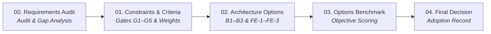

# Research & Benchmarking (`research/`)

This directory houses all **customer discovery research, requirements audits, architectural trade-off benchmarks, and decision records** that underpin the BusMora platform.

---

## Directory Structure

```
research/
├── product/                      # Customer & Market Research
│   └── product-discovery-summary.md
└── technical/                    # Architectural Trade-offs & Benchmark Decisions
    ├── 00-requirements-analysis.md
    ├── 01-constraints.md
    ├── 02-options.md
    ├── 03-benchmark.md
    └── 04-decision.md
```

---

## 1. Customer & Product Research (`product/`)

### [Product Discovery Summary (`product/product-discovery-summary.md`)](./product/product-discovery-summary.md)
* **Core Pain Points:**
  * *Manual Work Multipliers:* Fragmented workflows across multiple tools leading to operational fatigue.
  * *The Editing Trap:* Generic AI tools producing superficial content that requires heavy rewriting.
  * *Tool Amnesia:* Traditional LLM chat interfaces forgetting brand guidelines, past successes, and product details.
* **Customer Archetypes:** Beachhead analysis of SMB owners and marketing teams in Egypt and Saudi Arabia.
* **Competitive Landscape:** Analysis of Buffer/Hootsuite (scheduling without intelligence) vs Jasper/Copy.ai (generation without organizational memory).

---

## 2. Technical Research & Architecture Benchmark (`technical/`)

The technical architecture was formed through a 5-stage evidence-based research and evaluation process:



1. [**00 — Requirements Analysis**](./technical/00-requirements-analysis.md): Comprehensive extraction, contradiction resolution, and gap analysis across all historical project documentation.
2. [**01 — Constraints & Evaluation Criteria**](./technical/01-constraints.md): Definition of binding architectural constraints (K-01 to K-11), hard gates (G1–G5), and 9 weighted evaluation criteria.
3. [**02 — Architecture Options**](./technical/02-options.md): Deep architectural options for backend (`B1` Platform-Centred, `B2` Workflow-Centred, `B3` Context-Owned) and frontend (`FE-1` CSR, `FE-2` BFF, `FE-3` Workspace Event Shell).
4. [**03 — Options Benchmark**](./technical/03-benchmark.md): Quantitative and qualitative scoring against hard gates and weighted evaluation criteria.
5. [**04 — Final Architecture Decision**](./technical/04-decision.md): Final adoption record: **B1 + Amendment A1** for the backend and **FE-1 (architected for FE-3)** for the frontend.
