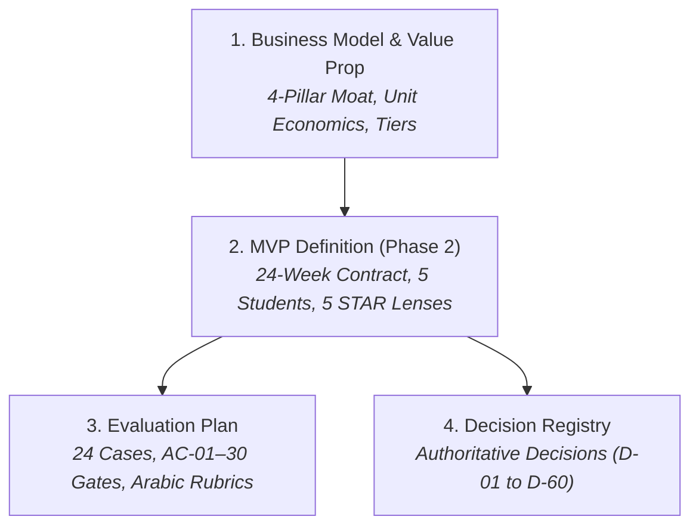

# Product & Business Strategy (`strategy/`)

This directory documents the **business strategy, MVP delivery boundaries, evaluation benchmarks, and historical governance records** for BusMora.

---

## Strategy Documents

### 1. [Business Model & Value Proposition (`business-model-value-proposition.md`)](./business-model-value-proposition.md)
* **The 4-Pillar Defensibility Moat:**
  1. *Brain Moat:* Cumulative organizational memory that deepens with every edit.
  2. *Governed Safe Publishing:* Zero autonomous unapproved posts; deterministic dispatch with read-back verification.
  3. *MENA Native Fluency:* Localized nuance, cultural relevance, and dialect support (Egyptian, Gulf, MSA, English).
  4. *Total Cost of Ownership:* Replacing fragmented agency and SaaS point-tool overhead with unified execution.
* **Economic Model:** Phased monetization (per-workspace usage & cost metering in Phase 2; subscription tiers & billing in Phase 4+), unit economics, and customer acquisition strategy.

### 2. [MVP Definition & Release Boundaries (`mvp-definition.md`)](./mvp-definition.md)
* **Release Boundary:** Strict 24-week timeline committed to **Phase 2 (First Production-Ready Release)** delivered by 5 students across 5 workstreams (~2,400 productive hours).
* **Target Beachhead Persona:** Sarah (Solo marketer / Founder of an Arabic-first service business selling via inquiries or bookings).
* **Core Product Mechanics:** Website URL crawl / guided intake $\rightarrow$ Business Brain graph $\rightarrow$ 5 STAR diagnostic lenses $\rightarrow$ Now/Next/Later adaptive roadmap $\rightarrow$ dynamic multi-source research $\rightarrow$ text-first campaigns & owner media $\rightarrow$ Facebook Page publishing $\rightarrow$ CSV/Excel performance learning $\rightarrow$ context staleness holds (FR-48) & honest handoffs (FR-49).

### 3. [Evaluation Framework & Quality Benchmarks (`evaluation.md`)](./evaluation.md)
* **The 24-Case Scenario Library:** Authored contrast pairs testing sparse context, fulfillment constraints, dialect authenticity, and failure recovery.
* **Arabic Fluency Rubrics:** Strict scoring across Fluency, Dialect Fit, Brand Fit, Cultural Fit, and Factual Grounding (≥ 80% pass rate on held-out suite without major correction).
* **Brain Value Experiment:** Controlled blind treatment vs control (≥ 50% reduction in clarification turns and factual/brand corrections).
* **Binding Acceptance Gates:** 30 comprehensive scenarios (AC-01 through AC-30), zero critical truthfulness/security violations, and the 10-minute first-value usability target.

### 4. [Authoritative Decision Registry (`decision-registry.md`)](./decision-registry.md)
* **Authoritative Governance:** The definitive chronological record of 60 architectural and product decisions (D-01 to D-60).
* Serves as the primary tie-breaker whenever requirements or designs present conflicting statements.
