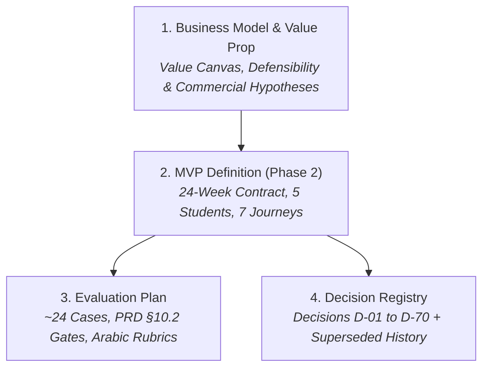

# Product & Business Strategy (`strategy/`)

This directory documents the **business strategy, MVP delivery boundaries, evaluation benchmarks, and historical governance records** for BusMora.

> **Authority Precedence:** Authoritative functional requirements, acceptance criteria, and technical contracts are governed by **[core/prd.md](../core/prd.md)** (PRD v2.0) and the canonical specifications in `core/`. All strategy documents are aligned with PRD v2.0 and provide business rationale and planning context; where they differ, the PRD wins.

---

## Strategy Documents

### 1. [Business Model & Value Proposition (`business-model-value-proposition.md`)](./business-model-value-proposition.md)
* **Value proposition canvas** for the primary service-business owner and the secondary marketer.
* **Defensibility hypotheses** (context continuity, last-mile execution infrastructure, regional language layer, governed autonomy), to be tested rather than assumed.
* **Commercial model:** no in-product billing, price or payment provider in Phase 2; per-workspace usage and cost metering from day one; packaging decided later from observed repeat use and real costs (P4-02).

### 2. [MVP Definition & Release Boundaries (`mvp-definition.md`)](./mvp-definition.md)
* **Release Boundary:** Strict 24-week timeline committed to **Phase 2 (First Production-Ready Release)** delivered by 5 students across 5 workstreams (~2,400 productive hours).
* **Personas:** Sarah, owner of an Arabic-first service business selling via inquiries or bookings (primary); an experienced marketer (secondary).
* **Core Product Flow:** sign-up (email link or Google) $\rightarrow$ confirmed essential intake $\rightarrow$ Chat **or** Roadmap Discovery $\rightarrow$ bounded research and Tasks $\rightarrow$ documents in Deliverables and Posts in Scheduling $\rightarrow$ exact-approval Facebook publishing $\rightarrow$ requested one-off analysis, context holds (FR-48) and honest handoffs (FR-49).

### 3. [Evaluation Framework & Quality Benchmarks (`evaluation.md`)](./evaluation.md)
* **The 24-Case Scenario Library:** Authored contrast pairs testing sparse context, fulfillment constraints, dialect authenticity, and failure recovery.
* **Arabic Fluency Rubrics:** Strict scoring across Fluency, Dialect Fit, Brand Fit, Cultural Fit, and Factual Grounding (≥ 80% pass rate on held-out suite without major correction).
* **Brain Value Experiment:** Blind treatment vs. control; the numeric target is frozen with the rubric in weeks 1–2.
* **Binding Acceptance Gates:** all active AC-01–25 and AC-27–58 (AC-26 retired), zero critical truthfulness/control violations, and the ten-minute first-value usability target.

### 4. [Authoritative Decision Registry (`decision-registry.md`)](./decision-registry.md)
* Chronological record of product and architecture decisions (D-01 to D-70), aligned with PRD v2.0, plus a superseded-decisions history.
* The PRD remains the tie-breaker; the registry explains why each choice was made.
