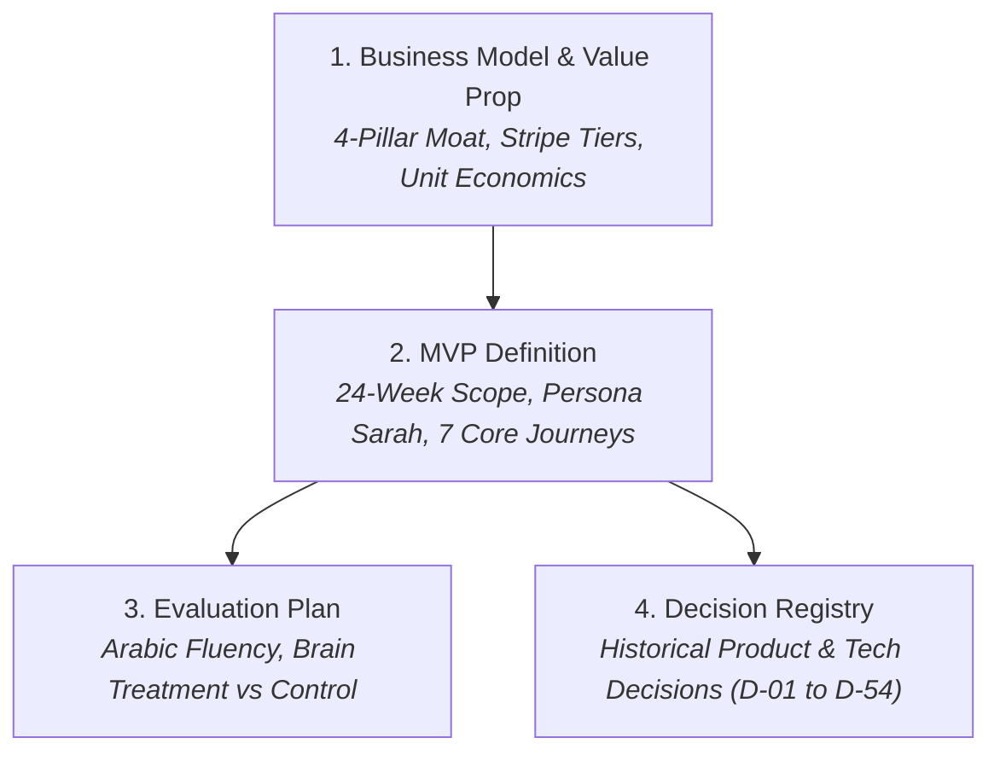

# Product & Business Strategy (`strategy/`)

This directory documents the **business strategy, MVP delivery boundaries, evaluation benchmarks, and historical governance records** for BusMora.

---

## Strategy Documents

### 1. [Business Model & Value Proposition (`business-model-value-proposition.md`)](./business-model-value-proposition.md)
* **The 4-Pillar Defensibility Moat:**
  1. *Brain Moat:* Cumulative organizational memory that deepens with every edit.
  2. *Governed Safe Publishing:* Zero autonomous unapproved posts; deterministic dispatch.
  3. *MENA Native Fluency:* Localized nuance, cultural relevance, and dialect support (Egyptian, Gulf, Levantine, MSA).
  4. *Total Cost of Ownership:* Transparent, predictable subscription replacing fragmented agency and SaaS overhead.
* **Economic Model:** Stripe subscription tiers (Starter, Growth, Scale), usage quotas, unit economics, and customer acquisition strategy.

### 2. [MVP Definition & Release Boundaries (`mvp-definition.md`)](./mvp-definition.md)
* **Release Boundary:** Strict 24-week timeline for a full-scope single release targeting SMB marketing operations.
* **Target Beachhead Persona:** Sarah (Boutique owner / Marketing lead in Cairo and Riyadh).
* **7 Core User Journeys:** Guided Onboarding $\rightarrow$ Social Channel Linking $\rightarrow$ Content Campaign Planning $\rightarrow$ Approval & Canvas Editing $\rightarrow$ Autonomous Publishing $\rightarrow$ Performance Insights $\rightarrow$ Knowledge Refinement.

### 3. [Evaluation Framework & Quality Benchmarks (`evaluation.md`)](./evaluation.md)
* **Arabic Fluency Rubrics:** Strict scoring criteria for MSA and regional dialects, idiom accuracy, and brand voice alignment.
* **Brain Value Experiment:** Controlled A/B measurement (Brain-grounded generation vs generic document-only retrieval).
* **Operational Hardening:** Deterministic publishing guarantees, idempotency tests, and MTTR benchmarks.

### 4. [Authoritative Decision Registry (`decision-registry.md`)](./decision-registry.md)
* **Authoritative Governance:** The definitive chronological record of 54 architectural and product decisions (D-01 to D-54).
* Serves as the primary tie-breaker whenever requirements or designs present conflicting statements.
