# MVP Definition

## AI Marketing Director — Phase 2 Release Contract (24-Week Scope)

> **Version:** 2.0 (PRD v1.1 Alignment) · **Date:** 28 October 2026  
> **Status:** Canonical Release Contract — Aligned with [PRD v1.1 (`core/prd.md`)](../core/prd.md) and [decision-registry.md](./decision-registry.md).

---

## 1. Release Strategy & Phasing

BusMora is an **AI Marketing Director** for Arabic-first business owners. It combines guided planning with direct conversation, diagnosing commercial constraints, setting feasible priorities, and executing marketing tasks with safe human governance.

The product delivery is organized into **four explicit phases**. The binding delivery commitment for the **24-week graduation project** is **Phase 2 (First Production-Ready Release)**, delivered by a team of **five students** using AI-assisted engineering with vertical workstream ownership (~2,400 productive hours).

```
Phase 1: Foundation (Platform, Workspaces, Audit, Worker Infrastructure)
   ↓
Phase 2: First Production-Ready Release (The 24-Week Release Contract)
   ├── Guided Intake & Website URL Import (Immediately active imported context)
   ├── Business Brain (Interactive Graph + Accessible Detail View)
   ├── 5 STAR Diagnostic Lenses + Adaptive Now/Next/Later Roadmap (FR-16, FR-45, FR-46)
   ├── Director Chat + Fast Router + Dynamic Orchestrator + Authentic Canvas (FR-19–23)
   ├── Dynamic Multi-Source Research with Per-Task Budget Governance (FR-24–28)
   ├── Text-First Campaigns, Visual Briefs & Owner Media (FR-29–32)
   ├── Governed Facebook Page Publishing with Exact-Version Binding & Lateness Allowance (FR-33–36)
   ├── CSV & Excel (.xlsx) Import + Manual Aggregate Outcome Capture & Recurring Review (FR-38–40, FR-47)
   ├── Context Impact & Freshness Holds (FR-48) + Honest Capability/Handoff Contract (FR-49)
   └── Full Responsive Arabic (RTL) / English (LTR) UI across 4 Content Registers (FR-43–44)
   ↓
Phase 3: Product Expansion (Post-MVP)
   ├── Social Profile Link Intake (P3-01 — Visibly "Coming Soon" in Phase 2)
   ├── Instagram Business & X Publishing Connectors (P3-02)
   └── Connected Platform Analytics (P3-03)
   ↓
Phase 4+: Creation & Commercial Expansion (Future)
   ├── Native AI Image Generation (P4-01)
   └── Subscriptions, Payment Processing & Quota Administration (P4-02)
```

The architecture is domain-neutral so that future channels, tools, and employees can be incorporated without altering foundational aggregates or core event contracts.

---

## 2. What the Owner Can Do (Phase 2 Experience)

1. **Sign up and establish context:** The owner creates a single-owner business workspace and chooses between Website Import or Guided Manual Intake (Social Profile Import is visibly disabled as **Coming Soon**).
2. **Immediate context availability:** Website import extracts business and brand context into the Brain as immediately active, source-labelled **imported/unverified** context—without demanding tedious field-by-field approval before first value.
3. **Receive direction:** The Marketing Director evaluates goals and capacity using the **5 STAR diagnostic lenses**, identifies the primary constraint hypothesis, and presents an editable **Now/Next/Later roadmap** alongside a recommended next action.
4. **Inspect the Brain:** The owner explores an interactive typed entity/relationship graph and accessible detail list, distinguishing imported facts, owner-provided claims, AI hypotheses, and confirmed decisions.
5. **Execute directly or via roadmap:** The owner can accept the next roadmap task or launch any supported task directly from chat (e.g. competitor research, single post draft, campaign brief) without completing a mandatory sequence.
6. **Watch real work on the Canvas:** Substantive tasks run through the Dynamic Orchestrator; the authentic Agent Canvas renders real agent states, tool calls, and evidence (no simulated progress or fabricated agents).
7. **Multi-source research with budget governance:** Research agents dynamically explore public search, websites, and community reviews within an authorized per-task budget. Any budget extension requires explicit owner approval.
8. **Text-first campaigns & dialect authenticity:** Content is generated across four distinct registers (Egyptian conversational, Gulf-oriented, MSA, or English), complete with visual briefs and support for owner-supplied media.
9. **Review and approve for Facebook:** The owner reviews exact post copy, destination Page, scheduled time/timezone, and delivery lateness allowance. Approved posts publish to Facebook Pages with read-back verification and failure recovery.
10. **Handle context changes safely:** If core facts (pricing, offers) change, affected tasks and scheduled posts are placed on a **Context Staleness Hold** until resolved by the owner.
11. **Measure outcomes:** The owner imports campaign performance files (CSV or Excel `.xlsx`) with schema mapping previews or enters manual aggregate observations. Deterministic KPIs are computed by backend code.
12. **Recurring review & controlled learning:** The Director presents a recurring review (observations first, interpretation second, proposed decision third) and proposes roadmap or Brain updates that require separate owner approval.

---

## 3. Component Architecture Matrix

| Component | Phase 2 Release Behavior (24-Week Scope) | Later-Phase Boundary |
|---|---|---|
| **SaaS Foundation** | Multi-tenant single-owner workspaces, custom Argon2id auth, JWT + Redis refresh token rotation, RLS data isolation, 4 deployables (`web`, `api`, `workers`, `ai`). | Multi-user roles, team invites, and enterprise hierarchies deferred. |
| **Intake & Onboarding** | Website URL crawl (≤ 10 pages, extracts business info & brand cues) + Guided Conversational Intake with progressive clarification. Source-labelled imported context is immediately active. | Social profile link onboarding is visibly disabled as **Coming Soon** (Phase 3: P3-01). |
| **Business Brain** | Relational concept graph (`brain_nodes`, `brain_edges` in PostgreSQL + Qdrant vectors) + interactive React Flow graph with accessible detail list. Explicit epistemic states (Observation, Claim, Hypothesis, Decision). | Ontology designer and unrestricted graph workspace excluded. |
| **Director & Diagnosis** | Marketing Director consultation, 5 STAR diagnostic lenses, primary constraint hypothesis, editable Now/Next/Later roadmap, ~10–12 curated task recipes. | Universal business health scores, multiplicative priority indexes, and full CRM excluded. |
| **Chat & Routing** | Fast AI Router classifying simple conversational queries (handled directly) vs substantive tasks (delegated to Orchestrator). Deterministic UI actions bypass AI routing. | Arbitrary executable workflows excluded. |
| **Orchestration & Canvas** | Bounded Dynamic Orchestrator planning specialist work; authentic Agent Canvas showing recorded execution events, tools, handoffs, and owner input points. Durable task recovery. | Unrestricted tool invention, recursive sub-agent spawning, and fake progress bars prohibited. |
| **Research Engine** | Dynamic multi-source research across search, accessible websites, and review/community material. Inspectable source grounding. Per-task computational/time budget (FR-27) with mandatory owner approval for extensions. | Authenticated social harvesting, private databases, comprehensive ad-library coverage excluded. |
| **Content & Copywriting** | Culturally authentic text generation across 4 registers (Egyptian, Gulf, MSA, English), visual briefs, and owner-supplied media attachment. | Native AI image generation deferred to Phase 4+ (P4-01). |
| **Publishing & Scheduling** | Genuine Facebook Page connection, exact-version approval binding, scheduled dispatch with lateness allowance, idempotent execution, read-back verification, and timeout reconciliation. | Instagram Business and X publishing deferred to Phase 3 (P3-02). Video/reels/stories excluded in Phase 2. |
| **Performance Learning** | Documented CSV and Excel (`.xlsx`) file import with validation preview and deterministic calculations + manual aggregate outcome capture (FR-38, FR-47). Goal-based diagnosis and recurring reviews. | Connected analytics APIs deferred to Phase 3 (P3-03). Cohort/LTV engines and automated attribution excluded. |
| **Context Governance** | Context Impact & Freshness (FR-48): material changes to offer, price, or claims flag dependent work and hold scheduled posts. Honest Handoff Contract (FR-49) for unsupported external execution. | Automatic background market scraping and silent auto-regeneration excluded. |
| **Localization & UX** | Full bilingual Arabic (RTL) / English (LTR) interface with independent settings for interface language, conversation language, and content register. Responsive mobile review. | Desktop-only workflows prohibited. |

---

## 4. Scope Boundaries & Exclusions

| Feature | Phase 2 Status | Disposition & Alternative |
|---|---|---|
| **Instagram Business & X Publishing** | **Phase 3** | Architecture models platforms neutrally; Phase 2 executes Facebook Pages only. |
| **Social Profile URL Import** | **Phase 3** | Displayed on onboarding screen as visibly disabled and labeled **Coming Soon**. |
| **Connected Platform Analytics APIs** | **Phase 3** | Supported via CSV and Excel (`.xlsx`) performance imports + manual aggregate entry. |
| **Native AI Image Generation** | **Phase 4+** | Text-first assets + visual briefs + owner-supplied media upload. |
| **In-Product Billing & Subscriptions** | **Phase 4+** | Per-workspace usage and cost metering from day one; billing administration deferred. |
| **Multi-User / Team Roles** | Out of Scope | Single-owner workspaces satisfy the core owner persona. |
| **Paid Ad Spend / Campaign Management** | Out of Scope | Generates strategy, ad copy, and briefs; owner executes in external ad managers. |
| **Direct Messaging / WhatsApp Bot** | Out of Scope | Inquiry response drafts provided to owner; no live messaging bot. |
| **CMS / Website Live Deployments** | Out of Scope | Copy and structure briefs provided for owner implementation with checklists. |
| **Video / Reels / Carousel Publishing** | Out of Scope | Phase 2 Facebook publishing is bounded to text/link and single owner-supplied image with caption. |

---

## 5. User Persona: Sarah — The Arabic-First Business Owner

### Profile
* **Who:** Founder or lead operator of a 5–50 person service business (consulting, clinics, professional services, specialized design) or local commercial business in Egypt or the GCC selling through inquiries, consultations, or bookings.
* **Working style:** Arabic-first, bilingual, managing marketing alongside operational duties without an in-house marketing agency or full-time marketing department head.
* **Pain points:**
  * **The "Editing Trap":** Generic AI tools produce bland, robotic Modern Standard Arabic that feels translated and disconnected from local buyers.
  * **Tool Amnesia:** Every new chat session loses context on brand voice, past campaigns, and offer constraints.
  * **Tool Hopping & Execution Friction:** Jumping between research tools, copywriting apps, spreadsheets, and social channels eats 10+ hours a week.
  * **Babysitting Burden:** Autonomous agent tools either get stuck in loops or execute unpredictable actions that require constant monitoring.
* **What she needs from BusMora:** An intelligent **Marketing Director** that understands her commercial constraints, proposes what deserves focus this week, drafts culturally resonant copy, publishes to Facebook with total safety, and learns from actual results.

---

## 6. Core User Journeys

### Journey 1: Establish Context & Reach First Value (Under 10 Minutes)
* Sarah signs up, creates her business workspace, and enters her website URL.
* The system extracts core business info and brand messaging into the Brain as **imported/unverified** context.
* Social Profile Import is clearly displayed as **Coming Soon** and disabled.
* Sarah is presented with immediate options: **Meet Your Marketing Director** or **Explore Your Business Brain**.
* Meeting the Director surfaces a concise Direction Card based on the 5 STAR diagnostic lenses, highlighting her primary commercial constraint and a concrete recommended next action (e.g. an offer clarification post or inquiry response guide).
* Target: Usable initial artifact and direction within 10 minutes of active interaction.

### Journey 2: Adaptive Planning & Direct Chat
* Sarah reviews her editable **Now/Next/Later roadmap**.
* Each task shows why it matters now, effort, required inputs, dependencies, and review criteria.
* Sarah can approve, reorder, postpone, or challenge any recommendation.
* She can also bypass the roadmap entirely: asking for a single Facebook post or a competitor review launches immediately using shared Brain memory.

### Journey 3: Dynamic Multi-Source Research with Budget Limits
* Sarah asks for competitive intelligence on local alternatives.
* The Router delegates to the Orchestrator; the authentic Agent Canvas renders active search and synthesis steps.
* The Research Agent inspects public web sources and customer reviews within an authorized budget.
* If additional queries would exceed the task budget, execution pauses and requests explicit owner approval. Refusal produces an honest, bounded partial report with citations.

### Journey 4: Culturally Authentic Content & Media Attachment
* Sarah requests a multi-post campaign targeting Egyptian or Gulf audiences.
* Content is generated in the authentic chosen register (Egyptian conversational, Gulf lifestyle, or MSA).
* Each post includes copy, hashtags, a visual brief, and an optional slot for Sarah's own product image.
* Generated deliverables are saved in Deliverables with version provenance.

### Journey 5: Governed Facebook Page Publishing
* Sarah opens Review & Approvals to review scheduled Facebook posts.
* She inspects exact copy, attached image, destination Facebook Page, scheduled time (in her Business Time Zone), and the delivery lateness window.
* Approving binds execution to that exact post version.
* The publish worker executes via the Facebook API with idempotency and read-back verification.

### Journey 6: Performance Learning (CSV / Excel & Manual Observations)
* Sarah uploads a monthly campaign spreadsheet (CSV or Excel `.xlsx`) or logs aggregate inquiry counts directly.
* A validation preview confirms metric definitions and date ranges.
* Deterministic KPI calculations run in application code.
* The Director diagnoses performance against stated goals and proposes separate roadmap revisions and Pending Brain Updates for Sarah's review.

### Journey 7: Context Freshness Hold & Honest Unsupported Handoff
* When Sarah changes her core pricing or service offerings in the Brain, the system detects dependent work (FR-48).
* Scheduled Facebook posts referencing outdated pricing are placed on a **Context Staleness Hold** until Sarah approves updated versions.
* When Sarah needs work outside supported connectors (e.g. WhatsApp follow-up or website landing page tweaks), the Director produces ready-to-use copy with an honest checklist (FR-49), never claiming system execution.

---

## 7. Success Criteria & Release Gates

Release acceptance is defined by **continuous empirical evaluation** against the 24-week release contract, not by commercial vanity metrics or mandatory paid customer counts.

### 7.1 Quantitative Release Gates (PRD §10)

| Area | Release Gate | Observable Measurement |
|---|---|---|
| **Acceptance Scenarios** | **Pass AC-01 through AC-30** | Verified end-to-end against real implementations (no stubs or visual mocks). |
| **Truthfulness & Safety** | **0 Critical Violations** | Zero hallucinated citations, unauthorized external actions, budget bypasses, cross-tenant leaks, or fake execution. |
| **Arabic Quality & Usefulness** | **≥ 80% Pass Rate** | Evaluated on held-out test suite across all 4 registers (Egyptian, Gulf, MSA, English) without major strategic/factual edits. |
| **Source Grounding** | **100% Inspectable Support** | Audited factual claims must trace to authentic sources or explicit owner claims/hypotheses. |
| **Publishing Reliability** | **≥ 95% Verified Publishing** | Facebook Page dispatch with idempotency, read-back verification, and safe handling of timeouts/revocations. |
| **Calculation Accuracy** | **100% Deterministic** | Performance metrics calculated deterministically; zero denominators, missing data, and incompatible units handled safely. |
| **Time to First Value** | **≤ 10 Minutes Target** | Active owner interaction time from signup to first usable artifact measured and reported. |
| **Ordinary Owner Access** | **AC-30 Production Gate** | Production Facebook app configuration verified for ordinary owners without relying on developer-role accounts. |

### 7.2 Product Quality Targets (Evaluation Tracking)
* Onboarding completion: ≥ 70% of signups explore Brain or meet Director.
* Content relevance: ≥ 75% of content deliverables accepted with zero or minor edits.
* Grounded Brain value: ≥ 50% fewer clarification turns and factual/brand corrections compared to raw document-only retrieval.
* Brain growth: ≥ 20 verified/approved knowledge items after 5 completed tasks.

---

## 8. Delivery Timeline & Workstream Ownership (24 Weeks)

The 24-week development plan allocates **120 person-weeks (~2,400 productive hours)** across **five students** with vertical end-to-end workstream accountability. The schedule dedicates **18 weeks to feature implementation (1,800 h)** and **6 weeks to stabilization and hardening (600 h)**.

```mermaid
gantt
    title BusMora Phase 2 Delivery Timeline (24 Weeks)
    dateFormat  X
    axisFormat  W%s
    section Workstreams
    Platform, Evidence, Brain & Controls (320h) :active, p1, 0, 18
    Director, Research, Recipes & Budgets (400h) :active, p2, 0, 18
    Bilingual Responsive UX, Canvas & Graph (380h) :active, p3, 0, 18
    Facebook Access, Scheduling & Recovery (260h) :active, p4, 0, 18
    Imports, Metrics, Manual Results & Review (220h) :active, p5, 0, 18
    Cross-System Integration & Tests (220h) :active, p6, 0, 18
    Stabilization, Hardening & Verification (600h) :crit, p7, 18, 24
```



### Workstream Allocation
1. **Platform, Evidence, Brain & Controls (320h — Platform Lead):** Multi-tenant isolation, relational concept graph, epistemic state machine, RLS security, data export/deletion controls.
2. **Director, Research, Recipes & Budgets (400h — AI Lead + Evaluation Partner):** 5 STAR diagnostic engine, Now/Next/Later roadmap, multi-source research, per-task budget enforcer, grounding audit.
3. **Bilingual Responsive UX, Canvas & Graph (380h — UX Lead):** Full Arabic RTL / English LTR layouts, interactive React Flow graph + detail view, authentic Agent Canvas, mobile approval views.
4. **Facebook Access, Scheduling & Recovery (260h — Integration Lead):** Meta Graph API connector, exact-version approval binding, scheduled worker, idempotent dispatch, read-back verification, AC-30 ordinary-owner access.
5. **Imports, Metrics, Manual Results & Review (220h — Evaluation/Data Lead):** CSV & Excel (`.xlsx`) parser, preview validator, deterministic KPI calculation, manual outcome capture, recurring review generator.
6. **Shared Cross-System Work (220h — Rotating Integration Owner):** End-to-end integration test suites, Docker Compose, CI/CD pipelines, operator recovery runbooks.
7. **Stabilization & Hardening (Final 6 Weeks / 600h — Whole Team):** Fault injection, security audits, native Arabic dialect reviews, mobile QA, backup/restore drills, final graduation acceptance evidence.

---

## 9. Extensibility

While Phase 2 delivers a focused, bounded **AI Marketing Director** executing on Facebook Pages, the underlying domain models—Workspaces, Knowledge Items, Relationships, Tasks, Deliverables, Post Versions, Approvals, and Events—are strictly **domain-neutral**. Future expansion into Phase 3 (Instagram/X, social link import, connected analytics) and Phase 4+ (AI image generation, subscriptions) will plug directly into these established aggregates without foundational redesign.
