# MVP Definition

## AI Marketing Director — Phase 2 Release Contract (24-Week Scope)

> **Version:** 3.0 (PRD v2.0 alignment) · **Date:** 30 October 2026
> **Status:** Supporting strategy document.
> **Authority:** Product requirements, release gates and technical contracts are governed by **[PRD v2.0 (`core/prd.md`)](../core/prd.md)** and the canonical specifications in `core/`. This file summarizes them for planning; where it differs, the PRD wins.

---

## 1. Release Strategy & Phasing

BusMora is an **AI Marketing Director** for Arabic-first business owners. After a short confirmed setup, the owner chooses between direct Chat and a guided Roadmap. The Director diagnoses the likely constraint, prepares useful work, and executes supported actions only with explicit approval.

The binding commitment for the **24-week graduation project** is **Phase 2 (First Production-Ready Release)**, delivered by **five students** using AI-assisted engineering with workstream ownership (~2,400 assumed productive hours, PRD §13.1).

```
Phase 1: Foundation (isolation, task/deliverable persistence, knowledge and approval states,
                     events/audit, integration and background-work foundations, evaluation/observability)
   ↓
Phase 2: First Production-Ready Release (the 24-week release contract)
   ├── Email-link verification + Google sign-in (FR-01, FR-50)
   ├── Website or manual intake into one form, confirmed by the owner before Brain activation (FR-03–07)
   ├── Business Brain Graph + accessible List, Pending Brain Updates, owner data controls (FR-08–13)
   ├── Independent Director Chat + Fast Router + Dynamic Orchestrator + conversation-local Canvas (FR-17–23)
   ├── Saved Roadmap Discovery → complete actionable step plan, Skip/Revisit, approved revisions (FR-14–16, FR-45–46, FR-51–54)
   ├── Dynamic multi-source research with per-task budget governance (FR-24–28)
   ├── Text-first campaigns, visual briefs and owner media in 4 registers (FR-29–32)
   ├── Document Deliverables (FR-41) + Posts in Scheduling: Month/Week/List/Unscheduled (FR-55, FR-57)
   ├── Governed Facebook Page publishing with exact-version approval and recovery (FR-33–36)
   ├── Requested one-off CSV / .xlsx analysis (FR-38–40)
   ├── Context freshness holds (FR-48) + honest handoffs (FR-49)
   └── Settings, notifications, full Arabic (RTL) / English (LTR) UI (FR-43–44, FR-56)
   ↓
Phase 3: Product Expansion
   ├── Social Profile Link intake (P3-01 — visibly "Coming Soon" in Phase 2)
   ├── Instagram Business & X publishing (P3-02)
   └── Connected platform analytics (P3-03)
   ↓
Phase 4+: Creation & Commercial Expansion
   ├── Native AI image generation (P4-01)
   └── Subscriptions, payments and quota administration (P4-02)
   ↓
Phase 5: Meta Ads Management (P5-01 — future vision only, no current tools or spend authority)
```

Retired and not replaced: Today Dashboard, Outcomes & Reviews, the Now/Next/Later roadmap model, and recurring performance reviews (FR-47 and AC-26 are retired, FR-58).

---

## 2. What the Owner Can Do (Phase 2 Experience)

1. **Sign up:** register with email/password and verify a single-use link, or use Google. Registration asks for no business details.
2. **Confirm essential context:** choose Import from Website or Manual Setup (Social Import shows **Coming Soon**). Both fill the same form: name, description, one or more offerings, country/service area and a contact/conversion route (or "not ready yet"). Pricing is optional. Nothing reaches the Brain until the owner confirms the displayed version.
3. **Choose a path:** after confirmation, **Chat with Marketing Director** or **Create My Roadmap**. Later logins open Chat at `/employee`.
4. **Chat directly:** ask, discuss or launch supported work without any Roadmap. Clarifications are choice-first, with Unknown / Skip / Not Applicable where legitimate.
5. **Build a Roadmap:** a saved, adaptive Discovery starts with the goal. "Research this" on a question opens linked research and returns the chosen result to that exact question. Generation produces a complete step plan that the owner approves.
6. **Execute, skip, revisit, revise:** run eligible steps with the Director (at most two running Tasks per Workspace), mark owner-executed steps as **Owner-reported Done**, Skip or Revisit steps, and approve or reject revision diffs.
7. **Watch real work:** the Canvas shows the selected conversation's actual Task; recoverable retries stay "Processing", terminal failures are shown honestly.
8. **Research within a budget:** research explores accessible public sources within an authorized budget; any increase needs explicit approval.
9. **Create documents and Posts:** research and strategy outputs are versioned documents in Deliverables; social copy becomes Posts in Scheduling, including manual and undated drafts.
10. **Publish safely to Facebook:** approve exact versions individually or in bulk; dispatch rechecks authority, uncertain outcomes are reconciled, never blindly resent.
11. **Handle context changes:** editing a price or offer flags only dependent work and holds affected scheduled Posts until the owner resolves them.
12. **Analyze on request:** attach a CSV or `.xlsx` to an explicit Chat request for a one-off analysis with deterministic calculations; no monitoring cadence or automatic roadmap change.

---

## 3. Component Matrix

| Component | Phase 2 Release Behavior | Boundary |
|---|---|---|
| **SaaS Foundation** | Single-owner workspaces, Argon2id + Google OIDC, JWT + Redis refresh rotation, tenant isolation, 4 deployables (`web`, `api`, `workers`, `ai`). | Team roles, invites and enterprise hierarchies excluded. |
| **Intake & Onboarding** | Bounded website crawl (provisional ≤ 10 relevant pages) prefilling one editable draft, or manual entry into the same form; exact-version owner confirmation activates the Brain. | Social profile import is Phase 3 (P3-01). No strategy questions in onboarding. |
| **Business Brain** | PostgreSQL concept graph + Qdrant vectors; interactive graph plus accessible list (mobile default); epistemic labels; individual Pending Brain Updates; export and real deletion. | Ontology designer and unrestricted graph workspace excluded. |
| **Director & Diagnosis** | Five diagnostic lenses as guidance, a primary constraint hypothesis with evidence and alternatives, ~10–12 curated task recipes. | Health scores, multiplicative priority indexes and mandatory worksheets excluded. |
| **Roadmap** | Saved adaptive Discovery, complete step plan with real dependencies, one active plan with versions/drafts/history, Skip/Revisit, owner attestation, approved revisions. | No Now/Next/Later columns, planning-column limits or periodic review dates. |
| **Chat & Orchestration** | Fast Router, bounded Dynamic Orchestrator, conversation-local authentic Canvas, durable Tasks with two-slot admission. | Tool invention, recursive spawning and simulated progress prohibited. |
| **Research Engine** | Dynamic multi-source research across accessible websites, reviews and community material, inspectable grounding, per-task budget (FR-27). | Private/authenticated harvesting and comprehensive ad-library coverage excluded. |
| **Content** | Text in 4 registers (Egyptian, Gulf-oriented, MSA, English), visual briefs, owner-supplied media. | Native image generation is Phase 4+. |
| **Deliverables** | Versioned non-Post documents with lineage, search/filter, text/Markdown/CSV export. | No PDF/Word design suite. |
| **Scheduling & Publishing** | Posts in Month/Week/List/Unscheduled; exact-version approval; scheduled dispatch with lateness allowance; reconciliation and holds; real Facebook Page publishing with ordinary-owner production access (AC-30). | Instagram Business and X are Phase 3. Video, reels, stories and carousels excluded. |
| **Requested Analysis** | CSV / `.xlsx` with documented templates, mapping preview, deterministic metrics, one-off document. | No recurring capture, dashboard, connected analytics or attribution engine. |
| **Settings & Notifications** | Providers, region (country, currency, IANA zone), three independent language choices, connections; in-app notifications with exact links. | No transient retry notifications. |
| **Localization & UX** | Full Arabic RTL / English LTR, mixed-script layouts, keyboard and mobile critical journeys. | Desktop-only workflows prohibited. |

---

## 4. Scope Boundaries & Exclusions

| Feature | Phase 2 Status | Alternative |
|---|---|---|
| **Instagram Business & X Publishing** | Phase 3 | Phase 2 publishes to Facebook Pages only. |
| **Social Profile URL Import** | Phase 3 | Shown disabled as **Coming Soon**. |
| **Connected Platform Analytics** | Phase 3 | Explicitly supplied CSV / `.xlsx` in Chat. |
| **Native AI Image Generation** | Phase 4+ | Visual briefs and owner media. |
| **In-Product Billing** | Phase 4+ | Internal usage metering and task allowances from day one. |
| **Meta Ads Management** | Phase 5 | Ad copy and briefs; the owner runs ads elsewhere. |
| **Today Dashboard / Outcomes & Reviews / recurring reviews** | Retired | None (FR-58). |
| **Multi-User / Team Roles** | Out of scope | Single-owner workspace. |
| **WhatsApp / DM automation** | Out of scope | Response drafts for the owner. |
| **Website / CMS deployment** | Out of scope | Ready-to-paste copy with an owner checklist. |

---

## 5. Personas

### Primary: Sarah — owner of a service business
* **Who:** founder or lead operator of an owner-operated service business in Egypt or a named GCC country (e.g. clinic, consultancy, studio, training provider) that gets customers through inquiries, consultations or bookings. A website is optional; WhatsApp, phone or a social page may be her conversion route.
* **Working style:** Arabic-first, bilingual, handles marketing alongside running the business, no marketing department.
* **Pain points:** generic translated-sounding Arabic; re-explaining her business to every tool; hopping between tools; not knowing what to work on next with limited time and budget.
* **What she needs:** a Marketing Director that understands her offer and conversion route, recommends a feasible next action with its evidence, prepares usable work, and publishes to Facebook only with her exact approval.

### Secondary: an experienced marketer or owner-marketer
* Uses direct Chat and Tasks for research, planning, copy and publishing to save time, with the same Brain and controls. Marketing expertise is not required by the product.

The launch cohort is a product hypothesis to evaluate, not a validated market (PRD §2.1).

---

## 6. Core User Journeys

### Journey 1: Sign Up & Confirm Essential Context
* Sarah signs up with Google (or email and a verification link).
* She enters her website; the crawl prefills the form. She corrects an offering, marks pricing as "quote required", and confirms.
* She is offered **Chat with Marketing Director** or **Create My Roadmap**.
* Target: useful first output within ten minutes of active interaction (measured, not claimed).

### Journey 2: Direct Chat
* Sarah asks for one Arabic Facebook post about a new service.
* The Director asks one choice-first clarification, then creates a Post in Scheduling, with no forced research, campaign or duplicate Deliverable (AC-22).

### Journey 3: Roadmap Discovery & Execution
* Sarah chooses "get more qualified inquiries" as her goal. Questions adapt; she marks one as Unknown and uses "Research this" on another, then confirms the returned answer.
* The Director proposes a complete step plan with evidence, uncertainty and dependencies. She approves it.
* She runs one step with the Director, marks an owner-executed step as Done (owner-reported), and skips another; the dependent step stays blocked and the Director suggests a revision.

### Journey 4: Research Within a Budget
* Sarah asks for a review of local competitors. The Canvas shows real search and synthesis steps.
* More queries would exceed the budget, so the Task pauses for her approval. She declines and gets an honest partial report with citations, saved as a Deliverable.

### Journey 5: Campaign, Scheduling & Facebook Publishing
* She requests a two-week campaign in Egyptian Arabic. Planning goes to Deliverables; the Posts appear in Scheduling.
* In Batch Review she approves the exact displayed versions. One is rescheduled by drag, which creates a new version and requires fresh approval.
* At dispatch the worker rechecks authority and publishes; a timeout becomes "uncertain" and is reconciled rather than resent.

### Journey 6: Context Change
* Sarah raises a price from EGP 5,000 to EGP 8,000. Only dependent documents are flagged and only the affected scheduled Post is held until she resolves it (FR-48).

### Journey 7: Requested Analysis & Honest Handoff
* She attaches last month's ad export (`.xlsx`) and asks what happened. After a mapping preview, she gets a one-off analysis with deterministic numbers and stated limitations.
* For a WhatsApp follow-up sequence, the Director produces ready-to-send drafts and a checklist, never claiming it sent anything (FR-49).

---

## 7. Success Criteria & Release Gates

Release acceptance follows PRD §10.2. No paid customer or fixed tester count is required.

| Area | Release Gate |
|---|---|
| **Acceptance scenarios** | All active AC-01–25 and AC-27–58 pass against real implementations (AC-26 retired). |
| **Truthfulness & control** | Zero critical violations in the release suite: invented evidence, unauthorized action, budget bypass, cross-workspace disclosure or fake execution. |
| **Usefulness** | ≥ 80% of held-out cases pass the frozen human rubric without major correction, overall and within each content register. |
| **Grounding** | All audited consequential claims have inspectable support or are labelled owner claims/hypotheses. |
| **Publication** | Retry, concurrency, cancellation, revocation, version/context change, late-job and uncertain-result scenarios pass with real platform evidence. |
| **Calculations / imports** | Deterministic fixtures match; unknown, zero, duplicate, period and unit/currency cases pass. |
| **Recovery / security** | No unresolved critical/high defects in access, credential, deletion, backup/restore, durable-job and rollback checks. |
| **Usability** | No blocking defect in Arabic/English critical journeys; ten-minute first-value target measured. |
| **Ordinary owner access** | AC-30: an ordinary owner connects and publishes through the production configuration. |
| **Runtime / resources** | Task-specific latency, timeout, concurrency and cost ceilings documented and met at a declared release load. |

Product measures (PRD §10.3): confirmed setup → chosen Chat or Roadmap → requested Task → accepted output → recorded execution or attestation, plus return use, correction effort, clarification burden and cost per accepted output. Numeric targets are frozen with the evaluation rubric in weeks 1–2.

---

## 8. Delivery Timeline & Workstream Ownership (24 Weeks)

Five people over 24 weeks give 120 person-weeks; the initial scenario is 20 productive hours per person per week (2,400 h), to be checked against actual availability. The final six weeks (~600 h) are reserved for stabilization, not new features (PRD §13.1).

```mermaid
gantt
    title BusMora Phase 2 Delivery Timeline (24 Weeks)
    dateFormat  X
    axisFormat  W%s
    section Workstreams
    Platform, Evidence/Brain, Approvals, Data Controls (320h) :active, p1, 0, 18
    Director, Research, Recipes, Grounding, Resources (400h) :active, p2, 0, 18
    Bilingual UX, Tasks, Graph, Canvas (380h) :active, p3, 0, 18
    Facebook Access, Scheduling, Publishing, Recovery (260h) :active, p4, 0, 18
    Confirmed Intake, Discovery, Requested Analysis (220h) :active, p5, 0, 18
    Cross-System Integration, Tests, Runbooks (220h) :active, p6, 0, 18
    Stabilization & Verification (600h) :crit, p7, 18, 24
```



### Workstream Allocation
1. **Platform, evidence/Brain, approvals, data controls (320 h — Platform lead):** tenant isolation, concept graph and epistemic states, approval records, export/deletion and restore suppression.
2. **Director, research, recipes, grounding, resource controls (400 h — AI lead with evaluation partner):** Router/Orchestrator, diagnosis, curated recipes, multi-source research, budget reservations, grounding audit.
3. **Bilingual responsive UX, tasks, graph, Canvas (380 h — UX lead):** Arabic RTL / English LTR, Chat and Canvas, Roadmap and steps, Brain graph/list, Scheduling views.
4. **Facebook access, scheduling, publishing, recovery (260 h — Integration lead):** Meta connector, exact-version approval, dispatch worker, reconciliation and holds, AC-30 production access.
5. **Confirmed intake, Discovery, requested analysis (220 h — Evaluation/data lead):** onboarding draft and confirmation, Discovery persistence and research return, CSV / `.xlsx` mapping and deterministic metrics.
6. **Cross-system integration, tests, deployment, runbooks (220 h — rotating integration owner).**
7. **Stabilization (final 6 weeks, 600 h — whole team):** fault injection, security, native-language review, mobile accessibility, load/cost checks, backup restore, release rehearsal.

Milestones follow PRD §13.2 (weeks 1–2 contracts and spikes; 3–4 foundation; 5–8 first slice; 9–12 research and specialists; 13–16 analysis, Discovery return, revisions, deletion; 17–18 feature freeze; 19–24 hardening and release). If capacity falls short, apply PRD §13.3: simplify within the contract, never cut truthful state, authorization, data controls, recovery, languages or real native workflows.

---

## 9. Extensibility

The domain models (Workspaces, Knowledge Items, Relationships, Tasks, Roadmaps, Deliverables, Posts, Post Versions, Approvals and events) are domain-neutral. Phase 3 (Instagram/X, social link import, connected analytics), Phase 4+ (image generation, billing) and Phase 5 (Meta Ads) plug into these aggregates and the MCP publishing seam without foundational redesign, and each needs its own evaluation before it is labelled available.
